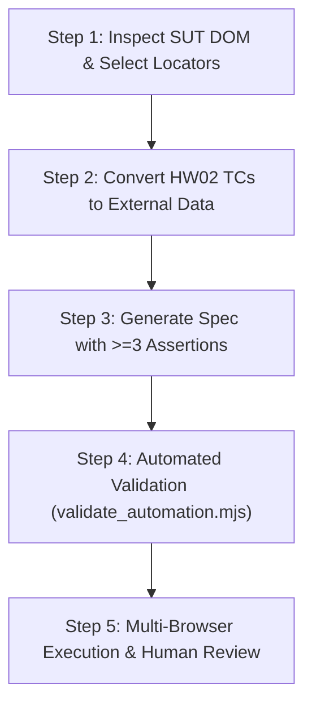

# Playwright Web UI Automation Testing (CSC13003 HW04 Method)

## 1. Goal & Overview
Deliver a robust, data-driven Web UI automation testing suite using **Playwright TypeScript** for 3 target features of the SUT (EShop), adhering strictly to the **AI-First strategy with Human Review**:
1. Convert at least **12 test cases per feature** (positive, negative, boundary/edge) inherited from HW02 into data files (`.json` or `.csv`).
2. Generate structured Playwright test scripts (`.spec.ts`) that strictly read external data and employ at least **3 distinct assertion patterns**.
3. Execute the entire test suite across at least **3 browsers** (`Chromium`, `Firefox`, `WebKit`) totaling at least **9 browser runs**.
4. Generate Playwright HTML Reports containing mandatory authorship and anti-cheat metadata: **`Run by: 23120319`** and an **ISO-8601 Timestamp**.
5. Conduct critical human review, identifying AI-generated errors/omissions (fragile selectors, flaky waits, missing assertions) and logging genuine SUT defects to GitHub Issues with screenshot evidence.

---

## 2. Non-Negotiable Rules & Anti-Cheat Compliance

### 2.1. SUT Immutability (Strict Zero-Modification Policy)
- **DO NOT modify, edit, or patch any code inside `eshop-sut/`** (`backend/`, `frontend-web/`, `frontend-admin/`, `frontend-mobile/`).
- The SUT is a read-only black box. If an assertion fails due to a real bug in EShop (e.g. editable total in checkout, missing validation on register), log it as a **Defect Report** and **GitHub Issue**, DO NOT fix it in EShop.

### 2.2. Strict Data-Driven Requirement
- All test inputs, flags, and expected results must be stored in external data files under `HW4/automation/data/*.json` (or `.csv`).
- **Hardcoded inline arrays or test data objects inside `.spec.ts` are strictly forbidden** and will fail the automated audit.

### 2.3. Anti-Cheat & Authorship Verification (§11)
- The Playwright HTML Report must visibly display:
  `Run by: 23120319` and an ISO-8601 Timestamp (e.g. `2026-11-13T10:30:00.000Z`).
- In the demonstration video, the student must show face-cam or execute `whoami` and `hostname` in the terminal.

### 2.4. Git Commit History Requirement (§12)
- Maintain at least **8 meaningful commits** that directly modify test script files (`.spec.ts`). Commits that touch only documentation or configs do NOT count toward this requirement.

### 2.5. Destination Output Directory (<OUTPUT_DIR> Override)
- All test artifacts, data files, spec files, reports, and screenshots must be stored exclusively inside the project's designated output directory (`<OUTPUT_DIR>`, configured by the workspace `CLAUDE.md`, which is `HW4/`), never inside `eshop-sut/` or at the workspace root.
- The standard directory structure under `<OUTPUT_DIR>` is:
  - `<OUTPUT_DIR>/automation/` : Playwright project root (`package.json`, `playwright.config.ts`)
  - `<OUTPUT_DIR>/automation/data/` : External test data (`.json` or `.csv`)
  - `<OUTPUT_DIR>/automation/tests/` : Playwright test specs (`.spec.ts`)
  - `<OUTPUT_DIR>/automation/playwright-report/` : Generated Playwright HTML reports
  - `<OUTPUT_DIR>/report/` : Main report, bug reports, and AI audit appendices
  - `<OUTPUT_DIR>/evidence/screenshots/` : Test failure screenshots and GitHub issue screenshots

---

## 3. The 5-Step Automation Lifecycle



---

### Step 1: DOM Inspection & Resilient Locator Selection
Before generating any test script, inspect the actual source code of the component under test in `eshop-sut/`:
- Customer Web: `eshop-sut/frontend-web/src/pages/`
- Admin Web: `eshop-sut/frontend-admin/src/pages/`

**Locator Priority Order (Playwright / W3C Best Practices):**
1. **User-facing role:** `page.getByRole('button', { name: 'Đăng ký' })`, `page.getByRole('heading', { level: 1 })`
2. **Accessible label:** `page.getByLabel('Mật khẩu')`
3. **Placeholder:** `page.getByPlaceholder('Nhập địa chỉ email')`
4. **Text content:** `page.getByText('Đăng ký thành công', { exact: false })`
5. **Test ID:** `page.getByTestId('checkout-total')`
6. ❌ **FORBIDDEN (Brittle):** Avoid auto-generated classes (e.g. `.css-1x8b`), fragile hierarchical XPath (`//div[2]/form/div[3]/button`), or fragile CSS `nth-child`.

---

### Step 2: Data-Driven Test Case Preparation
Map test cases directly from the corresponding HW02 feature design (`HW2/testcases/FR-xx.json`):
- Filter a balanced set of **at least 12 test cases**:
  - Positive / Happy path cases (valid inputs, successful flows).
  - Negative cases (blank fields, invalid formatting, duplicate records, unauthorized access).
  - Boundary / Edge cases (min/max length, special UTF-8 Vietnamese characters, extreme quantities).
- Save into `HW4/automation/data/<feature-id>-<name>.json`:
```json
[
  {
    "id": "TC-FR01-01",
    "description": "Valid registration with standard inputs",
    "category": "positive",
    "inputs": {
      "name": "Nguyen Van A 23120319",
      "email": "test_{{TIMESTAMP}}@student.hcmus.edu.vn",
      "password": "Password123@"
    },
    "expected": {
      "success": true,
      "redirectUrl": "/login",
      "toastMessage": "Đăng ký thành công"
    }
  }
]
```
*(Tip: Use dynamic tokens like `{{TIMESTAMP}}` in emails or usernames to ensure multiple test runs across 3 browsers do not collide with unique database constraints).*

---

### Step 3: Script Generation with $\ge 3$ Distinct Assertion Patterns
Each test script (`.spec.ts`) must import its data file and iterate through the cases. It must employ **at least 3 distinct assertion patterns** from the following list:

| Pattern ID | Assertion Method | Verification Target | Example Code |
|:---:|:---|:---|:---|
| **A-01** | `toHaveURL()` | Navigation / Redirect | `await expect(page).toHaveURL(/\/login/);` |
| **A-02** | `toBeVisible()` / `toBeHidden()` | UI Element / Dialog / Toast | `await expect(page.getByText(tc.expected.toastMessage)).toBeVisible();` |
| **A-03** | `toContainText()` / `toHaveText()` | Error messages / Content | `await expect(errorBanner).toContainText(tc.expected.errorMessage);` |
| **A-04** | `toHaveValue()` | Input field state / Default value | `await expect(priceInput).toHaveValue(tc.expected.price);` |
| **A-05** | `toBeDisabled()` / `toBeEnabled()` | Form submit button guarding | `await expect(submitBtn).toBeDisabled();` |
| **A-06** | `toHaveCount()` | List items / Table rows | `await expect(cartRows).toHaveCount(tc.expected.itemCount);` |

**Anti-Flakiness Rules:**
- ❌ Do NOT use `await page.waitForTimeout(3000)`.
- ✅ Rely on Playwright's auto-waiting web assertions (`expect(...).toBeVisible()`).
- ✅ Use `await page.waitForResponse(resp => resp.url().includes('/api/') && resp.status() === 200)` when handling asynchronous form submissions.
- ✅ Isolate browser context / clear `localStorage` in `beforeEach` to prevent state leakage between runs.

---

### Step 4: Automated Verification via Script
Run the built-in validator script to verify compliance before executing test suites:
```bash
node .agents/skills/playwright-automation-testing/scripts/validate_automation.mjs --dir HW4/automation
```
The script validates:
- [x] External data separation (no hardcoded test arrays in `.spec.ts`).
- [x] Test case count $\ge 12$ per feature.
- [x] Use of $\ge 3$ distinct assertion patterns per spec file.
- [x] Multi-browser project configuration in `playwright.config.ts`.
- [x] Report authorship metadata configuration (`Run by: 23120319`).

---

### Step 5: Multi-Browser Execution & Human Review Protocol

1. **Multi-Browser Test Execution:**
   ```bash
   cd HW4/automation
   # Run all features on Chromium, Firefox, WebKit
   npx playwright test
   
   # Or run specific feature across all 3 browsers
   npx playwright test tests/fr01-registration.spec.ts
   ```
2. **Review AI-Generated Script vs Reality (Human Review):**
   Examine every failure and discrepancy. Document what AI missed under 3 root causes:
   - **Fragile Selectors:** AI guessed class names or nested tags that don't exist in React components.
   - **Asynchronous / State Timing:** AI did not account for API response latency or token saving.
   - **Browser Quirk / Edge Case:** Difference in HTML5 native tooltip validation between Chromium and Firefox.
3. **Defect Triage:**
   - If failure is caused by an **AI script defect** $\rightarrow$ fix the script, commit with `fix(HW4-...): ...`.
   - If failure is caused by an **actual SUT bug** $\rightarrow$ capture Playwright screenshot, write a Defect Report, and file a GitHub Issue.

