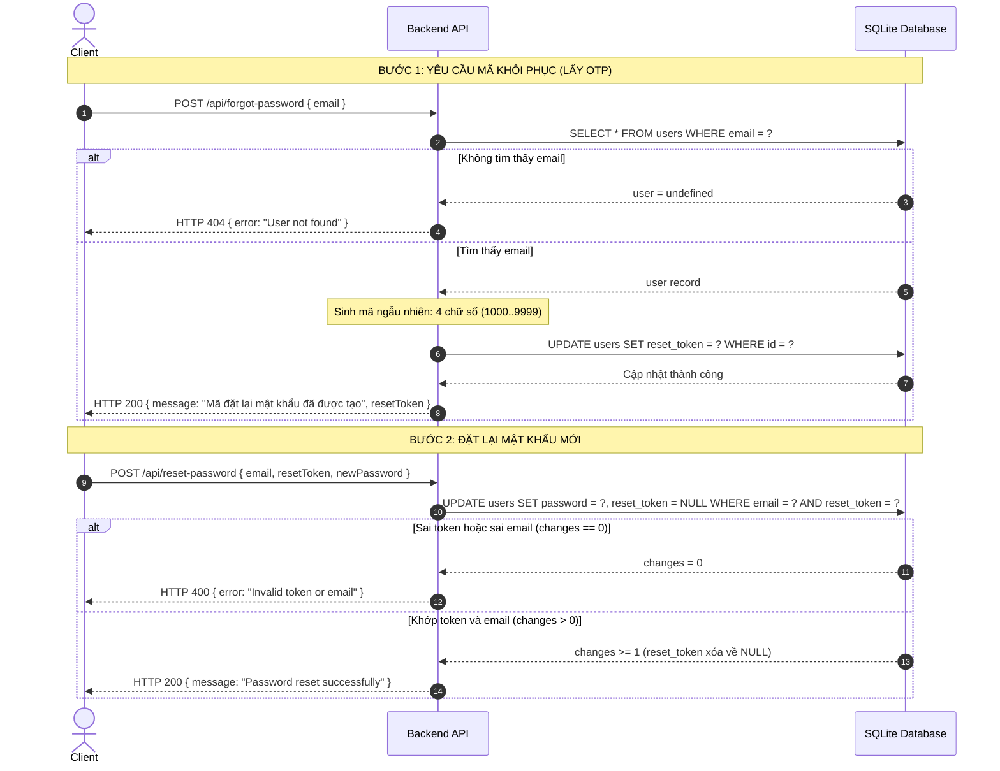

# FR-03: Quên mật khẩu và Đặt lại mật khẩu (Forgot Password & Password Reset)
## Báo cáo Kiểm thử miền (Domain Testing) — Stage 0 & Stage 1

- **Tính năng:** FR-03 — Quên mật khẩu và đặt lại mật khẩu (Quy trình 2 bước: Yêu cầu mã OTP và Đổi mật khẩu mới)
- **Thuộc nhóm:** Pool A (Web User Management & Authentication)
- **Người thực hiện:** Trương Thành Phát (MSSV: 23120319)
- **Tài liệu tham khảo:**
  - `docs/api_specification.md` (mục 1.3 và 1.4) `[SPEC]`
  - Mã nguồn Backend: `eshop-sut/backend/server.js:68-98` và `eshop-sut/backend/database.js:50-61` `[CODE]`
  - Mã nguồn Frontend Web: `eshop-sut/frontend-web/src/pages/ForgotPassword.jsx` `[CODE]`
  - Mã nguồn Frontend Mobile: `eshop-sut/frontend-mobile/App.js:242-284` `[CODE]`

---

## Stage 0: Thu thập thông tin và Khảo sát đặc tả thực tế

Quy trình khôi phục mật khẩu trong hệ thống EShop là một quy trình có trạng thái gồm 2 bước tuần tự (Stateful two-step flow):



### 1.1 Chi tiết các Endpoint & Request Fields

#### Bước 1: Yêu cầu mã khôi phục mật khẩu
- **Endpoint:** `POST /api/forgot-password` `[SPEC]` api_spec:35, `[CODE]` server.js:68
- **Base URL:** `http://localhost:3000`
- **Headers:** `Content-Type: application/json`
- **Request Body (JSON):**
  ```json
  {
    "email": "test@domain.com"
  }
  ```

#### Bước 2: Đặt lại mật khẩu mới
- **Endpoint:** `POST /api/reset-password` `[SPEC]` api_spec:45, `[CODE]` server.js:87
- **Base URL:** `http://localhost:3000`
- **Headers:** `Content-Type: application/json`
- **Request Body (JSON):**
  ```json
  {
    "email": "test@domain.com",
    "resetToken": "1234",
    "newPassword": "NewPassword123!"
  }
  ```

---

### 1.2 Ràng buộc validation THỰC SỰ có trong mã nguồn (Code Investigation)

Áp dụng quy tắc **Cross-platform Skew Checklist (v2.0)** đối chiếu đồng thời trên cả 3 tầng hệ thống:

#### 1. Tại Backend API (`eshop-sut/backend/server.js:68-98`):
- **Tại route `POST /api/forgot-password` (dòng 68–85):**
  - Thực hiện truy vấn tìm người dùng: `SELECT * FROM users WHERE email = ?` (dòng 70).
  - Nếu `!user`: Trả về `res.status(404).json({ error: "User not found" })` (dòng 71).
  - Nếu tìm thấy: Sinh chuỗi số ngẫu nhiên gồm **4 chữ số** bằng lệnh:
    ```javascript
    const resetToken = Math.floor(1000 + Math.random() * 9000).toString(); // [CODE] server.js:72
    ```
  - Cập nhật vào DB: `UPDATE users SET reset_token = ? WHERE id = ?` (dòng 73–75).
  - **Lỗ hổng bảo mật thông tin (Information Disclosure):** Backend trả về thẳng giá trị `resetToken` trong response body JSON (`res.json({ message: "...", resetToken })`, dòng 78–81). Bất kỳ ai biết email của nạn nhân đều có thể gọi API này và nhận ngay mã OTP để chiếm quyền tài khoản mà không cần đọc email thật.
  - **Không có validation đầu vào:** Không kiểm tra `email` có rỗng hay không, không kiểm tra định dạng email regex.
  - **Không có cơ chế hết hạn (No Expiration):** Bảng `users` trong `database.js:50-61` chỉ có cột `reset_token TEXT` mà **không có cột timestamp lưu thời điểm hết hạn** (như `reset_token_expires`). Token có hiệu lực vĩnh viễn cho đến khi được sử dụng hoặc bị ghi đè.
  - **Không có Rate Limiting:** Không giới hạn số lần yêu cầu OTP hay số lần thử sai mã.
- **Tại route `POST /api/reset-password` (dòng 87–98):**
  - Thực hiện cập nhật trực tiếp:
    ```javascript
    db.run(
      "UPDATE users SET password = ?, reset_token = NULL WHERE email = ? AND reset_token = ?",
      [newPassword, email, resetToken],
      function (err) {
        if (this.changes === 0)
          return res.status(400).json({ error: "Invalid token or email" });
        res.json({ message: "Password reset successfully" });
      }
    ); // [CODE] server.js:89-97
    ```
  - Nếu không có dòng nào được cập nhật (`this.changes === 0`): Trả về HTTP 400 `{ error: "Invalid token or email" }` (dòng 93–94).
  - Khi thành công: Đặt `reset_token = NULL` (token tự hủy sau 1 lần dùng - Single-use token) và trả về HTTP 200 `{ message: "Password reset successfully" }` (dòng 95).
  - **BACKEND HOÀN TOÀN KHÔNG VALIDATE `newPassword`:** Chấp nhận mọi kiểu mật khẩu: chuỗi rỗng `""`, 1 ký tự, mật khẩu siêu ngắn, mật khẩu không chứa chữ hoa/chữ số/ký tự đặc biệt.

#### 2. Tại Frontend Web (`eshop-sut/frontend-web/src/pages/ForgotPassword.jsx`):
- Hiển thị công khai mã OTP ra giao diện web ngay sau khi gọi API Bước 1:
  `setMessage("Mã OTP của bạn là: " + res.data.resetToken);` `[CODE]` ForgotPassword.jsx:17
- Tại form Bước 2: Label ghi rõ `"Mã OTP (4 số)"` `[CODE]` ForgotPassword.jsx:69.
- **Lệch pha regex mật khẩu:** Frontend Web áp dụng regex lỗi:
  ```javascript
  const flawedStrongPasswordRegex = /^(?=.*[a-z])(?=.*[A-Z])(?=.*\d)(?=.*\s)[A-Za-z\d\s]{8,}$/;
  ```
  Regex này đòi hỏi **khoảng trắng (`\s`)** và cấm ký tự đặc biệt thực sự, trong khi câu thông báo cảnh báo lại ghi: *"Phải gồm chữ hoa, chữ thường, số và KÝ TỰ ĐẶC BIỆT"* `[CODE]` ForgotPassword.jsx:26–30.

#### 3. Tại Frontend Mobile (`eshop-sut/frontend-mobile/App.js`):
- Tại Bước 1: Ẩn OTP khỏi giao diện, hiển thị thông báo giả lập: *"Nếu email tồn tại trong hệ thống, mã OTP đã được gửi đến email của bạn."* `[CODE]` App.js:251–253.
- Tại Bước 2: Sử dụng regex chuẩn ký tự đặc biệt:
  ```javascript
  const strongPasswordRegex = /^(?=.*[a-z])(?=.*[A-Z])(?=.*\d)(?=.*[^A-Za-z\d]).{8,}$/;
  ```
  Bắt buộc mật khẩu phải chứa ký tự đặc biệt thực sự `[^A-Za-z\d]` `[CODE]` App.js:261–269.

---

### 1.3 Các phản hồi có thể xảy ra (Possible Responses)

#### Bước 1: `POST /api/forgot-password`
| HTTP Status | Cấu trúc Response Body (JSON) | Điều kiện kích hoạt | Nguồn (Source tag) |
| :---: | :--- | :--- | :---: |
| **200 OK** | `{"message": "Mã đặt lại mật khẩu đã được tạo", "resetToken": "<4_digits>"}` | Email hợp lệ và tồn tại trong database bảng `users` | `[CODE]` server.js:78-81<br>`[SPEC]` api_spec:42 |
| **404 Not Found** | `{"error": "User not found"}` | Email không tồn tại trong database (hoặc email gửi lên bị thiếu/null) | `[CODE]` server.js:71 |
| **500 Internal Error** | `{"error": "<err.message>"}` | Lỗi ngoại lệ từ SQLite khi thực thi câu lệnh SQL UPDATE | `[CODE]` server.js:77 |
| **400 Bad Request** *(Kỳ vọng chuẩn)* | `{"error": "Email is required / Invalid email format"}` | Email rỗng hoặc sai cú pháp định dạng (Hiện tại Backend chưa hỗ trợ, trả về 404) | `[ASSUMED]` Standard REST |

#### Bước 2: `POST /api/reset-password`
| HTTP Status | Cấu trúc Response Body (JSON) | Điều kiện kích hoạt | Nguồn (Source tag) |
| :---: | :--- | :--- | :---: |
| **200 OK** | `{"message": "Password reset successfully"}` | Cặp `(email, resetToken)` hoàn toàn trùng khớp và token chưa bị hủy (khác NULL) | `[CODE]` server.js:95 |
| **400 Bad Request** | `{"error": "Invalid token or email"}` | Sai mã token, email không khớp token, hoặc token đã qua sử dụng (`reset_token IS NULL`) | `[CODE]` server.js:94 |
| **500 Internal Error** | `{"error": "<err.message>"}` | Lỗi ngoại lệ từ SQLite khi thực thi câu lệnh UPDATE | `[CODE]` server.js:92 |
| **400 Bad Request** *(Kỳ vọng chuẩn)* | `{"error": "Password does not meet requirements"}` | Mật khẩu mới vi phạm độ dài (< 8) hoặc thiếu chữ hoa/thường/số/ký tự đặc biệt (Hiện tại Backend chưa hỗ trợ, trả về 200) | `[ASSUMED]` Standard REST<br>`[SPEC]` api_spec:16 |

---

## Stage 1: Bảng biến Input, Output, State và Miền giá trị (Domains)

Bảng phân tích biến chi tiết bao gồm toàn bộ các biến đầu vào của cả 2 bước, các biến trạng thái trung gian của quy trình nghiệp vụ và các phản hồi đầu ra:

| Biến | Loại (Kind) | Kiểu dữ liệu | Miền giá trị & Ràng buộc kỹ thuật (Domain) | Nguồn (Source tag) |
| :--- | :--- | :--- | :--- | :---: |
| `Step1.email` | Input | String | - Địa chỉ email yêu cầu cấp mã OTP tại Bước 1.<br>- Ràng buộc kỹ thuật: Bắt buộc, chuỗi định dạng email chuẩn RFC 5322.<br>- *Code thực tế:* `server.js:70` không kiểm tra định dạng; nếu không tìm thấy trong DB thì trả về 404. | `[SPEC]` api_spec:39<br>`[CODE]` server.js:70 |
| `Step2.email` | Input | String | - Địa chỉ email xác thực cùng với mã OTP tại Bước 2.<br>- Ràng buộc kỹ thuật: Phải trùng khớp với email đã được cấp token ở Bước 1.<br>- *Code thực tế:* `server.js:90` sử dụng trong mệnh đề `WHERE email = ? AND reset_token = ?`. | `[SPEC]` api_spec:49<br>`[CODE]` server.js:90 |
| `Step2.resetToken` | Input | String | - Mã OTP khôi phục mật khẩu gửi lên để xác thực.<br>- Miền giá trị hợp lệ: Chuỗi 4 chữ số trong khoảng `["1000" .. "9999"]`.<br>- *Mâu thuẫn đặc tả:* Đặc tả ghi mẫu 6 chữ số `"123456"`, nhưng code backend chỉ sinh 4 chữ số.<br>- *Ràng buộc:* Bắt buộc, phải khớp chính xác với `reset_token` đang lưu trong DB của user đó. | `[CODE]` server.js:72, 90<br>`[SPEC]` api_spec:42 (mẫu 6 số)<br>`[CODE]` ForgotPassword.jsx:69 (4 số) |
| `Step2.newPassword` | Input | String | - Mật khẩu mới thay thế cho mật khẩu cũ.<br>- Ràng buộc nghiệp vụ: Độ dài tối thiểu 8 ký tự (`>= 8`), cận trên thường là 128 ký tự; phải có chữ hoa `[A-Z]`, chữ thường `[a-z]`, chữ số `\d`, và ký tự đặc biệt.<br>- *Dị biệt code:*<br>  + Backend (`server.js:90`): Chấp nhận mọi chuỗi (kể cả rỗng, 1 ký tự).<br>  + Web (`ForgotPassword.jsx:26`): Đòi hỏi khoảng trắng `\s`, cấm ký tự đặc biệt.<br>  + Mobile (`App.js:262`): Đòi hỏi ký tự đặc biệt chuẩn `[^A-Za-z\d]`. | `[SPEC]` api_spec:51<br>`[CODE]` server.js:90<br>`[CODE]` ForgotPassword.jsx:26<br>`[CODE]` App.js:262 |
| `user_exists` | State | Boolean | - Trạng thái tồn tại của email trong cơ sở dữ liệu `users`.<br>- Miền giá trị: `{ true (đã tồn tại), false (chưa tồn tại) }`.<br>- Nếu `false`: Bước 1 dừng ngay tại 404 Not Found. | `[CODE]` server.js:71 |
| `token_match_state` | State | Enum | - Trạng thái của token trong cơ sở dữ liệu khi gọi Bước 2:<br>  + `MATCH_VALID`: Token trùng khớp với email và đang hoạt động.<br>  + `WRONG_TOKEN`: Token sai giá trị so với DB (hoặc không đủ/thừa ký tự).<br>  + `CROSS_ACCOUNT`: Token hợp lệ của User B nhưng gửi kèm email của User A.<br>  + `ALREADY_USED`: Token đã được sử dụng thành công trước đó (đã bị xóa về `NULL`).<br>  + `NO_TOKEN_ISSUED`: User chưa từng gọi Bước 1 (`reset_token IS NULL`). | `[CODE]` server.js:90-94 |
| `token_expiry_state` | State | Enum | - Trạng thái thời gian hiệu lực của token: `{ VALID, EXPIRED }`.<br>- *Thực tế code:* **KHÔNG TỒN TẠI TRONG SUT**. Token không bao giờ hết hạn vì DB không lưu timestamp. | `[CODE]` database.js:58<br>`[ASSUMED]` (Security requirement) |
| `Step1.Response.status` | Output | Number | - Mã trạng thái HTTP trả về từ Bước 1.<br>- Miền giá trị: `{ 200 (Thành công), 404 (Không tìm thấy user), 500 (Lỗi SQL) }`. | `[CODE]` server.js:71, 77, 78 |
| `Step1.Response.message` | Output | String | - Thông điệp trả về ở Bước 1: `"Mã đặt lại mật khẩu đã được tạo"`. | `[CODE]` server.js:79 |
| `Step1.Response.resetToken` | Output | String | - Mã OTP 4 chữ số trả về trong response body của Bước 1. | `[CODE]` server.js:80 |
| `Step1.Response.error` | Output | String | - Thông điệp lỗi ở Bước 1: `"User not found"` (404) hoặc thông báo lỗi từ SQLite (500). | `[CODE]` server.js:71, 77 |
| `Step2.Response.status` | Output | Number | - Mã trạng thái HTTP trả về từ Bước 2.<br>- Miền giá trị: `{ 200 (Thành công), 400 (Sai token/email), 500 (Lỗi SQL) }`. | `[CODE]` server.js:94, 95 |
| `Step2.Response.message` | Output | String | - Thông điệp thành công ở Bước 2: `"Password reset successfully"`. | `[CODE]` server.js:95 |
| `Step2.Response.error` | Output | String | - Thông điệp lỗi ở Bước 2: `"Invalid token or email"` (400). | `[CODE]` server.js:94 |
| `DB.password_updated` | Side Effect | Boolean | - Trạng thái mật khẩu trong DB sau Bước 2: `{ true (đã cập nhật sang newPassword), false (giữ nguyên mật khẩu cũ) }`.<br>- Kiểm chứng bằng việc gọi `POST /api/login` với mật khẩu mới. | `[CODE]` server.js:90, 42 |
| `DB.token_cleared` | Side Effect | Boolean | - Trạng thái trường `reset_token` trong DB: Chuyển thành `NULL` sau khi đổi mật khẩu thành công. | `[CODE]` server.js:90 |

---

## Các phát hiện quan trọng & Câu hỏi mở (Open Questions)

### 1. Lỗ hổng rò rỉ mã OTP trực tiếp qua HTTP Response (Security Flaw)
- **Hiện tượng:** Tại `server.js:78-81`, API `POST /api/forgot-password` trả về trường `resetToken` trực tiếp trong JSON response cho client. Đồng thời Frontend Web (`ForgotPassword.jsx:17`) hiển thị mã này trên giao diện.
- **Tác động:** Bất kỳ ai cũng có thể đặt lại mật khẩu của người dùng khác chỉ bằng cách biết email của họ. Trong môi trường thực tế, OTP phải được gửi qua Email/SMS dịch vụ (như Nodemailer, SendGrid, Twilio) chứ không bao giờ được gửi lại cho client gọi API.
- **Xử lý kiểm thử:** Trong bài kiểm thử này, chúng ta sẽ tận dụng trường `res.data.resetToken` để kiểm thử tự động chuỗi 2 bước mà không cần mock dịch vụ gửi mail, đồng thời ghi nhận đây là một **khiếm khuyết an toàn thông tin (Security Defect)**.

### 2. Mâu thuẫn độ dài OTP giữa Tài liệu đặc tả và Mã nguồn thực tế
- Trong `api_specification.md` (mục 1.3, dòng 42), mã ví dụ trả về là 6 chữ số: `"resetToken": "123456"`.
- Trong mã nguồn Backend `server.js:72`, thuật toán sinh mã là `Math.floor(1000 + Math.random() * 9000).toString()`, luôn cho ra chuỗi **4 chữ số** (`1000` đến `9999`).
- Trên Frontend Web (`ForgotPassword.jsx:69`), nhãn input ghi rõ `"Mã OTP (4 số)"`.
- **Câu hỏi mở:** Có cần chuẩn hóa độ dài OTP thành 6 chữ số theo chuẩn RFC 6238 / spec hay chấp nhận 4 chữ số của code hiện tại?

### 3. Không có cơ chế hết hạn mã OTP (No Token Expiry)
- Bảng `users` trong cơ sở dữ liệu SQLite (`database.js:50-61`) không có bất kỳ cột nào lưu thời điểm hết hạn của OTP (như `reset_token_expires_at`).
- Mã OTP một khi đã tạo ra sẽ tồn tại vĩnh viễn trong database cho đến khi được dùng thành công hoặc bị ghi đè bởi một lần gọi `forgot-password` mới.
- **Hệ quả:** Vi phạm nghiêm trọng tiêu chuẩn an toàn xác thực (OWASP ASVS), tạo điều kiện cho tấn công vét cạn (Brute-force) mà không lo token hết hạn.

### 4. Backend bỏ ngỏ hoàn toàn việc kiểm tra mật khẩu mới (`newPassword`)
- Giống như tính năng FR-01, route `POST /api/reset-password` tại `server.js:89-98` nhận `newPassword` và lưu thẳng vào database mà không hề kiểm tra độ dài tối thiểu, độ phức tạp, thậm chí chuỗi rỗng `""` vẫn được cập nhật thành công và trả về HTTP 200.
- Đây là lỗi nghiêm trọng ở tầng Backend cho phép người dùng vô tình hoặc cố ý đặt mật khẩu rỗng/mật khẩu yếu.

### 5. Xử lý khi có nhiều tài khoản trùng Email trong Database
- Như đã phát hiện ở FR-01 (`BUG-FR01-03`), bảng `users` không có ràng buộc `UNIQUE(email)`.
- Nếu trong database tồn tại 2 tài khoản có cùng email:
  - Ở Bước 1: `db.get("SELECT * FROM users WHERE email = ?")` chỉ trả về tài khoản đầu tiên tìm thấy và cập nhật token cho tài khoản đó.
  - Ở Bước 2: `db.run("UPDATE users SET password = ?, reset_token = NULL WHERE email = ? AND reset_token = ?")` sẽ cập nhật mật khẩu cho tài khoản có token khớp, nhưng nếu cả hai cùng có token (hoặc cùng NULL), hành vi dữ liệu sẽ bị bất định.

---

## Stage 2: Phân hoạch tương đương (Equivalence Partitioning)

Tuân thủ hướng dẫn phân hoạch kiểm thử miền theo bài giảng **S04 Domain Testing (Step 2: Partitioning)**:
- **Range:** 1 lớp hợp lệ trong khoảng, 2 lớp không hợp lệ (dưới cận dưới và trên cận trên).
- **Must be:** 1 lớp hợp lệ, 1 hoặc nhiều lớp không hợp lệ cho mỗi trường hợp sai định dạng/sai loại.
- **State / Precondition:** Phân hoạch rõ ràng các trạng thái hệ thống: người dùng có tồn tại hay không, token có khớp hay không, token đã dùng hay chưa.
- **Missing / Empty:** Phân hoạch riêng cho chuỗi rỗng `""` và trường bị thiếu hoàn toàn trong JSON payload.
- **Dị biệt đa nền tảng (v2.0):** Phân hoạch các lớp kiểm thử sự mâu thuẫn giữa Web (regex lỗi khoảng trắng `\s`) và Mobile (regex ký tự đặc biệt `[^A-Za-z\d]`).
- **Lớp đầu ra (Outputs):** Bao quát đầy đủ các mã HTTP status và các phản hồi thành công/thất bại.

### Bảng phân hoạch tương đương đầy đủ (Complete Set of Partitions — EC01 đến EC31)

| Mã EC | Biến kiểm tra | Mô tả lớp tương đương | Hợp lệ / Không hợp lệ | Quy tắc phân hoạch (Guideline used) | Nguồn (Source tag) |
| :---: | :--- | :--- | :---: | :--- | :---: |
| **EC01** | `Step1.email` | Email đúng định dạng và có tồn tại trong database | **Valid** | Must be: valid format & State: user exists | `[SPEC]` api_spec:39<br>`[CODE]` server.js:70 |
| **EC02** | `Step1.email` | Email đúng cú pháp nhưng chưa từng đăng ký trong DB | Invalid | State: user does not exist (kích hoạt 404) | `[CODE]` server.js:71 |
| **EC03** | `Step1.email` | Chuỗi rỗng `""` | Invalid | Missing/Empty: empty string | `[SPEC]` api_spec:39 |
| **EC04** | `Step1.email` | Thiếu hoàn toàn trường `email` trong request JSON `{}` | Invalid | Missing/Empty: field omitted | `[SPEC]` api_spec:39 |
| **EC05** | `Step1.email` | Email sai định dạng cú pháp (thiếu ký tự `@`) | Invalid | Must be: malformed syntax | `[SPEC]` api_spec:39 |
| **EC06** | `Step1.email` | Email sai định dạng cú pháp (thiếu tên miền sau `@`) | Invalid | Must be: malformed syntax | `[SPEC]` api_spec:39 |
| **EC07** | `Step1.email` | Sai kiểu dữ liệu (truyền Boolean `true` hoặc Số) | Invalid | Type: non-string data type | `[CODE]` server.js:70 |
| **EC08** | `Step2.email` | Email trùng khớp hoàn toàn với tài khoản đã cấp OTP ở Bước 1 | **Valid** | State: matching email | `[SPEC]` api_spec:49<br>`[CODE]` server.js:90 |
| **EC09** | `Step2.email` | Email không khớp với token (email của người dùng khác) | Invalid | State conflict: email mismatch | `[CODE]` server.js:90-94 |
| **EC10** | `Step2.email` | Chuỗi rỗng `""` hoặc thiếu trường `email` ở Bước 2 | Invalid | Missing/Empty | `[CODE]` server.js:90-94 |
| **EC11** | `Step2.resetToken` | Mã OTP gồm đúng 4 chữ số và trùng khớp với DB (`"1000".."9999"`) | **Valid** | Must be: valid matching token | `[CODE]` server.js:72, 90 |
| **EC12** | `Step2.resetToken` | Mã OTP sai giá trị (đúng 4 số nhưng không khớp DB, e.g. `"0000"`) | Invalid | State: incorrect token value | `[CODE]` server.js:90-94 |
| **EC13** | `Step2.resetToken` | Mã OTP sai độ dài (chuỗi 3 số hoặc 6 số như ví dụ spec `"123456"`) | Invalid | Range/Length: invalid token length | `[SPEC]` api_spec:42<br>`[CODE]` server.js:72 |
| **EC14** | `Step2.resetToken` | Chuỗi rỗng `""` hoặc thiếu trường `resetToken` | Invalid | Missing/Empty: token missing | `[CODE]` server.js:90-94 |
| **EC15** | `Step2.resetToken` | Mã OTP đã được sử dụng thành công trước đó (đã xóa về `NULL`) | Invalid | State: token already used (single-use test) | `[CODE]` server.js:90-94 |
| **EC16** | `Step2.resetToken` | Mã OTP hợp lệ của User B gửi kèm email của User A (Cross-account) | Invalid | State conflict: cross-account token attack | `[CODE]` server.js:90-94 |
| **EC17** | `Step2.resetToken` | Gửi token cho tài khoản chưa từng gọi Bước 1 (`reset_token IS NULL`) | Invalid | State: no token ever issued | `[CODE]` server.js:90-94 |
| **EC18** | `Step2.newPassword` | Mật khẩu chuẩn mạnh ($8 \le \text{len} \le 128$, đủ hoa, thường, số, ký tự đặc biệt) | **Valid** | Range & Complexity: valid | `[SPEC]` api_spec:51<br>`[CODE]` App.js:262 |
| **EC19** | `Step2.newPassword` | Độ dài quá ngắn (< 8 ký tự, e.g. `"Pass1!"`) | Invalid | Range: below minimum length | `[SPEC]` api_spec:51 |
| **EC20** | `Step2.newPassword` | Thiếu chữ in hoa `[A-Z]` (e.g. `"password123!"`) | Invalid | Complexity: missing uppercase | `[SPEC]` api_spec:51 |
| **EC21** | `Step2.newPassword` | Thiếu chữ in thường `[a-z]` (e.g. `"PASSWORD123!"`) | Invalid | Complexity: missing lowercase | `[SPEC]` api_spec:51 |
| **EC22** | `Step2.newPassword` | Thiếu chữ số `\d` (e.g. `"Password!@#"`) | Invalid | Complexity: missing digit | `[SPEC]` api_spec:51 |
| **EC23** | `Step2.newPassword` | Thiếu ký tự đặc biệt `[^A-Za-z\d]` (nhưng có khoảng trắng `\s` - Web skew) | Invalid | Complexity: missing special char / Web skew | `[SPEC]` api_spec:51<br>`[CODE]` ForgotPassword.jsx:26 |
| **EC24** | `Step2.newPassword` | Chuỗi rỗng `""` hoặc thiếu trường `newPassword` | Invalid | Missing/Empty: empty password | `[SPEC]` api_spec:51 |
| **EC25** | `Step2.newPassword` | Độ dài quá dài vượt giới hạn an toàn (> 128 ký tự) | Invalid | Range: above maximum length | `[ASSUMED]` Security standard |
| **EC26** | `Step1.Response.status` | Trả về HTTP 200 OK kèm mã OTP hợp lệ | **Valid Output** | Normal success response Bước 1 | `[CODE]` server.js:78 |
| **EC27** | `Step1.Response.status` | Trả về HTTP 404 Not Found (`"User not found"`) | Invalid Output | State rejection response Bước 1 | `[CODE]` server.js:71 |
| **EC28** | `Step2.Response.status` | Trả về HTTP 200 OK (`"Password reset successfully"`) | **Valid Output** | Normal success response Bước 2 | `[CODE]` server.js:95 |
| **EC29** | `Step2.Response.status` | Trả về HTTP 400 Bad Request (`"Invalid token or email"`) | Invalid Output | Token/email rejection response Bước 2 | `[CODE]` server.js:94 |
| **EC30** | `Step2.Response.status` | Trả về HTTP 400 Bad Request do mật khẩu mới yếu (Kỳ vọng chuẩn) | Invalid Output | Password validation rejection Bước 2 | `[ASSUMED]` Standard REST |
| **EC31** | `Response.status` | Trả về HTTP 500 Internal Server Error khi có lỗi database | Invalid Output | Server internal error | `[CODE]` server.js:77, 92 |

---

> [!IMPORTANT]
> **ĐIỂM DỪNG ĐỂ DUYỆT (STOP FOR REVIEW)**:  
> Đã hoàn thành phân hoạch **31 lớp tương đương** (`EC01` đến `EC31`) bao quát toàn diện quy trình 2 bước và các biến Input / Output / State.  
> Xin mời người kiểm thử thẩm định trước khi chuyển sang **Stage 3 (Chọn đại diện)** và **Stage 4 (Thiết kế test cases & Ma trận bao phủ)**!

