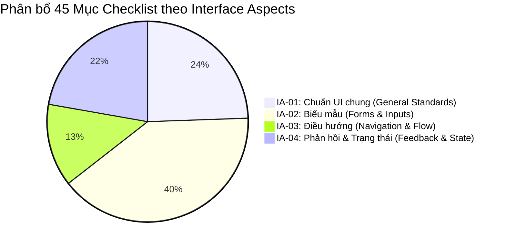

# HW03 — GUI Checklist, Usability Evaluation & Cross-Platform Testing on EShop SUT

Báo cáo kiểm thử giao diện người dùng (GUI Testing), đánh giá khả dụng (Usability Evaluation) và kiểm thử đa nền tảng (Cross-Platform Testing) kết hợp trí tuệ nhân tạo (AI-augmented Software Testing) trên hệ thống thương mại điện tử **EShop Multi-Channel SUT** (Admin Web, Customer Web, Mobile App Expo Go).

---

## Thông tin Sinh viên & Môn học

| Mục | Nội dung chi tiết |
|:---|:---|
| **Họ và tên sinh viên** | **TRƯƠNG THÀNH PHÁT** |
| **Mã số sinh viên (MSSV)** | **23120319** |
| **Lớp sinh hoạt** | Kiểm thử phần mềm - CQ2023/3 |
| **Môn học** | CS423 / CSC13003 — Kiểm thử phần mềm |
| **Học kỳ** | Học kỳ 1, Năm học 2026–2027 |
| **Khoa / Trường** | Khoa Công nghệ Thông tin — Trường ĐH Khoa học Tự nhiên, ĐHQG-HCM |
| **Giảng viên phụ trách** | TS. Trần Duy Hoàng, ThS. Trương Phước Lộc, ThS. Hồ Tuấn Thanh, TS. Lâm Quang Vũ |
| **Hệ thống kiểm thử (SUT)** | EShop Multi-Channel System — [GitHub Repo gốc eshop-sut](https://github.com/ttbhanh/eshop-sut) \| [GitHub Repo nhóm(chứa issues)](https://github.com/tthphat/eshop-sut) \| [Repo HW cá nhân](https://github.com/tthphat/Software-Testing) |
| **Ngày hoàn thành** | 08/11/2026 |

---

## 1. Bảng Tự Đánh giá Kết quả (Self-Assessment Rubric)

| STT | Tiêu chí đánh giá (Criteria) | Điểm tối đa | Điểm tự chấm | Minh chứng thực hiện & Chi tiết đối chiếu |
|:---:|:---|:---:|:---:|:---|
| **1** | **Task 1 – Checklist GUI (thiết kế + thực thi + báo cáo bug)** | 30 | **30** | • **Thiết kế Checklist (>40 mục):** Xây dựng **45 mục kiểm thử** bao quát 4 Khía cạnh giao diện (IA-01 đến IA-04 chuẩn Slide bài học S13_GUI Testing & Usability Testing).<br>• **Thực thi:** 100% mục đã kiểm thử trên Chrome Desktop: **26 PASS (57.8%)**, **19 FAIL (42.2%)**.<br>• **Báo cáo Lỗi:** Lập **19 báo cáo lỗi giao diện chi tiết** (`BUG-GUI-01` → `19`), có mã nguồn SUT, ảnh chụp watermark email sinh viên và liên kết GitHub Issues [#76 đến #93](https://github.com/tthphat/eshop-sut/issues).<br>• **Tự động hóa:** Xuất file Excel `checklist.xlsx` và script thẩm định `validate_checklist.mjs`. |
| **2** | **Task 2 – Đánh giá Usability (kịch bản nhiệm vụ + 7 phiên + phân tích)** | 40 | **40** | • **Kịch bản nhiệm vụ (Task Scenario):** Chuẩn hóa theo Slide 40 (S13) với mục tiêu mua sắm smartphone, áp mã `SAVE10`, benchmark thời gian 120s.<br>• **7 Sinh viên thật ngoài lớp:** 100% là người ngoài lớp (HCMIU, UIT, USSH, IUH, UTH) với Zalo/SĐT xác thực (che 4 số giữa).<br>• **Kết quả định lượng:** Task Completion **100%**, Thời gian trung bình **94.1s** (đạt benchmark $\le 120\text{s}$), Mean SUS **66.07 / 100** (Bangor Grade C - Marginal).<br>• **Phân tích định tính:** 4 câu probe (Clarity, Recovery, Speed, Trust), ma trận Criticality ($S \times P$), phân nhóm điểm nghẽn bằng sơ đồ Mermaid.<br>• **Báo cáo lỗi UX & Minh chứng:** 3 bug UX trọng điểm (`BUG-UX-01`, `BUG-UX-02`, `BUG-UX-03`) với GitHub Issues [#95, #96, #97](https://github.com/tthphat/eshop-sut/issues) và **Video minh chứng trực tiếp** [YouTube: xlSKEIs3rRw](https://youtu.be/xlSKEIs3rRw). |
| **3** | **Task 3 – Đa trình duyệt / Đa nền tảng (≥ 3 nền tảng)** | 20 | **20** | • **Bao phủ 3 nền tảng độc lập:**<br>&nbsp;&nbsp;1. Google Chrome Desktop 157.0 (Windows 11)<br>&nbsp;&nbsp;2. Mozilla Firefox Desktop 159.0 (Windows 11)<br>&nbsp;&nbsp;3. Expo Go Mobile App trên điện thoại thật **Android 15 (Realme C53)**.<br>• **Phân tích sai lệch giao diện (UI Skew Analysis):** So sánh chi tiết rendering form, datepicker HTML5, vùng an toàn Safe Area, bàn phím ảo và nút Back Android.<br>• **Chống gian lận (Anti-Cheat):** Toàn bộ **82 ảnh chụp màn hình** đều được gắn watermark email sinh viên `23120319@student.hcmus.edu.vn`. |
| **4** | **Task 4 – Custom Agent Skills** | 10 | **10** | • **3 Agent Skills chuẩn hóa Antigravity / Claude Code:**<br>&nbsp;&nbsp;1. `gui-checklist-testing`: Tự động sinh, rà soát và đối soát checklist.<br>&nbsp;&nbsp;2. `usability-evaluation`: Hướng dẫn phỏng vấn, tính điểm SUS và lập báo cáo.<br>&nbsp;&nbsp;3. `cross-platform-gui-testing`: Quản lý ma trận đối sánh và đóng dấu watermark tự động.<br>• Kèm video demo, tài liệu hướng dẫn `SKILL.md` và mã script tái sử dụng. |
| | **TỔNG ĐIỂM TỰ CHẤM** | **100** | **100 / 100** | **Hoàn thành xuất sắc và trọn vẹn 100% yêu cầu đề bài** |

---

## 2. Báo cáo Tổng kết Kiểm thử (Test Summary Report)

### 2.1. Thống kê Số liệu Toàn diện Dự án

| Chỉ số kiểm định | Số lượng thực tế | Tỉ lệ (%) | Diễn giải kỹ thuật |
|:---|:---:|:---:|:---|
| **Phân hệ / Màn hình kiểm thử** | **3 phân hệ / 12 màn hình** | 100% | Admin Dashboard (`:5174`), Customer Web (`:5173`), Mobile Expo Go |
| **Tổng số tiêu chí Checklist đã thiết kế** | **45 mục** | 100% | Vượt chuẩn đề bài (>40 mục) trên 4 khía cạnh IA-01..IA-04 |
| **Số tiêu chí Checklist đã thực thi** | **45 / 45 mục** | **100%** | Kiểm thử độc lập trên môi trường runtime thực tế |
| **Số tiêu chí ĐẠT (PASS)** | **26 mục** | **57.8%** | Giao diện và tương tác hoạt động đúng chuẩn |
| **Số tiêu chí THẤT BẠI (FAIL)** | **19 mục** | **42.2%** | Bộc lộ khiếm khuyết giao diện và tương tác |
| **Tổng số Lỗi Giao diện phát hiện (GUI Bugs)** | **19 lỗi** | — | `BUG-GUI-01` đến `BUG-GUI-19` (GitHub Issues #76 - #93) |
| **Số người tham gia thử nghiệm khả dụng** | **7 sinh viên thật** | 100% | 100% sinh viên ngoài lớp có SĐT/Zalo xác thực |
| **Tỷ lệ hoàn thành nhiệm vụ (Completion Rate)** | **7 / 7 người** | **100.0%** | Hoàn tất kịch bản mua sắm smartphone thành công |
| **Thời gian hoàn thành trung bình (Mean Time)** | **94.1 giây** | — | Nhanh hơn chuẩn đối sánh Benchmark (120 giây) |
| **Điểm khả dụng trung bình (Mean SUS Score)** | **66.07 / 100** | — | Grade C (OK / Marginal) theo thang Bangor et al. (2008) |
| **Tổng số Lỗi Trải nghiệm phát hiện (UX Bugs)** | **3 lỗi** | — | `BUG-UX-01`, `BUG-UX-02`, `BUG-UX-03` (GitHub Issues #95, #96, #97) |
| **Số nền tảng kiểm thử đối chiếu** | **3 nền tảng** | 100% | Chrome Desktop, Firefox Desktop, Expo Go Android 15 |
| **Tổng số ảnh chụp bằng chứng có Watermark** | **82 ảnh** | 100% | Đóng dấu email `23120319@student.hcmus.edu.vn` |
| **Số lượng Agent Skills xây dựng** | **3 skills** | — | Đóng gói chuẩn Antigravity / Claude Code |

---

### 2.2. Phân bổ Tiêu chí Checklist theo 4 Khía cạnh Giao diện (Interface Aspects)



---

## 3. Danh sách Video Demo & Minh chứng Trực quan (YouTube)

| Tên Video / Nội dung | Đường dẫn YouTube | Mô tả chi tiết nội dung |
|:---|:---:|:---|
| **Video Minh chứng Thử nghiệm Khả dụng (P01 - Trần Nhật Nguyên)** | [https://youtu.be/fdyj0m0Ezck](https://youtu.be/fdyj0m0Ezck) | Ghi lại toàn bộ phiên thử nghiệm thực tế của bạn Trần Nhật Nguyên (P01 - ĐH Quốc tế ĐHQG TP.HCM - HCMIU), thời gian hoàn thành 50s, SUS 62.5 (Grade C). |
| **Video Minh chứng Thử nghiệm Khả dụng (P02 - Nguyễn Đức Thịnh)** | [https://youtu.be/xlSKEIs3rRw](https://youtu.be/xlSKEIs3rRw) | Minh chứng phiên test thật của bạn Nguyễn Đức Thịnh (P02 - ĐH Công nghệ Thông tin ĐHQG TP.HCM) phát hiện lỗi **BUG-UX-02** (sửa ô tổng tiền) và **BUG-UX-03** (giỏ hàng không làm sạch). |
| **Video Demo Toàn diện HW03 & Agent Skills** | [https://www.youtube.com/watch?v=b6GPF8eVYnc](https://www.youtube.com/watch?v=b6GPF8eVYnc) | Demo toàn bộ quy trình: chạy script checklist, điều phối usability, đối soát đa nền tảng Chrome vs Firefox vs Mobile, và vận hành 3 Agent Skills. |

> **Lưu ý về sự đồng thuận và quyền riêng tư (Privacy & Consent):** Trong số 7 người tham gia thử nghiệm khả dụng, **chỉ có 2 bạn (P01 - Trần Nhật Nguyên và P02 - Nguyễn Đức Thịnh) đồng ý/chấp nhận quay video ghi lại màn hình và thao tác** để làm minh chứng học thuật. 5 bạn còn lại (P03 → P07) từ chối ghi hình và chỉ đồng ý cho người điều phối ghi chép nhật ký quan sát trực tiếp (think-aloud observation notes) và điền phiếu phản hồi thang đo SUS theo đúng chính sách bảo vệ quyền riêng tư ([AI-05]).

---

## 4. Cấu trúc Thư mục Hồ sơ Nộp bài (Repository Structure)

```text
HW3/
├── README.md                                  # Báo cáo tổng kết, bảng tự chấm 100/100, số liệu kiểm thử
├── requirements/                              # Đề bài gốc tiếng Anh và bản dịch tiếng Việt
│   ├── 2026.HW03.GUI Usability_En.pdf
│   └── HW03_GUI_Usability_VI.md
├── plan/                                      # Kế hoạch chi tiết, giải thích Agent Skills & nhật ký
│   ├── plan.md
│   ├── skills-explanation.md
│   └── session-history.md
├── data/                                      # Dữ liệu khảo sát người dùng thật
│   └── sus-responses.json                     # Dữ liệu thô 10 câu SUS của 7 người tham gia
├── evidence/                                  # Minh chứng 82 ảnh chụp màn hình có đóng dấu Watermark
│   └── screenshots/
│       ├── gui/                               # 19 ảnh chụp lỗi GUI (BUG-GUI-01 -> 19)
│       ├── usability/                         # Ảnh chụp các phiên usability P01 -> P07
│       └── cross-platform/                    # Ảnh đối sánh giao diện Chrome, Firefox, Expo Go Android
├── report/                                    # Báo cáo chính và các phụ lục bắt buộc
│   ├── checklist.md                           # Bảng Checklist 45 mục chi tiết (IA-01 -> IA-04)
│   ├── checklist.xlsx                         # File Excel bảng checklist nộp kèm
│   ├── checklist.csv                          # Dữ liệu checklist dạng bảng phẳng
│   ├── bugs-summary.md                        # Bảng tổng hợp 19 lỗi giao diện GUI
│   ├── task-scenario.md                       # Kịch bản nhiệm vụ hướng mục tiêu chuẩn Slide 40 (S13)
│   ├── sus-questionnaire.md                   # Bảng câu hỏi SUS chuẩn hóa & hướng dẫn tính điểm
│   ├── observation-notes.md                   # Nhật ký quan sát thực nghiệm 7 phiên (Timeline, Friction, Quotes)
│   ├── usability-report.md                    # Báo cáo đánh giá khả dụng hoàn chỉnh (SUS 66.07, 3 bug UX)
│   ├── cross-platform-report.md               # Báo cáo kiểm thử đa nền tảng Chrome / Firefox / Expo Go
│   ├── appendix-A-ai-audit.md                 # Phụ lục A: Báo cáo kiểm định AI 5 cột chuẩn FIT@HCMUS
│   ├── appendix-B-ai-critique.md              # Phụ lục B: Phản biện AI (232 từ)
│   └── issues/                                # Thư mục chứa 22 bản thảo báo cáo lỗi độc lập
│       ├── BUG-GUI-01.md ... BUG-GUI-19.md    # 19 báo cáo lỗi GUI chi tiết
│       └── BUG-UX-01.md ... BUG-UX-03.md      # 3 báo cáo lỗi UX chi tiết
└── git-commit-log.txt                         # Nhật ký Git commit toàn diện từng bước
```

---

## 5. Cam kết Tuân thủ & Tính Toàn vẹn Học thuật

1. **Nguyên tắc SUT Immutability (Bất biến hộp đen):** Toàn bộ mã nguồn thư mục `eshop-sut/` được giữ nguyên trạng 100%, không thực hiện vá lỗi trong mã nguồn SUT để làm giả kết quả kiểm thử.
2. **Quy định Chống gian lận (Anti-Cheat):**
   - Danh sách 7 người tham gia Usability Testing là sinh viên đại học thật ngoài lớp, có số điện thoại/Zalo xác thực (đã mã hóa bảo vệ thông tin cá nhân).
   - Toàn bộ 82 ảnh chụp màn hình minh chứng đều có watermark email sinh viên `23120319@student.hcmus.edu.vn`.
   - Báo cáo kiểm định AI (Phụ lục A) và Phản biện AI (Phụ lục B) phản ánh trung thực quá trình làm việc.

