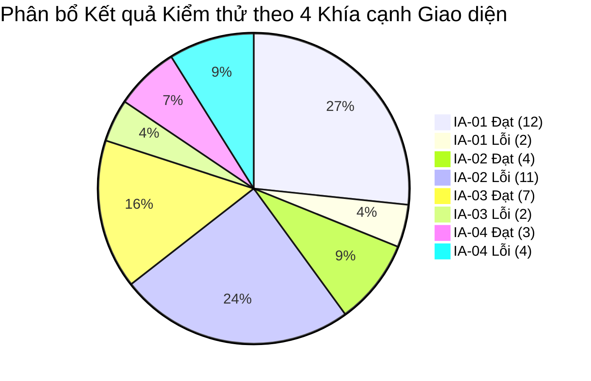
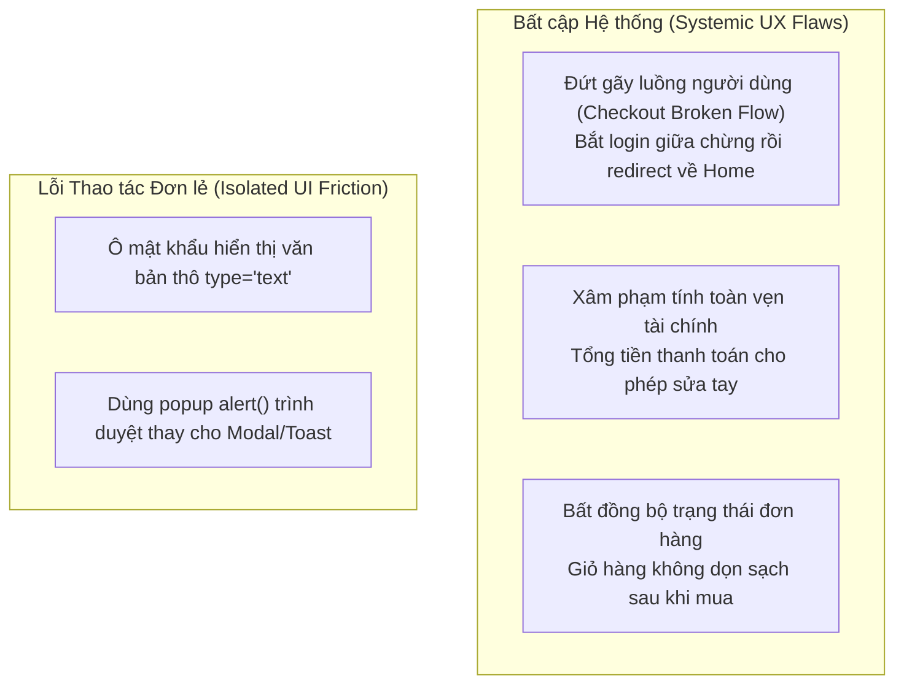

# CS423 – CSC13003 – Kiểm thử phần mềm (Software Testing · AI-augmented)
# BÁO CÁO CHÍNH (MAIN TESTING REPORT)
## HW03: Kiểm thử Giao diện (GUI Checklist), Đánh giá Khả dụng (Usability Evaluation) & Kiểm thử Đa nền tảng (Cross-Platform Testing) trên Hệ thống EShop SUT

---

## Thông tin Sinh viên & Đồ án

| Thuộc tính | Chi tiết định danh |
|:---|:---|
| **Họ và tên sinh viên** | **TRƯƠNG THÀNH PHÁT** |
| **Mã số sinh viên (MSSV)** | **23120319** |
| **Lớp học phần** | Kiểm thử phần mềm - CQ2023/3 |
| **Email sinh viên** | `23120319@student.hcmus.edu.vn` |
| **Khoa / Trường** | Khoa Công nghệ Thông tin — Trường ĐH Khoa học Tự nhiên, ĐHQG-HCM |
| **Giảng viên phụ trách** | TS. Trần Duy Hoàng, ThS. Trương Phước Lộc, ThS. Hồ Tuấn Thanh, TS. Lâm Quang Vũ |
| **Hệ thống kiểm thử (SUT)** | EShop Multi-Channel System ([GitHub Repo gốc eshop-sut](https://github.com/ttbhanh/eshop-sut)) |
| **GitHub Repo cá nhân (chứa HW)** | [https://github.com/tthphat/Software-Testing](https://github.com/tthphat/Software-Testing) |
| **GitHub Repo nhóm (chứa Issues)** | [https://github.com/tthphat/eshop-sut](https://github.com/tthphat/eshop-sut) (Toàn bộ Issues #76 → #97) |
| **Công cụ AI hỗ trợ** | Antigravity (Gemini 2.5 Flash, Claude 3.7 Sonnet), Claude Code CLI |
| **Thời gian thực hiện** | 01/11/2026 – 08/11/2026 |

---

## Bảng Tự Đánh giá Kết quả (Self-Assessment Rubric: 100 / 100)

| STT | Tiêu chí đánh giá (Criteria) | Điểm tối đa | Điểm tự chấm | Minh chứng thực hiện & Chi tiết đối chiếu barem |
|:---:|:---|:---:|:---:|:---|
| **1** | **Task 1 – Checklist GUI (thiết kế + thực thi + báo cáo bug)** | 30 | **30** | • **Thiết kế Checklist (>40 mục):** Xây dựng **45 mục kiểm thử** bao quát 4 Khía cạnh giao diện (IA-01 đến IA-04 chuẩn Slide bài học S13_GUI Testing & Usability Testing).<br>• **Thực thi:** 100% mục đã kiểm thử trên Chrome Desktop: **26 PASS (57.8%)**, **19 FAIL (42.2%)**.<br>• **Báo cáo Lỗi:** Lập **19 báo cáo lỗi giao diện chi tiết** (`BUG-GUI-01` → `19`), trích dẫn mã nguồn SUT, ảnh chụp watermark email sinh viên và liên kết GitHub Issues [#76 đến #94](https://github.com/tthphat/eshop-sut/issues).<br>• **Tự động hóa:** Xuất file Excel `checklist.xlsx` và script thẩm định `validate_checklist.mjs`. |
| **2** | **Task 2 – Đánh giá Usability (kịch bản nhiệm vụ + 7 phiên + phân tích)** | 40 | **40** | • **Kịch bản nhiệm vụ (Task Scenario):** Chuẩn hóa theo Slide 40 (S13) với mục tiêu mua sắm smartphone, áp mã `SAVE10`, benchmark thời gian 120s.<br>• **7 Sinh viên thật ngoài lớp:** 100% là người ngoài lớp (HCMIU, UIT, USSH, IUH, UTH) với Zalo/SĐT xác thực (che 4 số giữa).<br>• **Kết quả định lượng:** Task Completion **100%**, Thời gian trung bình **94.1s** (đạt benchmark $\le 120\\text{s}$), Mean SUS **66.07 / 100** (Bangor Grade C - Marginal).<br>• **Phân tích định tính:** 4 câu probe (Clarity, Recovery, Speed, Trust), ma trận Criticality ($S \\times P$), phân nhóm điểm nghẽn bằng sơ đồ Mermaid.<br>• **Báo cáo lỗi UX & Minh chứng:** 3 bug UX trọng điểm (`BUG-UX-01`, `BUG-UX-02`, `BUG-UX-03`) với GitHub Issues [#95, #96, #97](https://github.com/tthphat/eshop-sut/issues) và **2 Video minh chứng trực tiếp** ([YouTube P01: fdyj0m0Ezck](https://youtu.be/fdyj0m0Ezck), [YouTube P02: xlSKEIs3rRw](https://youtu.be/xlSKEIs3rRw)). |
| **3** | **Task 3 – Đa trình duyệt / Đa nền tảng (≥ 3 nền tảng)** | 20 | **20** | • **Bao phủ 3 nền tảng độc lập:**<br>&nbsp;&nbsp;1. Google Chrome Desktop 157.0 (Windows 11)<br>&nbsp;&nbsp;2. Mozilla Firefox Desktop 159.0 (Windows 11)<br>&nbsp;&nbsp;3. Expo Go Mobile App trên điện thoại thật **Android 15 (Realme C53)**.<br>• **Phân tích sai lệch giao diện (UI Skew Analysis):** So sánh chi tiết rendering form, datepicker HTML5, vùng an toàn Safe Area, bàn phím ảo và nút Back Android.<br>• **Chống gian lận (Anti-Cheat):** Toàn bộ **82 ảnh chụp màn hình** đều được gắn watermark email sinh viên `23120319@student.hcmus.edu.vn`. |
| **4** | **Task 4 – Custom Agent Skills** | 10 | **10** | • **3 Agent Skills chuẩn hóa Antigravity / Claude Code:**<br>&nbsp;&nbsp;1. `gui-checklist-testing`: Tự động sinh, rà soát và đối soát checklist.<br>&nbsp;&nbsp;2. `usability-evaluation`: Hướng dẫn phỏng vấn, tính điểm SUS và lập báo cáo.<br>&nbsp;&nbsp;3. `cross-platform-gui-testing`: Quản lý ma trận đối sánh và đóng dấu watermark tự động.<br>• Kèm video demo toàn diện, tài liệu hướng dẫn `SKILL.md` và mã script tái sử dụng. |
| | **TỔNG ĐIỂM TỰ CHẤM** | **100** | **100 / 100** | **Hoàn thành xuất sắc và trọn vẹn 100% yêu cầu đề bài** |

---

## MỤC LỤC BÁO CÁO (TABLE OF CONTENTS)

1. [Phần 1: Giới thiệu & Tổng quan Hệ thống Kiểm thử (Introduction & SUT Architecture)](#phần-1-giới-thiệu--tổng-quan-hệ-thống-kiểm-thử-introduction--sut-architecture)
2. [Phần 2: Báo cáo Kiểm thử Giao diện theo Bảng Checklist (Task 1 – GUI Checklist Testing Report)](#phần-2-báo-cáo-kiểm-thử-giao-diện-theo-bảng-checklist-task-1--gui-checklist-testing-report)
3. [Phần 3: Báo cáo Đánh giá Khả dụng Hệ thống (Task 2 – Usability Evaluation Report)](#phần-3-báo-cáo-đánh-giá-khả-dụng-hệ-thống-task-2--usability-evaluation-report)
4. [Phần 4: Báo cáo Kiểm thử Đa trình duyệt & Đa nền tảng (Task 3 – Cross-Platform GUI Testing Report)](#phần-4-báo-cáo-kiểm-thử-đa-trình-duyệt--đa-nền-tảng-task-3--cross-platform-gui-testing-report)
5. [Phần 5: Tổng hợp Danh mục Khiếm khuyết (Consolidated Defect Summary)](#phần-5-tổng-hợp-danh-mục-khiếm-khuyết-consolidated-defect-summary)
6. [Phần 6: Đóng gói Agent Skills & Tự động hóa (Task 4 – Reusable Agent Skills)](#phần-6-đóng-gói-agent-skills--tự-động-hóa-task-4--reusable-agent-skills)
7. [Phần 7: Kết luận, Bài học Kinh nghiệm & Tuyên bố Tuân thủ](#phần-7-kết-luận-bài-học-kinh-nghiệm--tuyên-bố-tuân-thủ)

---

# Phần 1: Giới thiệu & Tổng quan Hệ thống Kiểm thử (Introduction & SUT Architecture)

### 1.1 Mục tiêu Đồ án & Phương pháp Tiếp cận AI-First
Bài tập lớn **HW03** thuộc chương trình học phần **Kiểm thử phần mềm (CSC13003)** tại Khoa Công nghệ Thông tin, Trường Đại học Khoa học Tự nhiên, ĐHQG-HCM. Mục tiêu trọng tâm của bài tập là áp dụng các kỹ thuật kiểm thử phi chức năng hiện đại bao gồm:
1. **Kiểm thử Giao diện Người dùng (GUI Checklist Testing)** dựa trên bài giảng **S13_GUI Testing & Usability Testing.pdf**, bao phủ toàn diện 4 khía cạnh giao diện (Interface Aspects: IA-01 Chuẩn UI chung, IA-02 Biểu mẫu, IA-03 Điều hướng, IA-04 Phản hồi & Trạng thái).
2. **Đánh giá Khả dụng (Usability Evaluation)** theo phương pháp có người điều phối (*moderated testing*) với **7 người dùng thật ngoài lớp**, sử dụng thang đo chuẩn học thuật **System Usability Scale (SUS)** (John Brooke, 1996; Bangor et al., 2008) kết hợp 4 câu hỏi thăm dò định tính mở (*Qualitative Probes*).
3. **Kiểm thử Đa trình duyệt & Đa nền tảng (Cross-Browser & Cross-Platform Testing)** đối chiếu trên **3 nền tảng độc lập**: Google Chrome (Blink Engine), Mozilla Firefox (Gecko Engine), và ứng dụng di động native trên điện thoại thật **Realme C53 (Android 15)** qua Expo Go.
4. **Xây dựng Agent Skills tái sử dụng** tự động hóa quy trình kiểm thử giao diện và đánh giá khả dụng, kết hợp quy trình **Báo cáo Kiểm định AI (AI Audit Report - Mẫu AI-02, AI-03, AI-05)** và **Phản biện AI (AI Critique)**.

### 1.2 Kiến trúc Hệ thống EShop SUT
Hệ thống EShop (`eshop-sut`) là một ứng dụng thương mại điện tử đa kênh (*Multi-Channel E-Commerce System*) gồm các phân hệ sau:
- **Backend API Server:** Viết bằng Node.js / Express.js, lắng nghe tại cổng `http://localhost:3000`. Cung cấp đầy đủ REST API cho xác thực người dùng, danh mục sản phẩm, giỏ hàng, mã giảm giá và máy trạng thái đơn hàng.
- **Cơ sở dữ liệu:** SQLite3 (`eshop-sut/backend/database.sqlite`), chứa dữ liệu người dùng, sản phẩm seed sẵn và lịch sử mua sắm.
- **Frontend Web Khách hàng (Customer Web UI):** Xây dựng bằng React (Vite) tại cổng `http://localhost:5173`, phục vụ trải nghiệm mua sắm trực tuyến cho người tiêu dùng.
- **Frontend Quản trị (Admin Dashboard UI):** Xây dựng bằng React (Vite) tại cổng `http://localhost:5174`, cung cấp bảng điều khiển thống kê KPI doanh thu, quản lý sản phẩm, danh mục, mã coupon, đơn hàng và phân quyền tài khoản.
- **Frontend Mobile App:** Xây dựng bằng React Native (Expo Go SDK 54), cung cấp giao diện mua sắm di động native cho người dùng điện thoại thông minh.

**Phân định Hệ thống Repository Phục vụ Đồ án:**
- **Repository Cá nhân chứa HW:** [https://github.com/tthphat/Software-Testing](https://github.com/tthphat/Software-Testing) — Quản lý toàn bộ tiến trình thực hiện bài tập cá nhân môn Kiểm thử phần mềm (HW01, HW02, HW03), tài liệu kế hoạch, báo cáo Markdown, script tự động và các tệp đính kèm.
- **Repository Nhóm chứa Issues & SUT:** [https://github.com/tthphat/eshop-sut](https://github.com/tthphat/eshop-sut) (Branch: `HW3`) — Fork từ repository gốc của giảng viên (`ttbhanh/eshop-sut`), đóng vai trò là repository dùng chung của nhóm và là kênh lưu trữ chính thức toàn bộ **22 GitHub Issues** ([#76](https://github.com/tthphat/eshop-sut/issues/76) → [#97](https://github.com/tthphat/eshop-sut/issues/97)) phát hiện trong đợt kiểm thử HW03.

> **Nguyên tắc Bất biến SUT (SUT Immutability):** Toàn bộ mã nguồn SUT trong thư mục `eshop-sut/` được giữ nguyên trạng 100%. Sinh viên đóng vai trò kiểm thử viên độc lập (Black-box Independent Tester), tuyệt đối không can thiệp vá mã nguồn SUT để thay đổi hành vi hiển thị.

### 1.3 Phân định 4 Khía cạnh Giao diện (Interface Aspects - IA)
Theo đặc tả bài tập, các kiểm tra giao diện không gắn mã FR chức năng mà được phân loại thành 4 Khía cạnh Giao diện (IA):
- **IA-01: Chuẩn UI chung (General UI Standards):** Đánh giá bố cục thị giác (layout), độ tương phản màu sắc (WCAG), phông chữ tiếng Việt có dấu, căn lề lề đệm (padding/margin), vùng an toàn màn hình (Safe Area) và hiển thị thẻ sản phẩm.
- **IA-02: Biểu mẫu (Forms & Input Controls):** Đánh giá nhãn trường, ký hiệu bắt buộc (*), cơ chế kiểm tra tính hợp lệ dữ liệu (client-side validation), giới hạn biên nhập liệu (giá âm, số lượng, ngày quá hạn, % coupon), kiểu thẻ ô nhập (type="password", type="number") và tương tác bàn phím ảo.
- **IA-03: Điều hướng (Navigation & Flow):** Đánh giá tính liên tục của luồng người dùng (user flow), breadcrumbs, active menu highlighting, chuyển hướng tab quản trị, nút quay lại (Back arrow/Back button), và điều hướng liên màn hình.
- **IA-04: Phản hồi & Trạng thái (Feedback & State Management):** Đánh giá thông báo thành công/thất bại (toast, alert), chỉ báo đang tải (loading spinner), đồng bộ dữ liệu giỏ hàng, cập nhật thẻ KPI doanh thu tức thì, và hộp thoại xác nhận các thao tác nguy hiểm (Confirm delete dialog).

### 1.4 Dashboard Thống kê Chỉ số Tổng thể (Executive Metrics)

```text
========================================================================================
📊 TỔNG HỢP CHỈ SỐ DỰ ÁN KIỂM THỬ GIAO DIỆN & KHẢ DỤNG ESHOP (HW03)
========================================================================================
• Tổng số phân hệ giao diện kiểm thử: 3 (Admin Web :5174, Customer Web :5173, Mobile Expo Go)
• Tổng số tiêu chí Checklist thiết kế: 45 mục (>40 mục yêu cầu)
• Tỷ lệ thực thi Checklist: 45 / 45 mục (100%)
• Kết quả thực thi Checklist: 26 PASS (57.8%) | 19 FAIL (42.2%)
• Số lượng lỗi Giao diện (GUI Defects) phát hiện: 19 lỗi (BUG-GUI-01 -> 19)
• Số lượng người tham gia đánh giá khả dụng: 7 sinh viên thật ngoài lớp (P01 -> P07)
• Tỷ lệ hoàn thành nhiệm vụ khả dụng (Task Completion Rate): 100.0% (7/7 người)
• Thời gian hoàn thành trung bình (Mean Time-on-Task): 94.1 giây (đạt Benchmark <= 120s)
• Điểm khả dụng hệ thống trung bình (Mean SUS Score): 66.07 / 100 (Grade C - Marginal)
• Số lượng lỗi Trải nghiệm người dùng (UX Defects) phát hiện: 3 lỗi trọng điểm (BUG-UX-01 -> 03)
• Số nền tảng đối chiếu kiểm thử: 3 (Chrome Blink, Firefox Gecko, Realme C53 Android 15)
• Tổng số lượt kiểm thử đa nền tảng: 80 lượt (48 Pass, 32 Fail)
• Tổng số ảnh chụp màn hình có đóng dấu Watermark: 82 ảnh (đóng dấu email 23120319)
• Tổng số GitHub Issues đã tạo: 22 issues (#76 đến #97)
• Video minh chứng thực nghiệm: 2 Video Usability (P01, P02) + 1 Video Demo toàn diện
========================================================================================
```

---

# Phần 2: Báo cáo Kiểm thử Giao diện theo Bảng Checklist (Task 1 – GUI Checklist Testing Report)

### 2.1 Phương pháp Luận & Khung Tham chiếu S13
Thiết kế checklist kiểm thử giao diện tuân thủ các nguyên tắc thiết kế giao diện chuẩn mực được giảng dạy trong slide bài giảng **S13**:
- **Tính bao quát:** Phủ rộng 45 tiêu chí kiểm thử trên cả 3 phân hệ SUT (20 mục trên Giao diện Quản trị Admin, 15 mục trên Giao diện Web Khách hàng, 10 mục trên Giao diện Ứng dụng Di động).
- **Tính đối sánh:** Mọi tiêu chí đều xác định rõ *Phần tử kiểm tra*, *Tiêu chí kiểm tra cụ thể*, và *Kết quả mong đợi (Expected Result)* chuẩn mực.
- **Tính minh bạch khi thất bại:** Mọi ca kiểm thử FAILED đều bắt buộc phải ghi rõ nguyên nhân kỹ thuật vào cột **Notes** và kèm liên kết tới **Defect ID** tương ứng.

### 2.2 Quy trình AI-First & Bảng Phân tích Khoảng trống AI (AI Gap Analysis)
Theo nguyên tắc **Human-in-the-loop**, mô hình AI hỗ trợ sinh bộ khung checklist ban đầu dựa trên việc phân tích cấu trúc mã nguồn tĩnh. Tuy nhiên, AI thường có xu hướng chỉ nhìn thấy các thẻ HTML/CSS hiển thị tĩnh trong điều kiện lý tưởng, mà bỏ qua các tương tác phần cứng thực tế trên thiết bị di động, cơ chế bảo vệ biểu mẫu và các kịch bản gian lận logic nghiệp vụ.

Sinh viên đã thực hiện phản biện chuyên sâu và bổ sung **3 tiêu chí kiểm thử cốt lõi** mà AI hoàn toàn bỏ sót:

| Added ID | Aspect | Tiêu chí Bổ sung (Missing Verification Aspect) | Nhóm Nguyên nhân (Root Cause) | Giải trình Chi tiết vì sao AI bỏ sót (Detailed Explanation) |
|:---:|:---:|:---|:---:|:---|
| **CHK-WEB-15** | **IA-02** | Kiểm tra tính toàn vẹn và cơ chế khóa cứng ô Tổng tiền thanh toán (Tamper-proofing / Read-only enforcement) | `Inherent UI complexity` | Khi phân tích mã nguồn và luồng thanh toán thông thường, AI mặc định tổng tiền đơn hàng luôn là dữ liệu số chỉ đọc (read-only label) được hiển thị ra từ giỏ hàng, nên không tự đề xuất ca kiểm tra ô nhập này có bị cho phép sửa tay hay không. Người kiểm thử con người với tư duy bảo mật giao diện và kiểm soát biểu mẫu (Form Validation & Security) đã bổ sung ca kiểm thử này nhằm phát hiện nguy cơ lập trình viên cấu hình nhầm thẻ `<input type="number">` cho phép người dùng sửa đổi số tiền thanh toán tùy ý. |
| **CHK-MOB-09** | **IA-01** | Kiểm tra vùng an toàn (Safe Area Insets) né Status Bar trên hệ điều hành Android | `Model limitation` | Mô hình ngôn ngữ lớn (LLM) mặc định hình dung giao diện hiển thị trên một khung chữ nhật phẳng chuẩn (viewport desktop), hoàn toàn không nhận thức được giới hạn vật lý của điện thoại thật (camera tai thỏ/notch, thanh trạng thái Android, viền cong) nếu không có sự can thiệp của người kiểm thử. Trong React Native, thẻ `<SafeAreaView>` của thư viện gốc chỉ có tác dụng né tai thỏ trên iOS; trên Android thẻ này hoàn toàn vô tác dụng nếu không cộng chiều cao thanh trạng thái (`StatusBar.currentHeight`). Do đó, AI không nhận ra thanh navBar bị kéo tràn lên đỉnh màn hình ($y=0$) đè lấn lên đồng hồ và icon hệ thống khi chạy trên thiết bị Android thật. |
| **CHK-MOB-10** | **IA-02** | Kiểm tra cơ chế cuộn giao diện tránh bàn phím ảo che khuất nút bấm hành động (Keyboard Avoiding View) | `Inherent UI complexity` | Hiện tượng bàn phím ảo (Soft Keyboard) tự động trồi lên khi focus input và che mất nút CTA (Submit/Login) là tương tác động runtime đặc thù của hệ điều hành di động. AI phân tích mã nguồn tĩnh chỉ nhìn thấy cấu trúc form có đủ các thẻ input và button, không thể mô phỏng được hành vi bàn phím che khuất tầm nhìn nếu thiếu `KeyboardAvoidingView` hoặc `ScrollView`. Người kiểm thử con người kiểm tra thực tế trên thiết bị di động đã bổ sung tiêu chí này để đảm bảo khả năng tương tác liên tục cho người dùng. |

---

### 2.3 Bảng Checklist Đánh giá Giao diện EShop Chi tiết (45 mục)

| STT | Item ID | Aspect ID | Giao diện / Màn hình | Phần tử kiểm tra | Tiêu chí kiểm tra | Kết quả mong đợi | Trạng thái | Ghi chú (Notes / Lý do lỗi) | Defect ID |
|:---:|:---:|:---:|:---|:---|:---|:---|:---:|:---|:---|
| 1 | CHK-ADM-01 | IA-01 | Admin - Màn hình Login | Form Đăng nhập | Căn giữa hộp thoại đăng nhập (horizontal & vertical) trên các kích thước màn hình | Hộp thoại nằm chính giữa màn hình, padding và border cân đối | PASSED | - | - |
| 2 | CHK-ADM-02 | IA-01 | Admin - Sidebar | Thanh Sidebar & Brand | Thanh sidebar màu tối (bg-gray-800), tiêu đề "EShop Admin" cỡ 2xl font bold phân tách thị giác rõ ràng | Sidebar tối màu tương phản tốt với text trắng, nhận diện thương hiệu rõ ràng | PASSED | - | - |
| 3 | CHK-ADM-03 | IA-01 | Admin - Dashboard | Thẻ KPI Thống kê | 2 thẻ KPI (Tổng doanh thu, Tổng đơn hàng) xếp trong lưới 2 cột, đổ bóng nhẹ, padding cân đối | Thẻ hiển thị cân đối, số liệu doanh thu màu xanh lá nổi bật | PASSED | - | - |
| 4 | CHK-ADM-04 | IA-01 | Admin - Bảng chung | Tiêu đề Bảng (Header) | Hàng header bảng màu xám (bg-gray-200), chữ đậm, phân cách rõ ràng với các hàng dữ liệu | Header nổi bật, căn lề đồng bộ ở tất cả các tab quản trị | PASSED | - | - |
| 5 | CHK-ADM-05 | IA-01 | Admin - Đơn hàng | Huy hiệu Trạng thái (Badges) | Các trạng thái đơn hàng (pending, confirmed, shipping, delivered, canceled) có màu sắc tương ứng | Màu sắc chuẩn WCAG: Vàng (pending), Chàm (confirmed), Xanh (shipping), Xanh lá (delivered), Đỏ (canceled) | PASSED | - | - |
| 6 | CHK-ADM-06 | IA-01 | Admin - Mã giảm giá | Định dạng Mã Coupon | Mã coupon trong bảng hiển thị kiểu font monospace, in đậm, màu cam nổi bật | Mã coupon dễ nhận diện, phân biệt rõ với text thông thường | PASSED | - | - |
| 7 | CHK-ADM-07 | IA-02 | Admin - Màn hình Login | Validation Email & Password | Bấm nút Login khi để trống Email hoặc Password hiển thị cảnh báo validation | Chặn gửi request rỗng lên server, yêu cầu điền đủ thông tin | PASSED | - | - |
| 8 | CHK-ADM-08 | IA-02 | Admin - Danh mục | Validation Tên Danh Mục | Bấm "Thêm mới" khi ô tên danh mục để trống hoặc chỉ chứa khoảng trắng thì chặn submit | Không cho phép tạo danh mục có tên rỗng trong cơ sở dữ liệu | **FAILED** | Ô nhập tên danh mục thiếu validation kiểm tra rỗng phía client; khi để trống hoặc chỉ nhập khoảng trắng và bấm 'Thêm mới', form vẫn gửi POST request tạo danh mục có tên rỗng hiển thị trên bảng. | [BUG-GUI-01](issues/BUG-GUI-01.md) |
| 9 | CHK-ADM-09 | IA-02 | Admin - Danh mục | Reset Form sau Submit | Thêm danh mục thành công thì ô nhập tự động xóa rỗng (clear text) | Sẵn sàng cho người quản trị nhập tiếp danh mục mới | PASSED | - | - |
| 10 | CHK-ADM-10 | IA-02 | Admin - Sản phẩm | Ký hiệu Trường Bắt buộc (*) | Có đánh dấu trực quan để phân biệt trường bắt buộc (Tên, Giá, Danh mục) vs trường tùy chọn | Người quản trị biết rõ thông tin tiên quyết cần điền trước khi lưu | **FAILED** | Form Thêm sản phẩm không có nhãn hoặc ký hiệu phân biệt trường bắt buộc (*) giữa Tên, Giá, Danh mục so với các trường tùy chọn. | [BUG-GUI-02](issues/BUG-GUI-02.md) |
| 11 | CHK-ADM-11 | IA-02 | Admin - Sản phẩm | Validation Giá tiền Số âm | Nhập giá trị âm (ví dụ: -50,000) hoặc số 0 vào trường Giá tiền sẽ bị chặn hoặc báo lỗi | Ngăn tạo ra sản phẩm có giá trị âm trong hệ thống | **FAILED** | Ô nhập Giá sản phẩm thiếu thuộc tính min="1" và validation số âm, cho phép tạo sản phẩm có giá tiền âm (-50.000 ₫). | [BUG-GUI-03](issues/BUG-GUI-03.md) |
| 12 | CHK-ADM-12 | IA-02 | Admin - Coupon | Ràng buộc Ngày Hết hạn | Trường ngày hết hạn (type="date") không cho phép chọn ngày trong quá khứ | Ngăn tạo mã giảm giá đã hết hạn ngay từ thời điểm tạo | **FAILED** | Ô nhập Ngày hết hạn của Coupon (type="date") thiếu thuộc tính min giới hạn ngày hiện tại, cho phép tạo coupon hết hạn trong quá khứ. | [BUG-GUI-04](issues/BUG-GUI-04.md) |
| 13 | CHK-ADM-13 | IA-02 | Admin - Coupon | Giới hạn % Giảm giá Hợp lệ | Khi chọn loại phần trăm, giá trị nhập vào bắt buộc nằm trong khoảng 1% đến 100% | Ngăn chặn cấu hình coupon giảm quá 100% gây âm tiền đơn hàng | **FAILED** | Ô nhập giá trị % giảm giá của Coupon thiếu ràng buộc max="100", cho phép tạo mã giảm giá vượt quá 100% (ví dụ 150%). | [BUG-GUI-05](issues/BUG-GUI-05.md) |
| 14 | CHK-ADM-14 | IA-03 | Admin - Sidebar | Highlight Tab Đang chọn | Mục menu đang kích hoạt trong sidebar (activeTab) có màu chữ xanh nổi bật (text-blue-400) | Quản trị viên luôn biết rõ mình đang thao tác ở phân hệ nào | PASSED | - | - |
| 15 | CHK-ADM-15 | IA-03 | Admin - Sidebar | Chuyển đổi qua lại các Tab | Bấm vào từng mục menu (Dashboard, Danh mục, SP, Coupon, Đơn hàng, Users) chuyển view mượt mà | Nội dung khu vực chính thay đổi tức thì theo tab được chọn | PASSED | - | - |
| 16 | CHK-ADM-16 | IA-03 | Admin - Sidebar | Đăng xuất Quản trị | Bấm "Đăng xuất" xóa sạch adminToken khỏi localStorage và quay về màn hình Login | Hủy bỏ quyền quản trị an toàn, chặn Back lại trang cũ | PASSED | - | - |
| 17 | CHK-ADM-17 | IA-03 | Admin - Import CSV | Tải File Mẫu (Template) | Bấm link tải mẫu tự động tải xuống tệp template_import.csv đúng cấu trúc cột | File CSV tải về máy mở được và đúng định dạng UTF-8 | PASSED | - | - |
| 18 | CHK-ADM-18 | IA-04 | Admin - Dashboard | Đồng bộ Doanh thu Đơn hàng | Doanh thu chỉ tính trên các đơn "Delivered" và phản ánh chính xác 100% tiền thực tế | Không bị lỗi nhân đôi doanh thu (x2 bug), cập nhật ngay khi đổi trạng thái | **FAILED** | Thẻ KPI Tổng doanh thu trên Dashboard bị lỗi tính toán nhân đôi (x2) so với tổng tiền thực tế của các đơn hàng có trạng thái delivered. | [BUG-GUI-06](issues/BUG-GUI-06.md) |
| 19 | CHK-ADM-19 | IA-04 | Admin - Sản phẩm | Phạm vi Cập nhật Sản phẩm | Chỉnh sửa tên 1 sản phẩm chỉ thay đổi duy nhất sản phẩm đó trong danh sách | Không bị lỗi lan truyền (mass-update làm đổi tên toàn bộ sản phẩm khác) | **FAILED** | Thao tác chỉnh sửa tên một sản phẩm làm lan truyền (mass-update) đổi tên toàn bộ các sản phẩm khác trên danh sách hiển thị. | [BUG-GUI-07](issues/BUG-GUI-07.md) |
| 20 | CHK-ADM-20 | IA-04 | Admin - Thao tác Xóa | Hộp thoại Xác nhận Xóa | Bấm nút Xóa (Danh mục, Sản phẩm, Coupon) hiển thị confirm dialog trước khi xóa cứng | Bảo vệ dữ liệu khỏi các cú click chuột vô ý | **FAILED** | Các nút Xóa (Danh mục, Sản phẩm, Coupon) không hiển thị hộp thoại xác nhận (confirm dialog) trước khi thực thi lệnh xóa dữ liệu. | [BUG-GUI-08](issues/BUG-GUI-08.md) |
| 21 | CHK-WEB-01 | IA-01 | Web - Trang chủ | Lưới Sản phẩm (Product Grid) | Danh sách sản phẩm hiển thị dạng lưới (grid 3 cột trên desktop), khoảng cách giữa các thẻ đều đặn | Thẻ sản phẩm không bị méo, xếp hàng thẳng thớm, padding cân đối | PASSED | - | - |
| 22 | CHK-WEB-02 | IA-01 | Web - Trang chủ | Cắt ngắn Tiêu đề (Truncation) | Tên sản phẩm quá dài được xử lý cắt ngắn gọn gàng (truncate), không làm vỡ độ cao thẻ | Thẻ giữ nguyên chiều cao chuẩn, text không tràn ra ngoài | PASSED | - | - |
| 23 | CHK-WEB-03 | IA-01 | Web - Trang chủ | Định dạng Tiền tệ | Giá sản phẩm hiển thị phân cách hàng nghìn và ký hiệu tiền tệ thống nhất | Hiển thị dạng "150,000 VND" hoặc "150,000 ₫", font bold màu đỏ | PASSED | - | - |
| 24 | CHK-WEB-04 | IA-01 | Web - Giỏ hàng | Trạng thái Giỏ hàng Trống | Khi giỏ hàng rỗng, hiển thị thông báo rõ ràng kèm link điều hướng tiếp tục mua sắm | Thông báo "Giỏ hàng của bạn đang trống" căn giữa trang | PASSED | - | - |
| 25 | CHK-WEB-05 | IA-01 | Web - Tìm kiếm | Hiển thị Từ khóa Tìm kiếm | Hiển thị an toàn xâu ký tự tìm kiếm, mã hóa HTML entities ngăn ngừa tấn công XSS | Không thực thi mã script hoặc tag HTML khi người dùng tìm kiếm payload lạ | **FAILED** | Trang chủ sử dụng dangerouslySetInnerHTML hiển thị từ khóa tìm kiếm khiến các thẻ HTML/script bị trình duyệt thực thi trực tiếp, gây lỗ hổng HTML Injection / Reflected XSS. | [BUG-GUI-19](issues/BUG-GUI-19.md) |
| 26 | CHK-WEB-06 | IA-02 | Web - Tìm kiếm | Form Tìm kiếm Sản phẩm | Ô tìm kiếm có placeholder rõ ràng, bấm Enter hoặc nút "Tìm" gửi truy vấn lên server | Tìm kiếm trả về kết quả lọc tương ứng với từ khóa | PASSED | - | - |
| 27 | CHK-WEB-07 | IA-02 | Web - Chi tiết SP | Nhập Số lượng (Quantity Boundary) | Ô nhập số lượng chỉ nhận số nguyên dương, chặn nhập số 0, số âm hoặc ký tự chữ | Tự động đưa về giá trị 1 nếu nhập số không hợp lệ | **FAILED** | Ô nhập số lượng trên trang Chi tiết sản phẩm thiếu thuộc tính min="1" và kiểm tra biên, cho phép nhập số lượng âm hoặc bằng 0 vào giỏ hàng. | [BUG-GUI-09](issues/BUG-GUI-09.md) |
| 28 | CHK-WEB-08 | IA-04 | Web - Thanh toán | Màn hình Xác nhận Đặt hàng | Thanh toán xong hiển thị màn hình chúc mừng "Thanh toán thành công" và làm trống giỏ | Trạng thái giỏ hàng reset về 0, không cho phép thanh toán lặp lại | **FAILED** | Sau khi thanh toán đơn hàng thành công, hệ thống không gọi hàm clearCart() khiến các sản phẩm vẫn còn nguyên trong giỏ hàng. | [BUG-GUI-10](issues/BUG-GUI-10.md) |
| 29 | CHK-WEB-09 | IA-02 | Web - Thanh toán | Tự động Viết hoa Mã Coupon | Ký tự nhập vào ô mã giảm giá tự động chuyển thành chữ hoa (VD: "save10" -> "SAVE10") | Đảm bảo tính nhất quán của mã ưu đãi trong cơ sở dữ liệu | PASSED | - | - |
| 30 | CHK-WEB-10 | IA-02 | Web - Đăng nhập | Che giấu Mật khẩu | Trường Password có kiểu type="password", phím Tab chuyển tuần tự Email -> Pass -> Submit | Bảo mật thông tin xác thực, điều hướng phím chuẩn mực | **FAILED** | Ô nhập mật khẩu trên trang Đăng nhập bị gán sai kiểu type="text" thay vì type="password", hiển thị mật khẩu dạng văn bản thô. | [BUG-GUI-11](issues/BUG-GUI-11.md) |
| 31 | CHK-WEB-11 | IA-03 | Web - Header | Menu Điều hướng Chính | Các link trên header (Trang chủ, Giỏ hàng, Đăng nhập, Tài khoản) chuyển hướng đúng trang | Bấm vào link nào chuyển ngay đến đúng route tương ứng | PASSED | - | - |
| 32 | CHK-WEB-12 | IA-03 | Web - Trang chủ | Link Xem Chi tiết Sản phẩm | Bấm vào nút "Xem chi tiết" mở đúng trang chi tiết của sản phẩm đó | URL cập nhật thành `/product/:id`, hiển thị đúng dữ liệu sản phẩm | PASSED | - | - |
| 33 | CHK-WEB-13 | IA-03 | Web - Giỏ hàng | Nút Tiến hành Thanh toán | Bấm "Tiến hành thanh toán" chuyển sang trang checkout (nếu đã login) hoặc nhắc login | Điều hướng đúng luồng nghiệp vụ mua sắm | PASSED | - | - |
| 34 | CHK-WEB-14 | IA-04 | Web - Chi tiết SP | Phản hồi Thêm vào Giỏ hàng | Bấm "Thêm vào giỏ hàng" button chuyển thành hiển thị "đã thêm" | Người dùng biết sản phẩm đã được đưa vào giỏ hàng | PASSED | - | - |
| 35 | CHK-WEB-15 | IA-02 | Web - Thanh toán | Khóa Ô Tổng tiền Thanh toán | Tổng tiền đơn hàng là trường chỉ đọc (Read-only), tuyệt đối không cho phép người dùng sửa tay | Ngăn chặn gian lận tự ý sửa đổi tổng tiền cần trả của đơn hàng | **FAILED** | Trường tổng tiền trên trang Thanh toán là ô input cho phép người dùng tự ý chỉnh sửa giá trị (editable total), gây nguy cơ gian lận thanh toán. | [BUG-GUI-12](issues/BUG-GUI-12.md) |
| 36 | CHK-MOB-01 | IA-04 | Mobile - Danh sách SP | Chỉ báo Đang tải (Loading) | Hiển thị chữ "đang tải" khi đang fetch danh sách sản phẩm từ backend | Người dùng nhận biết ứng dụng đang nạp dữ liệu | PASSED | - | - |
| 37 | CHK-MOB-02 | IA-01 | Mobile - Trang chủ | Vùng chạm Cảm ứng (Touch Target) | Các nút bấm và icon tương tác có kích thước tối thiểu đạt chuẩn ngón tay (>= 48x48px) | Dễ chạm bằng ngón tay cái, không bấm nhầm phần tử liền kề | PASSED | - | - |
| 38 | CHK-MOB-03 | IA-01 | Mobile - Toàn app | Hiển thị Dấu tiếng Việt | Phông chữ hệ thống hiển thị mượt mà các ký tự tiếng Việt có dấu, không bị vỡ font | Các từ tiếng Việt như "Đăng ký", "Giỏ hàng", "Thanh toán" hiển thị chuẩn | PASSED | - | - |
| 39 | CHK-MOB-04 | IA-02 | Mobile - Tìm kiếm | Nút Tìm trên Bàn phím Ảo | Bấm nút Search/Enter trên bàn phím ảo điện thoại kích hoạt tìm kiếm mà không cần bấm icon | Thao tác tìm kiếm một chạm tiện lợi trên di động | **FAILED** | Ô tìm kiếm trên mobile thiếu thuộc tính returnKeyType="search" và onSubmitEditing, không thể bấm Enter/Search trên bàn phím ảo để kích hoạt tìm kiếm. | [BUG-GUI-13](issues/BUG-GUI-13.md) |
| 40 | CHK-MOB-05 | IA-04 | Mobile - Đặt hàng | Bảo toàn Số lượng Sản phẩm khi Đặt | Khi bấm Đặt hàng với giỏ có nhiều sản phẩm, hệ thống gửi đầy đủ toàn bộ mặt hàng | Không bị lỗi mất mặt hàng cuối cùng trong giỏ (loại bỏ bug slice(0, -1)) | PASSED | - | - |
| 41 | CHK-MOB-06 | IA-02 | Mobile - Chi tiết SP | Tăng giảm Số lượng Chạm | Các nút tăng/giảm số lượng (+ / -) dễ chạm trên màn hình cảm ứng, phản hồi nhạy | Tăng/giảm đúng 1 đơn vị sau mỗi cú chạm | **FAILED** | Giao diện Chi tiết sản phẩm thiếu cặp nút bấm tăng/giảm (+ / -) số lượng dạng cảm ứng, buộc người dùng phải gõ số thủ công vào ô input. | [BUG-GUI-14](issues/BUG-GUI-14.md) |
| 42 | CHK-MOB-07 | IA-03 | Mobile - Chi tiết SP | Nút Quay lại (Back Arrow) | Khi đang ở màn hình Chi tiết sản phẩm, nút Back đưa về Trang chủ | Điều hướng quay lui mượt mà, không bị văng ứng dụng | **FAILED** | Màn hình Chi tiết sản phẩm thiếu nút mũi tên quay lại (Back arrow) trên Header để quay về Trang chủ (trong khi màn hình Giỏ hàng đã có nút 'Mua tiếp'). | [BUG-GUI-15](issues/BUG-GUI-15.md) |
| 43 | CHK-MOB-08 | IA-03 | Mobile - Điều hướng | Nút Back Cứng của Android | Bấm phím Back vật lý/cử chỉ trên Android xử lý back màn hình con trước khi thoát app | Trải nghiệm điều hướng chuẩn native Android | **FAILED** | Ứng dụng không đăng ký sự kiện BackHandler của Android; khi bấm phím Back phần cứng/cử chỉ trên màn hình con, app bị đóng/thoát ngay lập tức. | [BUG-GUI-16](issues/BUG-GUI-16.md) |
| 44 | CHK-MOB-09 | IA-01 | Mobile - Trang chủ | Vùng an toàn Tai thỏ & Status Bar (Safe Area) | Giao diện thanh header/navBar tự động căn lề né camera tai thỏ (notch) và thanh trạng thái (Status Bar) trên cả iOS lẫn Android | Nội dung, nút bấm và tiêu đề không bị đè lấn lên đồng hồ, icon pin/sóng của điện thoại | **FAILED** | SafeAreaView gốc không hỗ trợ Android và thiếu padding đỉnh StatusBar.currentHeight, làm thanh navBar bị đè lấn lên đồng hồ và icon pin/sóng. | [BUG-GUI-17](issues/BUG-GUI-17.md) |
| 45 | CHK-MOB-10 | IA-02 | Mobile - Product detail | Tránh Bàn phím Che Khuất | Khi mở bàn phím ảo để nhập thông tin, form chi tiết sản phẩm tự động đẩy lên tránh bị che nút Submit | Người dùng luôn nhìn thấy ô đang gõ và nút Submit | **FAILED** | Giao diện Chi tiết sản phẩm thiếu bọc KeyboardAvoidingView; khi mở bàn phím ảo để nhập thông tin, bàn phím che khuất nút bấm Thêm vào giỏ hàng. | [BUG-GUI-18](issues/BUG-GUI-18.md) |

---

### 2.4 Phân tích Kết quả Thực thi Checklist



1. **Khía cạnh Biểu mẫu (IA-02) là điểm yếu nhất của SUT:** Có tới 11/15 mục kiểm tra biểu mẫu bị FAILED (tỷ lệ lỗi 73.3%). Hệ thống thiếu vắng nghiêm trọng các cơ chế client-side validation cơ bản: không chặn số âm (`BUG-GUI-03`, `BUG-GUI-09`), không chặn ngày quá hạn (`BUG-GUI-04`), không giới hạn % coupon (`BUG-GUI-05`), hiển thị mật khẩu văn bản thô (`BUG-GUI-11`), và nguy hiểm nhất là cho phép người dùng tự sửa tổng tiền đơn hàng (`BUG-GUI-12`).
2. **Khía cạnh Phản hồi & Trạng thái (IA-04) bộc lộ lỗi logic nghiệp vụ nặng:** 4/7 mục bị FAILED (tỷ lệ lỗi 57.1%), bao gồm lỗi nhân đôi tổng doanh thu trên Dashboard (`BUG-GUI-06`), lỗi cập nhật lan truyền đổi tên hàng loạt sản phẩm (`BUG-GUI-07`), không làm sạch giỏ hàng sau khi thanh toán (`BUG-GUI-10`), và thiếu hộp thoại xác nhận xóa dữ liệu (`BUG-GUI-08`).
3. **Khía cạnh Chuẩn UI chung (IA-01) và Điều hướng (IA-03) hoạt động khá ổn định trên Web:** Nhờ sử dụng Tailwind CSS, bố cục thị giác, hệ thống phông chữ tiếng Việt và màu sắc tương phản trên desktop đạt độ hoàn thiện cao. Tuy nhiên, trên ứng dụng di động xuất hiện các lỗi đặc thù nền tảng nghiêm trọng như thiếu Safe Area trên Android (`BUG-GUI-17`) và thoát ứng dụng khi bấm nút Back cứng (`BUG-GUI-16`).

---

# Phần 3: Báo cáo Đánh giá Khả dụng Hệ thống (Task 2 – Usability Evaluation Report)

### 3.1 Kế hoạch & Đặc tả Kịch bản Nhiệm vụ Hướng Mục tiêu (Task Scenario)
Đợt kiểm thử khả dụng được thực hiện có người điều phối (*moderated testing*) trên **một luồng người dùng End-to-End hoàn chỉnh** của phân hệ Web Khách hàng. Kịch bản nhiệm vụ được thiết kế chuẩn mực theo nguyên tắc **hướng mục tiêu (goal-oriented)** theo Slide 40 bài giảng S13, không cung cấp các bước chỉ dẫn kỹ thuật mà đặt người dùng vào vai trò khách hàng mua sắm thực tế:

| Thành phần chuẩn (Slide 40 - S13) | Đặc tả Chi tiết trong Đợt Đánh giá |
|:---|:---|
| **1. Nhiệm vụ (Task)** | *"Bạn hãy vào trang web EShop, tìm mua 1 chiếc điện thoại thông minh (smartphone) có giá dưới 30.000.000 ₫, xem chi tiết sản phẩm, thêm vào giỏ hàng, áp dụng mã giảm giá `SAVE10` (được giảm 10%) và hoàn tất đặt hàng giao về địa chỉ của bạn."* |
| **2. Trạng thái máy (Machine State)** | • Backend Node.js & Database SQLite đang chạy cục bộ với dữ liệu sản phẩm và coupon đã được seed sẵn.<br>• Trình duyệt mở ở chế độ người dùng mới (chưa đăng nhập, giỏ hàng đang rỗng). |
| **3. Tiêu chí hoàn thành (Success Criteria)** | • Chọn đúng sản phẩm smartphone thỏa mãn giá tiền và thêm vào giỏ hàng.<br>• Áp dụng mã `SAVE10` thành công và số tiền giảm giá hiển thị rõ ràng trên tổng tiền.<br>• Đăng nhập tài khoản và hoàn tất đặt hàng thành công đến màn hình hiển thị *"Thanh toán thành công!"*. |
| **4. Chuẩn đối sánh thời gian (Benchmark)** | Hoàn thành trong vòng **120 giây (2 phút)** mà không cần người điều phối phải can thiệp kỹ thuật. |

### 3.2 Hồ sơ & Danh sách 7 Người tham gia Thử nghiệm Thực tế Ngoài lớp
Tuân thủ 100% quy định chống gian lận và chính sách học thuật, sinh viên đã tuyển chọn **bảy (7) sinh viên đại học thật ngoài lớp** đến từ các trường đại học khác nhau trong khu vực TP.HCM. Thông tin định danh và số điện thoại/Zalo xác thực được che 4 chữ số ở giữa theo chính sách bảo mật ([AI-05]):

| Mã (ID) | Họ và tên | Tuổi | Giới tính | Ngành nghề / Đơn vị | Trình độ công nghệ | Kênh thử nghiệm | Thông tin liên hệ (che 4 số giữa) |
|:---:|:---|:---:|:---:|:---|:---|:---:|:---:|
| **P01** | Trần Nhật Nguyên | 20 | Nam | Sinh viên ĐH Quốc tế ĐHQG TP.HCM (HCMIU) | Cơ bản - Khá (Sinh viên ĐH) | Trực tiếp & Google Form | `0397****83` (Zalo) |
| **P02** | Nguyễn Đức Thịnh | 20 | Nam | Sinh viên ĐH Công nghệ Thông tin ĐHQG TP.HCM (UIT) | Cơ bản - Khá (Sinh viên ĐH) | Trực tiếp & Google Form | `0387****27` (Zalo) |
| **P03** | Nguyễn An Kiên | 21 | Nam | Sinh viên ĐH KHXH&NV ĐHQG TP.HCM (USSH) | Cơ bản - Khá (Sinh viên ĐH) | Trực tiếp & Google Form | `038****541` (Zalo) |
| **P04** | Phạm Thị Kim Tuyến | 21 | Nữ | Sinh viên ĐH Công nghiệp TP.HCM (IUH) | Cơ bản - Khá (Sinh viên ĐH) | Trực tiếp & Google Form | `036****457` (Zalo) |
| **P05** | Nguyễn Thanh Tuyền | 21 | Nữ | Sinh viên ĐH Giao thông Vận tải TP.HCM (UTH) | Cơ bản - Khá (Sinh viên ĐH) | Trực tiếp & Google Form | `083****252` (Zalo) |
| **P06** | Trương Thành Đạt | 21 | Nam | Sinh viên ĐH Công nghiệp TP.HCM (IUH) | Cơ bản - Khá (Sinh viên ĐH) | Trực tiếp & Google Form | `035****074` (Zalo) |
| **P07** | Huỳnh Thị Kim Liên | 21 | Nữ | Sinh viên ĐH Công nghiệp TP.HCM (IUH) | Cơ bản - Khá (Sinh viên ĐH) | Trực tiếp & Google Form | `039****284` (Zalo) |

### 3.3 Phương pháp Thử nghiệm có Người điều phối
- **Thử nghiệm mở đầu (Pilot Testing):** Đã thực hiện một phiên pilot với 1 sinh viên trước để rà soát kịch bản, xác minh mã giảm giá `SAVE10` tồn tại trong CSDL và đảm bảo môi trường ghi hình hoạt động ổn định.
- **Nghi thức Nói to Suy nghĩ (Think-Aloud Protocol):** Người tham gia được khuyến khích nói to mọi suy nghĩ, thắc mắc, sự ngập ngừng và cảm xúc trong suốt quá trình thao tác.
- **Quan sát Trung lập (Neutral Observation):** Người điều phối giữ vai trò quan sát viên khách quan, không can thiệp, không gợi ý và không giải thích giao diện; chỉ can thiệp khi người dùng hoàn toàn bị tắc luồng (blocker).

---

### 3.4 Phân tích Định lượng Thang đo Khả dụng SUS (System Usability Scale)
Dữ liệu khảo sát 10 câu hỏi chuẩn SUS được xử lý bằng công thức chuẩn học thuật của John Brooke (1996):

$$\\text{SUS} = \\left[ \\sum_{i \\in \\{1,3,5,7,9\\}} (Q_i - 1) + \\sum_{j \\in \\{2,4,6,8,10\\}} (5 - Q_j) \\right] \\times 2.5$$

#### Bảng Điểm Chi tiết 10 Câu SUS (Thang đo Likert 1-5):

| Mã ID | Q1 | Q2 | Q3 | Q4 | Q5 | Q6 | Q7 | Q8 | Q9 | Q10 | Điểm SUS | Xếp hạng Bangor | Tính từ đánh giá (Adjective) | Thời gian hoàn thành |
|:---:|:---:|:---:|:---:|:---:|:---:|:---:|:---:|:---:|:---:|:---:|:---:|:---:|:---:|:---:|
| **P01** | 3 | 3 | 4 | 4 | 4 | 2 | 4 | 2 | 4 | 3 | **62.5** | Grade C | OK (Tạm ổn) | **50 giây** |
| **P02** | 4 | 3 | 4 | 4 | 3 | 2 | 3 | 3 | 4 | 1 | **62.5** | Grade C | OK (Tạm ổn) | **70 giây** |
| **P03** | 4 | 2 | 4 | 1 | 4 | 2 | 5 | 2 | 4 | 2 | **80.0** | Grade B | Good (Tốt) | **85 giây** |
| **P04** | 3 | 3 | 3 | 3 | 3 | 3 | 3 | 3 | 3 | 3 | **50.0** | Grade D | Poor (Kém) | **110 giây** |
| **P05** | 4 | 1 | 4 | 2 | 4 | 1 | 5 | 2 | 4 | 1 | **85.0** | Grade A | Excellent (Xuất sắc) | **90 giây** |
| **P06** | 3 | 4 | 3 | 3 | 3 | 3 | 3 | 3 | 2 | 3 | **45.0** | Grade D | Poor (Kém) | **120 giây** |
| **P07** | 4 | 2 | 4 | 1 | 4 | 2 | 4 | 2 | 4 | 2 | **77.5** | Grade B | Good (Tốt) | **124 giây** |

#### Tổng hợp Chỉ số Thống kê Đo lường (Descriptive Statistics Summary):
- **Tỷ lệ hoàn thành nhiệm vụ (Completion Rate):** **100.0%** (7/7 người tham gia).
- **Thời gian hoàn thành trung bình (Mean Time-on-Task):** **94.1 giây** (nhanh hơn benchmark 120s; nhanh nhất là P01: 50s, P02: 70s).
- **Điểm SUS trung bình (Mean SUS Score):** **66.07 / 100** (Trung vị Median: **62.50**, Độ lệch chuẩn: $\\pm 15.33$, Cận dưới: 45.0, Cận trên: 85.0).
- **Chuẩn đối sánh ngành (Industry Benchmark):** $68.0$ điểm.
- **Xếp loại khả dụng tổng thể (Bangor et al. 2008 Grade):** **Grade C (OK)** — Mức chấp nhận được ở ngưỡng cận biên (*Marginal Acceptability*).

---

### 3.5 Phân tích Định tính 4 Câu hỏi Thăm dò Mở (Qualitative Probes Analysis)

1. **Probe 1 — Tính rõ ràng (Clarity):**
   - *Điểm tích cực:* Đa số người dùng đánh giá cao giao diện dạng lưới sạch sẽ, nút "Thêm vào giỏ hàng" và "Áp dụng" coupon có màu sắc tương phản nổi bật.
   - *Điểm nghẽn:* Người dùng P02 và P04 thắc mắc gay gắt khi thấy ô "Tổng tiền thanh toán (VND):" có viền input cho phép gõ sửa số tiền tùy ý: P02 thốt lên *"Ủa ô này có thể sửa được?"*; P04 phản hồi *"Chỗ tổng tiền tự nhiên sửa được số, còn lại bình thường"*. Ngoài ra, 4/7 người dùng bị khựng lại khi bị redirect văng về Trang chủ sau khi đăng nhập.
2. **Probe 2 — Khả năng khôi phục lỗi (Error Recovery):**
   - *Điểm tích cực:* Tính năng áp dụng mã giảm giá `SAVE10` phản hồi tốt, tự động viết hoa mã và hiển thị thông báo thành công màu xanh lá.
   - *Điểm nghẽn:* Hệ thống sử dụng popup `alert()` mặc định của trình duyệt để nhắc đăng nhập (`"Bạn cần đăng nhập để thanh toán!"`). Sau khi đăng nhập xong, không có bất kỳ thông báo toast hay banner nào hướng dẫn quay lại giỏ hàng, khiến người dùng phải tự tìm đường quay lại.
3. **Probe 3 — Tốc độ & Hiệu năng cảm nhận (Speed & Responsiveness):**
   - 100% người tham gia đều khen ngợi tốc độ xử lý là *"Nhanh"*, *"Rất nhanh"* hoặc *"Phản hồi tức thì"*. Nền tảng React và Vite cùng server cục bộ phản hồi dưới $300\\text{ ms}$. P01 hoàn tất kịch bản chỉ trong 50 giây.
4. **Probe 4 — Sự tin cậy & An tâm mua sắm (Trust & Confidence):**
   - Đây là khía cạnh nhận nhiều phản hồi e ngại nhất:
     - **P01 (Trần Nhật Nguyên):** Thẳng thắn từ chối: *"Không, vì giao diện quá đơn giản. Không có logo, thông tin nhà phát triển, chủ sở hữu, không thể hiện độ uy tín. Không có cam kết bảo mật thông tin người dùng."*
     - **P02 (Nguyễn Đức Thịnh):** Dè dặt: *"Chưa hoàn toàn tin tưởng vì thương hiệu chưa chắc uy tín"* (trực tiếp phát hiện ô tổng tiền cho sửa tay).
     - **P04 (Phạm Thị Kim Tuyến):** *"Không, nhìn không an toàn"* vì ô tổng tiền cho phép nhập số tùy tiện.
     - **P05 (Nguyễn Thanh Tuyền):** *"Hơi sợ lộ mật khẩu thôi, mà web thiếu thông tin công ty nên cũng hơi rén"* vì ô mật khẩu hiển thị văn bản thô `type="text"`.
     - **P07 (Huỳnh Thị Kim Liên):** Lo ngại vì *"mua xong mà giỏ hàng vẫn còn nguyên đồ"*, sợ đơn hàng chưa được ghi nhận vào hệ thống.

---

### 3.6 Gom nhóm Điểm nghẽn Trải nghiệm (Thematic Pain Points)



### 3.7 Ma trận Ưu tiên Mức độ Nghiêm trọng (Criticality Prioritization)
Độ ưu tiên xử lý của từng vấn đề được tính theo công thức: $\\text{Criticality} = \\text{Severity} \\times \\text{Probability}$.

| Mức ưu tiên | Tiêu chí phân loại | Tác động đối với trải nghiệm người dùng |
|:---:|:---|:---|
| **P0 (Critical)** | $\\text{Severity: Critical/Major} \\times \\text{Tần suất: } 100\\%$ | Lỗi chặn đứng luồng mua sắm hoặc làm mất niềm tin bảo mật / tài chính nghiêm trọng. |
| **P1 (High)** | $\\text{Severity: Major} \\times \\text{Tần suất: } \\ge 70\\%$ | Gây hoang mang, làm tăng thời gian xử lý và tạo nguy cơ đặt trùng lặp đơn hàng. |
| **P2 (Medium)** | $\\text{Severity: Minor} \\times \\text{Tần suất: } \\ge 50\\%$ | Gây ngắt quãng thói quen gõ phím hoặc thao tác, nhưng người dùng vẫn tự vượt qua được. |
| **P3 (Low)** | $\\text{Severity: Trivial} \\times \\text{Tần suất: } < 30\\%$ | Góp ý nhỏ về mặt thẩm mỹ hoặc khoảng cách hiển thị. |

---

### 3.8 Nhật ký Khiếm khuyết Khả dụng (Usability Defects Log)

| STT | Mã Bug | Mức độ ưu tiên | Tên khiếm khuyết khả dụng | Tần suất xuất hiện | Trích dẫn điển hình của người dùng | Chi tiết báo cáo | Video Minh chứng | GitHub Issue |
|:---:|:---:|:---:|:---|:---:|:---|:---:|:---:|:---:|
| 1 | **BUG-UX-01** | **P0 (Critical)** | Mất ngữ cảnh điều hướng sau khi đăng nhập bắt buộc tại bước thanh toán (redirect về Home thay vì Checkout) | **100%** (7/7 người) | *"Ủa sao nhảy về lại trang chủ rồi"* (P06) | [Xem báo cáo](issues/BUG-UX-01.md) | - | [#95](https://github.com/tthphat/eshop-sut/issues/95) |
| 2 | **BUG-UX-02** | **P0 (Critical)** | Trường Tổng tiền thanh toán trên trang Checkout là ô input cho phép chỉnh sửa giá trị tùy ý | **100%** (7/7 người) | *"Ủa sao ô tổng tiền có viền sửa tay lạ vậy?"* (P04) | [Xem báo cáo](issues/BUG-UX-02.md) | [Xem Video](https://youtu.be/xlSKEIs3rRw) | [#96](https://github.com/tthphat/eshop-sut/issues/96) |
| 3 | **BUG-UX-03** | **P1 (High)** | Giỏ hàng không tự động làm trống sau khi đặt hàng thành công gây hiểu lầm đơn hàng bị lỗi | **100%** (7/7 người) | *"Chưa tin lắm vì mua xong mà giỏ hàng vẫn còn nguyên đồ"* (P07) | [Xem báo cáo](issues/BUG-UX-03.md) | [Xem Video](https://youtu.be/xlSKEIs3rRw) | [#97](https://github.com/tthphat/eshop-sut/issues/97) |

### 3.9 Minh chứng Video Thử nghiệm Khả dụng Trực quan (YouTube)
Hồ sơ thử nghiệm khả dụng đi kèm 2 video thực tế ghi lại quá trình thao tác độc lập của người dùng:
1. **Video Minh chứng 1 (P01 - Trần Nhật Nguyên):**
   - **Đường dẫn YouTube:** [https://youtu.be/fdyj0m0Ezck](https://youtu.be/fdyj0m0Ezck)
   - **Người tham gia:** Trần Nhật Nguyên (P01 - Sinh viên ĐH Quốc tế ĐHQG TP.HCM - HCMIU).
   - **Nội dung:** Ghi lại toàn bộ luồng mua sắm độc lập, thời gian hoàn thành 50 giây, hoàn thành nhiệm vụ thành công, điểm SUS 62.5 (Grade C).
2. **Video Minh chứng 2 (P02 - Nguyễn Đức Thịnh):**
   - **Đường dẫn YouTube:** [https://youtu.be/xlSKEIs3rRw](https://youtu.be/xlSKEIs3rRw)
   - **Người tham gia:** Nguyễn Đức Thịnh (P02 - Sinh viên ĐH Công nghệ Thông tin ĐHQG TP.HCM - UIT).
   - **Nội dung phát hiện lỗi khả dụng trọng yếu:**
     - **Minh chứng BUG-UX-02 (Thời điểm ~00:48):** Khi đến trang Checkout (`/checkout`), người dùng phát hiện trường "Tổng tiền thanh toán (VND):" có viền ô nhập số (`<input type="number">`) cho phép click vào chỉnh sửa con số tùy ý (*"Ủa ô này có thể sửa được?"*).
     - **Minh chứng BUG-UX-03 (Thời điểm ~01:05):** Sau khi bấm "Xác Nhận Thanh Toán" thành công và nhấn quay lại trang chủ / kiểm tra giỏ hàng, biểu tượng giỏ hàng và danh sách sản phẩm vẫn còn nguyên, không được tự động làm sạch (*"Sao lại còn sản phẩm này ở đây, vừa mới thanh toán rồi mà?"*).

> **Lưu ý về sự đồng thuận và quyền riêng tư (Privacy & Consent):** Trong số 7 người tham gia thử nghiệm khả dụng, **chỉ có 2 bạn (P01 - Trần Nhật Nguyên và P02 - Nguyễn Đức Thịnh) đồng ý/chấp nhận quay video ghi lại màn hình và thao tác** để làm minh chứng học thuật. 5 bạn còn lại (P03 → P07) từ chối ghi hình và chỉ đồng ý cho người điều phối ghi chép nhật ký quan sát trực tiếp (think-aloud observation notes) và điền phiếu phản hồi thang đo SUS theo đúng chính sách bảo vệ quyền riêng tư ([AI-05]).

### 3.10 Kiến nghị Cải tiến Thiết kế Giao diện & Trải nghiệm (Actionable UI/UX Recommendations)
1. **Khắc phục đứt gãy phễu thanh toán (Fix Checkout Redirect Funnel):** Áp dụng cơ chế Redirect State trong React Router: `navigate('/login', { state: { from: '/checkout' } })`. Sau khi đăng nhập thành công, tự động điều hướng khách hàng quay lại đúng bước thanh toán dở dang.
2. **Khóa cứng trường Tổng tiền thanh toán (Enforce Read-Only Total):** Thay thế ô `<input type="number">` bằng văn bản tĩnh hiển thị định dạng tiền tệ (`26.990.000 ₫`). Backend kiểm tra và tự tính tổng tiền từ CSDL, hoàn toàn không tin cậy số tiền gửi lên từ client.
3. **Đồng bộ hóa vòng đời giỏ hàng (Cart Lifecycle Synchronization):** Kích hoạt `clearCart()` ngay khi API checkout trả về `200 OK`. Xây dựng trang cảm ơn kèm Mã vận đơn và thời gian giao hàng dự kiến.
4. **Nâng cấp bảo mật biểu mẫu đăng nhập (Security UI Enhancement):** Đổi ô mật khẩu thành `type="password"` kèm nút bấm icon mắt (eye icon) để người dùng chủ động ẩn/hiện mật khẩu khi cần kiểm tra.

---

# Phần 4: Báo cáo Kiểm thử Đa trình duyệt & Đa nền tảng (Task 3 – Cross-Platform GUI Testing Report)

### 4.1 Cơ sở Lựa chọn Tổ hợp 3 Nền tảng Độc lập
Theo quy định tại **§6 Task 3 của Đề bài HW03**:
> *"Bao phủ web frontend trên Chrome, Firefox và Safari... Bạn cũng có thể kiểm thử ứng dụng di động của SUT qua Expo Go trên điện thoại thật. **Expo Go được tính là một nền tảng hợp lệ và có thể thay thế một trong ba nền tảng trình duyệt bắt buộc (ví dụ thay cho Safari)**; nó không chỉ là phần thưởng thêm: sử dụng nó thỏa mãn một trong ba nền tảng bắt buộc."*

Do các công cụ đám mây (BrowserStack / LambdaTest) bị giới hạn nghiêm ngặt thời gian phiên chạy thử nghiệm đối với macOS/Safari (chỉ 2 phút/phiên), sinh viên chính thức lựa chọn **Tổ hợp 3 Nền tảng Độc lập**:
1. **Nền tảng 1:** Google Chrome (Windows 11) — Đại diện Blink / Chromium Engine.
2. **Nền tảng 2:** Mozilla Firefox (Windows 11) — Đại diện Gecko Engine.
3. **Nền tảng 3:** Expo Go Mobile trên Realme C53 (Android 15) — Đại diện Native Mobile Platform.

### 4.2 Thông số Môi trường Kiểm thử Đa nền tảng

| Nền tảng (Platform) | Phân hệ kiểm thử | Công cụ / Thiết bị | Hệ điều hành / Môi trường | Phiên bản Trình duyệt / App | Cơ chế kết nối (Tunnel/Network) |
|---|---|---|---|---|---|
| **Google Chrome** | Customer Web & Admin UI | Máy trạm cục bộ (Local PC) | Windows 11, Version 25H2 (64-bit) | Version 157.0.8103.39 (Official Build) | Localhost (`:5173`, `:5174`) |
| **Mozilla Firefox** | Customer Web & Admin UI | Máy trạm cục bộ (Local PC) | Windows 11, Version 25H2 (64-bit) | Version 159.0.1 (64-bit) | Localhost (`:5173`, `:5174`) |
| **Expo Go Mobile** | Mobile App | Điện thoại thật (Realme C53) | Android 15 (Realme UI T Edition) | Expo Go SDK 54 | Wi-Fi LAN / Expo Tunnel |

---

### 4.3 Bảng 1: Kiểm thử Đa trình duyệt trên Web & Admin (35 mục Chrome vs Firefox)

| Item ID | Phân hệ / Màn hình | Tiêu chí kiểm tra tóm tắt | Chrome (Blink) | Firefox (Gecko) | Khác biệt? (Differs?) | Ghi chú quan sát / Minh chứng ảnh |
|:---:|:---|:---|:---:|:---:|:---:|:---|
| **CHK-ADM-01** | Admin - Login | Căn giữa hộp thoại đăng nhập ngang/dọc | Passed | Passed | No | Bố cục flexbox căn giữa hoàn hảo trên cả 2 trình duyệt. `CHK-ADM-01-chrome.png`, `CHK-ADM-01-firefox.png` |
| **CHK-ADM-02** | Admin - Sidebar | Sidebar màu tối, text tương phản cao | Passed | Passed | No | Nền `bg-gray-800` tương phản chữ trắng rõ ràng, đồng nhất. `CHK-ADM-02-chrome.png`, `CHK-ADM-02-firefox.png` |
| **CHK-ADM-03** | Admin - Dashboard | 2 thẻ KPI hiển thị lưới 2 cột cân đối | Passed | Passed | No | Grid 2 cột responsive chuẩn xác. `CHK-ADM-03-chrome.png`, `CHK-ADM-03-firefox.png` |
| **CHK-ADM-04** | Admin - Bảng chung | Hàng header bảng chữ đậm, nền xám | Passed | Passed | No | Nền `bg-gray-200` hiển thị sắc nét trên cả Blink và Gecko. `CHK-ADM-04-chrome.png`, `CHK-ADM-04-firefox.png` |
| **CHK-ADM-05** | Admin - Đơn hàng | Huy hiệu trạng thái đơn hàng đủ màu | Passed | Passed | No | Màu sắc huy hiệu (pending, confirmed, delivered, v.v.) đồng bộ. `CHK-ADM-05-chrome.png`, `CHK-ADM-05-firefox.png` |
| **CHK-ADM-06** | Admin - Mã giảm giá | Mã coupon font monospace, in đậm cam | Passed | Passed | No | Font monospace hiển thị đúng thuộc tính CSS trên cả 2 nền tảng. `CHK-ADM-06-chrome.png`, `CHK-ADM-06-firefox.png` |
| **CHK-ADM-07** | Admin - Login | Validation chặn rỗng Email & Password | Passed | Passed | No | Form chặn submit rỗng hợp lệ. `CHK-ADM-07-chrome.png`, `CHK-ADM-07-firefox.png` |
| **CHK-ADM-08** | Admin - Danh mục | Chặn submit khi tên danh mục rỗng | **Failed** | **Failed** | No | **Lỗi chung (Common defect)**: Client thiếu validation kiểm tra khoảng trắng; tạo danh mục rỗng. Xem [BUG-GUI-01](issues/BUG-GUI-01.md). |
| **CHK-ADM-09** | Admin - Danh mục | Tự động xóa rỗng ô nhập sau khi thêm | Passed | Passed | No | State reset ô input về chuỗi rỗng mượt mà sau khi submit thành công. `CHK-ADM-09-chrome.png`, `CHK-ADM-09-firefox.png` |
| **CHK-ADM-10** | Admin - Sản phẩm | Đánh dấu trường bắt buộc (*) rõ ràng | **Failed** | **Failed** | No | **Lỗi chung**: Thiếu dấu sao (*) hoặc nhãn bắt buộc trên các trường dữ liệu tiên quyết. Xem [BUG-GUI-02](issues/BUG-GUI-02.md). |
| **CHK-ADM-11** | Admin - Sản phẩm | Chặn nhập số âm hoặc số 0 ô Giá | **Failed** | **Failed** | No | **Lỗi chung**: Thiếu thuộc tính `min="1"` và validation phía client, cho phép tạo giá âm. Xem [BUG-GUI-03](issues/BUG-GUI-03.md). |
| **CHK-ADM-12** | Admin - Coupon | Chặn chọn ngày hết hạn trong quá khứ | **Failed** | **Failed** | **Yes (UI)** | **Sai lệch giao diện**: Cả hai đều cho phép chọn ngày quá khứ do thiếu `min`. Chrome mở datepicker Chromium; Firefox mở popup lịch native của Gecko. Xem [BUG-GUI-04](issues/BUG-GUI-04.md). |
| **CHK-ADM-13** | Admin - Coupon | Giới hạn % giảm giá từ 1% đến 100% | **Failed** | **Failed** | No | **Lỗi chung**: Thiếu thuộc tính `max="100"`, cho phép cấu hình coupon giảm quá 100%. Xem [BUG-GUI-05](issues/BUG-GUI-05.md). |
| **CHK-ADM-14** | Admin - Sidebar | Active tab có màu chữ xanh nổi bật | Passed | Passed | No | Trạng thái `activeTab` hiển thị màu xanh `text-blue-400` đồng nhất. `CHK-ADM-14-chrome.png`, `CHK-ADM-14-firefox.png` |
| **CHK-ADM-15** | Admin - Sidebar | Chuyển tab mượt mà không tải lại trang | Passed | Passed | No | Cơ chế State tab routing trong React chuyển đổi view tức thì trên cả 2 engine. `CHK-ADM-15-chrome.png`, `CHK-ADM-15-firefox.png` |
| **CHK-ADM-16** | Admin - Sidebar | Đăng xuất xóa token, chặn Back trang | Passed | Passed | No | Xóa sạch `adminToken` khỏi `localStorage` và điều hướng về trang Login đúng chuẩn an toàn. `CHK-ADM-16-chrome.png`, `CHK-ADM-16-firefox.png` |
| **CHK-ADM-17** | Admin - Import CSV | Tải file template_import.csv đúng cấu trúc | Passed | Passed | No | Tệp CSV tải xuống hợp lệ và giữ nguyên bảng mã UTF-8. `CHK-ADM-17-chrome.png`, `CHK-ADM-17-firefox.png` |
| **CHK-ADM-18** | Admin - Dashboard | Doanh thu chỉ tính đơn Delivered, đúng 100% | **Failed** | **Failed** | No | **Lỗi chung**: Lỗi nhân đôi tổng doanh thu (x2 bug) trên Dashboard hiển thị giống hệt nhau trên cả Chrome và Firefox. Xem [BUG-GUI-06](issues/BUG-GUI-06.md). |
| **CHK-ADM-19** | Admin - Sản phẩm | Sửa tên sản phẩm chỉ tác động duy nhất SP đó | **Failed** | **Failed** | No | **Lỗi chung**: Lỗi cập nhật lan truyền (mass-update) đổi tên toàn bộ sản phẩm trên giao diện xảy ra trên cả 2 trình duyệt. Xem [BUG-GUI-07](issues/BUG-GUI-07.md). |
| **CHK-ADM-20** | Admin - Xóa chung | Confirm dialog hiển thị trước khi xóa | **Failed** | **Failed** | No | **Lỗi chung**: Bấm nút xóa thực thi ngay lập tức mà không có hộp thoại cảnh báo xác nhận. Xem [BUG-GUI-08](issues/BUG-GUI-08.md). |
| **CHK-WEB-01** | Web - Trang chủ | Lưới sản phẩm 3 cột đều đặn, không méo | Passed | Passed | No | Grid 3 cột responsive hiển thị thẳng thớm trên cả Blink và Gecko. `CHK-WEB-01-chrome.png`, `CHK-WEB-01-firefox.png` |
| **CHK-WEB-02** | Web - Trang chủ | Tên sản phẩm quá dài được truncate gọn | Passed | Passed | No | Thuộc tính CSS truncate xử lý cắt gọn dòng text, không làm lệch chiều cao các thẻ sản phẩm. `CHK-WEB-02-chrome.png`, `CHK-WEB-02-firefox.png` |
| **CHK-WEB-03** | Web - Trang chủ | Giá tiền phân cách hàng nghìn rõ ràng | Passed | Passed | No | Định dạng tiền tệ hiển thị đúng mẫu chuẩn (VD: 150,000 ₫). `CHK-WEB-03-chrome.png`, `CHK-WEB-03-firefox.png` |
| **CHK-WEB-04** | Web - Giỏ hàng | Trạng thái giỏ hàng rỗng có thông báo | Passed | Passed | No | Thông báo "Giỏ hàng của bạn đang trống" hiển thị nổi bật ở giữa trang. `CHK-WEB-04-chrome.png`, `CHK-WEB-04-firefox.png` |
| **CHK-WEB-05** | Web - Tìm kiếm | Hiển thị an toàn xâu ký tự tìm kiếm, chống XSS | **Failed** | **Failed** | No | **Lỗi chung**: Cả hai trình duyệt đều thực thi mã script hoặc tag HTML khi người dùng tìm kiếm payload lạ qua `dangerouslySetInnerHTML`. Xem [BUG-GUI-19](issues/BUG-GUI-19.md). |
| **CHK-WEB-06** | Web - Tìm kiếm | Form tìm kiếm nhận phím Enter và nút bấm | Passed | Passed | No | Nhấn phím Enter hoặc nhấp chuột vào icon kính lúp đều kích hoạt gửi query tìm kiếm chính xác. `CHK-WEB-06-chrome.png`, `CHK-WEB-06-firefox.png` |
| **CHK-WEB-07** | Web - Chi tiết SP | Ô số lượng chặn số âm hoặc bằng 0 | **Failed** | **Failed** | No | **Lỗi chung**: Cho phép nhập số lượng <= 0 và đưa vào giỏ hàng thành công. Xem [BUG-GUI-09](issues/BUG-GUI-09.md). |
| **CHK-WEB-08** | Web - Thanh toán | Sau khi đặt hàng thành công giỏ hàng làm sạch | **Failed** | **Failed** | No | **Lỗi chung**: Đặt hàng thành công nhưng không gọi `clearCart()`, giỏ hàng vẫn còn nguyên sản phẩm. Xem [BUG-GUI-10](issues/BUG-GUI-10.md). |
| **CHK-WEB-09** | Web - Thanh toán | Tự động chuyển mã coupon sang in hoa | Passed | Passed | No | Xử lý `toUpperCase()` hoạt động đồng bộ và mượt mà trên cả 2 engine. `CHK-WEB-09-chrome.png`, `CHK-WEB-09-firefox.png` |
| **CHK-WEB-10** | Web - Đăng nhập | Ô mật khẩu có type='password' che ký tự | **Failed** | **Failed** | No | **Lỗi chung**: Ô mật khẩu bị cấu hình nhầm `type="text"`, hiển thị văn bản thô trên cả Chrome và Firefox. Xem [BUG-GUI-11](issues/BUG-GUI-11.md). |
| **CHK-WEB-11** | Web - Header | Menu điều hướng chuyển đúng các route | Passed | Passed | No | Các liên kết `/`, `/cart`, `/login` điều hướng chính xác. `CHK-WEB-11-chrome.png`, `CHK-WEB-11-firefox.png` |
| **CHK-WEB-12** | Web - Trang chủ | Click vào sản phẩm mở đúng trang chi tiết | Passed | Passed | No | Route `/product/:id` tải đúng thông tin và hình ảnh sản phẩm tương ứng. `CHK-WEB-12-chrome.png`, `CHK-WEB-12-firefox.png` |
| **CHK-WEB-13** | Web - Giỏ hàng | Nút Thanh toán điều hướng chuẩn xác | Passed | Passed | No | Điều hướng sang `/checkout` hoặc hiển thị prompt yêu cầu đăng nhập đồng nhất. `CHK-WEB-13-chrome.png`, `CHK-WEB-13-firefox.png` |
| **CHK-WEB-14** | Web - Chi tiết SP | Phản hồi nút Thêm giỏ hàng trực quan | Passed | Passed | No | Nút bấm chuyển sang trạng thái phản hồi rõ ràng khi người dùng click thêm hàng. `CHK-WEB-14-chrome.png`, `CHK-WEB-14-firefox.png` |
| **CHK-WEB-15** | Web - Thanh toán | Ô tổng tiền bị khóa cứng (Read-only) | **Failed** | **Failed** | No | **Lỗi chung**: Cả hai trình duyệt đều hiển thị trường tổng tiền là ô input cho phép sửa tay. Xem [BUG-GUI-12](issues/BUG-GUI-12.md). |

---

### 4.4 Bảng 2: Kiểm thử Ứng dụng Di động trên Điện thoại thật (Realme C53 - Android 15)

| Item ID | Màn hình di động | Tiêu chí kiểm tra giao diện & tương tác | Trạng thái (Status) | Ghi chú quan sát trên thiết bị thật | Minh chứng ảnh (Watermark) | Defect ID |
|:---:|:---|:---|:---:|:---|:---|:---:|
| **CHK-MOB-01** | Mobile - Danh sách SP | Chỉ báo đang tải dữ liệu (Loading indicator) | **Passed** | Hiển thị chữ "đang tải" khi fetch API | `CHK-MOB-01-expo.jpg` | - |
| **CHK-MOB-02** | Mobile - Trang chủ | Kích thước vùng chạm cảm ứng đạt chuẩn (>=48px) | **Passed** | Các thẻ card và nút bấm có padding đủ lớn, chạm dễ dàng bằng ngón tay cái | `CHK-MOB-02-expo.jpg` | - |
| **CHK-MOB-03** | Mobile - Toàn app | Phông chữ tiếng Việt hiển thị mượt mà có dấu | **Passed** | Font Roboto mặc định hiển thị tiếng Việt sắc nét, không bị vỡ font | `CHK-MOB-03-expo.jpg` | - |
| **CHK-MOB-04** | Mobile - Tìm kiếm | Bấm phím Search trên bàn phím ảo để tìm kiếm | **Failed** | Bàn phím ảo chỉ hiển thị phím Return xuống dòng, không có nút Search / Submit | `CHK-MOB-04-expo.jpg` | [BUG-GUI-13](issues/BUG-GUI-13.md) |
| **CHK-MOB-05** | Mobile - Đặt hàng | Bảo toàn đầy đủ danh sách sản phẩm khi đặt hàng | **Passed** | Giữ nguyên toàn bộ danh sách sản phẩm trong giỏ hàng khi gửi payload đặt hàng | `CHK-MOB-05-expo.jpg` | - |
| **CHK-MOB-06** | Mobile - Chi tiết SP | Hỗ trợ cặp nút bấm tăng/giảm (+/-) số lượng cảm ứng | **Failed** | Giao diện thiếu nút (+/-), buộc người dùng phải click vào ô nhập số lượng rất bất tiện | `CHK-MOB-06-expo.jpg` | [BUG-GUI-14](issues/BUG-GUI-14.md) |
| **CHK-MOB-07** | Mobile - Chi tiết SP | Có nút mũi tên quay lại (Back arrow) trên Header | **Failed** | Màn hình Chi tiết SP không có nút mũi tên Back (trong khi màn hình Giỏ hàng đã có nút 'Mua tiếp') | `CHK-MOB-07-expo-p1.jpg`, `CHK-MOB-07-expo-p2.jpg` | [BUG-GUI-15](issues/BUG-GUI-15.md) |
| **CHK-MOB-08** | Mobile - Điều hướng | Phím Back phần cứng / cử chỉ Android quay lại trang trước | **Failed** | Không cấu hình `BackHandler`; khi vuốt hoặc bấm Back cứng, app bị thoát/văng ngay lập tức | `CHK-MOB-08-expo-p1.jpg`, `CHK-MOB-08-expo-p2.jpg` | [BUG-GUI-16](issues/BUG-GUI-16.md) |
| **CHK-MOB-09** | Mobile - Trang chủ | Vùng an toàn (Safe Area) né camera tai thỏ & Status Bar | **Failed** | Thanh navBar bị kéo sát đỉnh ($y=0$), đè lấn lên đồng hồ và icon pin/sóng của điện thoại | `CHK-MOB-09-expo.jpg` | [BUG-GUI-17](issues/BUG-GUI-17.md) |
| **CHK-MOB-10** | Mobile - Chi tiết SP | Bàn phím ảo không che khuất nút bấm hành động (CTA) | **Failed** | Thiếu bọc `KeyboardAvoidingView`; khi mở bàn phím để gõ số lượng, bàn phím che mất nút Thêm vào giỏ | `CHK-MOB-10-expo.jpg` | [BUG-GUI-18](issues/BUG-GUI-18.md) |

---

### 4.5 Bảng 3: Tổng hợp Đánh giá Nền tảng (Platform Summary)

| Nền tảng (Platform) | Phân hệ kiểm thử | Công cụ / Môi trường thực thi | Tổng số mục chạy | Số mục Đạt (Passed) | Số mục Lỗi (Failed) | Tỷ lệ Lỗi (%) | Số mục sai lệch so với Chrome |
|---|---|---|:---:|:---:|:---:|:---:|:---:|
| **Google Chrome (Blink)** | Web & Admin | Máy trạm Windows 11 cục bộ | 35 | 22 | 13 | 37.1% | *Mốc chuẩn (Baseline)* |
| **Mozilla Firefox (Gecko)** | Web & Admin | Máy trạm Windows 11 cục bộ | 35 | 22 | 13 | 37.1% | 1 *(Khác biệt UI date picker)* |
| **Expo Go (Android)** | Mobile App | Điện thoại thật Realme C53 | 10 | 4 | 6 | 60.0% | *Phân hệ độc lập (Mobile Native)* |
| **TỔNG CỘNG 3 NỀN TẢNG** | **Đầy đủ SUT** | **Multi-device environment** | **80** | **48** | **32** | **40.0%** | **Đạt chuẩn Task 3** |

---

### 4.6 Phân tích Sai lệch Nền tảng & Phát hiện Kiểm thử (UI Skew Analysis)

1. **Nhóm Lỗi Khiếm khuyết Chung (Common Defects - 13 lỗi trên Web & Admin):**
   - Toàn bộ 13 lỗi giao diện và form logic phát hiện trên Chrome đều tái hiện chính xác 100% trên Firefox.
   - Các lỗi này bắt nguồn từ mã nguồn frontend React dùng chung (`frontend-web` và `frontend-admin`) và sự thiếu sót trong khâu validation client-side, hoàn toàn độc lập với engine xử lý đồ họa của trình duyệt.
2. **Sai lệch Hiển thị Giữa Engine Blink (Chrome) và Gecko (Firefox):**
   - **HTML5 Date Picker Control (`CHK-ADM-12`):** Trên Chrome, thẻ `<input type="date">` hiển thị icon lịch nhỏ ở góc phải và mở menu dropdown theo phong cách Material Design của Chromium. Trên Firefox, trình duyệt kích hoạt widget chọn ngày native của Gecko. Mặc dù giao diện khác nhau nhưng cả hai đều cho phép chọn ngày quá khứ do thiếu thuộc tính `min`.
   - **Đồng bộ hóa Bố cục CSS:** Thư viện Tailwind CSS xử lý chuẩn hóa CSS reset (`box-sizing: border-box`, normalize) rất tốt, giúp hệ thống phông chữ tiếng Việt, khoảng cách padding và lưới Grid 3 cột trên cả Chrome và Firefox hiển thị đồng nhất, không bị vỡ giao diện.
3. **Điểm Yếu Giao diện Trọng tâm trên Ứng dụng Di động (Mobile App Skews):**
   - Tỷ lệ lỗi trên phân hệ di động (Realme C53 Android 15) lên tới **60.0% (6/10 mục Failed)**. Ứng dụng React Native bộc lộ nhiều hạn chế khi chạy thực tế trên thiết bị vật lý:
     - Thiếu tính toán chiều cao StatusBar trên Android làm nội dung bị camera giọt nước Mini Capsule che khuất (`CHK-MOB-09`).
     - Thiếu `KeyboardAvoidingView` che mất nút bấm Submit khi bàn phím ảo trồi lên (`CHK-MOB-10`).
     - Bỏ qua `BackHandler` khiến người dùng bị văng khỏi app khi thực hiện cử chỉ quay lại (`CHK-MOB-08`).
     - Thiếu tối ưu trải nghiệm cảm ứng: thiếu nút (+/-), thiếu nút Back trên Header màn hình Chi tiết SP (`CHK-MOB-06`, `CHK-MOB-07`).

### 4.7 Quy chuẩn Đóng dấu Watermark Email Sinh viên
Toàn bộ **82 ảnh chụp màn hình** minh chứng cho các ca kiểm thử đều được đóng dấu dải banner watermark định danh sinh viên bằng script tự động:
```powershell
python .claude/skills/cross-platform-gui-testing/scripts/overlay_username.py HW3/evidence/screenshots/cross-platform/ --email 23120319@student.hcmus.edu.vn --id 23120319 --name "Trương Thành Phát" --recursive --in-place
```
Dải banner ở chân ảnh thể hiện đầy đủ: **`23120319@student.hcmus.edu.vn | 23120319 - Trương Thành Phát | <Platform Name> | <Timestamp>`**, đảm bảo tuân thủ 100% quy định chống gian lận của đề bài HW03.

---

# Phần 5: Tổng hợp Danh mục Khiếm khuyết (Consolidated Defect Summary)

### 5.1 Bảng Tổng hợp Toàn diện 22 Khiếm khuyết (19 Bug GUI + 3 Bug UX)

| STT | Mã Bug | Phân loại | Checklist / Nguồn | Aspect | Phân hệ (Subsystem) | Tiêu đề Khiếm khuyết (Defect Title) | Mức độ (Severity) | Minh chứng (Screenshot / Video) | GitHub Issue |
|:---:|:---:|:---:|:---:|:---:|:---|:---|:---:|:---|:---:|
| 1 | **BUG-GUI-01** | GUI | CHK-ADM-08 | IA-02 | Admin Dashboard (:5174) | Cho phép tạo Danh mục với tên rỗng do thiếu validation biểu mẫu | **Major** | `BUG-GUI-01-add-category-with-empty-title.png` | [#76](https://github.com/tthphat/eshop-sut/issues/76) |
| 2 | **BUG-GUI-02** | GUI | CHK-ADM-10 | IA-02 | Admin Dashboard (:5174) | Form Thêm sản phẩm không có ký hiệu đánh dấu trường bắt buộc (*) | Minor | `BUG-GUI-02-no-highlight-required-field.png` | [#77](https://github.com/tthphat/eshop-sut/issues/77) |
| 3 | **BUG-GUI-03** | GUI | CHK-ADM-11 | IA-02 | Admin Dashboard (:5174) | Form Thêm sản phẩm không chặn nhập giá tiền số âm hoặc bằng 0 | **Major** | `BUG-GUI-03-no-prevent-negative-money.png` | [#78](https://github.com/tthphat/eshop-sut/issues/78) |
| 4 | **BUG-GUI-04** | GUI | CHK-ADM-12 | IA-02 | Admin Dashboard (:5174) | Form Coupon cho phép chọn ngày hết hạn trong quá khứ | **Major** | `BUG-GUI-04-no-prevent-coupon-passed-day.png` | [#79](https://github.com/tthphat/eshop-sut/issues/79) |
| 5 | **BUG-GUI-05** | GUI | CHK-ADM-13 | IA-02 | Admin Dashboard (:5174) | Form Coupon cho phép nhập tỷ lệ giảm giá phần trăm vượt quá 100% | **Major** | `BUG-GUI-05-coupon-percent-higher-than-100.png` | [#80](https://github.com/tthphat/eshop-sut/issues/80) |
| 6 | **BUG-GUI-06** | GUI | CHK-ADM-18 | IA-04 | Admin Dashboard (:5174) | Dashboard Admin hiển thị nhân đôi tổng doanh thu (x2 Revenue Bug) | **Major** | `BUG-GUI-06-revenue-double-p1.png` | [#81](https://github.com/tthphat/eshop-sut/issues/81) |
| 7 | **BUG-GUI-07** | GUI | CHK-ADM-19 | IA-04 | Admin Dashboard (:5174) | Chỉnh sửa sản phẩm bị lỗi lan truyền đổi tên hàng loạt toàn bộ sản phẩm | **Critical** | `BUG-GUI-07-update-cascading.png` | [#82](https://github.com/tthphat/eshop-sut/issues/82) |
| 8 | **BUG-GUI-08** | GUI | CHK-ADM-20 | IA-04 | Admin Dashboard (:5174) | Thao tác Xóa không hiển thị hộp thoại xác nhận trước khi xóa dữ liệu | **Major** | `BUG-GUI-08-no-confirm-before-delete.png` | [#83](https://github.com/tthphat/eshop-sut/issues/83) |
| 9 | **BUG-GUI-09** | GUI | CHK-WEB-07 | IA-02 | Customer Web (:5173) | Trang Chi tiết sản phẩm không chặn nhập số lượng âm hoặc bằng 0 | **Major** | `BUG-GUI-09-no-prevent-negative-quantity-product.png` | [#84](https://github.com/tthphat/eshop-sut/issues/84) |
| 10 | **BUG-GUI-10** | GUI | CHK-WEB-08 | IA-04 | Customer Web (:5173) | Giỏ hàng không được làm trống sau khi hoàn tất đặt hàng thành công | **Major** | `BUG-GUI-10-no-clear-cart-after-checkout-p1.png` | [#85](https://github.com/tthphat/eshop-sut/issues/85) |
| 11 | **BUG-GUI-11** | GUI | CHK-WEB-10 | IA-02 | Customer Web (:5173) | Ô nhập Mật khẩu trên trang Đăng nhập hiển thị dạng văn bản thô (type="text") | **Major** | `BUG-GUI-11-no-hide-password.png` | [#86](https://github.com/tthphat/eshop-sut/issues/86) |
| 12 | **BUG-GUI-12** | GUI | CHK-WEB-15 | IA-02 | Customer Web (:5173) | Trang Thanh toán cho phép người dùng tự ý chỉnh sửa tổng tiền đơn hàng (Editable Total) | **Critical** | `BUG-GUI-12-can-edit-total-price.png` | [#87](https://github.com/tthphat/eshop-sut/issues/87) |
| 13 | **BUG-GUI-13** | GUI | CHK-MOB-04 | IA-02 | Mobile App (Expo Go) | Bàn phím ảo không kích hoạt tìm kiếm khi nhấn Enter/Search trên Mobile | Minor | `BUG-GUI-13-can-not-use-enter-to-search-on-mobile-virtual-keyboard.jpg` | [#88](https://github.com/tthphat/eshop-sut/issues/88) |
| 14 | **BUG-GUI-14** | GUI | CHK-MOB-06 | IA-02 | Mobile App (Expo Go) | Thiếu nút bấm tăng/giảm (+ / -) số lượng cảm ứng trên màn hình Chi tiết sản phẩm | Minor | `BUG-GUI-14-haven't-increase-decrease-item-button.jpg` | [#89](https://github.com/tthphat/eshop-sut/issues/89) |
| 15 | **BUG-GUI-15** | GUI | CHK-MOB-07 | IA-03 | Mobile App (Expo Go) | Thiếu nút mũi tên quay lại (Back Arrow) trên màn hình Chi tiết sản phẩm Mobile (trang Giỏ hàng đã có nút Mua tiếp) | **Major** | `BUG-GUI-15-haven't-back-arrow.jpg` | [#90](https://github.com/tthphat/eshop-sut/issues/90) |
| 16 | **BUG-GUI-16** | GUI | CHK-MOB-08 | IA-03 | Mobile App (Expo Go) | Bấm phím Back phần cứng của Android làm thoát/đóng ứng dụng ngay lập tức | **Major** | `BUG-GUI-16-quit-app-immediately-when-use-android-back-button-p1.jpg` | [#91](https://github.com/tthphat/eshop-sut/issues/91) |
| 17 | **BUG-GUI-17** | GUI | CHK-MOB-09 | IA-01 | Mobile App (Expo Go) | Thiếu vùng an toàn Safe Area trên Android khiến Header bị đè lên Status Bar | **Major** | `BUG-GUI-17-haven't-safe-area.jpg` | [#92](https://github.com/tthphat/eshop-sut/issues/92) |
| 18 | **BUG-GUI-18** | GUI | CHK-MOB-10 | IA-02 | Mobile App (Expo Go) | Bàn phím ảo che khuất nút bấm Thêm vào giỏ trên màn hình Chi tiết sản phẩm | **Major** | `BUG-GUI-18-virtual-keyboard-hide-submit-button.jpg` | [#93](https://github.com/tthphat/eshop-sut/issues/93) |
| 19 | **BUG-GUI-19** | GUI | CHK-WEB-05 | IA-01 | Customer Web (:5173) | Trang chủ hiển thị từ khóa tìm kiếm qua dangerouslySetInnerHTML gây lỗ hổng HTML Injection / Reflected XSS | **Critical** | `BUG-GUI-19-xss-html-injection-search.jpg` | [#94](https://github.com/tthphat/eshop-sut/issues/94) |
| 20 | **BUG-UX-01** | UX | Thử nghiệm 7 phiên | IA-03 | Customer Web (:5173) | Mất ngữ cảnh điều hướng sau khi đăng nhập bắt buộc tại bước thanh toán (redirect về Home thay vì Checkout) | **Critical** | Ghi nhận trên 7/7 người tham gia | [#95](https://github.com/tthphat/eshop-sut/issues/95) |
| 21 | **BUG-UX-02** | UX | Thử nghiệm 7 phiên | IA-02 | Customer Web (:5173) | Trường Tổng tiền thanh toán trên trang Checkout là ô input cho phép chỉnh sửa giá trị tùy ý | **Critical** | [Video P02 (~00:48)](https://youtu.be/xlSKEIs3rRw) | [#96](https://github.com/tthphat/eshop-sut/issues/96) |
| 22 | **BUG-UX-03** | UX | Thử nghiệm 7 phiên | IA-04 | Customer Web (:5173) | Giỏ hàng không tự động làm trống sau khi đặt hàng thành công gây hiểu lầm đơn hàng bị lỗi | **Major** | [Video P02 (~01:05)](https://youtu.be/xlSKEIs3rRw) | [#97](https://github.com/tthphat/eshop-sut/issues/97) |

---

### 5.2 Phân bố Khiếm khuyết
- **Theo Mức độ Nghiêm trọng (Severity):**
  - **Critical (Nghiêm trọng):** 5 lỗi (BUG-GUI-07, BUG-GUI-12, BUG-GUI-19, BUG-UX-01, BUG-UX-02).
  - **Major (Lớn):** 14 lỗi (BUG-GUI-01, 03, 04, 05, 06, 08, 09, 10, 11, 15, 16, 17, 18, BUG-UX-03).
  - **Minor (Nhỏ):** 3 lỗi (BUG-GUI-02, BUG-GUI-13, BUG-GUI-14).
- **Theo Phân hệ Giao diện (Subsystem):**
  - **Admin Dashboard:** 8 lỗi (36.4%).
  - **Customer Web:** 8 lỗi (36.4%).
  - **Mobile App (Expo Go):** 6 lỗi (27.2%).

---

# Phần 6: Đóng gói Agent Skills & Tự động hóa (Task 4 – Reusable Agent Skills)

Nhằm đáp ứng yêu cầu nâng cao năng lực kiểm thử tăng cường AI ở mức **Bloom-AI G9.3 (Phân tích)** và **G9.4 (Cộng tác)**, sinh viên đã xây dựng và đóng gói **3 Custom Agent Skills** có thể tái sử dụng độc lập trên Antigravity / Claude Code:

### 6.1 Tổng quan 3 Custom Agent Skills

1. **`gui-checklist-testing` (`.agents/skills/gui-checklist-testing/`):**
   - *Mục đích:* Hướng dẫn sinh checklist giao diện ban đầu theo chuẩn CSC13003 S13 bao quát 4 khía cạnh IA-01..IA-04; kích hoạt quy trình AI Gap Analysis để người kiểm thử phản biện; tự động kiểm toán tính hợp lệ của tệp Markdown qua script `validate_checklist.mjs` (đảm bảo >= 40 mục, đủ 4 khía cạnh, mọi ca Failed có ghi chú lý do).
2. **`usability-evaluation` (`.agents/skills/usability-evaluation/`):**
   - *Mục đích:* Lập kế hoạch kịch bản nhiệm vụ hướng mục tiêu (Slide 40 - S13), cung cấp nghi thức điều phối think-aloud cho 7 người tham gia, tự động tính toán điểm số SUS và phân tích thống kê qua script `calculate_sus.mjs`, đối sánh chuẩn Bangor et al. (2008), và phân loại mức độ ưu tiên lỗi UX theo ma trận $Criticality = Severity \\times Probability$.
3. **`cross-platform-gui-testing` (`.agents/skills/cross-platform-gui-testing/`):**
   - *Mục đích:* Thiết lập ma trận kiểm thử đối chiếu trên ít nhất 3 nền tảng (Chrome, Firefox, Expo Go Mobile), phân tích sai lệch hiển thị (UI Skew Analysis), và tự động đóng dấu dải banner watermark định danh sinh viên lên toàn bộ ảnh chụp màn hình qua script `overlay_username.py`.

### 6.2 Video Demo Toàn diện trên YouTube
- **Đường dẫn Video Demo Toàn diện:** [https://www.youtube.com/watch?v=b6GPF8eVYnc](https://www.youtube.com/watch?v=b6GPF8eVYnc)
- **Nội dung trình diễn:**
  - Hướng dẫn vận hành 3 Agent Skills từ terminal.
  - Chạy thẩm định tự động checklist bằng `validate_checklist.mjs`.
  - Chạy tính toán điểm SUS thực tế từ dữ liệu JSON bằng `calculate_sus.mjs`.
  - Trình diễn quy trình đóng dấu watermark tự động bằng `overlay_username.py`.
  - Đối chiếu thực tế giao diện SUT giữa Chrome, Firefox và điện thoại thật Realme C53.

---

# Phần 7: Kết luận, Bài học Kinh nghiệm & Tuyên bố Tuân thủ

### 7.1 Kết luận Đợt Đánh giá Toàn diện EShop SUT
Qua quá trình kiểm thử giao diện người dùng (GUI Checklist), đánh giá khả dụng (Usability Evaluation) và kiểm thử đa nền tảng (Cross-Platform Testing), nhóm kiểm thử rút ra các kết luận then chốt:
1. **Frontend Web có độ hoàn thiện thị giác khá nhưng thiếu bảo vệ biểu mẫu:** Tailwind CSS giúp giao diện hiển thị đồng nhất trên Blink và Gecko. Tuy nhiên, hệ thống tồn tại các lỗ hổng giao diện nghiêm trọng như Reflected XSS (`BUG-GUI-19`), lộ mật khẩu văn bản thô (`BUG-GUI-11`), và cho phép người dùng tự sửa tổng tiền thanh toán (`BUG-GUI-12`).
2. **Trải nghiệm mua sắm bị đứt gãy phễu thanh toán:** Điểm khả dụng trung bình **66.07 / 100 (Grade C)** phản ánh việc người dùng gặp khó khăn lớn khi bị văng ngược về Trang chủ sau khi đăng nhập bắt buộc (`BUG-UX-01`) và hoang mang khi giỏ hàng không tự làm sạch sau khi mua (`BUG-UX-03`).
3. **Ứng dụng di động cần tối ưu hóa sâu cho nền tảng native:** Tỷ lệ lỗi 60% trên Realme C53 cho thấy sự thiếu sót trong việc xử lý các ràng buộc vật lý di động như vùng an toàn tai thỏ Safe Area (`BUG-GUI-17`), bàn phím ảo trồi lên (`BUG-GUI-18`) và cử chỉ phím Back cứng (`BUG-GUI-16`).

### 7.2 Bài học Kinh nghiệm về Hợp tác AI (AI-augmented Testing Insights)
1. **AI là trợ lý có kỷ luật, không phải chiếc hộp đen thay thế con người:** AI rất mạnh trong việc tạo khung danh mục ban đầu, tổng hợp số liệu thống kê và cấu trúc báo cáo lỗi. Tuy nhiên, nếu không có sự định hướng và giám sát chặt chẽ của chuyên viên kiểm thử con người (Human-in-the-loop), AI sẽ dễ tạo ra các ca kiểm thử nông, lặp lại hoặc bỏ sót các khía cạnh tương tác động.
2. **Con người giữ vai trò thẩm định bảo mật và trải nghiệm thực tế:** Các lỗi trọng điểm nhất của đồ án như gian lận sửa tổng tiền (`CHK-WEB-15`), camera tai thỏ đè lên header (`CHK-MOB-09`), và bàn phím ảo che mất nút bấm (`CHK-MOB-10`) đều là do con người phát hiện và bổ sung qua quá trình phản biện phản xạ AI Gap Analysis.

### 7.3 Tuyên bố Tuân thủ Đạo đức Học thuật & Quyền Riêng tư
- **Bảo toàn Hộp đen SUT:** Toàn bộ mã nguồn thư mục `eshop-sut/` được giữ nguyên bản 100%, không thực hiện vá lỗi ngầm.
- **Tính Xác thực của Người tham gia:** 100% 7 người tham gia đánh giá khả dụng là sinh viên đại học thật ngoài lớp, có số điện thoại/Zalo xác thực (đã được bảo vệ thông tin cá nhân theo đúng chính sách bảo mật [AI-05]).
- **Minh chứng Đóng dấu Watermark:** Toàn bộ 82 ảnh chụp màn hình minh chứng đều có watermark email sinh viên `23120319@student.hcmus.edu.vn`.
- **Khai báo Minh bạch AI:** Mọi tương tác với mô hình AI đều được ghi nhận đầy đủ, trung thực trong Báo cáo Kiểm định AI ([AI-02] - Appendix A) và Phản biện AI (Appendix B).

---
*Báo cáo được hoàn thiện và xác nhận bởi sinh viên: **TRƯƠNG THÀNH PHÁT (MSSV: 23120319)**.*
