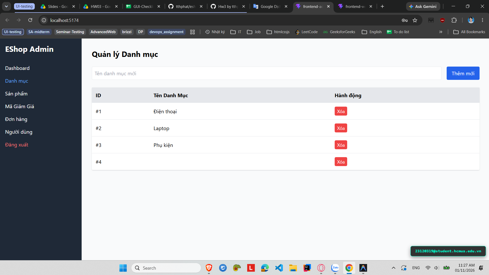

# [BUG-GUI-26][IA-02] Admin cho phép tạo Danh mục với tên rỗng do thiếu validation biểu mẫu

| Mục | Nội dung |
|---|---|
| Tính năng | Quản lý Danh mục (Category Management) – Admin Dashboard |
| Test case liên quan | `CHK-ADM-08` (Khía cạnh `IA-02` – Biểu mẫu & Form Validation) |
| Mức độ (Severity) | Major |
| Độ ưu tiên (Priority) | High |
| Khả năng tái hiện | Luôn luôn (100%) |
| Môi trường | Windows 11, Google Chrome, Frontend Admin Vite `http://localhost:5174/`, Backend Express `http://localhost:5000/api` |
| Ngày phát hiện | 2026-11-01 |
| GitHub Issue | [#76](https://github.com/tthphat/eshop-sut/issues/76) |

## Điều kiện tiên quyết
- Backend API và Frontend Admin của EShop SUT đang hoạt động bình thường.
- Đã đăng nhập vào trang Quản trị Admin và đang ở tab "Danh mục" (`http://localhost:5174/`).

## Các bước tái hiện
1. Khởi động hệ thống EShop SUT và truy cập vào trang Quản trị Admin tại `http://localhost:5174/`.
2. Trên thanh điều hướng bên trái (Sidebar), bấm chọn mục **"Danh mục"**.
3. Để trống ô nhập liệu **"Tên danh mục mới"** (hoặc chỉ gõ các ký tự khoảng trắng).
4. Bấm nút **"Thêm mới"**.

## Request / Response thực tế
```http
POST /api/categories HTTP/1.1
Host: localhost:5000
Content-Type: application/json

{
  "name": ""
}

HTTP/1.1 200 OK
Content-Type: application/json; charset=utf-8

{
  "id": 5,
  "name": ""
}
```

## Kết quả mong đợi
Biểu mẫu phải có cơ chế validation phía client để ngăn chặn việc submit dữ liệu rỗng (sử dụng thuộc tính `required` của HTML5 hoặc hiển thị tooltip/thông báo cảnh báo trực quan: *"Tên danh mục không được để trống"*). Hệ thống không được gửi HTTP request rỗng lên server và không tạo bản ghi rỗng trong cơ sở dữ liệu. — nguồn: [SPEC] / [ASSUMED] (Tiêu chuẩn thiết kế biểu mẫu UI/UX & toàn vẹn dữ liệu)

## Kết quả thực tế
Form không có bất kỳ cơ chế validation nào phía client; khi bấm "Thêm mới" với ô tên danh mục để trống, trình duyệt gửi ngay request `POST /api/categories` với payload `{"name": ""}`. Backend chấp nhận và tạo bản ghi danh mục có tên rỗng, bảng Quản lý Danh mục lập tức hiển thị một hàng trống mới kèm nút "Xóa".

## Bằng chứng
- `evidence/screenshots/gui/BUG-GUI-01-add-category-with-empty-title.png` (Ảnh chụp màn hình thực tế có watermark sinh viên `23120319@student.hcmus.edu.vn`)
- GitHub Issue: https://github.com/tthphat/eshop-sut/issues/76



## Phân tích nguyên nhân (giả thuyết, nếu thấy trong code)
`frontend-admin/src/App.jsx:L142-151` và `frontend-admin/src/App.jsx:L297-308` (đã xác nhận trực tiếp từ mã nguồn SUT):
- Tại dòng 142-151, hàm xử lý sự kiện `handleCategorySubmit` không có bước kiểm tra chuỗi rỗng (`if (!categoryName.trim())`) trước khi gọi `axios.post(`${API_URL}/categories`, { name: categoryName })`.
- Tại dòng 298-304, thẻ `<input type="text">` không có thuộc tính `required` hay bất kỳ cơ chế kiểm soát dữ liệu đầu vào nào của React/HTML5:
  ```jsx
  <input
    type="text"
    placeholder="Tên danh mục mới"
    className="border p-2 rounded flex-1"
    value={categoryName}
    onChange={(e) => setCategoryName(e.target.value)}
  />
  ```

## Phát hiện bởi
Test case do AI thiết kế kết hợp thực thi kiểm thử thủ công bởi sinh viên Trương Thành Phát ([CHK-ADM-08](../checklist.md#L27)).
