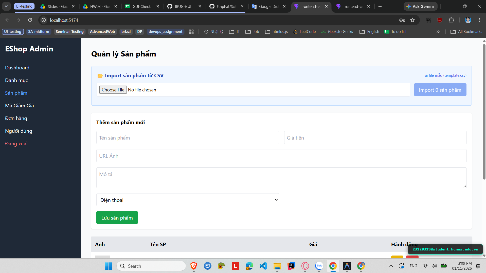

# [BUG-GUI-27][IA-02] Form Thêm sản phẩm không có ký hiệu đánh dấu trường bắt buộc (*)

| Mục | Nội dung |
|---|---|
| Tính năng | Quản lý Sản phẩm (Product Management) – Admin Dashboard |
| Test case liên quan | `CHK-ADM-10` (Khía cạnh `IA-02` – Biểu mẫu & Form Standards) |
| Mức độ (Severity) | Minor |
| Độ ưu tiên (Priority) | Medium |
| Khả năng tái hiện | Luôn luôn (100%) |
| Môi trường | Windows 11, Google Chrome, Frontend Admin Vite `http://localhost:5174/`, Backend Express `http://localhost:5000/api` |
| Ngày phát hiện | 2026-11-01 |
| GitHub Issue | *Đang cập nhật* |

## Điều kiện tiên quyết
- Backend API và Frontend Admin của EShop SUT đang hoạt động bình thường.
- Đã đăng nhập vào trang Quản trị Admin và đang ở tab "Sản phẩm" (`http://localhost:5174/`).

## Các bước tái hiện
1. Khởi động hệ thống EShop SUT và truy cập vào trang Quản trị Admin tại `http://localhost:5174/`.
2. Trên thanh điều hướng bên trái (Sidebar), bấm chọn mục **"Sản phẩm"**.
3. Quan sát biểu mẫu "Thêm sản phẩm mới" (hoặc "Sửa sản phẩm").
4. Kiểm tra các nhãn (label) và trường nhập liệu: "Tên sản phẩm", "Giá tiền", "URL Ảnh", "Mô tả", "Danh mục".

## Request / Response thực tế
*(Lỗi hiển thị giao diện người dùng - Phía Client không hiển thị ký hiệu trực quan)*

## Kết quả mong đợi
Các trường thông tin bắt buộc trong biểu mẫu (như Tên sản phẩm, Giá tiền, Danh mục) phải có ký hiệu đánh dấu trực quan rõ ràng như dấu sao đỏ `(*)` hoặc ghi chú "Bắt buộc", giúp người quản trị phân biệt ngay với các trường tùy chọn (Mô tả, URL Ảnh) trước khi bấm "Lưu sản phẩm". — nguồn: [SPEC] / [ASSUMED] (Tiêu chuẩn thiết kế biểu mẫu UI/UX)

## Kết quả thực tế
Form "Thêm sản phẩm mới" hiển thị các ô input trần với placeholder mà không có bất kỳ nhãn `<label>` hoặc dấu sao đỏ `(*)` nào để phân biệt trường bắt buộc và trường tùy chọn. Người dùng không biết trường nào là bắt buộc cho đến khi submit thử và bị trình duyệt chặn.

## Bằng chứng
- `evidence/screenshots/gui/BUG-GUI-02-no-highlight-required-field.png` (Ảnh chụp màn hình thực tế có watermark sinh viên `23120319@student.hcmus.edu.vn`)



## Phân tích nguyên nhân (giả thuyết, nếu thấy trong code)
`frontend-admin/src/App.jsx:L483-544` (đã xác nhận trực tiếp từ mã nguồn SUT):
- Biểu mẫu chỉ render các thẻ `<input>` trực tiếp trong lưới `grid grid-cols-2 gap-4` mà không bọc trong các `<label>` có chỉ dẫn trường bắt buộc:
  ```jsx
  <div className="grid grid-cols-2 gap-4">
    <input placeholder="Tên sản phẩm" ... required />
    <input placeholder="Giá tiền" type="number" ... />
    <input placeholder="URL Ảnh" ... />
    <textarea placeholder="Mô tả" ... />
    <select ...>...</select>
  </div>
  ```

## Phát hiện bởi
Test case do AI thiết kế kết hợp thực thi kiểm thử thủ công bởi sinh viên Trương Thành Phát ([CHK-ADM-10](../checklist.md#L29)).
