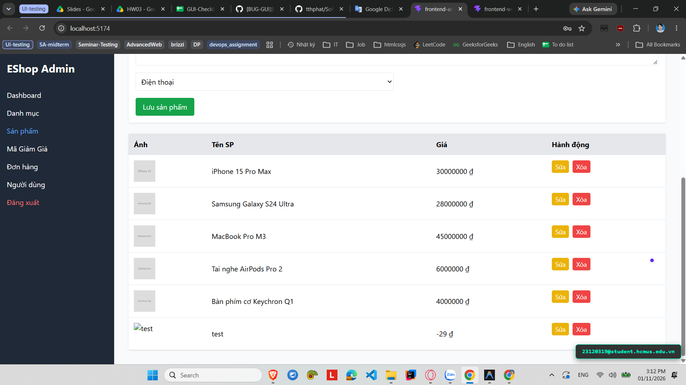

# [BUG-GUI-28][IA-02] Form Thêm sản phẩm không chặn nhập giá tiền số âm hoặc bằng 0

| Mục | Nội dung |
|---|---|
| Tính năng | Quản lý Sản phẩm (Product Management) – Admin Dashboard |
| Test case liên quan | `CHK-ADM-11` (Khía cạnh `IA-02` – Biểu mẫu & Form Validation) |
| Mức độ (Severity) | Major |
| Độ ưu tiên (Priority) | High |
| Khả năng tái hiện | Luôn luôn (100%) |
| Môi trường | Windows 11, Google Chrome, Frontend Admin Vite `http://localhost:5174/`, Backend Express `http://localhost:5000/api` |
| Ngày phát hiện | 2026-11-01 |
| GitHub Issue | *Đang cập nhật* |

## Điều kiện tiên quyết
- Backend API và Frontend Admin của EShop SUT đang hoạt động bình thường.
- Đã đăng nhập vào trang Quản trị Admin và đang ở tab "Sản phẩm" (`http://localhost:5174/`).

## Các bước tái hiện
1. Truy cập vào trang Quản trị Admin tại `http://localhost:5174/`, chọn tab **"Sản phẩm"**.
2. Nhập tên sản phẩm: "Sản phẩm thử nghiệm giá âm".
3. Nhập vào ô "Giá tiền" giá trị âm (ví dụ: `-50000`) hoặc `0`.
4. Bấm nút **"Lưu sản phẩm"**.

## Request / Response thực tế
```http
POST /api/products HTTP/1.1
Host: localhost:5000
Content-Type: application/json

{
  "name": "Sản phẩm thử nghiệm giá âm",
  "price": "-50000",
  "description": "",
  "imageUrl": "",
  "category_id": 1
}

HTTP/1.1 200 OK
Content-Type: application/json; charset=utf-8

{
  "id": 12,
  "name": "Sản phẩm thử nghiệm giá âm",
  "price": -50000,
  "category_id": 1
}
```

## Kết quả mong đợi
Ô nhập liệu Giá tiền phải có cơ chế validation chặn nhập số âm hoặc số 0 (sử dụng thuộc tính `min="1"` hoặc `min="1000"` trên thẻ input, và kiểm tra `if (price <= 0)` phía client). Hệ thống phải hiển thị thông báo lỗi yêu cầu giá sản phẩm phải là số dương lớn hơn 0. — nguồn: [SPEC] / [ASSUMED] (Quy tắc toàn vẹn nghiệp vụ thương mại điện tử)

## Kết quả thực tế
Form không có ràng buộc `min` trên thẻ input và không kiểm tra giá trị âm trong hàm submit. Hệ thống gửi request lên backend và tạo thành công sản phẩm có giá `-50.000 ₫`, hiển thị giá âm trên bảng quản trị và làm sai lệch nghiêm trọng nghiệp vụ bán hàng.

## Bằng chứng
- `evidence/screenshots/gui/BUG-GUI-03-no-prevent-negative-money.png` (Ảnh chụp màn hình thực tế có watermark sinh viên `23120319@student.hcmus.edu.vn`)



## Phân tích nguyên nhân (giả thuyết, nếu thấy trong code)
`frontend-admin/src/App.jsx:L500-508` và `L105-131` (đã xác nhận trực tiếp từ mã nguồn SUT):
- Thẻ input giá tiền thiếu thuộc tính HTML5 `min="1"` hoặc `min="1000"`:
  ```jsx
  <input
    placeholder="Giá tiền"
    type="number"
    className="border p-2 rounded"
    value={productForm.price}
    onChange={(e) =>
      setProductForm({ ...productForm, price: e.target.value })
    }
  />
  ```
- Hàm `handleProductSubmit` không có lệnh kiểm tra `if (Number(productForm.price) <= 0)`.

## Phát hiện bởi
Test case do AI thiết kế kết hợp thực thi kiểm thử thủ công bởi sinh viên Trương Thành Phát ([CHK-ADM-11](../checklist.md#L30)).
