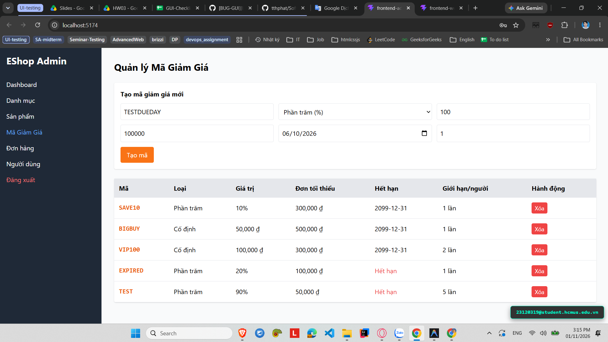

# [BUG-GUI-29][IA-02] Form Coupon cho phép chọn ngày hết hạn trong quá khứ

| Mục | Nội dung |
|---|---|
| Tính năng | Quản lý Mã giảm giá (Coupon Management) – Admin Dashboard |
| Test case liên quan | `CHK-ADM-12` (Khía cạnh `IA-02` – Biểu mẫu & Form Validation) |
| Mức độ (Severity) | Major |
| Độ ưu tiên (Priority) | High |
| Khả năng tái hiện | Luôn luôn (100%) |
| Môi trường | Windows 11, Google Chrome, Frontend Admin Vite `http://localhost:5174/`, Backend Express `http://localhost:5000/api` |
| Ngày phát hiện | 2026-11-01 |
| GitHub Issue | *Đang cập nhật* |

## Điều kiện tiên quyết
- Backend API và Frontend Admin của EShop SUT đang hoạt động bình thường.
- Đã đăng nhập vào trang Quản trị Admin và đang ở tab "Mã giảm giá" (`http://localhost:5174/`).

## Các bước tái hiện
1. Truy cập vào trang Quản trị Admin tại `http://localhost:5174/`, chọn tab **"Mã giảm giá"**.
2. Nhập mã coupon: `PASTDATE10`, chọn loại phần trăm, giá trị `10`.
3. Tại ô chọn Ngày hết hạn (`type="date"`), chọn một ngày trong quá khứ (ví dụ: ngày hôm qua hoặc năm trước).
4. Bấm nút **"Tạo mã"**.

## Request / Response thực tế
```http
POST /api/admin/coupons HTTP/1.1
Host: localhost:5000
Content-Type: application/json

{
  "code": "PASTDATE10",
  "type": "percent",
  "discount_value": "10",
  "min_order_amount": 0,
  "expired_at": "2026-10-20",
  "max_uses_per_user": 1
}

HTTP/1.1 200 OK
Content-Type: application/json; charset=utf-8

{
  "id": 8,
  "code": "PASTDATE10",
  "expired_at": "2026-10-20"
}
```

## Kết quả mong đợi
Trường chọn ngày hết hạn (`type="date"`) phải có thuộc tính `min` giới hạn từ ngày hiện tại (`min={new Date().toISOString().split('T')[0]}`) hoặc có validation chặn submit nếu ngày được chọn nhỏ hơn ngày hôm nay. Tránh việc tạo ra mã coupon đã hết hạn ngay từ thời điểm tạo. — nguồn: [SPEC] / [ASSUMED] (Quy tắc kiểm soát biểu mẫu nghiệp vụ)

## Kết quả thực tế
Form không có ràng buộc `min` trên thẻ input date; hệ thống cho phép chọn ngày quá khứ tự do và gửi API tạo thành công mã giảm giá đã hết hạn, gây rác dữ liệu và nhầm lẫn khi người dùng sử dụng.

## Bằng chứng
- `evidence/screenshots/gui/BUG-GUI-04-no-prevent-coupon-passed-day.png` (Ảnh chụp màn hình thực tế có watermark sinh viên `23120319@student.hcmus.edu.vn`)



## Phân tích nguyên nhân (giả thuyết, nếu thấy trong code)
`frontend-admin/src/App.jsx:L688-697` (đã xác nhận trực tiếp từ mã nguồn SUT):
- Thẻ input ngày hết hạn hoàn toàn thiếu thuộc tính `min`:
  ```jsx
  <input
    placeholder="Ngày hết hạn"
    type="date"
    className="border p-2 rounded"
    value={couponForm.expired_at}
    onChange={(e) =>
      setCouponForm({ ...couponForm, expired_at: e.target.value })
    }
    required
  />
  ```

## Phát hiện bởi
Test case do AI thiết kế kết hợp thực thi kiểm thử thủ công bởi sinh viên Trương Thành Phát ([CHK-ADM-12](../checklist.md#L31)).
