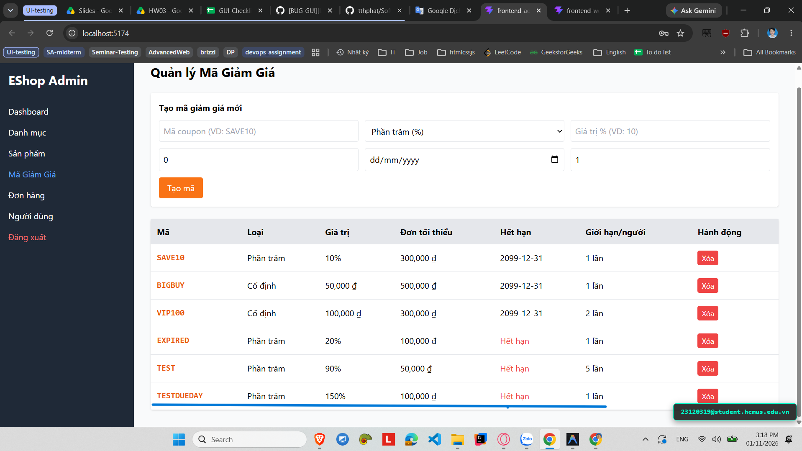

# [BUG-GUI-30][IA-02] Form Coupon cho phép nhập tỷ lệ giảm giá phần trăm vượt quá 100%

| Mục | Nội dung |
|---|---|
| Tính năng | Quản lý Mã giảm giá (Coupon Management) – Admin Dashboard |
| Test case liên quan | `CHK-ADM-13` (Khía cạnh `IA-02` – Biểu mẫu & Form Validation) |
| Mức độ (Severity) | Major |
| Độ ưu tiên (Priority) | High |
| Khả năng tái hiện | Luôn luôn (100%) |
| Môi trường | Windows 11, Google Chrome, Frontend Admin Vite `http://localhost:5174/`, Backend Express `http://localhost:5000/api` |
| Ngày phát hiện | 2026-11-01 |
| GitHub Issue | *Đang cập nhật* |

## Điều kiện tiên quyết
- Backend API và Frontend Admin của EShop SUT đang hoạt động bình thường.
- Đã đăng nhập vào trang Quản trị Admin và đang ở tab "Mã giảm giá" (`http://localhost:5174/`).

## Các bước tái hiện
1. Truy cập vào trang Quản trị Admin tại `http://localhost:5174/`, chọn tab **"Mã giảm giá"**.
2. Nhập mã coupon: `DISCOUNT150`.
3. Chọn loại: "Phần trăm (%)".
4. Tại ô Giá trị %, nhập con số `150` (hoặc `200`).
5. Chọn ngày hết hạn hợp lệ và bấm nút **"Tạo mã"**.

## Request / Response thực tế
```http
POST /api/admin/coupons HTTP/1.1
Host: localhost:5000
Content-Type: application/json

{
  "code": "DISCOUNT150",
  "type": "percent",
  "discount_value": "150",
  "min_order_amount": 0,
  "expired_at": "2026-12-31",
  "max_uses_per_user": 1
}

HTTP/1.1 200 OK
Content-Type: application/json; charset=utf-8

{
  "id": 9,
  "code": "DISCOUNT150",
  "type": "percent",
  "discount_value": 150
}
```

## Kết quả mong đợi
Khi loại giảm giá là "Phần trăm (%)", hệ thống phải ràng buộc giá trị nhập vào nằm trong khoảng từ `1%` đến `100%` (sử dụng thuộc tính `min="1"` và `max="100"` trên thẻ input, kèm validation kiểm tra phía client). Ngăn chặn tạo coupon giảm quá 100% dẫn đến sai lệch tính toán âm tiền đơn hàng. — nguồn: [SPEC] / [ASSUMED] (Quy tắc logic nghiệp vụ tài chính)

## Kết quả thực tế
Form không có ràng buộc `max="100"` khi chọn loại phần trăm. Người dùng nhập `150%` hoặc bất kỳ con số nào lớn hơn 100 đều được hệ thống chấp nhận và lưu vào cơ sở dữ liệu.

## Bằng chứng
- `evidence/screenshots/gui/BUG-GUI-05-coupon-percent-higher-than-100.png` (Ảnh chụp màn hình thực tế có watermark sinh viên `23120319@student.hcmus.edu.vn`)



## Phân tích nguyên nhân (giả thuyết, nếu thấy trong code)
`frontend-admin/src/App.jsx:L659-675` (đã xác nhận trực tiếp từ mã nguồn SUT):
- Ô input giá trị phần trăm không hề có thuộc tính `min` và `max`:
  ```jsx
  <input
    placeholder={
      couponForm.type === "percent"
        ? "Giá trị % (VD: 10)"
        : "Số tiền (VD: 50000)"
    }
    type="number"
    className="border p-2 rounded"
    value={couponForm.discount_value}
    onChange={(e) =>
      setCouponForm({
        ...couponForm,
        discount_value: e.target.value,
      })
    }
    required
  />
  ```

## Phát hiện bởi
Test case do AI thiết kế kết hợp thực thi kiểm thử thủ công bởi sinh viên Trương Thành Phát ([CHK-ADM-13](../checklist.md#L32)).
