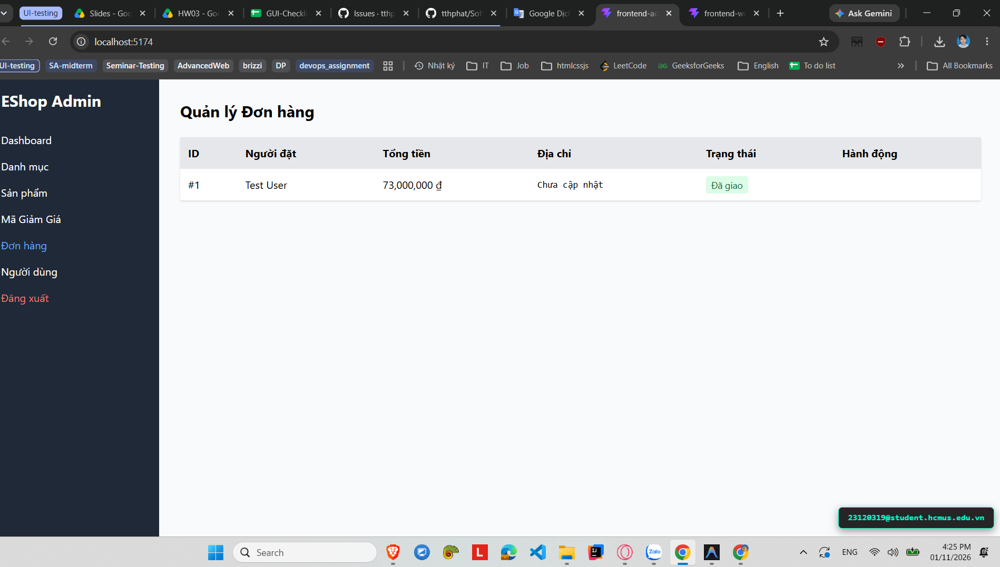
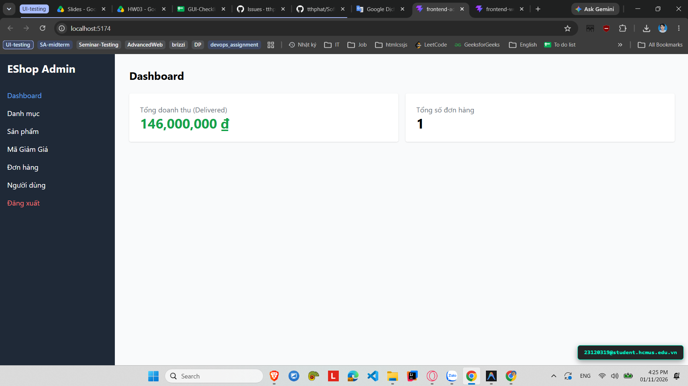

# [BUG-GUI-31][IA-04] Dashboard Admin hiển thị nhân đôi tổng doanh thu (x2 Revenue Bug)

| Mục | Nội dung |
|---|---|
| Tính năng | Thống kê Báo cáo (Dashboard KPI) – Admin Dashboard |
| Test case liên quan | `CHK-ADM-18` (Khía cạnh `IA-04` – Phản hồi & Trạng thái / Dữ liệu KPI) |
| Mức độ (Severity) | Major |
| Độ ưu tiên (Priority) | High |
| Khả năng tái hiện | Luôn luôn (100%) |
| Môi trường | Windows 11, Google Chrome, Frontend Admin Vite `http://localhost:5174/`, Backend Express `http://localhost:5000/api` |
| Ngày phát hiện | 2026-11-01 |
| GitHub Issue | *Đang cập nhật* |

## Điều kiện tiên quyết
- Backend API và Frontend Admin của EShop SUT đang hoạt động bình thường.
- Có ít nhất một đơn hàng với trạng thái `delivered` trong cơ sở dữ liệu (ví dụ: đơn hàng trị giá 200.000 ₫).

## Các bước tái hiện
1. Đăng nhập vào trang Quản trị Admin tại `http://localhost:5174/`.
2. Truy cập tab **"Đơn hàng"**, kiểm tra danh sách đơn hàng có trạng thái "delivered" và tính tổng tiền thực tế của các đơn này.
3. Chuyển sang tab **"Dashboard"**.
4. Quan sát số liệu hiển thị trên thẻ KPI **"Tổng doanh thu (Delivered)"**.

## Request / Response thực tế
*(Lỗi tính toán logic tổng hợp trên Frontend)*

## Kết quả mong đợi
Thẻ KPI "Tổng doanh thu (Delivered)" phải phản ánh chính xác 100% tổng giá trị (`total_amount`) của các đơn hàng có trạng thái `delivered`, không được nhân hệ số hay cộng thừa số liệu. — nguồn: [SPEC] / [ASSUMED] (Tiêu chuẩn hiển thị dữ liệu KPI trung thực)

## Kết quả thực tế
Thẻ KPI "Tổng doanh thu (Delivered)" luôn hiển thị số tiền gấp đôi (x2) so với tổng tiền thực tế của các đơn hàng delivered (ví dụ: tổng đơn hàng thực tế là 200.000 ₫ thì KPI hiển thị thành 400.000 ₫).

## Bằng chứng
- `evidence/screenshots/gui/BUG-GUI-06-revenue-double-p1.png` (Ảnh chụp thẻ Dashboard hiển thị doanh thu nhân đôi)
- `evidence/screenshots/gui/BUG-GUI-06-revenue-double-p2.png` (Ảnh chụp danh sách đơn hàng thực tế đối chiếu số tiền)




## Phân tích nguyên nhân (giả thuyết, nếu thấy trong code)
`frontend-admin/src/App.jsx:L217-220` (đã xác nhận trực tiếp từ mã nguồn SUT):
- Hàm tính toán doanh thu cố tình nhân `* 2` giá trị của từng đơn hàng delivered:
  ```javascript
  const totalRevenue = orders.reduce((sum, o) => {
    if (o.status === "delivered") return sum + o.total_amount * 2;
    return sum;
  }, 0);
  ```

## Phát hiện bởi
Test case do AI thiết kế kết hợp thực thi kiểm thử thủ công bởi sinh viên Trương Thành Phát ([CHK-ADM-18](../checklist.md#L37)).
