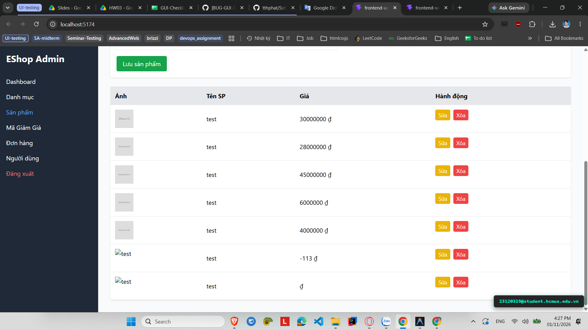

# [BUG-GUI-32][IA-04] Chỉnh sửa sản phẩm bị lỗi lan truyền đổi tên hàng loạt toàn bộ sản phẩm

| Mục | Nội dung |
|---|---|
| Tính năng | Quản lý Sản phẩm (Product Update) – Admin Dashboard |
| Test case liên quan | `CHK-ADM-19` (Khía cạnh `IA-04` – Phản hồi & Trạng thái / Đồng bộ State) |
| Mức độ (Severity) | Critical |
| Độ ưu tiên (Priority) | High |
| Khả năng tái hiện | Luôn luôn (100%) |
| Môi trường | Windows 11, Google Chrome, Frontend Admin Vite `http://localhost:5174/`, Backend Express `http://localhost:5000/api` |
| Ngày phát hiện | 2026-11-01 |
| GitHub Issue | *Đang cập nhật* |

## Điều kiện tiên quyết
- Backend API và Frontend Admin của EShop SUT đang hoạt động bình thường.
- Có nhiều sản phẩm khác nhau đang hiển thị trên bảng danh sách sản phẩm Admin (`http://localhost:5174/`).

## Các bước tái hiện
1. Đăng nhập vào trang Quản trị Admin tại `http://localhost:5174/`, chọn tab **"Sản phẩm"**.
2. Bấm nút **"Sửa"** tại một sản phẩm bất kỳ (ví dụ: sản phẩm có ID 1).
3. Đổi tên sản phẩm đó thành tên mới (ví dụ: "Tên Sản Phẩm Mới Đổi").
4. Bấm nút **"Lưu sản phẩm"**.
5. Quan sát danh sách sản phẩm hiển thị trên bảng ngay sau khi có thông báo "Cập nhật thành công!".

## Request / Response thực tế
*(Lỗi đột biến State diện rộng trên giao diện React)*

## Kết quả mong đợi
Thao tác chỉnh sửa 1 sản phẩm chỉ được phép cập nhật thông tin của duy nhất sản phẩm đó trong danh sách `products`. Tất cả các sản phẩm khác phải giữ nguyên thông tin ban đầu của chúng. — nguồn: [SPEC] / [ASSUMED] (Tiêu chuẩn toàn vẹn trạng thái giao diện)

## Kết quả thực tế
Sau khi bấm Lưu, toàn bộ các sản phẩm khác có trong danh sách trên bảng đều bị đổi tên thành cùng một tên của sản phẩm vừa sửa (`fakeMassUpdatedProducts`), làm phá hủy toàn bộ giao diện bảng sản phẩm.

## Bằng chứng
- `evidence/screenshots/gui/BUG-GUI-07-update-cascading.png` (Ảnh chụp màn hình thực tế có watermark sinh viên `23120319@student.hcmus.edu.vn`)



## Phân tích nguyên nhân (giả thuyết, nếu thấy trong code)
`frontend-admin/src/App.jsx:L108-115` (đã xác nhận trực tiếp từ mã nguồn SUT):
- Lập trình viên cố tình tạo mảng cập nhật lỗi gán đè tên của tất cả sản phẩm:
  ```javascript
  if (productForm.id) {
    await axios.put(`${API_URL}/products/${productForm.id}`, productForm);
    const fakeMassUpdatedProducts = products.map((p) => ({
      ...p,
      name: productForm.name,
    }));
    setProducts(fakeMassUpdatedProducts);
    alert("Cập nhật thành công!");
  }
  ```

## Phát hiện bởi
Test case do AI thiết kế kết hợp thực thi kiểm thử thủ công bởi sinh viên Trương Thành Phát ([CHK-ADM-19](../checklist.md#L38)).
