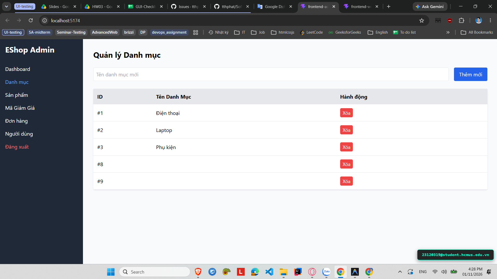

# [BUG-GUI-33][IA-04] Thao tác Xóa không hiển thị hộp thoại xác nhận trước khi xóa dữ liệu

| Mục | Nội dung |
|---|---|
| Tính năng | Thao tác Xóa (Delete Safety Action) – Admin Dashboard |
| Test case liên quan | `CHK-ADM-20` (Khía cạnh `IA-04` – Phản hồi & Trạng thái / An toàn Thao tác) |
| Mức độ (Severity) | Major |
| Độ ưu tiên (Priority) | High |
| Khả năng tái hiện | Luôn luôn (100%) |
| Môi trường | Windows 11, Google Chrome, Frontend Admin Vite `http://localhost:5174/`, Backend Express `http://localhost:5000/api` |
| Ngày phát hiện | 2026-11-01 |
| GitHub Issue | *Đang cập nhật* |

## Điều kiện tiên quyết
- Backend API và Frontend Admin của EShop SUT đang hoạt động bình thường.
- Đang ở tab "Danh mục", "Sản phẩm" hoặc "Mã giảm giá" có các mục dữ liệu tồn tại.

## Các bước tái hiện
1. Đăng nhập vào trang Quản trị Admin tại `http://localhost:5174/`.
2. Vào bất kỳ tab nào có nút Xóa (ví dụ: tab "Danh mục" hoặc tab "Sản phẩm").
3. Bấm vào nút màu đỏ **"Xóa"** tại một hàng bất kỳ.

## Request / Response thực tế
```http
DELETE /api/categories/5 HTTP/1.1
Host: localhost:5000

HTTP/1.1 200 OK
```

## Kết quả mong đợi
Thao tác xóa là thao tác nguy hiểm và không thể hoàn tác (destructive action). Hệ thống phải hiển thị hộp thoại xác nhận (Confirmation Dialog / `window.confirm("Bạn có chắc chắn muốn xóa không?")`) trước khi gửi request xóa vĩnh viễn dữ liệu. — nguồn: [SPEC] / [ASSUMED] (Tiêu chuẩn bảo vệ người dùng khỏi thao tác vô ý - Nielsen Usability Heuristic #5: Error Prevention)

## Kết quả thực tế
Hệ thống không hiển thị bất kỳ hộp thoại xác nhận nào; khi bấm nút "Xóa", API DELETE được kích hoạt ngay lập tức và dữ liệu bị xóa cứng khỏi hệ thống mà không có cơ hội hủy bỏ.

## Bằng chứng
- `evidence/screenshots/gui/BUG-GUI-08-no-confirm-before-delete.png` (Ảnh chụp màn hình thực tế có watermark sinh viên `23120319@student.hcmus.edu.vn`)



## Phân tích nguyên nhân (giả thuyết, nếu thấy trong code)
`frontend-admin/src/App.jsx:L133-140` và `L153-160` (đã xác nhận trực tiếp từ mã nguồn SUT):
- Các hàm xóa gọi trực tiếp `axios.delete` mà không gọi `window.confirm`:
  ```javascript
  const deleteProduct = async (id) => {
    try {
      await axios.delete(`${API_URL}/products/${id}`);
      fetchData();
    } catch (err) {
      alert("Lỗi xóa SP: " + err.message);
    }
  };
  ```

## Phát hiện bởi
Test case do AI thiết kế kết hợp thực thi kiểm thử thủ công bởi sinh viên Trương Thành Phát ([CHK-ADM-20](../checklist.md#L39)).
