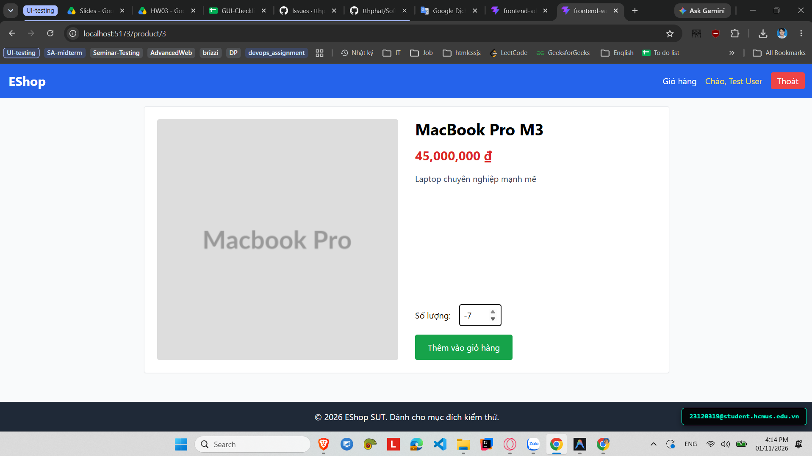

# [BUG-GUI-34][IA-02] Trang Chi tiết sản phẩm không chặn nhập số lượng âm hoặc bằng 0

| Mục | Nội dung |
|---|---|
| Tính năng | Chi tiết Sản phẩm & Thêm vào giỏ hàng – Customer Web |
| Test case liên quan | `CHK-WEB-07` (Khía cạnh `IA-02` – Biểu mẫu & Form Validation) |
| Mức độ (Severity) | Major |
| Độ ưu tiên (Priority) | High |
| Khả năng tái hiện | Luôn luôn (100%) |
| Môi trường | Windows 11, Google Chrome, Frontend Customer Web `http://localhost:5173/`, Backend Express `http://localhost:5000/api` |
| Ngày phát hiện | 2026-11-01 |
| GitHub Issue | [#84](https://github.com/tthphat/eshop-sut/issues/84) |

## Điều kiện tiên quyết
- Backend API và Frontend Customer Web của EShop SUT đang hoạt động bình thường.
- Đang mở trang Chi tiết sản phẩm bất kỳ tại `http://localhost:5173/product/:id`.

## Các bước tái hiện
1. Truy cập vào trang Web Khách hàng tại `http://localhost:5173/`.
2. Bấm vào một sản phẩm để vào trang Chi tiết sản phẩm.
3. Tại ô nhập liệu **"Số lượng:"**, xóa số 1 và gõ vào số âm (ví dụ: `-5`) hoặc số `0`.
4. Bấm nút **"Thêm vào giỏ hàng"**.

## Request / Response thực tế
*(Dữ liệu giỏ hàng phía Client lưu state với số lượng âm)*
```json
{
  "id": 1,
  "name": "Giày Sneaker Nam",
  "price": 350000,
  "quantity": -5
}
```

## Kết quả mong đợi
Ô nhập liệu số lượng bắt buộc phải ràng buộc chỉ nhận số nguyên dương $\ge 1$ (sử dụng thuộc tính HTML5 `min="1"`, `step="1"` và kiểm tra validation `parseInt(quantity) >= 1` trước khi thêm vào giỏ). Khi người dùng nhập số âm hoặc số 0, hệ thống phải tự động điều chỉnh về 1 hoặc hiển thị thông báo lỗi. — nguồn: [SPEC] / [ASSUMED] (Quy tắc nghiệp vụ giỏ hàng)

## Kết quả thực tế
Thẻ `<input type="number">` không có thuộc tính `min="1"` và hàm xử lý `handleAddToCart` không có lệnh kiểm tra biên số lượng. Hệ thống chấp nhận giá trị âm và thêm mặt hàng với số lượng `-5` vào giỏ hàng, làm trừ tiền và làm sai lệch nghiêm trọng tính toán tổng tiền thanh toán.

## Bằng chứng
- `evidence/screenshots/gui/BUG-GUI-09-no-prevent-negative-quantity-product.png` (Ảnh chụp màn hình thực tế có watermark sinh viên `23120319@student.hcmus.edu.vn`)



## Phân tích nguyên nhân (giả thuyết, nếu thấy trong code)
`frontend-web/src/pages/ProductDetail.jsx:L56-66` (đã xác nhận trực tiếp từ mã nguồn SUT):
- Thẻ input không có thuộc tính `min="1"`:
  ```jsx
  <input
    type="number"
    value={quantity}
    onChange={(e) => setQuantity(e.target.value)}
    className="border p-2 w-20 rounded"
  />
  ```
- Hàm `handleAddToCart` gọi trực tiếp `addToCart(product, parseInt(quantity))` mà không kiểm tra tính hợp lệ của `quantity`.

## Phát hiện bởi
Test case do AI thiết kế kết hợp thực thi kiểm thử thủ công bởi sinh viên Trương Thành Phát ([CHK-WEB-07](../checklist.md#L46)).
