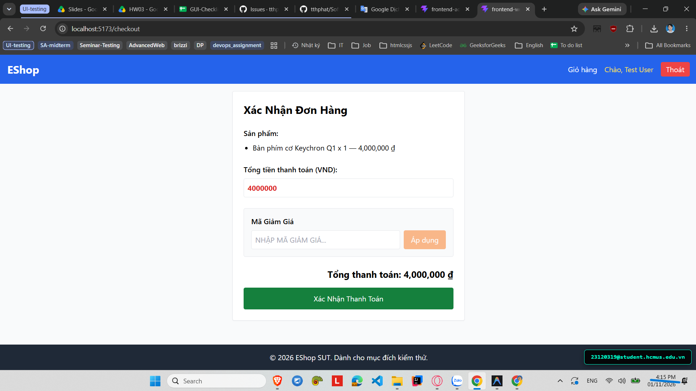
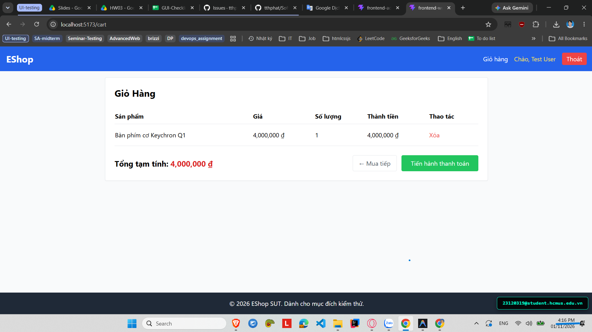

# [BUG-GUI-35][IA-04] Giỏ hàng không được làm trống sau khi hoàn tất đặt hàng thành công

| Mục | Nội dung |
|---|---|
| Tính năng | Quy trình Thanh toán (Checkout) – Customer Web |
| Test case liên quan | `CHK-WEB-08` (Khía cạnh `IA-04` – Phản hồi & Trạng thái / Đồng bộ Giỏ hàng) |
| Mức độ (Severity) | Major |
| Độ ưu tiên (Priority) | High |
| Khả năng tái hiện | Luôn luôn (100%) |
| Môi trường | Windows 11, Google Chrome, Frontend Customer Web `http://localhost:5173/`, Backend Express `http://localhost:5000/api` |
| Ngày phát hiện | 2026-11-01 |
| GitHub Issue | [#85](https://github.com/tthphat/eshop-sut/issues/85) |

## Điều kiện tiên quyết
- Đã đăng nhập tài khoản khách hàng trên `http://localhost:5173/`.
- Giỏ hàng có ít nhất một mặt hàng hợp lệ và đang ở trang Thanh toán (`/checkout`).

## Các bước tái hiện
1. Tiến hành thanh toán đơn hàng tại trang `http://localhost:5173/checkout`.
2. Bấm nút **"Xác Nhận Thanh Toán"**.
3. Màn hình hiển thị thông báo "Thanh toán thành công! Cảm ơn bạn đã mua sắm tại EShop."
4. Bấm link "Quay lại trang chủ" hoặc quan sát biểu tượng Giỏ hàng trên thanh Header.
5. Truy cập lại trang Giỏ hàng (`/cart`).

## Request / Response thực tế
API `POST /api/checkout` trả về HTTP 200 OK thành công, tuy nhiên local state giỏ hàng (`cart` trong `CartContext`) không được reset.

## Kết quả mong đợi
Sau khi đơn hàng được tạo và lưu thành công trên máy chủ, hệ thống phải tự động dọn sạch giỏ hàng (gọi hàm `clearCart()` để xóa state và xóa localStorage). Biểu tượng giỏ hàng trên thanh Header phải hiển thị badge 0 và trang Giỏ hàng chuyển về trạng thái "Giỏ hàng của bạn đang trống". — nguồn: [SPEC] / [ASSUMED] (Tiêu chuẩn trải nghiệm mua sắm E-commerce)

## Kết quả thực tế
Hệ thống không hề kích hoạt dọn dẹp giỏ hàng; sau khi thông báo thanh toán thành công, toàn bộ các mặt hàng vừa mua vẫn còn nguyên vẹn trong giỏ hàng và badge giỏ hàng trên Header vẫn giữ nguyên số lượng cũ, dẫn đến nguy cơ khách hàng bấm thanh toán trùng lặp đơn hàng.

## Bằng chứng
- `evidence/screenshots/gui/BUG-GUI-10-no-clear-cart-after-checkout-p1.png` (Màn hình thông báo thanh toán thành công)
- `evidence/screenshots/gui/BUG-GUI-10-no-clear-cart-after-checkout-p2.png` (Màn hình trang chủ và giỏ hàng vẫn còn nguyên sản phẩm sau khi đã thanh toán)




## Phân tích nguyên nhân (giả thuyết, nếu thấy trong code)
`frontend-web/src/pages/Checkout.jsx:L8` và `L40-66` (đã xác nhận trực tiếp từ mã nguồn SUT):
- Tại dòng 8, component import `clearCart` từ hook `useCart()`:
  ```jsx
  const { cart, cartTotal, clearCart } = useCart();
  ```
- Tuy nhiên trong hàm `handleCheckout` (dòng 40-66), sau khi gọi API thanh toán thành công và set `setSuccess(true)`, lập trình viên hoàn toàn quên gọi lệnh `clearCart()`!

## Phát hiện bởi
Test case do AI thiết kế kết hợp thực thi kiểm thử thủ công bởi sinh viên Trương Thành Phát ([CHK-WEB-08](../checklist.md#L47)).
