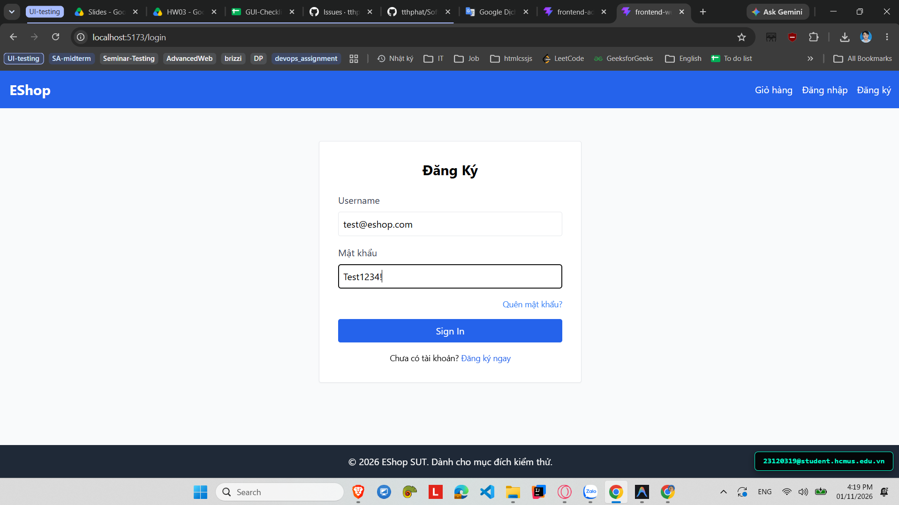

# [BUG-GUI-36][IA-02] Ô nhập Mật khẩu trên trang Đăng nhập hiển thị dạng văn bản thô (type="text")

| Mục | Nội dung |
|---|---|
| Tính năng | Đăng nhập tài khoản (Authentication) – Customer Web |
| Test case liên quan | `CHK-WEB-10` (Khía cạnh `IA-02` – Biểu mẫu & Bảo mật Nhập liệu) |
| Mức độ (Severity) | Major |
| Độ ưu tiên (Priority) | High |
| Khả năng tái hiện | Luôn luôn (100%) |
| Môi trường | Windows 11, Google Chrome, Frontend Customer Web `http://localhost:5173/`, Backend Express `http://localhost:5000/api` |
| Ngày phát hiện | 2026-11-01 |
| GitHub Issue | [#86](https://github.com/tthphat/eshop-sut/issues/86) |

## Điều kiện tiên quyết
- Frontend Customer Web đang chạy tại `http://localhost:5173/`.
- Mở trang Đăng nhập tại `http://localhost:5173/login`.

## Các bước tái hiện
1. Truy cập vào trang Đăng nhập `http://localhost:5173/login`.
2. Bấm vào ô nhập liệu **"Mật khẩu"**.
3. Nhập mật khẩu bất kỳ (ví dụ: `SecretPassword123!`).
4. Quan sát các ký tự đang hiển thị trên màn hình.

## Request / Response thực tế
*(Lỗi cấu hình kiểu phần tử form HTML - Client UI)*

## Kết quả mong đợi
Ô nhập mật khẩu bắt buộc phải có thuộc tính `type="password"` để che giấu các ký tự người dùng gõ bằng các dấu chấm tròn `••••••` hoặc hoa thị `******`, bảo vệ người dùng khỏi nguy cơ bị nhìn trộm mật khẩu (shoulder surfing). — nguồn: [SPEC] / [ASSUMED] (Tiêu chuẩn bảo mật biểu mẫu OWASP / WCAG)

## Kết quả thực tế
Thẻ `<input>` cho mật khẩu được cấu hình nhầm thành `type="text"`. Khi người dùng gõ mật khẩu, toàn bộ chuỗi ký tự hiển thị rõ ràng dưới dạng văn bản thô (plain text) trên màn hình.

## Bằng chứng
- `evidence/screenshots/gui/BUG-GUI-11-no-hide-password.png` (Ảnh chụp màn hình thực tế có watermark sinh viên `23120319@student.hcmus.edu.vn`)



## Phân tích nguyên nhân (giả thuyết, nếu thấy trong code)
`frontend-web/src/pages/Login.jsx:L38-46` (đã xác nhận trực tiếp từ mã nguồn SUT):
- Ô nhập mật khẩu khai báo sai loại input:
  ```jsx
  <div>
    <label className="block text-gray-700 mb-2">Mật khẩu</label>
    <input
      type="text"
      value={password}
      onChange={(e) => setPassword(e.target.value)}
      className="w-full border p-2 rounded"
      required
    />
  </div>
  ```

## Phát hiện bởi
Test case do AI thiết kế kết hợp thực thi kiểm thử thủ công bởi sinh viên Trương Thành Phát ([CHK-WEB-10](../checklist.md#L49)).
