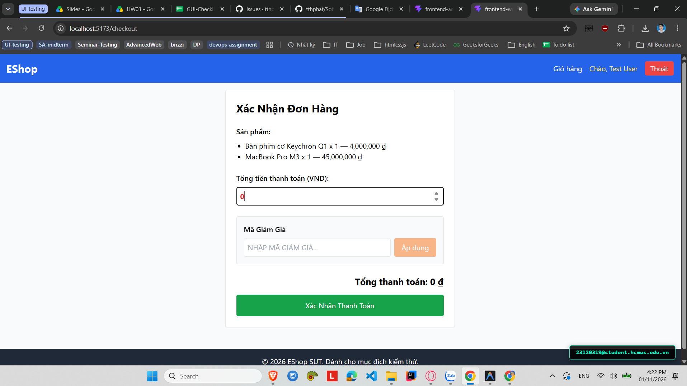

# [BUG-GUI-37][IA-02] Trang Thanh toán cho phép người dùng tự ý chỉnh sửa tổng tiền đơn hàng (Editable Total)

| Mục | Nội dung |
|---|---|
| Tính năng | Xác nhận Đơn hàng & Thanh toán (Checkout) – Customer Web |
| Test case liên quan | `CHK-WEB-15` (Khía cạnh `IA-02` – Biểu mẫu & Chống Gian lận Nghiệp vụ) |
| Mức độ (Severity) | Critical |
| Độ ưu tiên (Priority) | High |
| Khả năng tái hiện | Luôn luôn (100%) |
| Môi trường | Windows 11, Google Chrome, Frontend Customer Web `http://localhost:5173/`, Backend Express `http://localhost:5000/api` |
| Ngày phát hiện | 2026-11-01 |
| GitHub Issue | [#87](https://github.com/tthphat/eshop-sut/issues/87) |

## Điều kiện tiên quyết
- Giỏ hàng có các sản phẩm với tổng giá trị thực tế (ví dụ: 1.050.000 ₫).
- Đang ở trang Xác Nhận Đơn Hàng tại `http://localhost:5173/checkout`.

## Các bước tái hiện
1. Đăng nhập và thêm sản phẩm đắt tiền vào giỏ hàng (tổng tiền 1.050.000 ₫).
2. Chuyển sang trang Thanh toán `http://localhost:5173/checkout`.
3. Bấm vào ô nhập liệu **"Tổng tiền thanh toán (VND):"**.
4. Xóa số tiền gốc và tự gõ vào số tiền tùy ý cực nhỏ (ví dụ: `1000` hoặc `1`).
5. Bấm nút **"Xác Nhận Thanh Toán"**.

## Request / Response thực tế
```http
POST /api/checkout HTTP/1.1
Host: localhost:5000
Content-Type: application/json
Authorization: Bearer <user_token>

{
  "items": [
    { "id": 1, "name": "Giày Sneaker Nam", "price": 350000, "quantity": 3 }
  ],
  "total_amount": 1000,
  "coupon_id": null
}

HTTP/1.1 200 OK
Content-Type: application/json; charset=utf-8

{
  "message": "Order placed successfully",
  "order_id": 15
}
```

## Kết quả mong đợi
Tổng tiền thanh toán là thông tin nhạy cảm và bắt buộc phải là trường chỉ đọc (Read-only / Non-editable) do hệ thống tự tính toán dựa trên danh sách sản phẩm và coupon. Người dùng tuyệt đối không được phép chỉnh sửa số tiền này trên giao diện. — nguồn: [SPEC] / [ASSUMED] (Tiêu chuẩn an toàn thương mại điện tử & chống gian lận)

## Kết quả thực tế
Giao diện thanh toán sử dụng một thẻ `<input type="number">` có state `editableTotal` liên kết trực tiếp với dữ liệu gửi lên máy chủ. Người dùng có thể tự gõ bất kỳ giá trị nào (kể cả 1 ₫) và thanh toán thành công đơn hàng tiền triệu, gây thiệt hại tài chính nghiêm trọng cho doanh nghiệp.

## Bằng chứng
- `evidence/screenshots/gui/BUG-GUI-12-can-edit-total-price.png` (Ảnh chụp màn hình thực tế có watermark sinh viên `23120319@student.hcmus.edu.vn`)



## Phân tích nguyên nhân (giả thuyết, nếu thấy trong code)
`frontend-web/src/pages/Checkout.jsx:L14`, `L43`, `L91-103` (đã xác nhận trực tiếp từ mã nguồn SUT):
- Tại dòng 14: Khởi tạo state cho phép sửa tổng tiền:
  ```jsx
  const [editableTotal, setEditableTotal] = useState(cartTotal);
  ```
- Tại dòng 91-103: Render ô input cho phép gõ sửa giá tiền tự do:
  ```jsx
  <input
    type="number"
    value={editableTotal}
    onChange={(e) => {
      setEditableTotal(Number(e.target.value));
      setCouponResult(null);
      setCouponError('');
    }}
    className="border p-2 rounded text-red-600 font-bold"
  />
  ```
- Tại dòng 43-47: Gửi trực tiếp `editableTotal` làm `total_amount` trong request checkout.

## Phát hiện bởi
Test case chuyên sâu do con người phản biện bổ sung vào checklist ([CHK-WEB-15](../checklist.md#L54) – Mục phản biện AI Gap Analysis).
