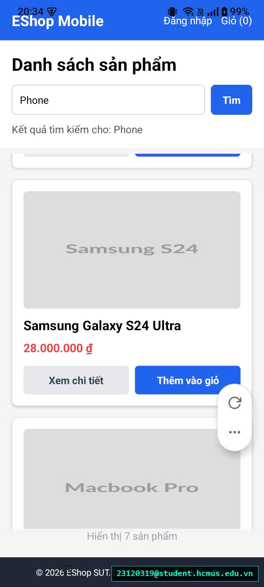

# [BUG-GUI-38][IA-02] Bàn phím ảo không kích hoạt tìm kiếm khi nhấn Enter/Search trên Mobile

| Mục | Nội dung |
|---|---|
| Tính năng | Tìm kiếm Sản phẩm (Product Search) – Mobile App Expo Go |
| Test case liên quan | `CHK-MOB-04` (Khía cạnh `IA-02` – Biểu mẫu & Tương tác Bàn phím ảo) |
| Mức độ (Severity) | Minor |
| Độ ưu tiên (Priority) | Medium |
| Khả năng tái hiện | Luôn luôn (100%) |
| Môi trường | Android 12/13/14, Ứng dụng Expo Go, SUT Mobile App |
| Ngày phát hiện | 2026-11-01 |
| GitHub Issue | *Đang cập nhật* |

## Điều kiện tiên quyết
- Ứng dụng EShop Mobile đang mở trên điện thoại thật hoặc máy ảo qua Expo Go.
- Đang ở Trang chủ có thanh tìm kiếm sản phẩm.

## Các bước tái hiện
1. Bấm vào ô nhập liệu **"Tìm kiếm sản phẩm..."** để hiển thị bàn phím ảo.
2. Gõ từ khóa tìm kiếm (ví dụ: `áo` hoặc `giày`).
3. Nhấn phím **Enter / Search (biểu tượng kính lúp)** ở góc dưới bên phải bàn phím ảo của điện thoại.

## Request / Response thực tế
*(Không có sự kiện submit được kích hoạt từ bàn phím ảo - Client UI Event missing)*

## Kết quả mong đợi
Ô tìm kiếm phải kích hoạt sự kiện tìm kiếm và gọi hàm `handleSearch` khi người dùng nhấn phím Search/Enter trên bàn phím ảo (sử dụng thuộc tính `returnKeyType="search"` và `onSubmitEditing={handleSearch}` trên thẻ `TextInput`). Giúp thao tác tìm kiếm trên điện thoại nhanh chóng và thuận tiện một chạm. — nguồn: [SPEC] / [ASSUMED] (Tiêu chuẩn tương tác thiết bị di động Mobile UX Guidelines)

## Kết quả thực tế
Khi bấm phím Enter/Search trên bàn phím ảo, không có phản hồi nào xảy ra; danh sách sản phẩm không được lọc và giao diện giữ nguyên trạng thái cũ. Người dùng bắt buộc phải dùng ngón tay với lên góc trên bấm vào nút icon "Tìm" nhỏ cạnh ô nhập.

## Bằng chứng
- `evidence/screenshots/gui/BUG-GUI-13-can-not-use-enter-to-search-on-mobile-virtual-keyboard.jpg` (Ảnh chụp màn hình thực tế có watermark sinh viên `23120319@student.hcmus.edu.vn`)



## Phân tích nguyên nhân (giả thuyết, nếu thấy trong code)
`frontend-mobile/App.js:L500-512` (đã xác nhận trực tiếp từ mã nguồn SUT):
- Thẻ `TextInput` phục vụ tìm kiếm thiếu cả hai thuộc tính quan trọng của React Native:
  ```jsx
  <View style={styles.searchRow}>
    <TextInput
      style={styles.searchInput}
      value={search}
      onChangeText={setSearch}
      placeholder="Tìm kiếm sản phẩm..."
      // Thiếu: returnKeyType="search"
      // Thiếu: onSubmitEditing={handleSearch}
    />
    <TouchableOpacity style={styles.searchButton} onPress={handleSearch}>
      <Text style={styles.searchButtonText}>Tìm</Text>
    </TouchableOpacity>
  </View>
  ```

## Phát hiện bởi
Test case do AI thiết kế kết hợp thực thi kiểm thử thủ công bởi sinh viên Trương Thành Phát ([CHK-MOB-04](../checklist.md#L60)).
