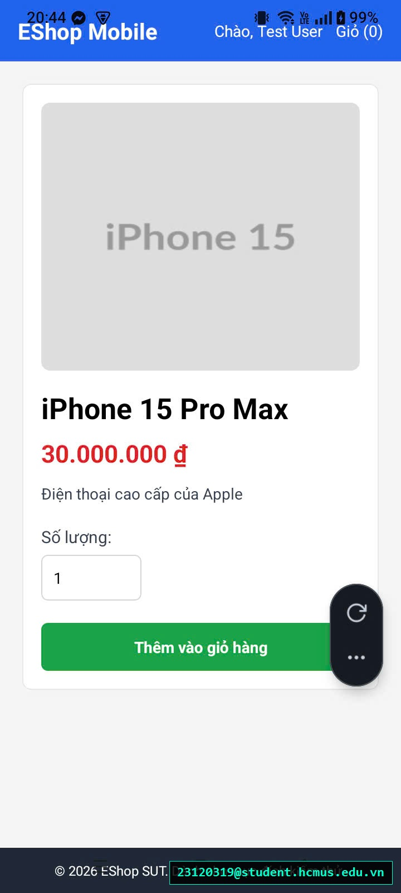

# [BUG-GUI-39][IA-02] Thiếu nút bấm tăng/giảm (+ / -) số lượng cảm ứng trên màn hình Chi tiết sản phẩm Mobile

| Mục | Nội dung |
|---|---|
| Tính năng | Chi tiết Sản phẩm & Chọn Số lượng – Mobile App Expo Go |
| Test case liên quan | `CHK-MOB-06` (Khía cạnh `IA-02` – Biểu mẫu & Điều khiển Cảm ứng) |
| Mức độ (Severity) | Minor |
| Độ ưu tiên (Priority) | Medium |
| Khả năng tái hiện | Luôn luôn (100%) |
| Môi trường | Android 12/13/14, Ứng dụng Expo Go, SUT Mobile App |
| Ngày phát hiện | 2026-11-01 |
| GitHub Issue | *Đang cập nhật* |

## Điều kiện tiên quyết
- Ứng dụng EShop Mobile đang mở trên thiết bị di động.
- Đang ở màn hình Chi tiết một sản phẩm bất kỳ.

## Các bước tái hiện
1. Trên Trang chủ ứng dụng di động, bấm vào "Xem chi tiết" của một sản phẩm.
2. Quan sát khu vực điều chỉnh số lượng mua sản phẩm.
3. Thử tìm các nút tăng `(+)` hoặc giảm `(-)` để điều chỉnh nhanh số lượng sản phẩm.

## Request / Response thực tế
*(Giao diện thiếu thành phần điều khiển - Missing Stepper Touch Control)*

## Kết quả mong đợi
Trên màn hình cảm ứng di động, trường số lượng mua hàng phải đi kèm cặp nút bấm tăng/giảm cảm ứng dạng Stepper `[-]  [ 1 ]  [+]` với vùng chạm $\ge 48 	imes 48$px, cho phép người dùng dùng ngón tay cái chạm nhanh để tăng hoặc giảm số lượng mà không bắt buộc phải kích hoạt bàn phím ảo. — nguồn: [SPEC] / [ASSUMED] (Tiêu chuẩn thiết kế giao diện cảm ứng Touch Target Heuristics)

## Kết quả thực tế
Giao diện chỉ hiển thị duy nhất một ô nhập text số lượng trần (`TextInput`). Người dùng bắt buộc phải chạm vào ô, đợi bàn phím số trồi lên, xóa số cũ rồi gõ số mới, gây bất tiện lớn cho trải nghiệm mua sắm trên thiết bị di động.

## Bằng chứng
- `evidence/screenshots/gui/BUG-GUI-14-haven't-increase-decrease-item-button.jpg` (Ảnh chụp màn hình thực tế có watermark sinh viên `23120319@student.hcmus.edu.vn`)



## Phân tích nguyên nhân (giả thuyết, nếu thấy trong code)
`frontend-mobile/App.js:L575-585` (đã xác nhận trực tiếp từ mã nguồn SUT):
- Khu vực chọn số lượng chỉ render ô nhập đơn lẻ không có nút tăng giảm:
  ```jsx
  <Text style={styles.detailLabel}>Số lượng</Text>
  <TextInput
    style={styles.quantityInput}
    keyboardType="numeric"
    value={quantity}
    onChangeText={setQuantity}
  />
  ```

## Phát hiện bởi
Test case do AI thiết kế kết hợp thực thi kiểm thử thủ công bởi sinh viên Trương Thành Phát ([CHK-MOB-06](../checklist.md#L62)).
