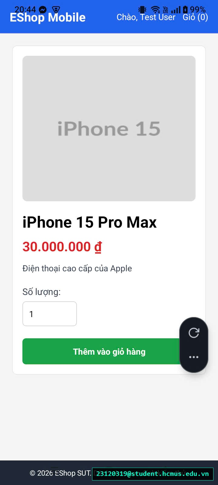

# [BUG-GUI-40][IA-03] Thiếu nút mũi tên quay lại (Back Arrow) trên màn hình Chi tiết sản phẩm Mobile

| Mục | Nội dung |
|---|---|
| Tính năng | Điều hướng Chi tiết Sản phẩm (Product Detail Navigation) – Mobile App Expo Go |
| Test case liên quan | `CHK-MOB-07` (Khía cạnh `IA-03` – Điều hướng & Header Navigation) |
| Mức độ (Severity) | Major |
| Độ ưu tiên (Priority) | High |
| Khả năng tái hiện | Luôn luôn (100%) |
| Môi trường | Android 15 (Realme C53), Ứng dụng Expo Go SDK 54, SUT Mobile App |
| Ngày phát hiện | 2026-11-01 |
| GitHub Issue | [#90](https://github.com/tthphat/eshop-sut/issues/90) |

## Điều kiện tiên quyết
- Đang ở màn hình Chi tiết sản phẩm trên ứng dụng EShop Mobile.

## Các bước tái hiện
1. Từ Trang chủ ứng dụng EShop Mobile, bấm chọn xem một sản phẩm bất kỳ để chuyển sang màn hình Chi tiết sản phẩm (Product Detail).
2. Quan sát thanh tiêu đề điều hướng trên cùng (Header / NavBar) và khu vực nội dung.
3. Tìm nút quay lại trang trước (Back Arrow `←`).  
   *(Lưu ý đối chiếu: Trong khi màn hình Giỏ hàng đã được thiết kế sẵn nút "Mua tiếp" để điều hướng quay về Trang chủ, thì màn hình Chi tiết sản phẩm hoàn toàn không có bất kỳ nút điều hướng quay lui nào).*

## Request / Response thực tế
*(Giao diện Chi tiết sản phẩm thiếu nút điều hướng quay lui)*

## Kết quả mong đợi
Thanh Header của màn hình Chi tiết sản phẩm bắt buộc phải có nút quay lại (Back arrow icon `←`) ở góc trên cùng bên trái. Khi người dùng bấm vào, ứng dụng phải đưa người dùng quay trở lại Trang chủ một cách mượt mà và trực quan. — nguồn: [SPEC] / [ASSUMED] (Nguyên lý điều hướng chuẩn Mobile Material / iOS Guidelines)

## Kết quả thực tế
Thanh Header của màn hình Chi tiết sản phẩm chỉ gồm tiêu đề thương hiệu "EShop Mobile" và cụm nút góc phải (Đăng nhập, Giỏ hàng), hoàn toàn thiếu nút mũi tên Back. Do màn hình Chi tiết sản phẩm không có nút "Mua tiếp" như trang Giỏ hàng, người dùng không có cách trực quan nào để quay lui về danh sách sản phẩm ngoài việc phải bấm vào logo thương hiệu "EShop Mobile".

## Bằng chứng
- `evidence/screenshots/gui/BUG-GUI-15-haven't-back-arrow.jpg` (Ảnh chụp màn hình thực tế trên Realme C53 có watermark sinh viên `23120319@student.hcmus.edu.vn`)



## Phân tích nguyên nhân (xác nhận từ mã nguồn SUT)
`frontend-mobile/App.js:L434-452`:
- Hàm `renderHeader` hiển thị cố định cấu trúc thanh điều hướng chung cho toàn bộ app mà không bổ sung nút Back khi đang ở view `product-detail`:
  ```jsx
  const renderHeader = () => (
    <View style={styles.navBar}>
      <TouchableOpacity onPress={goHome}>
        <Text style={styles.brand}>EShop Mobile</Text>
      </TouchableOpacity>
      <View style={styles.navLinks}>
        {/* Chỉ có Đăng nhập và Giỏ hàng, thiếu nút Back cho Chi tiết sản phẩm */}
      </View>
    </View>
  );
  ```
- Trong khi đó, tại màn hình Giỏ hàng (`renderCart`), lập trình viên có gắn nút quay về (`onPress={goHome}` với nhãn "Mua tiếp"), nhưng màn hình Chi tiết sản phẩm (`renderProductDetail`) lại bị bỏ quên.

## Phát hiện bởi
Thực thi kiểm thử thủ công và phát hiện bởi sinh viên Trương Thành Phát ([CHK-MOB-07](../checklist.md#L61)).
