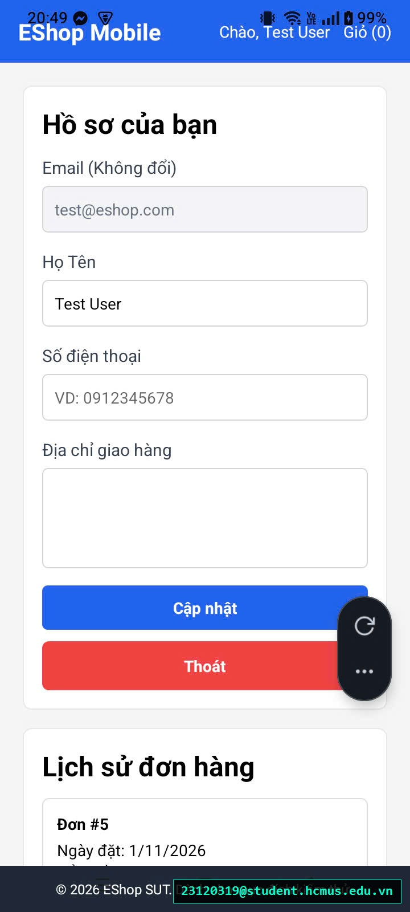
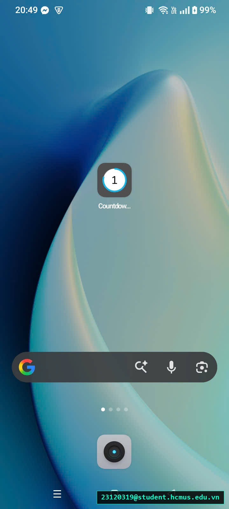

# [BUG-GUI-41][IA-03] Bấm phím Back phần cứng của Android làm thoát/đóng ứng dụng ngay lập tức

| Mục | Nội dung |
|---|---|
| Tính năng | Điều hướng Hệ thống Android (Hardware Back Button) – Mobile App Expo Go |
| Test case liên quan | `CHK-MOB-08` (Khía cạnh `IA-03` – Điều hướng & Native Back Handling) |
| Mức độ (Severity) | Major |
| Độ ưu tiên (Priority) | High |
| Khả năng tái hiện | Luôn luôn (100%) |
| Môi trường | Thiết bị Android thật / Máy ảo Android, Expo Go |
| Ngày phát hiện | 2026-11-01 |
| GitHub Issue | *Đang cập nhật* |

## Điều kiện tiên quyết
- Ứng dụng EShop Mobile đang mở trên thiết bị Android.
- Người dùng đang ở màn hình con như Chi tiết sản phẩm (`product-detail`) hoặc Giỏ hàng (`cart`).

## Các bước tái hiện
1. Từ Trang chủ, bấm mở Chi tiết một sản phẩm bất kỳ.
2. Nhấn phím Back vật lý trên thanh điều hướng dưới đáy Android hoặc vuốt cử chỉ Back từ cạnh màn hình.
3. Quan sát hành vi phản hồi của ứng dụng.

## Request / Response thực tế
*(Ứng dụng bị hệ điều hành Android đóng ngay lập tức - App Process Minimized/Exited)*

## Kết quả mong đợi
Ứng dụng phải lắng nghe sự kiện phím Back phần cứng của Android thông qua API `BackHandler`. Khi đang ở màn hình con (`view !== "home"`), bấm Back phải đưa người dùng quay trở lại Trang chủ hoặc màn hình trước. Chỉ khi đang ở Trang chủ mới hiển thị xác nhận thoát hoặc đóng app. — nguồn: [SPEC] / [ASSUMED] (Tiêu chuẩn hành vi hệ thống Android Native UX)

## Kết quả thực tế
Ứng dụng không hề đăng ký lắng nghe sự kiện `BackHandler`. Khi người dùng bấm phím Back ở bất kỳ màn hình nào, hệ điều hành Android coi như ứng dụng không có lịch sử điều hướng nội bộ và lập tức đóng/thoát app về màn hình chính của điện thoại.

## Bằng chứng
- `evidence/screenshots/gui/BUG-GUI-16-quit-app-immediately-when-use-android-back-button-p1.jpg` (Đang ở màn hình con Chi tiết sản phẩm)
- `evidence/screenshots/gui/BUG-GUI-16-quit-app-immediately-when-use-android-back-button-p2.jpg` (Vừa bấm Back thì bị văng thẳng về màn hình Launcher của điện thoại)

## Phân tích nguyên nhân (giả thuyết, nếu thấy trong code)
`frontend-mobile/App.js` (đã xác nhận trực tiếp từ mã nguồn SUT):
- Toàn bộ tệp `App.js` điều khiển view bằng `const [view, setView] = useState("home")` nhưng hoàn toàn không import `BackHandler` từ thư viện `react-native` và không có bất kỳ `useEffect` nào để bắt sự kiện `hardwareBackPress`.

## Phát hiện bởi
Test case do AI thiết kế kết hợp thực thi kiểm thử thủ công bởi sinh viên Trương Thành Phát ([CHK-MOB-08](../checklist.md#L64)).
