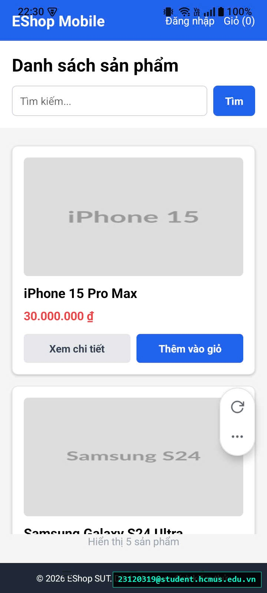

# [BUG-GUI-42][IA-01] Thiếu vùng an toàn Safe Area trên Android khiến Header bị đè lên Status Bar

| Mục | Nội dung |
|---|---|
| Tính năng | Bố cục Tổng thể & Vùng an toàn (Layout & Safe Area) – Mobile App Expo Go |
| Test case liên quan | `CHK-MOB-09` (Khía cạnh `IA-01` – Chuẩn UI chung & Safe Area Insets) |
| Mức độ (Severity) | Major |
| Độ ưu tiên (Priority) | High |
| Khả năng tái hiện | Luôn luôn (100% trên thiết bị Android thật) |
| Môi trường | Thiết bị Android thật (có camera notch/đục lỗ), Expo Go |
| Ngày phát hiện | 2026-11-01 |
| GitHub Issue | *Đang cập nhật* |

## Điều kiện tiên quyết
- Mở ứng dụng EShop Mobile trên điện thoại thật chạy hệ điều hành Android.

## Các bước tái hiện
1. Khởi chạy ứng dụng EShop Mobile trên thiết bị Android qua Expo Go.
2. Quan sát khu vực thanh Header màu xanh trên cùng của màn hình.
3. Chú ý vị trí hiển thị của chữ "EShop Mobile", nút "Đăng nhập", nút "Giỏ" so với đồng hồ, icon pin, sóng Wi-Fi/VoLTE của hệ điều hành.

## Request / Response thực tế
*(Lỗi tràn bố cục phần cứng - Hardware Clipping Defect)*

## Kết quả mong đợi
Thanh tiêu đề (Header/NavBar) phải có khoảng đệm phía trên (Padding Top) né hoàn toàn khu vực thanh trạng thái hệ thống (`StatusBar.currentHeight`), đảm bảo không có bất kỳ phần tử chữ hay nút bấm nào bị chèn đè lên đồng hồ hay các biểu tượng hệ thống của điện thoại. — nguồn: [SPEC] / [ASSUMED] (Tiêu chuẩn vùng an toàn hiển thị thiết bị di động)

## Kết quả thực tế
Thanh Header màu xanh bị kéo tràn lên tận đỉnh màn hình ($y=0$). Toàn bộ tiêu đề "EShop Mobile" và các nút bấm chức năng "Đăng nhập", "Giỏ hàng" bị đè lấn trực tiếp vào dòng hiển thị đồng hồ và cột pin/sóng, làm vỡ thẩm mỹ và gây khó khăn cho việc bấm chạm chính xác.

## Bằng chứng
- `evidence/screenshots/gui/BUG-GUI-17-haven't-safe-area.jpg` (Ảnh chụp màn hình thực tế có watermark sinh viên `23120319@student.hcmus.edu.vn`)



## Phân tích nguyên nhân (giả thuyết, nếu thấy trong code)
`frontend-mobile/App.js:L454-465` và `styles.safeArea` (đã xác nhận trực tiếp từ mã nguồn SUT):
- Thẻ `<SafeAreaView>` của gói `react-native` gốc chỉ có tác dụng né tai thỏ trên iOS. Trên Android, thẻ này hoàn toàn vô tác dụng và không hề tự động cộng chiều cao `StatusBar.currentHeight`.
- Đoạn code thiếu padding top né Status Bar:
  ```jsx
  // L1001:
  safeArea: { flex: 1, backgroundColor: "#f5f5f5" },
  // Cần bổ sung: paddingTop: Platform.OS === 'android' ? StatusBar.currentHeight : 0
  ```

## Phát hiện bởi
Test case chuyên sâu do con người phản biện bổ sung vào checklist ([CHK-MOB-09](../checklist.md#L65) – Mục phản biện AI Gap Analysis: Nhóm nguyên nhân `Model limitation`).
