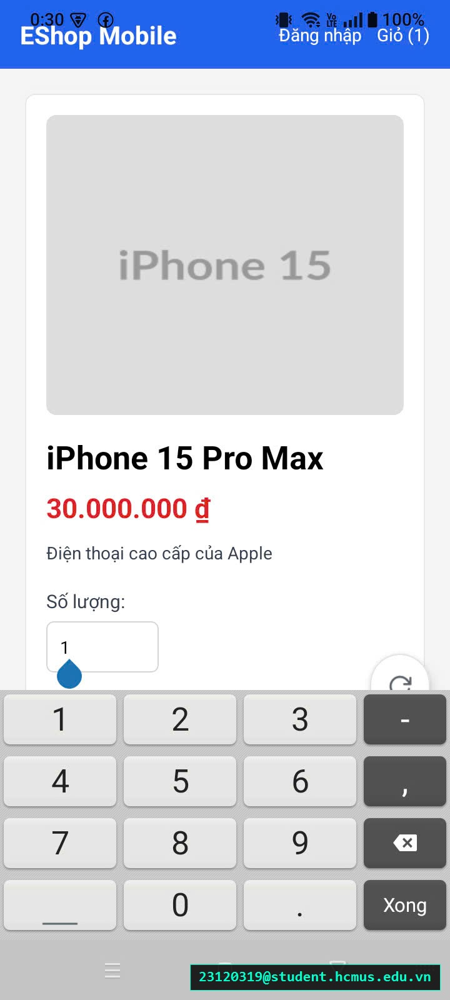

# [BUG-GUI-43][IA-02] Bàn phím ảo che khuất nút bấm Thêm vào giỏ trên màn hình Chi tiết sản phẩm Mobile

| Mục | Nội dung |
|---|---|
| Tính năng | Chi tiết Sản phẩm & Tương tác Biểu mẫu – Mobile App Expo Go |
| Test case liên quan | `CHK-MOB-10` (Khía cạnh `IA-02` – Biểu mẫu & Tránh Bàn phím che khuất) |
| Mức độ (Severity) | Major |
| Độ ưu tiên (Priority) | High |
| Khả năng tái hiện | Luôn luôn (100%) |
| Môi trường | Android 12/13/14, Ứng dụng Expo Go, SUT Mobile App |
| Ngày phát hiện | 2026-11-01 |
| GitHub Issue | *Đang cập nhật* |

## Điều kiện tiên quyết
- Đang ở màn hình Chi tiết sản phẩm trên ứng dụng EShop Mobile.

## Các bước tái hiện
1. Mở màn hình Chi tiết một sản phẩm bất kỳ.
2. Bấm vào ô nhập liệu "Số lượng" để kích hoạt bàn phím ảo trồi lên.
3. Quan sát vị trí của nút bấm hành động chính "Thêm vào giỏ hàng" ở phía dưới.

## Request / Response thực tế
*(Bàn phím ảo đè lấn toàn bộ khu vực nút CTA dưới đáy màn hình)*

## Kết quả mong đợi
Màn hình biểu mẫu trên di động bắt buộc phải được bọc trong component `KeyboardAvoidingView` hoặc `ScrollView`. Khi bàn phím ảo trồi lên, giao diện phải tự động đẩy hoặc cho phép cuộn nội dung lên trên để người dùng luôn nhìn thấy ô đang nhập cùng nút bấm hành động (Submit/CTA "Thêm vào giỏ"). — nguồn: [SPEC] / [ASSUMED] (Tiêu chuẩn khả dụng biểu mẫu di động Mobile Usability)

## Kết quả thực tế
Màn hình không có cơ chế xử lý bàn phím ảo. Khi bàn phím trồi lên, nó đè lấn che mất hoàn toàn nút bấm màu xanh "Thêm vào giỏ hàng". Người dùng không thể bấm thêm vào giỏ khi đang gõ mà bắt buộc phải tìm cách đóng bàn phím trước, gây cản trở nghiêm trọng thao tác mua sắm.

## Bằng chứng
- `evidence/screenshots/gui/BUG-GUI-18-virtual-keyboard-hide-submit-button.jpg` (Ảnh chụp màn hình thực tế có watermark sinh viên `23120319@student.hcmus.edu.vn`)



## Phân tích nguyên nhân (giả thuyết, nếu thấy trong code)
`frontend-mobile/App.js:L545-600` (đã xác nhận trực tiếp từ mã nguồn SUT):
- Màn hình Chi tiết sản phẩm chỉ dùng thẻ `<View style={styles.detailContainer}>` mà không bọc trong `KeyboardAvoidingView` kèm `behavior={Platform.OS === 'ios' ? 'padding' : 'height'}`:
  ```jsx
  <View style={styles.detailContainer}>
    {/* Các nội dung text, ảnh và input số lượng */}
    <TouchableOpacity style={styles.button} onPress={...}>
      <Text style={styles.buttonText}>Thêm vào giỏ</Text>
    </TouchableOpacity>
  </View>
  ```

## Phát hiện bởi
Test case chuyên sâu do con người phản biện bổ sung vào checklist ([CHK-MOB-10](../checklist.md#L66) – Mục phản biện AI Gap Analysis: Nhóm nguyên nhân `Inherent UI complexity`).
