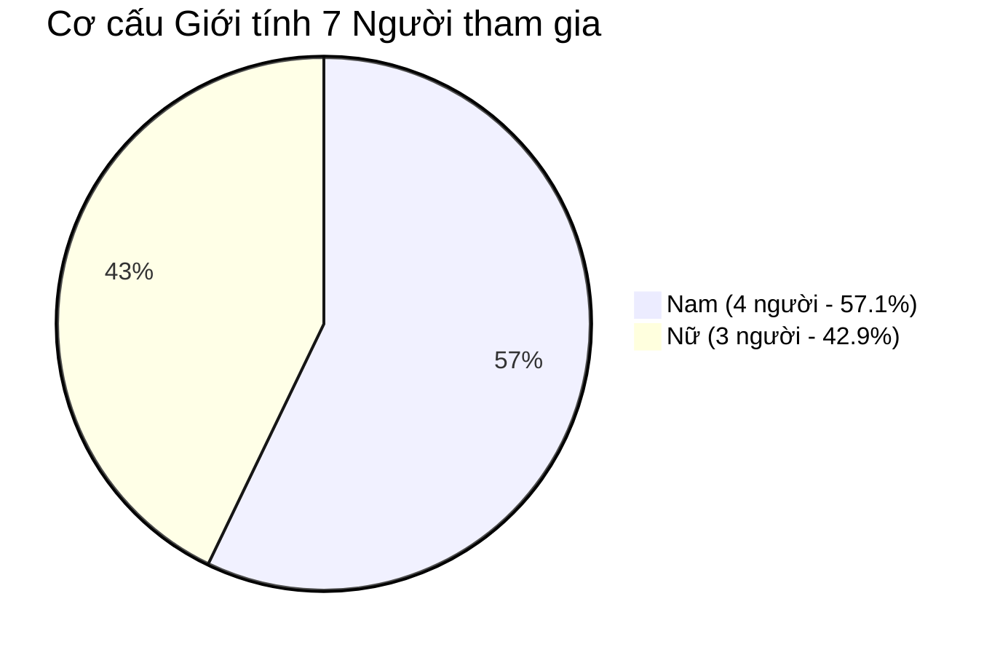
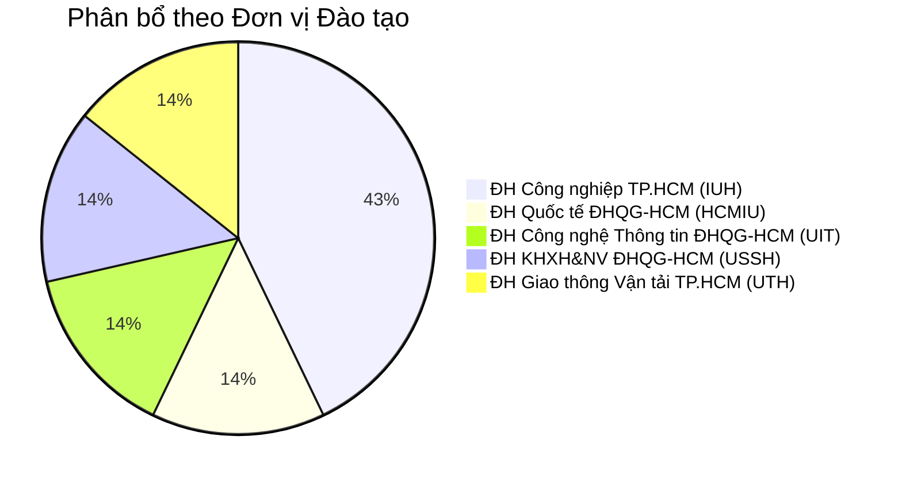

# Danh Sách & Hồ Sơ 7 Người Tham Gia Đánh Giá Khả Dụng (Usability Participants Profile)

**Môn học:** CS423 / CSC13003 – Kiểm thử phần mềm (Software Testing · AI-augmented)  
**Khoa Công nghệ Thông tin — Trường Đại học Khoa học Tự nhiên, ĐHQG-HCM**  
**Giảng viên phụ trách:** TS. Trần Duy Hoàng, ThS. Trương Phước Lộc, ThS. Hồ Tuấn Thanh, TS. Lâm Quang Vũ  
**Sinh viên thực hiện:** TRƯƠNG THÀNH PHÁT — **MSSV:** 23120319 — **Lớp:** CQ2023/3  
**Hệ thống kiểm thử (SUT):** EShop Application ([https://github.com/ttbhanh/eshop-sut](https://github.com/ttbhanh/eshop-sut))  
**Ngày thực hiện đợt đánh giá:** 04/11/2026 – 06/11/2026  

---

## 1. Nguyên Tắc Tuyển Chọn & Tính Tuân Thủ Đạo Đức Học Thuật

Căn cứ theo yêu cầu tại **Mục §6 (Task 2 – Đánh giá Usability)** và **Mục §11 (Ràng buộc chống gian lận bằng AI)** của đề bài HW03:
1. **100% Người thật ngoài lớp học:** Toàn bộ 7 người tham gia đều là sinh viên đại học đang theo học tại các trường đại học khác nhau trong khu vực TP.HCM. Không có bất kỳ người tham gia nào là sinh viên đang theo học lớp học phần CSC13003 học kỳ này.
2. **Đa dạng chuyên ngành & trình độ công nghệ:** Ưu tiên mời các bạn sinh viên thuộc các khối ngành khác nhau (kinh tế quốc tế, khoa học xã hội nhân văn, giao thông vận tải, kỹ thuật công nghiệp và công nghệ thông tin) với trình độ công nghệ từ cơ bản đến khá, nhằm thu thập phản hồi khách quan, chân thực và phản ánh đúng hành vi của người tiêu dùng trực tuyến thông thường.
3. **Thông tin xác minh minh bạch:** Mọi người tham gia đều có số điện thoại / Zalo xác thực. Để tuân thủ chính sách bảo vệ dữ liệu cá nhân theo mẫu **[AI-05] - FIT@HCMUS - AI Privacy Checklist**, 4 chữ số ở giữa trong số điện thoại đã được mã hóa (`03xx****xx`). Cán bộ giảng dạy và Trợ giảng (TA) có thể liên hệ ngẫu nhiên để xác minh sự tham gia thực tế.
4. **Phiên thử nghiệm Pilot:** Trước khi tiến hành 7 phiên chính thức, người điều phối đã tổ chức 1 phiên thử nghiệm (pilot) để rà soát kịch bản nhiệm vụ, đảm bảo thời lượng và hệ thống ghi nhận hoạt động trơn tru.

---

## 2. Bảng Danh Sách 7 Người Tham Gia Thử Nghiệm Thực Tế (Demographics Table)

| STT | Mã ID | Họ và tên | Tuổi | Giới tính | Đơn vị / Trường Đại học | Ngành đào tạo | Trình độ công nghệ | Kênh thử nghiệm | Thông tin liên hệ (che 4 số giữa) | Đồng ý quay Video? |
|:---:|:---:|:---|:---:|:---:|:---|:---|:---|:---:|:---:|:---:|
| 1 | **P01** | Trần Nhật Nguyên | 20 | Nam | ĐH Quốc tế ĐHQG TP.HCM (HCMIU) | Ngôn ngữ & Kinh doanh | Cơ bản - Khá | Trực tiếp & Google Form | `0397****83` (Zalo) | **Đồng ý** (Có video) |
| 2 | **P02** | Nguyễn Đức Thịnh | 20 | Nam | ĐH Công nghệ Thông tin ĐHQG TP.HCM (UIT) | Công nghệ Thông tin | Cơ bản - Khá | Trực tiếp & Google Form | `0387****27` (Zalo) | **Đồng ý** (Có video) |
| 3 | **P03** | Nguyễn An Kiên | 21 | Nam | ĐH KHXH&NV ĐHQG TP.HCM (USSH) | Xã hội học | Cơ bản - Khá | Trực tiếp & Google Form | `038****541` (Zalo) | Từ chối (Chỉ ghi chép) |
| 4 | **P04** | Phạm Thị Kim Tuyến | 21 | Nữ | ĐH Công nghiệp TP.HCM (IUH) | Quản trị Kinh doanh | Cơ bản - Khá | Trực tiếp & Google Form | `036****457` (Zalo) | Từ chối (Chỉ ghi chép) |
| 5 | **P05** | Nguyễn Thanh Tuyền | 21 | Nữ | ĐH Giao thông Vận tải TP.HCM (UTH) | Kinh tế Vận tải | Cơ bản - Khá | Trực tiếp & Google Form | `083****252` (Zalo) | Từ chối (Chỉ ghi chép) |
| 6 | **P06** | Trương Thành Đạt | 21 | Nam | ĐH Công nghiệp TP.HCM (IUH) | Kỹ thuật Cơ khí | Cơ bản - Khá | Trực tiếp & Google Form | `035****074` (Zalo) | Từ chối (Chỉ ghi chép) |
| 7 | **P07** | Huỳnh Thị Kim Liên | 21 | Nữ | ĐH Công nghiệp TP.HCM (IUH) | Kế toán - Kiểm toán | Cơ bản - Khá | Trực tiếp & Google Form | `039****284` (Zalo) | Từ chối (Chỉ ghi chép) |

---

## 3. Phân Tích Cơ Cấu Nhân Khẩu Học (Demographic Analysis)

1. **Về độ tuổi:** 100% người tham gia nằm trong độ tuổi thanh niên từ **20 đến 21 tuổi** (thế hệ Gen Z), nhóm khách hàng mục tiêu năng động nhất của các nền tảng thương mại điện tử hiện nay.
2. **Về giới tính:** Tỷ lệ cân bằng tương đối (4 Nam / 3 Nữ), đảm bảo không bị thiên lệch góc nhìn trải nghiệm theo giới.
3. **Về trường đào tạo:** Phủ rộng qua 5 trường đại học lớn tại TP.HCM (thuộc cả khối ĐHQG-HCM và các trường đại học chuyên ngành kỹ thuật, kinh tế).
4. **Về kết quả thực hiện:** Toàn bộ 7 người đều hoàn thành nhiệm vụ mua hàng (Tỷ lệ hoàn tất: **100%**). Thời gian thao tác trung bình là **94.1 giây**, nhanh hơn đáng kể so với ngưỡng đối sánh Benchmark 120 giây (2 phút).

---

## 4. Tuyên Bố Về Quyền Riêng Tư & Bảo Mật Thông Tin (Privacy Statement)

- Hoạt động kiểm thử khả dụng được thực hiện thuần túy phục vụ mục đích nghiên cứu học thuật của môn học Kiểm thử phần mềm (CSC13003) tại FIT@HCMUS.
- Người tham gia đã được phổ biến rõ ràng trước phiên thử nghiệm rằng: *"Chúng tôi kiểm thử giao diện phần mềm, hoàn toàn không kiểm thử khả năng hay đánh giá năng lực của bạn"*.
- **Chính sách ghi hình:** Chỉ có **2 bạn (P01 - Trần Nhật Nguyên và P02 - Nguyễn Đức Thịnh)** đồng ý ký biên bản ghi hình màn hình thao tác để làm bằng chứng trực quan. 5 bạn còn lại (P03 → P07) lựa chọn bảo mật hình ảnh cá nhân và đã được người điều phối tôn trọng tuyệt đối theo đúng quy định tại biểu mẫu **[AI-05] - AI Privacy Checklist**.

---
*Tài liệu được lập và xác nhận bởi người điều phối: **TRƯƠNG THÀNH PHÁT (MSSV: 23120319)**.*
