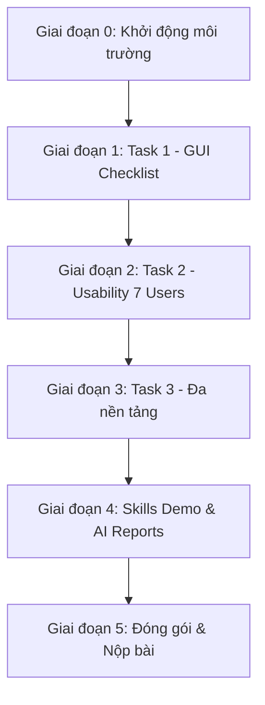

# KẾ HOẠCH THỰC HIỆN BÀI TẬP HW03: GUI & USABILITY TESTING
**Môn học:** Kiểm thử phần mềm (CSC13003) — Học kỳ 1, Năm học 2026–2027  
**Giảng viên phụ trách:** TS. Trần Duy Hoàng, ThS. Trương Phước Lộc, ThS. Hồ Tuấn Thanh, TS. Lâm Quang Vũ — Khoa CNTT, Trường ĐH KHTN (HCMUS)  
**Sinh viên thực hiện:** TRƯƠNG THÀNH PHÁT — **MSSV:** 23120319 — **Lớp:** CQ2023/3  
**Email sinh viên (Watermark):** `23120319@student.hcmus.edu.vn`  
**Hệ thống kiểm thử (SUT):** EShop Application (`https://github.com/ttbhanh/eshop-sut`)  

---

## 1. TỔNG QUAN & NGUYÊN TẮC BẮT BUỘC (NON-NEGOTIABLE PRINCIPLES)

### 1.1. Mục tiêu bài tập
Thực hiện trọn vẹn 3 nhiệm vụ kiểm thử cốt lõi kết hợp ứng dụng Agentic AI theo quy định của đề bài:
1. **Task 1 (30đ):** Thiết kế, mở rộng, phản biện AI và thực thi **GUI Checklist Testing (> 40 mục)** bao phủ 4 khía cạnh giao diện (IA-01 → IA-04), log bug lên Markdown và GitHub Issues.
2. **Task 2 (40đ):** Lập kế hoạch, điều phối và phân tích **Usability Evaluation** có người điều phối (Moderated) trên 1 luồng End-to-End với **7 người tham gia thật** ngoài lớp, đo lường điểm chuẩn SUS và 4 câu hỏi thăm dò mở (Clarity, Error Recovery, Speed, Trust).
3. **Task 3 (20đ):** Kiểm thử đa nền tảng (**≥ 3 nền tảng**: Chrome, Firefox, Expo Go Mobile), phân tích sai lệch giao diện (Platform Skew), bắt buộc gắn watermark email sinh viên.
4. **Agent Skills & Báo cáo AI (10đ):** Đóng gói bộ kỹ năng Agent Skill tái sử dụng kèm video demo YouTube, Báo cáo kiểm toán AI (AI Audit Log) và Đoạn văn phê bình AI (AI Critique 200–300 từ).

### 1.2. Các quy tắc bất biến (Strict Rules)
1. **SUT Immutability (Tuyệt đối không sửa code SUT):**
   - Thư mục `eshop-sut/` là hộp đen chỉ đọc (**Read-only**). Tuyệt đối **không chỉnh sửa, vá lỗi hay thêm code** vào `backend/`, `frontend-web/`, `frontend-admin/`, hay `frontend-mobile/`. Mọi lỗi giao diện/chức năng phát hiện được đều phải lập báo cáo lỗi (Bug Report).
2. **Chống gian lận bằng chứng (Anti-Fraud Constraints):**
   - Mọi ảnh chụp màn hình bằng chứng **BẮT BUỘC có watermark email sinh viên**: `23120319@student.hcmus.edu.vn`.
   - Danh sách 7 người tham gia Usability phải là người thật ngoài lớp, số điện thoại/Zalo che 4 số giữa (ví dụ: `0912****89`), sẵn sàng cho việc TA gọi ngẫu nhiên 2 người để kiểm tra chéo.
   - Khi điền form trên SUT, tên người dùng hoặc email phải thể hiện mã số sinh viên `23120319`.
3. **Địa chỉ lưu trữ Artifacts (`<OUTPUT_DIR>`):**
   - Toàn bộ tài liệu, dữ liệu và báo cáo phải lưu tại thư mục **`HW3/`**, tuyệt đối không ghi file lung tung ra thư mục gốc.
4. **Nhật ký Git Commit:**
   - Mỗi bước/hành động kiểm thử phải tạo 1 Git commit tương ứng với tiền tố `HW3-...` (ví dụ: `HW3-docs(checklist): ...`, `HW3-test(gui): ...`).

---

## 2. XÁC ĐỊNH PHẠM VI KIỂM THỬ (SCOPE DEFINITION)

### 2.1. Phạm vi Task 1 — GUI Checklist Testing
Để vượt mức tối thiểu 40 mục và tránh trùng lặp nội dung đơn điệu trên 1 màn hình đơn lẻ, bài tập sẽ bao phủ **3 màn hình cốt lõi của Web Frontend** và **1 màn hình Mobile**:
- **Màn hình 1 (Home & Catalog):** Trang chủ, thanh điều hướng, tìm kiếm sản phẩm, lọc danh mục (FR-05).
- **Màn hình 2 (Product Detail):** Xem chi tiết sản phẩm, chọn số lượng, hiển thị giá, nút Thêm giỏ hàng (FR-06).
- **Màn hình 3 (Cart & Checkout):** Xem giỏ hàng, áp dụng coupon giảm giá, form nhập thông tin giao hàng & thanh toán (FR-07, FR-08, FR-09).
- **Màn hình 4 (Mobile Home/Cart trên Expo Go):** Đối chiếu các thành phần tương ứng trên ứng dụng di động.

Checklist sẽ phân bổ đều trên **4 Khía cạnh giao diện (Interface Aspects)**:
- **IA-01: Chuẩn UI chung (General UI Standards):** Màu sắc, độ tương phản WCAG, Typography, canh lề, bố cục khoảng cách, logo, tính thẩm mỹ.
- **IA-02: Form & Nhập liệu (Forms & Inputs):** Nhãn trường, placeholder, đánh dấu trường bắt buộc `*`, thứ tự phím Tab, validation inline, vô hiệu hóa nút submit khi dữ liệu rỗng/sai.
- **IA-03: Điều hướng (Navigation):** Menu chính, đường dẫn trang (Breadcrumbs), liên kết logo về trang chủ, trạng thái active của menu, xử lý nút Back trình duyệt.
- **IA-04: Phản hồi & Trạng thái (Feedback & System States):** Loading indicators/spinners, thông báo thành công (Toast), thông báo lỗi rõ ràng, trạng thái giỏ hàng rỗng, màn hình xử lý khi mất mạng.

### 2.2. Phạm vi Task 2 — Usability Evaluation
- **Luồng End-to-End duy nhất:**
  $$\text{Đăng nhập/Vãng lai} \longrightarrow \text{Tìm kiếm Smartphone} \longrightarrow \text{Xem chi tiết} \longrightarrow \text{Thêm vào giỏ} \longrightarrow \text{Áp mã giảm giá SAVE10} \longrightarrow \text{Thanh toán thành công}$$
- **Kịch bản nhiệm vụ (Task Scenario):**
  > *"Bạn cần mua 1 chiếc điện thoại thông minh phục vụ học tập có giá dưới 30.000.000 ₫ trên EShop, áp dụng mã giảm giá SAVE10 và hoàn tất đơn hàng giao về địa chỉ nhà bạn."*
- **Đối tượng tham gia:** 7 người dùng ngoài lớp (ưu tiên các ngành Kinh tế, Luật, Y khoa, người đi làm không chuyên công nghệ).

### 2.3. Phạm vi Task 3 — Đa nền tảng (Cross-Platform)
Chọn **Tổ hợp A (Tổ hợp tối ưu và được khuyến khích mạnh nhất)**:
1. **Nền tảng 1:** Desktop Web trên **Google Chrome** (Windows 11).
2. **Nền tảng 2:** Desktop Web trên **Mozilla Firefox** (Windows 11).
3. **Nền tảng 3:** Mobile App chạy trên điện thoại thật thông qua ứng dụng **Expo Go** (Android/iOS).

---

## 3. LỘ TRÌNH THỰC HIỆN CHI TIẾT TỪNG BƯỚC (STEP-BY-STEP IMPLEMENTATION)



---

### 🚀 GIAI ĐOẠN 0: Khởi động & Chuẩn bị Môi trường SUT
*Mục tiêu:* Đảm bảo toàn bộ hệ thống SUT hoạt động trơn tru trên cả Web lẫn Mobile và cấu hình sẵn công cụ chụp ảnh watermark.

- [ ] **Bước 0.1: Kiểm tra cơ sở dữ liệu và Backend SUT:**
  - Khởi động MongoDB service hoặc Docker container cho cơ sở dữ liệu.
  - Chạy backend: `cd eshop-sut/backend && npm install && npm run dev`.
  - Nạp dữ liệu mẫu (Seed data): đảm bảo có sẵn danh mục, sản phẩm điện thoại và mã coupon (`SAVE10`, `FREESHIP`).
- [ ] **Bước 0.2: Khởi chạy Web Frontend:**
  - Chạy web: `cd eshop-sut/frontend-web && npm install && npm run dev` (truy cập `http://localhost:5173`).
  - Kiểm tra mở được trên cả Google Chrome và Mozilla Firefox.
- [ ] **Bước 0.3: Khởi chạy Mobile App qua Expo Go:**
  - Chạy metro bundler: `cd eshop-sut/frontend-mobile && npm install && npx expo start --tunnel`.
  - Mở ứng dụng Expo Go trên điện thoại thông minh thật, quét mã QR để nạp app.
- [ ] **Bước 0.4: Thiết lập Watermark Tool:**
  - Chuẩn bị công cụ gắn overlay email: `23120319@student.hcmus.edu.vn` góc trên/dưới ảnh chụp màn hình.
- [ ] **Git Commit:** `HW3-chore(env): verify SUT backend web and mobile environment readiness`

---

### 🎯 GIAI ĐOẠN 1: Task 1 — Thiết kế, Phản biện & Thực thi GUI Checklist (30 Điểm)
*Mục tiêu:* Tạo bộ checklist chuẩn > 40 mục, phân tích lỗi thiếu sót của AI, thực thi đánh dấu Pass/Fail, chụp ảnh bằng chứng có watermark và log bug lên GitHub Issues.

- [ ] **Bước 1.1: Sinh bộ mục Checklist ban đầu bằng AI (Baseline):**
  - Kích hoạt skill `gui-checklist-testing` (hoặc prompt AI) để tạo danh sách 30-35 mục đầu tiên phủ 4 khía cạnh IA-01 → IA-04.
  - Lưu bản ghi prompt và kết quả vào `HW3/report/appendix-A-ai-audit.md`.
- [ ] **Bước 1.2: Phản biện AI & Bổ sung các mục bị bỏ sót (Human Review & AI Gap Analysis):**
  - Rà soát kỹ lưỡng danh sách do AI sinh ra.
  - Bổ sung tối thiểu 10–15 mục chuyên sâu mà AI thường bỏ qua:
    - *Khả năng truy cập (Accessibility - WCAG 2.1)*: Tương phản màu nút bấm, phóng to 200% không vỡ layout, điều hướng bằng bàn phím.
    - *Hiển thị tiếng Việt & Text Overflow*: Font chữ tiếng Việt có chân/không chân, độ dài chuỗi ký tự dài khi hiển thị tên sản phẩm.
    - *Xử lý trạng thái biên & Phản hồi*: Trạng thái Loading spinner khi mạng chậm, thông báo giỏ hàng rỗng, nút quay lại mua hàng.
    - *Input Mask & Chống nhập sai*: Chặn nhập chữ vào ô số điện thoại/số lượng.
  - Viết phần giải thích **vì sao AI bỏ sót** cho từng mục bổ sung (do prompt chưa đề cập ngữ cảnh Việt Nam, giới hạn tri thức của LLM về CSS động, v.v.).
- [ ] **Bước 1.3: Kiểm tra định lượng Checklist bằng Script:**
  - Chạy script kiểm tra chuẩn hóa:
    ```bash
    node .claude/skills/gui-checklist-testing/scripts/validate_checklist.mjs HW3/report/checklist.md
    ```
  - Đảm bảo checklist đạt: Tổng số mục ≥ 40, phủ đủ 4 nhóm `IA-01`, `IA-02`, `IA-03`, `IA-04`.
- [ ] **Bước 1.4: Thực thi kiểm thử thủ công trên SUT (Execution):**
  - Mở trình duyệt Chrome, thao tác lần lượt từng mục checklist trên SUT.
  - Đánh dấu trạng thái: **`PASSED`** hoặc **`FAILED`** (kèm lý do tại cột **Notes**).
  - Dự kiến phát hiện ít nhất 4–6 lỗi GUI thật của EShop.
- [ ] **Bước 1.5: Thu thập ảnh bằng chứng (Evidence Collection):**
  - Chụp ảnh màn hình cho **tất cả các mục FAILED** (Chỉ chụp mục Failed theo đúng đề bài §6).
  - Chèn watermark: `23120319@student.hcmus.edu.vn`.
  - Lưu vào thư mục: `HW3/evidence/screenshots/gui/` với tên chuẩn: `CHK-IAxx-yy_FAILED.png`.
- [ ] **Bước 1.6: Log Bug lên Markdown & GitHub Issues:**
  - Viết tài liệu báo cáo bug chi tiết cho từng lỗi vào `HW3/report/issues/BUG-GUI-xx.md`.
  - Tạo các Issue tương ứng trên trang GitHub Repository cá nhân, chèn ảnh chụp màn hình và link commit.
  - Lập bảng tổng hợp bug tại `HW3/report/bugs-summary.md`.
- [ ] **Bước 1.7: Xuất file Excel `checklist.xlsx`:**
  - Chuyển đổi toàn bộ bảng checklist thành file Excel chuẩn `HW3/report/checklist.xlsx` phục vụ nộp bài theo §14.
- [ ] **Git Commit:**
  - `HW3-docs(checklist): design GUI checklist baseline and human AI gap analysis`
  - `HW3-test(gui): execute checklist on Chrome and collect failed screenshot evidence`
  - `HW3-docs(bugs): file GUI defect reports on markdown and GitHub issues`

---

### 👥 GIAI ĐOẠN 2: Task 2 — Đánh giá Khả dụng (Usability Evaluation - 40 Điểm)
*Mục tiêu:* Thực hiện đánh giá có người điều phối trên 7 người dùng thật, đo lường điểm SUS tự động, phân tích 4 câu hỏi probe và lập ma trận mức độ nghiêm trọng lỗi UX.

- [ ] **Bước 2.1: Hoàn thiện Kế hoạch & Kịch bản nhiệm vụ (Task Scenario):**
  - Soạn kịch bản chuẩn 4 thành phần theo Slide 40:
    - *Task:* Mua điện thoại thông minh dưới 30 triệu với coupon SAVE10.
    - *Machine State:* Chưa đăng nhập, giỏ hàng trống, database có sẵn hàng.
    - *Success Criteria:* Tạo đơn hàng thành công, hiển thị đúng giá sau giảm.
    - *Benchmark:* Thời gian kỳ vọng hoàn thành = 120 giây.
  - Đưa kịch bản vào phần mở đầu của `HW3/report/usability-report.md`.
- [ ] **Bước 2.2: Chuẩn bị Thang đo SUS & 4 Câu hỏi Probe mở:**
  - Chuẩn bị bảng 10 câu hỏi chuẩn SUS (1 = Hoàn toàn không đồng ý → 5 = Hoàn toàn đồng ý).
  - Chuẩn bị 4 câu hỏi probe:
    1. *Tính rõ ràng (Clarity):* "Giao diện có điểm nào làm bạn khó hiểu hoặc phải dừng lại suy nghĩ không?"
    2. *Khôi phục lỗi (Error Recovery):* "Khi gặp lỗi, thông báo có giúp bạn biết cách sửa ngay không?"
    3. *Tốc độ (Speed):* "Các bước thực hiện nhanh hay chậm so với kỳ vọng của bạn?"
    4. *Sự tin cậy (Trust):* "Bạn có cảm thấy an tâm khi nhập thông tin và thanh toán trên trang này không? Vì sao?"
- [ ] **Bước 2.3: Tuyển chọn 7 Người tham gia thật & Lập bảng Hồ sơ:**
  - Tuyển 7 người quen/đồng nghiệp/bạn bè ngoài lớp (ưu tiên non-IT).
  - Lập bảng hồ sơ người tham gia: Mã `P01` → `P07`, Họ tên, Nghề nghiệp, Thiết bị, SĐT/Zalo (che 4 số giữa, VD: `0903****12`).
- [ ] **Bước 2.4: Thực hiện Phiên Pilot Test (Chạy thử):**
  - Chạy thử với 1 người để căn chỉnh kịch bản, lời thoại và đồng hồ bấm giờ.
  - Sửa đổi nếu phát hiện hướng dẫn gây nhầm lẫn.
- [ ] **Bước 2.5: Tiến hành 7 Phiên Điều phối Thực tế (1-on-1 Sessions):**
  - Dàn dựng bối cảnh: *"Kiểm thử sản phẩm, không kiểm thử bạn. Hãy nói to suy nghĩ (Think-Aloud)."*
  - Giữ vai trò quan sát trung lập, không can thiệp hay chỉ dẫn nút bấm.
  - Bấm giờ và ghi chép nhật ký quan sát hợp nhất vào file **`HW3/report/observation-notes.md`** (Thời gian hoàn thành, điểm ngập ngừng, thao tác bấm nhầm, câu nói nguyên văn của user).
  - Cho người dùng chấm điểm 10 câu SUS và phỏng vấn nhanh 4 câu hỏi probe mở.
  - Chụp ảnh màn hình điểm vướng mắc UX có gắn watermark email sinh viên: `HW3/evidence/screenshots/usability/`.
- [ ] **Bước 2.6: Nhập dữ liệu thô & Tính toán Điểm chuẩn SUS:**
  - Điền kết quả 7 người vào file `HW3/data/sus-responses.json`.
  - Thực thi script tính toán thống kê:
    ```bash
    node .claude/skills/usability-evaluation/scripts/calculate_sus.mjs HW3/data/sus-responses.json
    ```
  - Trích xuất: Điểm SUS từng người, Điểm trung bình (Mean SUS), Trung vị (Median), Độ lệch chuẩn (σ), Tỷ lệ thành công (Success Rate %) và Xếp hạng Bangor Grade (A/B/C/D/F).
- [ ] **Bước 2.7: Phân tích Định tính & Lập Ma trận Nghiêm trọng (Criticality Matrix):**
  - Tổng hợp câu trả lời của 4 câu probe: Phân tích khía cạnh Rõ ràng, Khôi phục lỗi, Tốc độ, Tin cậy.
  - Phân loại lỗi đơn lẻ (One-off) vs Lỗi hệ thống (Systemic flaw).
  - Đánh giá mức độ nghiêm trọng: $\text{Criticality} = \text{Severity} \times \text{Probability}$ (P0: Chặn thanh toán, P1: Gây nhầm lẫn lớn, P2: Khó chịu nhỏ, P3: Góp ý thẩm mỹ).
- [ ] **Bước 2.8: Log Bug UX & Hoàn thiện Báo cáo Usability:**
  - Viết tài liệu bug UX vào `HW3/report/issues/BUG-UX-xx.md` và tạo GitHub Issues kèm ảnh chụp.
  - Tổng hợp toàn bộ vào báo cáo chính thức: **`HW3/report/usability-report.md`**.
- [ ] **Git Commit:**
  - `HW3-docs(usability): formulate task scenario and recruitment demographics`
  - `HW3-test(usability): conduct 7 moderated sessions and record observation notes`
  - `HW3-analysis(sus): compute SUS metrics and evaluate usability findings`
  - `HW3-docs(bugs): file usability issues on GitHub with user evidence`

---

### 📱 GIAI ĐOẠN 3: Task 3 — Kiểm thử Đa nền tảng / Đa trình duyệt (20 Điểm)
*Mục tiêu:* Chạy lại kiểm thử trên 3 nền tảng (Chrome, Firefox, Expo Go Mobile), lập ma trận so sánh sai lệch hiển thị và gắn watermark email sinh viên.

- [ ] **Bước 3.1: Thực thi kiểm thử trên Mozilla Firefox:**
  - Mở web SUT trên Firefox, kiểm tra layout, font chữ, form controls, responsive co giãn màn hình.
  - Chụp ảnh màn hình hiển thị trên Firefox (thấy rõ URL `localhost:5173` và khung trình duyệt, watermark email).
- [ ] **Bước 3.2: Thực thi kiểm thử trên Expo Go Mobile (Điện thoại thật):**
  - Mở app qua Expo Go trên smartphone thật.
  - Thao tác các màn hình Home, Detail, Cart, Checkout.
  - Soi các lỗi đặc thù di động:
    - Bàn phím ảo có che khuất ô nhập hoặc nút Submit không?
    - Nút bấm có đủ diện tích chạm ngón tay (Touch target size ≥ 48x48px) không?
    - Hình ảnh có bị tràn màn hình hoặc vỡ tỷ lệ không?
    - Thông báo validation hiển thị dạng alert hay inline text?
  - Chụp ảnh màn hình trên điện thoại thật (thấy rõ thanh trạng thái pin/sóng, watermark email).
- [ ] **Bước 3.3: Lập Ma trận So sánh Sai lệch Nền tảng (Platform Skew Matrix):**
  - Viết báo cáo so sánh chéo vào **`HW3/report/cross-platform.md`**.
  - Bảng đối chiếu song song: `Tiêu chí | Chrome (Web) | Firefox (Web) | Expo Go (Mobile) | Sai lệch phát hiện | Ảnh bằng chứng`.
- [ ] **Bước 3.4: Báo cáo Lỗi Đa nền tảng (Platform Skew Bugs):**
  - Tạo các file bug riêng biệt tại `HW3/report/issues/BUG-XP-xx.md` và tạo GitHub Issues.
- [ ] **Git Commit:**
  - `HW3-test(cross-platform): execute GUI checklist on Firefox and Mobile Expo Go`
  - `HW3-docs(cross-platform): construct cross-platform comparison matrix and file skew defects`

---

### 🤖 GIAI ĐOẠN 4: Agent Skills, Video Demo & Phụ lục AI (10 Điểm)
*Mục tiêu:* Hoàn thiện tài liệu các Agent Skill, quay video minh họa YouTube, viết Báo cáo kiểm toán AI và Bài phê bình AI.

- [ ] **Bước 4.1: Kiểm tra & Đồng bộ Agent Skills:**
  - Rà soát 3 skill chính trong `.claude/skills/` và `.agents/skills/`:
    - `gui-checklist-testing` (Checklist + AI Gap Analysis)
    - `usability-evaluation` (SUS calculation + Moderated Testing)
    - `cross-platform-gui-testing` (Multi-device Skew Detection)
  - Đảm bảo các file `SKILL.md`, `scripts/`, `templates/` hoạt động chuẩn xác, độc lập và có tài liệu hướng dẫn.
- [ ] **Bước 4.2: Quay Video Demo Agent Skill (Upload YouTube):**
  - Quay màn hình video 3–5 phút thể hiện cách sử dụng Agent Skill từ đầu đến cuối trên 1 màn hình/luồng SUT.
  - Tải lên YouTube ở chế độ Không công khai (**Unlisted**), lấy đường link URL.
- [ ] **Bước 4.3: Viết Báo cáo Kiểm toán AI (AI Audit Report - §9):**
  - Tổng hợp đầy đủ nhật ký tương tác AI vào **`HW3/report/appendix-A-ai-audit.md`**:
    - Công cụ sử dụng (Antigravity / Claude / Gemini / ChatGPT).
    - Mức độ Bloom-AI: **G9.3 (Phân tích)** và **G9.4 (Cộng tác)**.
    - Thời gian, Prompt của sinh viên, Output của AI cho từng giai đoạn.
- [ ] **Bước 4.4: Viết Đoạn văn Phê bình AI (AI Critique - §10):**
  - Soạn thảo đoạn văn **200–300 từ** tại **`HW3/report/appendix-B-ai-critique.md`**:
    - AI đã sai, thiên lệch hoặc bỏ sót điều gì trong quá trình sinh checklist và phân tích?
    - Vì sao AI không phát hiện được các lỗi giao diện/trải nghiệm thực tế (thiếu ngữ cảnh hiển thị đồ họa động, không cảm nhận được thao tác chạm của con người)?
    - Bài học rút ra về nguyên tắc cộng tác người - AI (Human-in-the-loop).
- [ ] **Git Commit:**
  - `HW3-docs(skills): record video demonstration and document agent skills`
  - `HW3-docs(audit): compile AI audit log and 200-300 words AI critique`

---

### 📦 GIAI ĐOẠN 5: Tổng hợp Báo cáo, Đóng gói & Chuẩn bị Vấn đáp (Nộp bài)
*Mục tiêu:* Rà soát toàn bộ danh mục tài liệu nộp theo §14, đóng gói file zip chuẩn quy cách và chuẩn bị tinh thần cho buổi vấn đáp.

- [ ] **Bước 5.1: Hoàn thiện File `HW3/README.md`:**
  - Bảng tự đánh giá điểm (Self-Assessed Grade Table theo mẫu §15).
  - Tóm tắt kết quả kiểm thử: Số màn hình kiểm thử, số mục checklist (thiết kế, Pass, Fail), số lượng bug phát hiện, số người tham gia Usability (7), điểm trung bình SUS, link video demo YouTube.
- [ ] **Bước 5.2: Xuất bản Báo cáo sang định dạng PDF:**
  - Chuyển đổi các file Markdown quan trọng sang PDF theo yêu cầu đề bài §14:
    - Báo cáo chính: `report/checklist.pdf`, `report/usability-report.pdf`, `report/cross-platform.pdf`.
    - Phụ lục: `report/appendix-A-ai-audit.pdf`, `report/appendix-B-ai-critique.pdf`.
- [ ] **Bước 5.3: Xuất Nhật ký Git Commit (Git Commit Log):**
  - Chạy lệnh xuất log:
    ```powershell
    git log --pretty=format:"%h - %cd : %s" --date=iso > HW3/report/git-commit-log.txt
    ```
- [ ] **Bước 5.4: Kiểm tra Danh mục Nộp bài (Pre-submission Checklist):**
  - [x] Đủ checklist > 40 mục bao phủ IA-01..04 + Giải thích AI gap.
  - [x] File `checklist.xlsx` đã có sẵn trong `HW3/report/`.
  - [x] Báo cáo Usability với đủ 7 người thật ngoài lớp, số liên hệ che 4 số giữa, điểm SUS, phân tích 4 câu probe.
  - [x] File dữ liệu thô `HW3/data/sus-responses.json`.
  - [x] Báo cáo đa nền tảng ≥ 3 nền tảng (Chrome, Firefox, Expo Go Mobile).
  - [x] Tất cả ảnh chụp màn hình đều có watermark email `23120319@student.hcmus.edu.vn`.
  - [x] GitHub Issues đã được tạo kèm ảnh chụp minh chứng.
  - [x] AI Audit Log và AI Critique (200-300 từ) đầy đủ (MD + PDF).
  - [x] Video demo YouTube link Unlisted đã chèn vào README.
  - [x] Bảng tự chấm điểm trong `README.md`.
- [ ] **Bước 5.5: Nén file nộp bài:**
  - Đặt tên file zip đúng định dạng quy định (§14):
    **`23120319_HW03_AI_GUIUsability_100.zip`**
  - Nộp lên Moodle đúng hạn.
- [ ] **Bước 5.6: Chuẩn bị Vấn đáp (Oral Defense - §13):**
  - Nắm vững quy trình thực hiện, lý do thêm các mục checklist phản biện AI, cách tính SUS và các lỗi nghiêm trọng đã tìm thấy để giải thích tự tin trong 5–7 phút nếu được chọn ngẫu nhiên.

---

## 4. MA TRẬN TIẾN ĐỘ & THỜI GIAN THỰC HIỆN DỰ KIẾN (TIMELINE)

| Ngày / Mốc | Giai đoạn | Công việc trọng tâm | Sản phẩm hoàn thành (Artifacts) |
|:---:|:---|:---|:---|
| **Ngày 1** | Chuẩn bị & Task 1 Baseline | Dựng môi trường SUT (Web + Mobile), sinh checklist AI, thực hiện AI Gap Analysis | `checklist.md` (> 40 mục), `appendix-A-ai-audit.md` |
| **Ngày 2** | Task 1 Execution & Bugs | Chạy checklist trên Chrome, chụp ảnh lỗi có watermark, log bug lên GitHub Issues, xuất file Excel | Ảnh `evidence/screenshots/gui/`, `checklist.xlsx`, `issues/BUG-GUI-xx.md` |
| **Ngày 3** | Task 2 Prep & Pilot | Viết Task Scenario, chuẩn bị phiếu SUS/Probes, tuyển 7 người ngoài lớp, chạy Pilot test | `task-scenario.md`, bảng 7 người tham gia, form SUS |
| **Ngày 4** | Task 2 Moderation | Điều phối 7 phiên test độc lập, ghi nhật ký quan sát `observation-notes.md`, chụp ảnh lỗi UX | `observation-notes.md`, ảnh `evidence/screenshots/usability/` |
| **Ngày 5** | Task 2 Analysis & Report | Chạy script tính điểm SUS, phân tích 4 câu probe, lập ma trận Criticality, log bug UX | `sus-responses.json`, `usability-report.md`, `issues/BUG-UX-xx.md` |
| **Ngày 6** | Task 3 Cross-Platform | Kiểm thử Firefox & Expo Go Mobile, lập bảng ma trận so sánh sai lệch, chụp ảnh đối sánh | `cross-platform.md`, `issues/BUG-XP-xx.md`, ảnh `cross-platform/` |
| **Ngày 7** | Skills, AI Critique & Package | Quay video demo YouTube, viết AI Critique (200-300 từ), xuất PDF, đóng gói zip nộp Moodle | `appendix-B-ai-critique.md`, `README.md`, `23120319_HW03_AI_GUIUsability_100.zip` |

---

## 5. QUẢN TRỊ RỦI RO & BIỆN PHÁP DỰ PHÒNG (RISK MANAGEMENT)

| Rủi ro tiềm ẩn | Mức độ ảnh hưởng | BiỆn pháp phòng ngừa & Xử lý |
|:---|:---:|:---|
| **1. Người tham gia hủy hẹn hoặc bận đột xuất** | Cao | Tuyển dư sẵn 8–9 người từ đầu; chuẩn bị kịch bản ngắn gọn (khoảng 10–15 phút/phiên) để người tham gia dễ sắp xếp thời gian. |
| **2. Expo Go không kết nối được backend localhost** | Trung bình | Dùng tùy chọn `--tunnel` của Expo CLI (`npx expo start --tunnel`) để điện thoại kết nối qua internet mà không bị nghẽn do tường lửa mạng LAN. |
| **3. Ảnh chụp màn hình quên gắn Watermark email** | Nghiêm trọng | Thiết lập thói quen gắn watermark ngay khi chụp và lưu ảnh vào thư mục evidence; kiểm tra lại toàn bộ ảnh trước khi viết báo cáo. |
| **4. AI sinh checklist chung chung, trùng lặp** | Trung bình | Sử dụng kỹ thuật Prompt Engineering theo từng khía cạnh IA-01 → IA-04; chủ động bổ sung các mục chuyên sâu về nghiệp vụ EShop ở bước Human Review. |
| **5. SUT bị lỗi server crash khi đang test** | Trung bình | Khởi động lại backend nhanh chóng; dữ liệu kiểm thử được seed sẵn bằng file JSON tĩnh để khôi phục trạng thái máy (Machine State) tức thì. |
