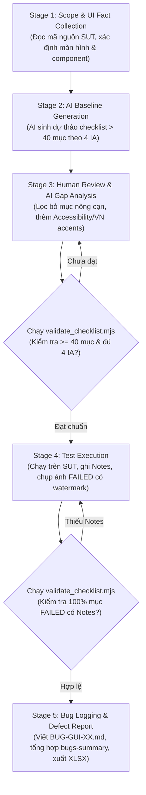
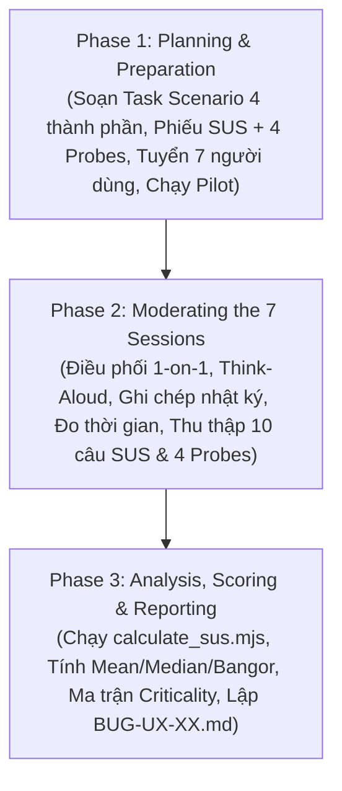
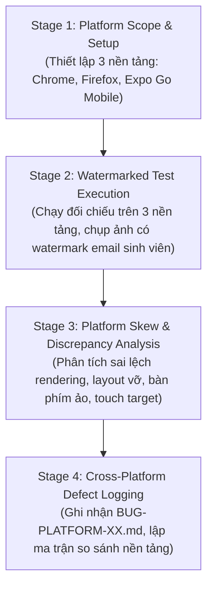
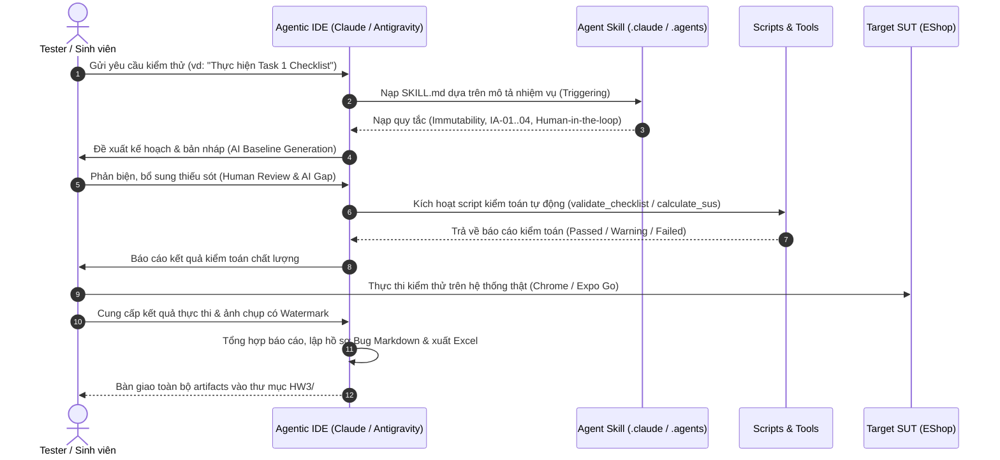

# Báo cáo Giải trình Kiến trúc và Nguồn gốc Bộ Agent Skills (HW03)

Tài liệu này giải trình chi tiết về kiến trúc, mục đích thiết kế, các thành phần công cụ và nguồn gốc căn cứ (từ Đề bài HW03 và Slide bài giảng CSC13003 S13) của **trọn bộ 3 Agent Skills** được xây dựng phục vụ bài tập **HW03 – GUI & Usability Testing**.

---

## 1. Tổng quan Bộ Agent Skills và Ma trận Đối chiếu Yêu cầu

| STT | Tên Skill | Thư mục lưu trữ | Ánh xạ Task đề bài | Căn cứ Đề bài (HW03 Spec) | Căn cứ Bài giảng (Slide S13) |
|:---:|:---|:---|:---:|:---|:---|
| 1 | **`gui-checklist-testing`** | `.claude/skills/gui-checklist-testing/`<br>`.agents/skills/gui-checklist-testing/` | **Task 1: Checklist GUI** (30đ) | • §4 Pool D & Khía cạnh giao diện (IA-01..04)<br>• §6 Task 1 (Checklist > 40 mục, AI Gap)<br>• §7 Agent Skill<br>• §14 File Excel checklist & Bug report | • Slide 6: Common GUI elements<br>• Slide 7-9: Purpose & Visual consistency<br>• Slide 11-14: 14 nhóm Common GUI bugs<br>• Slide 15-18: Checklist & Navigation testing<br>• Slide 28: Manual vs Automated |
| 2 | **`usability-evaluation`** | `.claude/skills/usability-evaluation/`<br>`.agents/skills/usability-evaluation/` | **Task 2: Đánh giá Usability** (40đ) | • §5 Phạm vi: Luồng End-to-End<br>• §6 Task 2: 3 giai đoạn, 7 người thật<br>• §6 Task 2: SUS + 4 câu hỏi probe<br>• §11 Chống gian lận: Thông tin 7 người | • Slide 30-31: 6 Basic components<br>• Slide 38: Typical test plan format<br>• Slide 39-40: 4 Thành phần Task Scenario<br>• Slide 42-44: Performance vs Preference data<br>• Slide 48-50: Phân tích số liệu & Criticality |
| 3 | **`cross-platform-gui-testing`** | `.claude/skills/cross-platform-gui-testing/`<br>`.agents/skills/cross-platform-gui-testing/` | **Task 3: Đa nền tảng** (20đ) | • §6 Task 3: $\ge 3$ nền tảng (Expo Go hợp lệ)<br>• §6 Task 3: Watermark email sinh viên<br>• §11 Chống gian lận ảnh chụp màn hình | • Slide 7: Visual consistency across devices<br>• Slide 15, 21: Compatibility & Platform testing<br>• Slide 22: Challenges: Diverse platforms/devices |

---

## 2. Chi tiết Skill 1: `gui-checklist-testing`

### 2.1. Mục đích thiết kế
Tự động hóa và chuẩn hóa quy trình thiết kế, phản biện, thực thi và báo cáo lỗi cho **Checklist kiểm thử giao diện người dùng** đạt quy mô **hơn 40 mục** trên hệ thống EShop SUT.

### 2.2. Căn cứ từ Đề bài HW03 (`HW03_GUI_Usability_VI.md`)
1. **Khái niệm 4 Khía cạnh Giao diện (Interface Aspect - IA)** (§4, dòng 73–81):
   - Đề bài quy định rõ kiểm thử GUI không đánh số theo FR mà chia theo 4 nhóm khía cạnh:
     - `IA-01`: Chuẩn UI chung
     - `IA-02`: Form (biểu mẫu)
     - `IA-03`: Điều hướng
     - `IA-04`: Phản hồi / trạng thái
   - *Áp dụng trong Skill*: Cấu trúc bảng checklist và mã định danh (`CHK-IA01-xx`, `CHK-IA02-xx`...) được phân loại bắt buộc theo 4 nhóm này.
2. **Quy mô và Quy trình Human-in-the-Loop** (§6 Task 1, dòng 96–102):
   - Yêu cầu checklist phải có **hơn 40 mục**.
   - Dùng AI sinh bộ mục ban đầu $\rightarrow$ Người kiểm thử review phản biện và bổ sung các mục AI bỏ sót.
   - Bắt buộc giải thích **vì sao AI bỏ sót** theo 3 nguyên nhân cốt lõi (`Prompt/input quality`, `Model limitation`, `Inherent UI complexity`).
   - Thực thi checklist đánh dấu `Passed` / `Failed`, có cột `Notes` giải thích lý do thất bại. **Chỉ chụp ảnh màn hình cho các mục Failed**.
   - Báo cáo bug cả trên Markdown và GitHub Issues kèm ảnh chụp bằng chứng.

### 2.3. Căn cứ từ Slide bài giảng (`S13_GUI Testing & Usability Testing.pdf`)
1. **Phạm vi kiểm thử Low-Level Checklist & Navigation (Slide 15, 16, 17, 18)**:
   - *Slide 16 (Checklist testing)*: Định nghĩa các thành phần của **IA-01**: GUI standards, Color scheme, Typography, Layout and alignment, Labels, Error messages.
   - *Slide 17, 18 (Navigation testing)*: Định nghĩa các thành phần của **IA-03**: Main Menu Navigation, Breadcrumb Navigation, Links and Buttons, Form Navigation (Tab order, focus order).
2. **Danh mục 14 nhóm lỗi GUI phổ biến (Slide 11, 12, 13, 14)**:
   - Toàn bộ tiêu chí kiểm tra trong template checklist được xây dựng trực tiếp từ các lỗi kinh điển trong slide:
     - *Slide 11*: Data validation, Incorrect field default, Mishandling of server process failures, Mandatory fields not mandatory, Wrong fields retrieved by queries.
     - *Slide 12*: Incorrect search criteria, Field order, Multiple database rows returned, Currency of data on screens, Window object/DB field correspondence.
     - *Slide 13*: Correct window modality, Window system commands not available/don't work, Control state alignment with state of data, Focus on objects needing it.
     - *Slide 14*: Menu options align with state of data, Action of menu commands aligns with state of data, Synchronization of window object content, State of controls aligns with state of data.

### 2.4. Các tệp thành phần đã tạo trong Skill
- **[SKILL.md](file:///d:/HCMUS/semester7/software-testing/Software-Testing/.claude/skills/gui-checklist-testing/SKILL.md)**: Hướng dẫn quy trình 5 giai đoạn (Discovery $\rightarrow$ AI Baseline $\rightarrow$ Human Review & AI Gap Analysis $\rightarrow$ Execution $\rightarrow$ Bug Logging).
- **[templates/checklist-template.md](file:///d:/HCMUS/semester7/software-testing/Software-Testing/.claude/skills/gui-checklist-testing/templates/checklist-template.md)**: Mẫu bảng checklist chuẩn 10 cột, tích hợp đầy đủ tiêu chí cho cả 4 khía cạnh IA-01..IA-04.
- **[templates/ai-gap-analysis-template.md](file:///d:/HCMUS/semester7/software-testing/Software-Testing/.claude/skills/gui-checklist-testing/templates/ai-gap-analysis-template.md)**: Mẫu bảng phân tích chi tiết các mục AI bỏ sót (WCAG contrast, text truncation tiếng Việt, bàn phím ảo che khuất nút trên mobile, focus trap modal, double-click race condition).
- **[scripts/validate_checklist.mjs](file:///d:/HCMUS/semester7/software-testing/Software-Testing/.claude/skills/gui-checklist-testing/scripts/validate_checklist.mjs)**: Script tự động phân tích file markdown checklist, đếm tổng số mục ($\ge 40$), kiểm tra độ phủ 4 khía cạnh IA, đếm tỷ lệ Pass/Fail, và cảnh báo các mục Failed thiếu cột Notes.

### 2.5. Luồng hoạt động chi tiết qua 5 Stage (Workflow by Stages)

Quy trình hoạt động của Skill `gui-checklist-testing` được thiết kế theo mô hình 5 giai đoạn tuần tự với 2 chốt chặn kiểm toán tự động (Automated Quality Gates):



| Giai đoạn (Stage) | Tác nhân chính | Đầu vào (Inputs) | Thao tác kỹ thuật chi tiết | Công cụ / Script hỗ trợ | Đầu ra cụ thể (Outputs) |
|---|---|---|---|---|---|
| **Stage 1: Khảo sát & Thu thập Thực tế UI** | Tester + Agent | Mã nguồn SUT (`frontend-web/src/pages/*.jsx`, `frontend-mobile/App.js`), SUT đang chạy trên browser. | • Đọc cấu trúc DOM, các trường Form, nút CTA, menu điều hướng.<br>• Xác định 4 màn hình trọng tâm: Home, Product Detail, Cart & Checkout, Mobile Home/Cart.<br>• Lập danh mục các trạng thái động (loading, modal, error state). | IDE File Viewer, DevTools Inspector | Bản tóm tắt giao diện mục tiêu, danh mục routes và UI components. |
| **Stage 2: AI sinh Checklist Baseline (> 40 mục)** | Agent (AI) | Danh mục UI components từ Stage 1, Barem 4 khía cạnh IA từ Slide S13. | • Prompt AI sinh danh sách 40–45 mục kiểm thử.<br>• Phân bổ đều vào 4 nhóm: IA-01 (Chuẩn UI), IA-02 (Form), IA-03 (Điều hướng), IA-04 (Phản hồi/Trạng thái).<br>• Điền các cột: Item ID, Aspect, Screen, Element, Verification Criteria, Expected Behavior. | `templates/checklist-template.md` | Bảng dự thảo checklist ban đầu (~40-45 mục) dưới dạng Markdown thô. |
| **Stage 3: Human Review, AI Gap Analysis & Pre-Audit** | Tester (Human) | Bảng checklist dự thảo từ Stage 2, Hướng dẫn Slide S13, Tiêu chuẩn WCAG 2.1. | • **Phản biện & sàng lọc**: Xóa bỏ các mục chung chung, sáo rỗng hoặc trùng lặp do AI sinh.<br>• **Bổ sung các điểm mù AI thường bỏ sót**: Tương phản màu WCAG, vỡ layout dấu tiếng Việt, bàn phím ảo che input trên mobile, bẫy focus modal dialog, click đúp gây lỗi dữ liệu.<br>• **Lập bảng AI Gap Analysis**: Ghi nhận lý do vì sao AI bỏ sót theo 3 nhóm nguyên nhân (`Prompt quality`, `Model limitation`, `Inherent UI complexity`).<br>• **Chạy Pre-Audit Script**: Chạy kiểm toán tự động xác nhận số mục $\ge 40$ và đủ cả 4 khía cạnh IA-01..04. | `scripts/validate_checklist.mjs`, `templates/ai-gap-analysis-template.md` | `HW3/report/checklist.md` (đạt chuẩn sơ bộ) + Bảng phân tích AI Gap Analysis. |
| **Stage 4: Thực thi Kiểm thử & Post-Audit** | Tester (Human) | SUT đang chạy (`localhost:3000`, backend port 5000), Checklist hoàn chỉnh từ Stage 3. | • Chạy từng ca kiểm thử trên trình duyệt SUT thực tế.<br>• Ghi nhận trạng thái: `PASSED`, `FAILED`, `BLOCKED`.<br>• **Quy tắc bắt buộc**: Mọi mục FAILED phải ghi rõ lý do chi tiết vào cột `Notes` và chụp ảnh màn hình có **overlay watermark email sinh viên** (`23120319@student.hcmus.edu.vn`).<br>• **Chạy Post-Audit Script**: Tự động rà soát toàn bộ bảng kiểm thử, cảnh báo ngay lập tức nếu có bất kỳ ca FAILED nào quên ghi Notes. | `scripts/validate_checklist.mjs`, Công cụ chèn Watermark DOM/DevTools | Cột kết quả trong `checklist.md` được điền đầy đủ + Thư mục ảnh `HW3/evidence/screenshots/gui/`. |
| **Stage 5: Lập Báo cáo Lỗi & Xuất bản Artifacts** | Tester + Agent | Các mục FAILED và ảnh bằng chứng từ Stage 4. | • Soạn thảo báo cáo lỗi chi tiết cho từng ca thất bại theo mẫu chuẩn GitHub Issues (`BUG-GUI-XX.md`).<br>• Tổng hợp bảng ma trận lỗi vào `bugs-summary.md`.<br>• Xuất bảng checklist sang định dạng bảng tính `checklist.xlsx` để nộp kèm bài tập. | Script chuyển đổi Markdown $\rightarrow$ XLSX | `HW3/report/issues/BUG-GUI-XX.md`, `HW3/report/bugs-summary.md`, `HW3/report/checklist.xlsx`. |

---

## 3. Chi tiết Skill 2: `usability-evaluation`

### 3.1. Mục đích thiết kế
Đóng gói phương pháp luận và công cụ thực thi **Đánh giá tính khả dụng có người điều phối (Moderated Usability Evaluation)** trên 1 luồng End-to-End với **7 người dùng thật** ngoài lớp, đo lường thang đo SUS chuẩn mực và phân tích phát hiện UX.

### 3.2. Căn cứ từ Đề bài HW03 (`HW03_GUI_Usability_VI.md`)
1. **Phạm vi & Người tham gia** (§5 & §6 Task 2, dòng 88–130):
   - Chọn 1 luồng end-to-end duy nhất (ví dụ: Tìm sản phẩm $\rightarrow$ Thêm giỏ hàng $\rightarrow$ Áp dụng coupon $\rightarrow$ Thanh toán).
   - Tuyển **7 người tham gia thật** ngoài lớp, ưu tiên non-IT/không phải tester, thông tin liên hệ xác minh được (che 4 số giữa SĐT/Zalo).
   - Chạy 1 phiên thử nghiệm (pilot) trước khi chạy 7 phiên chính thức.
   - Có thể bị TA gọi ngẫu nhiên 2 người để xác minh (§6 dòng 129 & §11 dòng 175).
2. **Kịch bản nhiệm vụ & Công cụ đo lường** (§6 Task 2, Giai đoạn 1):
   - Viết kịch bản nhiệm vụ hướng mục tiêu (goal-oriented, đưa mục tiêu thực tế, không chỉ từng bước click).
   - Thang đo định lượng: Thang đo chuẩn **SUS (System Usability Scale)** 10 câu.
   - Bộ 4 câu hỏi thăm dò mở (Open Probes) bắt buộc:
     1. **Tính rõ ràng (Clarity)**
     2. **Khôi phục lỗi (Error recovery)**
     3. **Tốc độ (Speed)**
     4. **Sự tin cậy (Trust)**
3. **Quy trình điều phối & Báo cáo** (§6 Task 2, Giai đoạn 2 & 3):
   - Dàn dựng bối cảnh: "Kiểm thử phần mềm, không kiểm thử người dùng", khuyến khích nói to suy nghĩ (Think-Aloud).
   - Quan sát trung lập, không can thiệp dẫn dắt.
   - Tính điểm SUS 7 người, phân loại lỗi đơn lẻ vs lỗi hệ thống, ma trận mức độ nghiêm trọng, log bug lên Markdown & GitHub Issues.

### 3.3. Căn cứ từ Slide bài giảng (`S13_GUI Testing & Usability Testing.pdf`)
1. **6 Thành phần cơ bản của Usability Testing (Slide 30, 31)**:
   - *Slide 30*: Định nghĩa kiểm thử khả dụng với người dùng đại diện (representative target population) và tiêu chí cụ thể.
   - *Slide 31*: 6 bước cấu thành: (1) Problem statements & test plans $\rightarrow$ (2) Representative sample $\rightarrow$ (3) Actual work environment $\rightarrow$ (4) Observation $\rightarrow$ (5) Quantitative & qualitative measurements $\rightarrow$ (6) Analysis & recommendations.
2. **Cấu trúc Kế hoạch & Kịch bản nhiệm vụ chuẩn (Slide 38, 39, 40)**:
   - *Slide 38 (Typical test plan format)*: Định hình cấu trúc kế hoạch gồm Mục đích, Problem statement, Nhiệm vụ, Hồ sơ người dùng, Phương pháp quan sát, Thiết bị, Vai trò người điều phối, Tiêu chí đánh giá, Báo cáo.
   - *Slide 39 (Task selection)*: Hướng mục tiêu (Focus on user view, NOT components/details), cụ thể và đo lường được.
   - *Slide 40 (Task components table)*: Quy định đúng **4 thành phần nhiệm vụ**:
     $$\text{Task Scenario} = \text{Task} + \text{Machine state} + \text{Successful completion criteria} + \text{Benchmark}$$
     $\rightarrow$ Cấu trúc này được đưa nguyên bản vào `templates/task-scenario-template.md`.
3. **Thu thập dữ liệu Hiệu năng & Sở thích (Slide 42, 43, 44)**:
   - *Slide 43 (Performance data - Khách quan)*: Thời gian hoàn thành, tỷ lệ thành công, số lỗi thao tác, thời gian phản hồi hệ thống.
   - *Slide 44 (Preference data - Chủ quan)*: Thang đo Likert 5 mức độ (Thang đo nền tảng của bảng câu hỏi SUS).
4. **Phân tích số liệu và Đánh giá mức độ nghiêm trọng (Slide 48, 49, 50)**:
   - *Slide 48 (Summarizing performance)*: Tính toán thời gian trung bình (Mean), trung vị (Median), độ lệch chuẩn (Standard deviation), tỷ lệ hoàn thành (Task accuracy %).
   - *Slide 50 (Analyzing Data)*: Nhận diện lỗi người dùng, tìm nguồn gốc lỗi, phân cấp mức độ ưu tiên:
     $$\text{Criticality} = \text{Severity} \times \text{Probability}$$

### 3.4. Các tệp thành phần đã tạo trong Skill
- **[SKILL.md](file:///d:/HCMUS/semester7/software-testing/Software-Testing/.claude/skills/usability-evaluation/SKILL.md)**: Quy trình trọn gói 3 Phase từ lập kế hoạch, kịch bản người điều phối (Moderator Guide) đến phân tích định lượng & định tính.
- **[templates/task-scenario-template.md](file:///d:/HCMUS/semester7/software-testing/Software-Testing/.claude/skills/usability-evaluation/templates/task-scenario-template.md)**: Mẫu kịch bản nhiệm vụ 4 thành phần (Task, Machine state, Success criteria, Benchmark 120s) kèm lời thoại mẫu cho người điều phối.
- **[templates/sus-questionnaire-template.md](file:///d:/HCMUS/semester7/software-testing/Software-Testing/.claude/skills/usability-evaluation/templates/sus-questionnaire-template.md)**: Phiếu khảo sát chuẩn SUS 10 câu Likert song ngữ Anh-Việt kèm công thức quy đổi điểm và 4 câu hỏi probe mở (Rõ ràng, Phục hồi lỗi, Tốc độ, Tin cậy).
- **[templates/observation-notes-template.md](file:///d:/HCMUS/semester7/software-testing/Software-Testing/.claude/skills/usability-evaluation/templates/observation-notes-template.md)**: Bảng nhật ký quan sát hành vi, thời gian, điểm vướng mắc và trích dẫn lời nói người dùng theo thời gian thực.
- **[scripts/calculate_sus.mjs](file:///d:/HCMUS/semester7/software-testing/Software-Testing/.claude/skills/usability-evaluation/scripts/calculate_sus.mjs)**: Script tự động tính điểm chuẩn SUS:
  - Công thức: Câu lẻ $(Q_i - 1)$, câu chẵn $(5 - Q_j)$, tổng nhân $2.5$.
  - Tính Mean SUS, Median SUS, Standard Deviation ($\sigma$), tỷ lệ hoàn thành.
  - Phân loại xếp hạng Bangor Grade (Grade A: $\ge 80.3$, B: $68.0-80.2$, C: $51.0-67.9$, D: $36.0-50.9$, F: $<36.0$) và chuẩn ngành ($68.0$). Xuất trực tiếp bảng Markdown/CSV cho báo cáo.

### 3.5. Luồng hoạt động chi tiết qua 3 Phase (Workflow by Phases)

Quy trình hoạt động của Skill `usability-evaluation` tuân thủ nghiêm ngặt phương pháp thử nghiệm có điều phối (Moderated Usability Testing) với 7 người dùng ngoài lớp:



| Giai đoạn (Phase) | Tác nhân chính | Đầu vào (Inputs) | Thao tác kỹ thuật chi tiết | Công cụ / Script hỗ trợ | Đầu ra cụ thể (Outputs) |
|---|---|---|---|---|---|
| **Phase 1: Chuẩn bị & Lập kế hoạch (Planning & Preparation)** | Tester | Yêu cầu bài tập HW03 (§6 Task 2), Luồng nghiệp vụ mục tiêu của EShop (VD: Mua hàng & Nhập mã giảm giá). | • **Xác định mục tiêu kiểm thử**: Tìm ra rào cản thao tác và điểm gây bối rối trong luồng mua hàng.<br>• **Soạn Kịch bản Nhiệm vụ (Task Scenario)**: Chuẩn hóa theo Slide 40 gồm 4 phần: Task (mục tiêu thực tế, không chỉ từng nút click), Machine state (trạng thái hệ thống trước test), Success criteria (tiêu chí hoàn thành), Benchmark (thời gian chuẩn, ví dụ 120s).<br>• **Chuẩn bị công cụ đo**: Bản khảo sát SUS 10 câu Likert + 4 câu hỏi đào sâu (Clarity, Error Recovery, Speed, Trust).<br>• **Tuyển 7 người dùng thật**: Ưu tiên người dùng phổ thông ngoài ngành IT, thu thập thông tin liên hệ và che 4 chữ số giữa (SĐT/Zalo).<br>• **Chạy phiên thử nghiệm (Pilot)**: Chạy thử trước 1 người để tinh chỉnh thời gian và tài liệu. | `templates/task-scenario-template.md`, `templates/sus-questionnaire-template.md` | `HW3/plan/usability-test-plan.md`, Danh sách 7 người dùng xác thực, Kịch bản Moderator Guide. |
| **Phase 2: Điều phối 7 Phiên Thử nghiệm (Moderating 7 Sessions)** | Tester (Moderator) + 7 Người dùng | SUT đã reset dữ liệu mẫu (Seeded DB), Kịch bản nhiệm vụ từ Phase 1, Phiếu khảo sát. | • **Thiết lập bối cảnh**: Giới thiệu nguyên tắc "Thử nghiệm phần mềm, không thử nghiệm người dùng", hướng dẫn kỹ thuật vừa làm vừa nói (Think-Aloud).<br>• **Quan sát độc lập & Trung lập**: Moderator không giải thích hay can thiệp, chỉ quan sát và ghi chép.<br>• **Ghi chép Nhật ký Quan sát**: Ghi nhận thời gian bắt đầu/kết thúc, số lần click nhầm, do dự, và trích dẫn nguyên văn lời nói bực bội/khen ngợi của người dùng.<br>• **Khảo sát sau thử nghiệm**: Người dùng tự điền phiếu 10 câu hỏi SUS; Moderator phỏng vấn nhanh 4 câu hỏi probe mở để đào sâu nguyên nhân điểm nghẽn UX. | `templates/observation-notes-template.md`, Đồng hồ bấm giờ, Công cụ chụp màn hình có watermark | `HW3/report/observation-notes.md`, `HW3/data/sus-responses.json`, Bằng chứng hình ảnh các điểm nghẽn UX. |
| **Phase 3: Phân tích Dữ liệu, Tính điểm & Báo cáo (Analysis & Reporting)** | Tester + Agent | Dữ liệu thô `sus-responses.json`, Nhật ký quan sát `observation-notes.md`. | • **Tính điểm SUS tự động**: Chạy script `calculate_sus.mjs` để quy đổi điểm chuẩn theo công thức (câu lẻ $-1$, câu chẵn $5-x$, nhân $2.5$), xuất các chỉ số Mean, Median, Độ lệch chuẩn ($\sigma$), Xếp loại Bangor Grade (A/B/C/D/F) và đối chiếu mốc chuẩn ngành ($68.0$).<br>• **Phân tích Định tính & Tổng hợp Vấn đề**: Tách biệt lỗi giao diện cá lẻ với khiếm khuyết thiết kế trải nghiệm mang tính hệ thống.<br>• **Đánh giá Mức độ Nghiêm trọng**: Phân loại theo công thức Slide 50: $\text{Criticality} = \text{Severity} \times \text{Probability}$ (P0 Blockers $\rightarrow$ P3 Cosmetic).<br>• **Lập Báo cáo & Bug Log**: Soạn thảo các bug usability (`BUG-UX-XX.md`) kèm giải pháp khắc phục UI/UX khả thi. | `scripts/calculate_sus.mjs`, Template bug report | `HW3/report/usability-report.md`, `HW3/report/issues/BUG-UX-XX.md`. |

---

## 4. Chi tiết Skill 3: `cross-platform-gui-testing`

### 4.1. Mục đích thiết kế
Hướng dẫn thiết lập môi trường, thực thi kiểm thử giao diện trên **tối thiểu 3 nền tảng khác nhau**, phát hiện các điểm sai lệch hiển thị/chức năng (Platform Skew), và thực thi quy định bằng chứng có watermark chống gian lận.

### 4.2. Căn cứ từ Đề bài HW03 (`HW03_GUI_Usability_VI.md`)
1. **Yêu cầu Đa nền tảng** (§6 Task 3, dòng 131–138):
   - Chạy Task 1 trên **ít nhất ba (3) nền tảng**.
   - Trình duyệt Web: Chrome, Firefox, Safari (hoặc Chrome trên Android).
   - **Đặc cách quan trọng**: Ứng dụng di động của SUT qua **Expo Go trên điện thoại thật** được tính là một nền tảng hợp lệ và có thể thay thế Safari (thỏa mãn 1 trong 3 nền tảng bắt buộc).
2. **Quy tắc Bằng chứng Chống Gian lận (Anti-Fraud Constraints)** (§6 dòng 137 & §11 dòng 176):
   - Mọi ảnh chụp màn hình **bắt buộc phải có overlay username** theo định dạng email sinh viên (ví dụ: `21127xxx@student.hcmus.edu.vn`).
   - Ảnh chụp phải thể hiện rõ tên trình duyệt, hệ điều hành, khung thiết bị và URL SUT.
   - Khi điền form (đăng ký, thanh toán) phải thể hiện mã số sinh viên hoặc họ tên sinh viên.

### 4.3. Căn cứ từ Slide bài giảng (`S13_GUI Testing & Usability Testing.pdf`)
1. **Tính nhất quán thị giác đa nền tảng (Slide 7, 15, 21)**:
   - *Slide 7 (Visual Consistency)*: Kiểm thử GUI xác minh phần mềm duy trì tính nhất quán thị giác trên các thiết bị và nền tảng khác nhau, ngăn ngừa lỗi tràn chữ, lệch hàng, vỡ hình ảnh.
   - *Slide 15 & 21 (Non-Functional Level)*: Phân loại Compatibility testing & Platform/environment testing thuộc cấp độ phi chức năng của kiểm thử GUI.
2. **Thách thức đa thiết bị và Giải pháp (Slide 22)**:
   - *Slide 22 (Diverse Platforms and Devices)*:
     - Thách thức: Đảm bảo hiệu năng và giao diện GUI nhất quán qua nhiều hệ điều hành, trình duyệt và kích thước màn hình.
     - Giải pháp: Thực hiện kiểm thử toàn diện cross-browser và cross-device kết hợp thiết kế đáp ứng (responsive design).

### 4.4. Các tệp thành phần đã tạo trong Skill
- **[SKILL.md](file:///d:/HCMUS/semester7/software-testing/Software-Testing/.claude/skills/cross-platform-gui-testing/SKILL.md)**: Định nghĩa 3 tổ hợp nền tảng hợp lệ, trong đó khuyến nghị Tổ hợp A: **Desktop Chrome (Windows) + Desktop Firefox (Windows) + Safari (BrowserStack) / Expo Go Mobile trên điện thoại thật**.
- **[scripts/overlay_username.py](file:///d:/HCMUS/semester7/software-testing/Software-Testing/.claude/skills/cross-platform-gui-testing/scripts/overlay_username.py)**: Script Python chuyên dụng tự động đóng dấu dải banner định danh chống gian lận (email sinh viên, MSSV, họ tên, platform và timestamp) ở mép dưới ảnh; hỗ trợ tự động nhận diện platform theo tên file và xử lý đệ quy qua các thư mục con.
- **Cấu trúc 45 Thư mục Bằng chứng (45 Case Folders)**: Tổ chức thư mục HW3/evidence/screenshots/cross-platform/ gồm 45 thư mục con chuẩn hóa:
  - 35 thư mục Web & Admin (CHK-ADM-01..20 & CHK-WEB-01..15): mỗi thư mục chứa 3 ảnh <CASE_ID>-chrome.png, <CASE_ID>-firefox.png, <CASE_ID>-safari.png.
  - 10 thư mục Mobile (CHK-MOB-01..10): mỗi thư mục chứa ảnh Expo Go trên điện thoại thật <CASE_ID>-expo.png (hoặc .jpg).
- **Bảng ma trận so sánh sai lệch nền tảng (Platform Skew Matrix)**: Đối chiếu font chữ, widget ngày tháng, bàn phím ảo che khuất form, và cách xử lý khi mất kết nối mạng giữa Web và Mobile.

### 4.5. Luồng hoạt động chi tiết qua 4 Stage (Workflow by Stages)

Quy trình hoạt động của Skill `cross-platform-gui-testing` tập trung phát hiện sai lệch hiển thị và đảm bảo tính nguyên vẹn của bằng chứng đa nền tảng:



| Giai đoạn (Stage) | Tác nhân chính | Đầu vào (Inputs) | Thao tác kỹ thuật chi tiết | Công cụ / Script hỗ trợ | Đầu ra cụ thể (Outputs) |
|---|---|---|---|---|---|
| **Stage 1: Thiết lập Phạm vi & Môi trường Đa nền tảng** | Tester | SUT Backend (Node.js/SQLite), Web Frontend, Mobile Expo App. | • Khởi động Backend và Web SUT trên máy tính.<br>• Khởi tạo ứng dụng di động qua `npx expo start`, cấu hình tunnel/LAN IP để điện thoại thật truy cập được API.<br>• Chuẩn bị 3 nền tảng kiểm thử: **Desktop Chrome (Windows)**, **Desktop Firefox (Windows)**, và **Điện thoại thật chạy Expo Go (Android/iOS)**.<br>• Cấu hình sẵn cơ chế chèn watermark email sinh viên (`23120319@student.hcmus.edu.vn`). | Expo CLI, Chrome DevTools, Script overlay watermark | Môi trường 3 nền tảng hoạt động đồng thời, truy cập cùng một cơ sở dữ liệu chung. |
| **Stage 2: Thực thi Đối chiếu có Watermark Bắt buộc** | Tester (Human) | Bộ tiêu chí kiểm thử từ Task 1, 3 nền tảng đang hoạt động. | • Thực hiện các kịch bản kiểm thử then chốt lần lượt trên cả 3 nền tảng.<br>• Quan sát sự khác biệt về hiển thị layout, form input, và điều hướng.<br>• **Quy định chống gian lận**: Chụp ảnh màn hình mọi lỗi hoặc sai lệch hiển thị, bắt buộc hiển thị rõ: (1) Khung trình duyệt / thiết bị di động, (2) Thanh trạng thái / URL SUT, (3) **Overlay username email sinh viên** nằm ở góc màn hình. | Snipping Tool, Watermark Injector, ADB / Expo Screenshot | Thư mục bằng chứng ảnh `HW3/evidence/screenshots/cross-platform/` có đóng dấu xác thực. |
| **Stage 3: Phân tích Sai lệch Nền tảng (Platform Skew Analysis)** | Tester + Agent | Hình ảnh bằng chứng và kết quả đối chiếu từ Stage 2. | • Lập bảng so sánh đối đầu giữa các nền tảng (Chrome vs Firefox vs Expo Go Mobile):<br>  - *Font rendering & Icon*: Độ sắc nét, khả năng hiển thị ký tự tiếng Việt có dấu.<br>  - *Form Controls*: Sự khác biệt giữa Web HTML5 date picker vs Native Mobile picker; bàn phím ảo che mất nút Submit trên điện thoại.<br>  - *Touch Target vs Mouse Pointer*: Các nút bấm < 48x48px khó thao tác bằng ngón tay trên di động.<br>  - *Responsive Wrapping*: Vỡ khung lưới sản phẩm khi đổi độ phân giải màn hình. | Bảng so sánh Markdown | Bảng ma trận đối chiếu sai lệch nền tảng (`platform-discrepancy-matrix.md`). |
| **Stage 4: Báo cáo Lỗi Tương thích Đa nền tảng** | Tester + Agent | Bảng ma trận sai lệch từ Stage 3. | • Phân loại lỗi thành: Lỗi tương thích trình duyệt (Browser Incompatibility) hoặc Lỗi chuyển đổi Web-to-Mobile (Responsive / Mobile Skew).<br>• Lập hồ sơ lỗi chi tiết theo định dạng `BUG-PLATFORM-XX.md` đính kèm ảnh chụp so sánh song song giữa các nền tảng.<br>• Tổng hợp phần đánh giá đa nền tảng vào báo cáo tổng kết. | Template Bug Report | `HW3/report/issues/BUG-PLATFORM-XX.md`, Chương đánh giá đa nền tảng trong báo cáo tổng kết. |

---

## 5. Cơ chế Vận hành Tổng quát của một Agent Skill trong Môi trường IDE

Để hiểu rõ cách một Agent Skill hoạt động trong thực tế, phần này mô hình hóa cơ chế kích hoạt, kiến trúc 3 tầng và vòng lặp tương tác giữa AI và Con người (Human-in-the-Loop).

### 5.1. Vòng đời Kích hoạt và Thực thi của một Skill (Life-cycle)

Một Agent Skill không phải là một đoạn mã chạy độc lập tự động từ đầu đến cuối, mà là một **gói quy trình chuyên gia chuẩn hóa (Standardized Expert Workflow Package)** được Agent nạp và tuân thủ theo các bước sau:



1. **Khám phá & Kích hoạt (Context Discovery & Triggering)**:
   - Khi người dùng đưa ra câu lệnh hoặc mục tiêu liên quan đến kiểm thử GUI, tính khả dụng hoặc đa nền tảng, IDE tự động quét qua các tệp `SKILL.md` trong `.claude/skills/` hoặc `.agents/skills/`.
   - IDE đọc phần YAML frontmatter (`name`, `description`) để chọn đúng kỹ năng chuyên biệt phù hợp với nhiệm vụ.
2. **Thiết lập Khung Ràng buộc (Constraint Enforcement)**:
   - Ngay khi kích hoạt, Skill lập tức áp đặt các quy tắc bất biến cốt lõi:
     - **SUT Immutability**: Tuyệt đối không chạm vào code `eshop-sut/`.
     - **Output Destination**: Mọi kết quả phải xuất vào `<OUTPUT_DIR>` (`HW3/`).
     - **Anti-Fraud**: Mọi ảnh chụp phải có watermark email sinh viên.
3. **Phân rã Giai đoạn có Kiểm soát (Step-by-Step Staged Execution)**:
   - Skill dẫn dắt Agent và Tester đi qua từng Stage/Phase cụ thể. Ở mỗi bước, Skill cung cấp đúng biểu mẫu (`templates/`) để tránh việc Agent tự do bịa đặt cấu trúc dữ liệu không chuẩn mực.
4. **Chốt chặn Kiểm toán Tự động (Automated Quality Gates)**:
   - Tại các mốc chuyển giao quan trọng (trước khi test và sau khi test), Skill yêu cầu kích hoạt các script tự động (`scripts/*.mjs`, `scripts/*.py`).
   - Nếu script báo lỗi (ví dụ: checklist chưa đủ 40 mục, hoặc ca FAILED thiếu Notes), quy trình bị chặn lại bắt buộc phải hoàn thiện trước khi chuyển sang bước kế tiếp.
5. **Đóng gói Sản phẩm Chuyển giao (Deliverable Bundling)**:
   - Toàn bộ kết quả đầu ra được định dạng chuẩn mực (Markdown báo cáo, file Excel `.xlsx`, ảnh chụp màn hình `.png`, hồ sơ bug GitHub Issues).

### 5.2. Mô hình Kiểm soát 3 Lớp (Human-in-the-Loop Tri-Layer Model)

Mỗi Skill được vận hành dựa trên sự kết hợp hài hòa của 3 tầng năng lực:

```
┌──────────────────────────────────────────────────────────────────┐
│  TẦNG 1: TRÍ TUỆ NHÂN TẠO (AI Drafting Engine)                   │
│  • Khảo sát code nhanh, nhận diện UI component & form fields     │
│  • Khởi tạo dữ liệu nền tảng ban đầu (> 40 mục checklist sơ bộ) │
│  • Soạn thảo khung báo cáo lỗi (Steps, Expected, Actual)         │
└─────────────────────────────────┬────────────────────────────────┘
                                  │ (Chuyển giao bản nháp)
                                  ▼
┌──────────────────────────────────────────────────────────────────┐
│  TẦNG 2: CON NGƯỜI LÀM TRỌNG TÂM (Human Gatekeeper & Reviewer)   │
│  • Phản biện, loại bỏ mục AI sinh nông cạn                       │
│  • Bổ sung các khía cạnh chiều sâu: Accessibility WCAG, VN fonts │
│  • Điều phối tương tác trực tiếp với người dùng thật (Task 2)    │
│  • Chịu trách nhiệm ra quyết định đánh giá Pass / Fail           │
└─────────────────────────────────┬────────────────────────────────┘
                                  │ (Chuyển giao dữ liệu đã duyệt)
                                  ▼
┌──────────────────────────────────────────────────────────────────┐
│  TẦNG 3: CÔNG CỤ TỰ ĐỘNG HÓA CỨNG (Automated Deterministic Tools)│
│  • validate_checklist.mjs: Ép chỉ tiêu số lượng (>= 40 mục),     │
│    độ phủ 4 IA, và cưỡng chế có ghi chú lý do ở cột Notes        │
│  • calculate_sus.mjs: Tính toán điểm SUS chuẩn Bangor 100% chính │
│    xác theo công thức toán học, loại bỏ sai sót tính tay         │
│  • audit.py: Ghi chép nhật ký minh bạch AI Audit Log không sai lệch│
└──────────────────────────────────────────────────────────────────┘
```

Mô hình 3 lớp này giải quyết triệt để vấn đề "AI ảo giác" (Hallucination) hoặc "làm chiếu lệ", biến Agent thành một trợ lý kiểm thử tin cậy dưới sự dẫn dắt của chuyên gia con người và sự giám sát của các công cụ xác thực độc lập.

---

## 6. Tóm tắt Giá trị Kỹ thuật và Ý nghĩa Thực tiễn

1. **Khép kín quy trình kiểm thử từ Lý thuyết đến Thực hành**: Bộ skills chuyển hóa 100% các khái niệm học thuật từ slide bài giảng FIT@HCMUS (Slide 11-14 về lỗi GUI, Slide 40 về kịch bản nhiệm vụ, Slide 48 về chỉ số đo lường) thành các quy trình thực thi và tệp mã nguồn cụ thể.
2. **Tự động hóa có kiểm soát (Human-in-the-Loop)**: Trang bị sẵn các script kiểm tra chất lượng checklist (`validate_checklist.mjs`) và tính toán thống kê tự động (`calculate_sus.mjs`), giúp loại bỏ hoàn toàn các sai sót tính toán thủ công và đảm bảo đáp ứng đầy đủ barem điểm của đề bài.
3. **Tuân thủ tuyệt đối quy định học thuật**: Tích hợp chặt chẽ cơ chế phát hiện điểm yếu của AI (AI Gap Analysis), quy tắc đóng dấu email sinh viên chống giả mạo bằng chứng, và bảo toàn tính toàn vẹn của dữ liệu thử nghiệm.
4. **Nguyên tắc Bất biến SUT (SUT Immutability Rule - Strict Zero-Modification Policy)**: Thiết lập bắt buộc trong cả 3 skills: Agent kiểm thử **tuyệt đối không được sửa đổi, vá lỗi hay can thiệp vào mã nguồn của `eshop-sut/`** (backend, frontend-web, frontend-admin, frontend-mobile). Mọi lỗi phát hiện đều phải được ghi nhận trung thực thành Bug Report, giữ nguyên trạng thái SUT như một hộp đen tĩnh (Read-Only Black-Box). Toàn bộ sản phẩm kiểm thử phải lưu độc lập trong `HW3/`.
