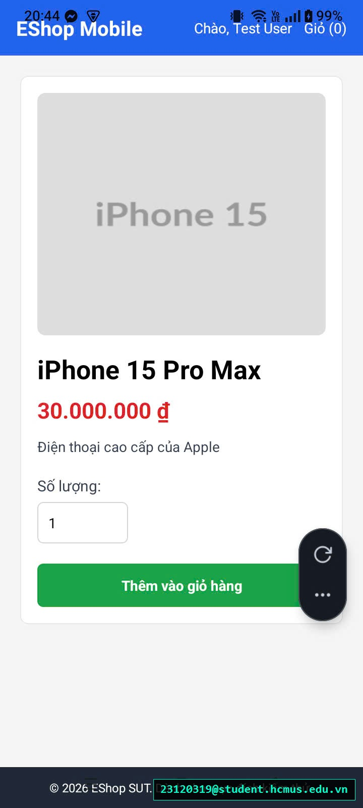

# [BUG-GUI-40][IA-03] Thiếu nút mũi tên quay lại (Back Arrow) trên thanh Header Mobile

| Mục | Nội dung |
|---|---|
| Tính năng | Điều hướng Giao diện (Navigation Bar) – Mobile App Expo Go |
| Test case liên quan | `CHK-MOB-07` (Khía cạnh `IA-03` – Điều hướng & Header Navigation) |
| Mức độ (Severity) | Major |
| Độ ưu tiên (Priority) | High |
| Khả năng tái hiện | Luôn luôn (100%) |
| Môi trường | Android 12/13/14, Ứng dụng Expo Go, SUT Mobile App |
| Ngày phát hiện | 2026-11-01 |
| GitHub Issue | *Đang cập nhật* |

## Điều kiện tiên quyết
- Đang ở một màn hình con bất kỳ trong ứng dụng Mobile (ví dụ: màn hình Chi tiết sản phẩm, Giỏ hàng, hoặc Đăng nhập).

## Các bước tái hiện
1. Từ Trang chủ, bấm "Xem chi tiết" một sản phẩm hoặc bấm vào nút "Giỏ hàng".
2. Quan sát thanh tiêu đề điều hướng trên cùng (Header / NavBar).
3. Tìm nút quay lại trang trước (Back Arrow `←`).

## Request / Response thực tế
*(Thanh Header thiếu nút điều hướng quay lui)*

## Kết quả mong đợi
Thanh Header của các màn hình con bắt buộc phải có nút quay lại (Back arrow icon `←`) ở góc trên cùng bên trái. Khi người dùng bấm vào, ứng dụng phải đưa người dùng quay trở lại màn hình trước đó một cách mượt mà và trực quan. — nguồn: [SPEC] / [ASSUMED] (Nguyên lý điều hướng chuẩn Mobile Material / iOS Guidelines)

## Kết quả thực tế
Thanh Header ở tất cả các màn hình con đều giống hệt Trang chủ (chỉ gồm chữ "EShop Mobile", nút Đăng nhập và Giỏ hàng), hoàn toàn không có bất kỳ nút Back mũi tên nào. Người dùng không có cách trực quan để quay lui ngoài việc bấm vào logo chữ "EShop Mobile" để nhảy thẳng về trang chủ (mất trạng thái điều hướng phân cấp).

## Bằng chứng
- `evidence/screenshots/gui/BUG-GUI-15-haven't-back-arrow.jpg` (Ảnh chụp màn hình thực tế có watermark sinh viên `23120319@student.hcmus.edu.vn`)



## Phân tích nguyên nhân (giả thuyết, nếu thấy trong code)
`frontend-mobile/App.js:L434-452` (đã xác nhận trực tiếp từ mã nguồn SUT):
- Hàm `renderHeader` cố định cứng cho mọi màn hình mà không kiểm tra màn hình hiện tại có phải là màn hình con hay không để render nút Back:
  ```jsx
  const renderHeader = () => (
    <View style={styles.navBar}>
      <TouchableOpacity onPress={goHome}>
        <Text style={styles.brand}>EShop Mobile</Text>
      </TouchableOpacity>
      <View style={styles.navLinks}>
        {/* Chỉ có Đăng nhập và Giỏ hàng, thiếu nút Back */}
      </View>
    </View>
  );
  ```

## Phát hiện bởi
Test case do AI thiết kế kết hợp thực thi kiểm thử thủ công bởi sinh viên Trương Thành Phát ([CHK-MOB-07](../checklist.md#L63)).
