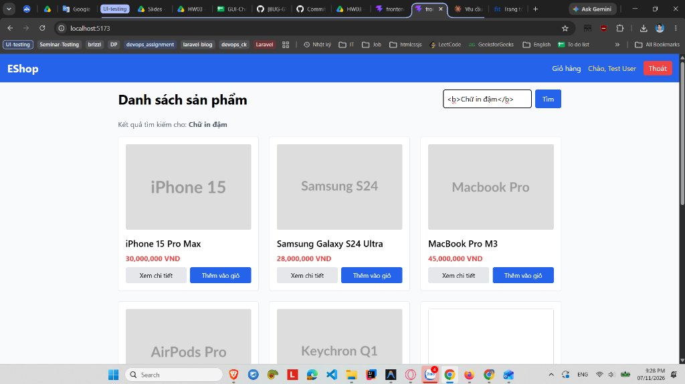

# [BUG-GUI-44][IA-01] Trang chủ hiển thị từ khóa tìm kiếm qua dangerouslySetInnerHTML gây lỗ hổng HTML Injection / Reflected XSS

| Mục | Nội dung |
|---|---|
| Tính năng | Tìm kiếm Sản phẩm & Hiển thị Từ khóa – Customer Web |
| Test case liên quan | `CHK-WEB-05` (Khía cạnh `IA-01` – Chuẩn UI chung & An toàn Hiển thị Chuỗi) |
| Mức độ (Severity) | Critical |
| Độ ưu tiên (Priority) | High |
| Khả năng tái hiện | Luôn luôn (100%) |
| Môi trường | Windows 11, Google Chrome Version 156 / Mozilla Firefox Version 159, Customer Web `http://localhost:5173/` |
| Ngày phát hiện | 2026-11-07 |
| GitHub Issue | *Đang cập nhật* |

## Điều kiện tiên quyết
- Frontend Web Khách hàng của EShop SUT đang hoạt động tại `http://localhost:5173/`.
- Đang ở Trang chủ (`Home.jsx`).

## Các bước tái hiện
1. Mở trình duyệt truy cập vào `http://localhost:5173/`.
2. Tại thanh tìm kiếm ở góc trên bên phải trang chủ, nhập một đoạn mã HTML hoặc payload XSS:
   ```html
   <b>Chữ in đậm</b>
   ```
   *(hoặc các payload khác như `<h1>Tiêu đề lớn</h1>`, ``)*.
3. Bấm nút **"Tìm"** (hoặc nhấn phím **Enter**).
4. Quan sát dòng hiển thị từ khóa tìm kiếm bên dưới tiêu đề "Danh sách sản phẩm".

## Request / Response thực tế
- URL gọi API: `GET http://localhost:3000/api/products?search=%3Cb%3ECh%E1%BB%AF%20in%20%C4%91%E1%BA%ADm%3C/b%3E`
- Trên giao diện DOM:
  ```html
  <div class="mb-4 text-gray-600">
    Kết quả tìm kiếm cho: 
    <span><b>Chữ in đậm</b></span>
  </div>
  ```

## Kết quả mong đợi
Giao diện người dùng phải hiển thị chuỗi tìm kiếm an toàn dưới dạng văn bản thô (Plain Text) và phải mã hóa các thực thể HTML (HTML Entity Encoding: ví dụ biến `<` thành `&lt;`, `>` thành `&gt;`). Trình duyệt tuyệt đối không được thực thi hay biên dịch các thẻ HTML/script từ người dùng nhập vào. — nguồn: [SPEC] / [ASSUMED] (Tiêu chuẩn an toàn ứng dụng web OWASP Top 10 & React Security Best Practices)

## Kết quả thực tế
Thẻ `<b>` đã bị trình duyệt biên dịch và hiển thị văn bản bên trong dưới dạng **chữ in đậm**. Toàn bộ mã HTML/script do người dùng nhập vào ô tìm kiếm được inject trực tiếp vào DOM mà không qua bất kỳ lớp làm sạch (Sanitize) nào, dẫn tới lỗ hổng bảo mật nghiêm trọng HTML Injection và Reflected Cross-Site Scripting (XSS).

## Bằng chứng
- `evidence/screenshots/gui/BUG-GUI-19-xss-html-injection-search.jpg` (Ảnh chụp màn hình thực tế trên Google Chrome)



## Phân tích nguyên nhân (xác nhận từ mã nguồn SUT)
Tại `frontend-web/src/pages/Home.jsx:L61-66`:
```jsx
{search && !errorHtml && (
  <div className="mb-4 text-gray-600">
    Kết quả tìm kiếm cho:{" "}
    <span dangerouslySetInnerHTML={{ __html: search }} />
  </div>
)}
```
Lập trình viên đã sử dụng thuộc tính `dangerouslySetInnerHTML={{ __html: search }}` trực tiếp với biến `search` lấy từ input của người dùng (`e.target.value`) mà không qua thư viện làm sạch (như `DOMPurify.sanitize(search)`) hoặc hiển thị an toàn bằng cú pháp React thông thường `{search}`.

## Phát hiện bởi
Thực thi kiểm thử thủ công và phát hiện bởi sinh viên Trương Thành Phát ([CHK-WEB-05](../checklist.md)).

