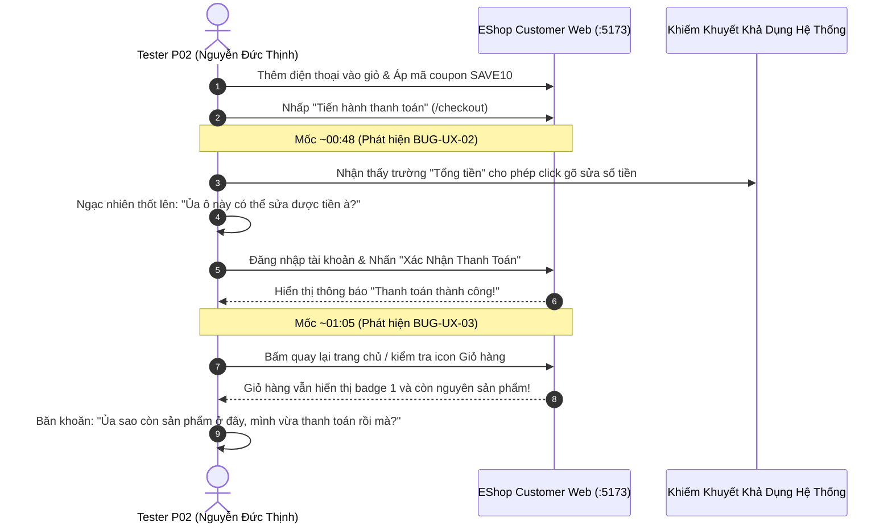

# Danh Sách & Video Minh Chứng Kiểm Thử Khả Dụng (Usability Testing Video Evidence)

**Môn học:** CS423 / CSC13003 – Kiểm thử phần mềm (Software Testing · AI-augmented)  
**Khoa Công nghệ Thông tin — Trường Đại học Khoa học Tự nhiên, ĐHQG-HCM**  
**Giảng viên phụ trách:** TS. Trần Duy Hoàng, ThS. Trương Phước Lộc, ThS. Hồ Tuấn Thanh, TS. Lâm Quang Vũ  
**Sinh viên thực hiện:** TRƯƠNG THÀNH PHÁT — **MSSV:** 23120319 — **Lớp:** CQ2023/3  
**Hệ thống kiểm thử (SUT):** EShop Application ([https://github.com/ttbhanh/eshop-sut](https://github.com/ttbhanh/eshop-sut))  
**Kịch bản kiểm thử:** Luồng mua sắm điện thoại di động & áp mã coupon (`Home` → `Product Detail` → `Cart` → `Coupon SAVE10` → `Checkout`).

---

## 1. Bảng Tổng Hợp Video Minh Chứng Kiểm Thử Khả Dụng (2 Người Tham Gia Đồng Thuận Ghi Hình)

Nhằm đảm bảo tính trung thực, minh bạch và chống gian lận trong quá trình thực nghiệm đánh giá khả dụng (Task 2), sinh viên đã tiến hành ghi hình thực tế thao tác của người dùng. Trong 7 người tham gia thử nghiệm, có **2 sinh viên (P01 và P02)** ký văn bản đồng thuận cho phép ghi hình phiên tương tác và đăng tải minh chứng học thuật:

| STT | Mã Tester | Họ và tên người tham gia | Đơn vị / Trường đào tạo | Liên kết Video YouTube (Link) | Thời gian hoàn thành (ToT) | Điểm SUS | Trọng tâm kiểm thử & Khiếm khuyết phát hiện |
|:---:|:---:|:---|:---|:---:|:---:|:---:|:---|
| **1** | **P01** | **Trần Nhật Nguyên** | Trường Đại học Quốc tế, ĐHQG-HCM (HCMIU) |  [https://youtu.be/fdyj0m0Ezck](https://youtu.be/fdyj0m0Ezck) | **50s** *(Nhanh nhất)* | **62.5 / 100** *(Grade C)* | Thực hiện luồng mua sắm độc lập, trơn tru. Ghi nhận phản hồi định tính: giao diện thiếu thông tin pháp lý & cam kết bảo mật. |
| **2** | **P02** | **Nguyễn Đức Thịnh** | Trường Đại học Công nghệ Thông tin, ĐHQG-HCM (UIT) |  [https://youtu.be/xlSKEIs3rRw](https://youtu.be/xlSKEIs3rRw) | **70s** *(Rất nhanh)* | **62.5 / 100** *(Grade C)* | **Phát hiện trực tiếp 2 lỗi UX nghiêm trọng:** • `~00:48`: **BUG-UX-02** (Cho phép sửa số tiền thanh toán) • `~01:05`: **BUG-UX-03** (Giỏ hàng không xóa sau thanh toán) |

> **Ghi chú về chế độ lưu trữ:** Các video được tải lên YouTube ở chế độ **Không công khai (Unlisted)** nhằm bảo vệ dữ liệu cá nhân theo quy định ĐHQG-HCM. Chỉ người sở hữu liên kết trực tiếp (hội đồng chấm bài) mới có quyền truy cập xem xét.

---

## 2. Chi Tiết Video Kiểm Thử 1: Tester P01 — Trần Nhật Nguyên

* **Đường dẫn xem video:** [https://youtu.be/fdyj0m0Ezck](https://youtu.be/fdyj0m0Ezck)
* **Người thực hiện thử nghiệm:** Trần Nhật Nguyên (**P01**)
* **Trường đào tạo:** Sinh viên Đại học Quốc tế, ĐHQG-HCM (HCMIU)
* **Số điện thoại xác thực:** `0397****83` (Zalo)
* **Môi trường thử nghiệm:** Google Chrome Desktop (Windows 11), Web Frontend `http://localhost:5173/`
* **Thời gian thực hiện (Time-on-Task):** **50 giây** (Đạt chuẩn benchmark $\le 120\text{s}$)
* **Điểm đánh giá SUS:** **62.5 / 100** (Bangor Grade C - Marginal Acceptability)

### Dòng thời gian thao tác (Timeline Breakdown):
* `00:00 - 00:15`: Người dùng mở trình duyệt, truy cập trang chủ EShop tại `localhost:5173`. Lướt qua lưới danh mục để tìm sản phẩm điện thoại di động phù hợp với tiêu chí giá (< 30.000.000 ₫).
* `00:15 - 00:28`: Xác định smartphone ưng ý, bấm *"Xem chi tiết"* chuyển hướng sang `/product/:id`. Kiểm tra cấu hình và bấm *"Thêm vào giỏ hàng"*.
* `00:28 - 00:38`: Bấm vào icon Giỏ hàng trên thanh Header điều hướng đến `/cart`. Rà soát danh mục hàng hóa trong giỏ.
* `00:38 - 00:44`: Nhập mã giảm giá `SAVE10` vào ô coupon, nhấn *"Áp dụng"*. Giao diện hiển thị thông báo giảm giá 10% thành công và tự động tính lại tổng tiền.
* `00:44 - 00:50`: Bấm *"Tiến hành thanh toán"*, xác thực tài khoản và hoàn tất đặt hàng thành công đến màn hình hiển thị lời chúc mừng *"Thanh toán thành công!"*.
* **Phỏng vấn định tính sau phiên (Qualitative Insights):** Bạn thao tác rất nhanh nhờ bố cục trực quan quen thuộc của các trang thương mại điện tử. Tuy nhiên đối với câu hỏi phỏng vấn số 4 (Trust & Reliability), Nguyên nhận xét: *"Giao diện nhìn hơi đơn sơ, thiếu giấy phép đăng ký sàn TMĐT và cam kết bảo vệ thanh toán nên chưa tạo được cảm giác an tâm tuyệt đối nếu phải thanh toán tiền thật."*

---

## 3. Chi Tiết Video Kiểm Thử 2: Tester P02 — Nguyễn Đức Thịnh

* **Đường dẫn xem video:** [https://youtu.be/xlSKEIs3rRw](https://youtu.be/xlSKEIs3rRw)
* **Người thực hiện thử nghiệm:** Nguyễn Đức Thịnh (**P02**)
* **Trường đào tạo:** Sinh viên Đại học Công nghệ Thông tin, ĐHQG-HCM (UIT)
* **Số điện thoại xác thực:** `0387****27` (Zalo)
* **Môi trường thử nghiệm:** Google Chrome Desktop (Windows 11), Web Frontend `http://localhost:5173/`
* **Thời gian thực hiện (Time-on-Task):** **70 giây** (Đạt chuẩn benchmark $\le 120\text{s}$)
* **Điểm đánh giá SUS:** **62.5 / 100** (Bangor Grade C - Marginal Acceptability)

### Sơ đồ chuỗi tương tác & Phát hiện khiếm khuyết trong video:

### Các mốc thời gian phát hiện lỗi trọng điểm (Defect Timestamps):

1. **Mốc thời gian `~00:48` — Bắt quả tang BUG-UX-02 (Critical - Điểm nghẽn Kiểm soát Tài chính):**
   * *Hành vi quan sát:* Khi di chuyển vào biểu mẫu thanh toán `/checkout`, người dùng kiểm tra các thông tin giao nhận và dừng lại tại trường "Tổng tiền thanh toán (VND):".
   * *Phản ứng bằng lời:* Thịnh bất ngờ khựng lại, trỏ chuột vào ô và thốt lên: *"Ủa ô này có thể sửa được tiền à?"*. Sau đó bạn bấm phím thử chỉnh sửa số tiền trực tiếp trên giao diện.
   * *Hệ quả UX:* Trường số tiền là `input text` chưa được đặt thuộc tính `readonly` / `disabled`, vi phạm bảo vệ biểu mẫu tài chính và gây mất uy tín bảo mật nghiêm trọng.
   * *Mã kiểm thử & GitHub Issue:* [BUG-UX-02](../issues/BUG-UX-02.md) | [GitHub Issue #96](https://github.com/tthphat/eshop-sut/issues/96).

2. **Mốc thời gian `~01:05` — Bắt quả tang BUG-UX-03 (Major - Lệch Trạng Thái Vòng Đời Giỏ Hàng):**
   * *Hành vi quan sát:* Sau khi xác nhận thanh toán thành công và nhận lời chúc mừng từ hệ thống, bạn quay lại trang chủ để dạo xem tiếp.
   * *Phản ứng bằng lời:* Nhìn lên góc trên bên phải, biểu tượng giỏ hàng vẫn còn số `1`. Bấm vào giỏ thì thấy sản phẩm vừa mua vẫn chưa bị xóa. Thịnh thắc mắc: *"Ủa sao còn sản phẩm ở đây, mình vừa mới thanh toán rồi mà?"*.
   * *Hệ quả UX:* Tiến trình checkout không gọi hàm dọn sạch giỏ hàng (`clearCart()`), khiến người dùng tưởng nhầm giao dịch chưa hoàn tất và có nguy cơ đặt trùng đơn hàng.
   * *Mã kiểm thử & GitHub Issue:* [BUG-UX-03](../issues/BUG-UX-03.md) | [GitHub Issue #97](https://github.com/tthphat/eshop-sut/issues/97).

---

## 4. Chính Sách Bảo Vệ Quyền Riêng Tư & Thỏa Thuận Người Tham Gia (Privacy & Consent)

Tuân thủ quy định đạo đức nghiên cứu phần mềm và chính sách an toàn thông tin cá nhân FIT@HCMUS ([AI-05]):

1. **Sự đồng thuận (Informed Consent):**
   * Trong 7 người tham gia đánh giá khả dụng, **chỉ có 2 bạn (P01 - Trần Nhật Nguyên và P02 - Nguyễn Đức Thịnh)** đồng thuận ghi lại video màn hình và giọng nói phục vụ công tác kiểm thử học thuật.
   * 5 người tham gia còn lại (P03 → P07) lựa chọn hình thức kiểm thử trực tiếp có quan sát viên ghi chép nhật ký hành vi (think-aloud protocol) và điền form khảo sát SUS, không ghi hình nhằm đảm bảo tối đa quyền riêng tư cá nhân.
2. **Quyền riêng tư & Bảo mật:**
   * Video được thiết lập chế độ **Không công khai (Unlisted)** trên YouTube, không bị tìm kiếm công khai, chỉ chia sẻ đường link nội bộ cho hội đồng chấm bài.
   * Các dữ liệu nhạy cảm (số điện thoại cá nhân) trong các tài liệu văn bản công khai đều được che giấu một phần (dạng `0397****83`).

---
*Tài liệu được hoàn thiện và xác nhận bởi sinh viên: **TRƯƠNG THÀNH PHÁT (MSSV: 23120319)**.*
