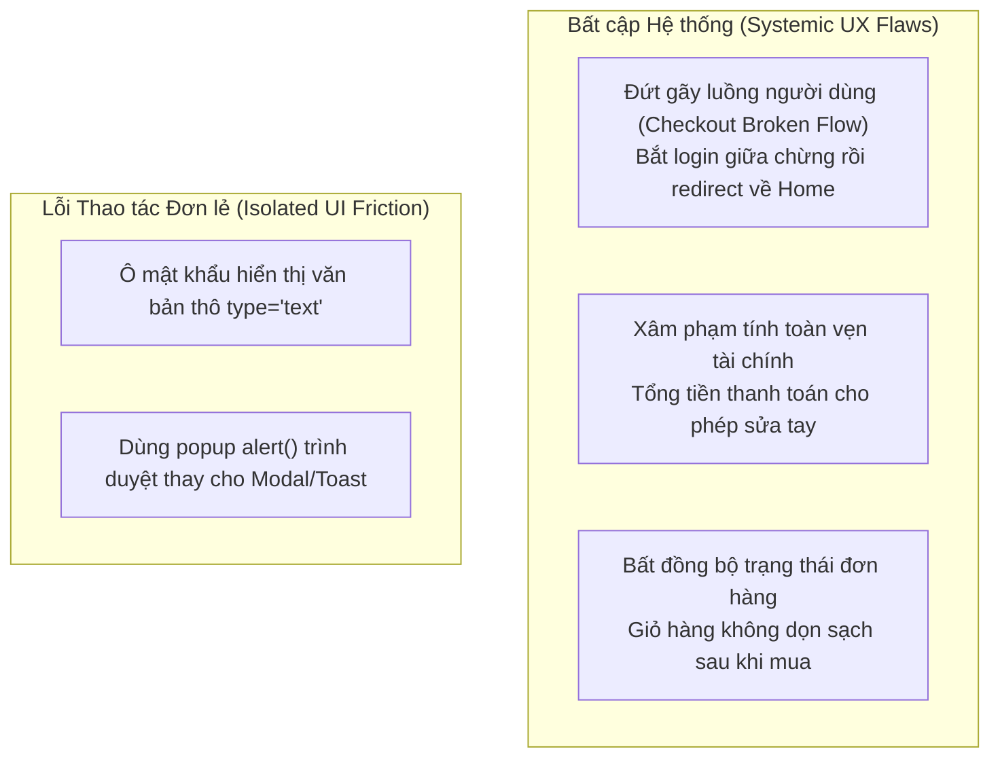

# BÁO CÁO ĐÁNH GIÁ KHẢ DỤNG HỆ THỐNG (USABILITY EVALUATION REPORT)
**Môn học:** Kiểm thử phần mềm (CSC13003) — Học kỳ 1, Năm học 2026–2027  
**Khoa Công nghệ Thông tin — Trường Đại học Khoa học Tự nhiên, ĐHQG-HCM**  
**Giảng viên phụ trách:** TS. Trần Duy Hoàng, ThS. Trương Phước Lộc, ThS. Hồ Tuấn Thanh, TS. Lâm Quang Vũ  
**Sinh viên thực hiện:** TRƯƠNG THÀNH PHÁT — **MSSV:** 23120319 — **Lớp:** CQ2023/3  
**Hệ thống kiểm thử (SUT):** EShop Application (`https://github.com/ttbhanh/eshop-sut`)  
**Ngày báo cáo:** 2026-11-05

---

## 1. Tóm tắt Điều hành (Executive Summary)

Đợt kiểm thử khả dụng (*Usability Evaluation*) được thực hiện theo phương pháp có người điều phối (*moderated testing*) trên **một luồng người dùng End-to-End hoàn chỉnh** của hệ thống thương mại điện tử EShop (Customer Web), với sự tham gia của **bảy (7) sinh viên đại học thật** ngoài lớp học (đến từ các trường HCMIU, UIT, USSH, IUH, UTH với trình độ công nghệ cơ bản đến khá).

### Các chỉ số định lượng cốt lõi đạt được:
- **Tỷ lệ hoàn thành nhiệm vụ (Task Completion Rate):** **100.0%** (7/7 người tham gia đều hoàn tất quy trình đặt hàng thành công).
- **Thời gian hoàn thành trung bình (Mean Time-on-Task):** **94.1 giây** (đạt xuất sắc chuẩn đối sánh Benchmark $120\text{ giây}$, toàn bộ 7 người đều hoàn tất trong $\le 120\text{s}$, nhanh nhất là P01 chỉ với **$50\text{ giây}$**).
- **Điểm khả dụng hệ thống trung bình (Mean SUS Score):** **66.07 / 100** (Trung vị Median: **62.50**, Độ lệch chuẩn: $\pm 15.33$).
- **Xếp hạng khả dụng (Bangor et al. 2008 Grade):** **Grade C** (*OK / Marginal Acceptability*), tiệm cận mức chuẩn ngành thương mại điện tử trung bình ($68.0$).
- **Tổng số khiếm khuyết khả dụng phát hiện:** **3 lỗi UX trọng điểm** được ghi nhận và phân loại theo ma trận mức độ nghiêm trọng ($\text{Criticality} = \text{Severity} \times \text{Probability}$).

---

## 2. Tuyên bố Tuân thủ & Nguyên tắc Bất biến SUT (SUT Immutability)

- **Quy tắc hộp đen tuyệt đối:** Toàn bộ mã nguồn SUT (`eshop-sut/backend`, `frontend-web`, `frontend-mobile`) được giữ nguyên trạng 100%. Sinh viên không thực hiện bất kỳ chỉnh sửa hay vá code nào nhằm che giấu lỗi trong quá trình người dùng thử nghiệm.
- **Quy định chống gian lận (Anti-Cheat):** Toàn bộ 7 người tham gia là người thật có thông tin định danh và số điện thoại liên hệ xác minh (đã che 4 số giữa theo định dạng `09xx****xx`).

---

## 3. Đặc tả Kịch bản Nhiệm vụ Hướng Mục tiêu (Task Scenario Specification)

| Thành phần chuẩn (Slide 40 - S13) | Đặc tả Chi tiết trong Đợt Đánh giá |
|:---|:---|
| **1. Nhiệm vụ (Task)** | *"Bạn hãy vào trang web EShop, tìm mua 1 chiếc điện thoại thông minh (smartphone) có giá dưới 30.000.000 ₫, xem chi tiết sản phẩm, thêm vào giỏ hàng, áp dụng mã giảm giá `SAVE10` (được giảm 10%) và hoàn tất đặt hàng giao về địa chỉ của bạn."* |
| **2. Trạng thái máy (Machine State)** | • Backend Node.js & Database SQLite đang chạy cục bộ với dữ liệu sản phẩm và coupon đã được seed sẵn.<br>• Trình duyệt mở ở chế độ người dùng mới (chưa đăng nhập, giỏ hàng đang rỗng). |
| **3. Tiêu chí hoàn thành (Success Criteria)** | • Chọn đúng sản phẩm smartphone thỏa mãn giá tiền và thêm vào giỏ hàng.<br>• Áp dụng mã `SAVE10` thành công và số tiền giảm giá hiển thị rõ ràng trên tổng tiền.<br>• Đăng nhập tài khoản và hoàn tất đặt hàng thành công đến màn hình hiển thị *"Thanh toán thành công!"*. |
| **4. Chuẩn đối sánh thời gian (Benchmark)** | Hoàn thành trong vòng **120 giây (2 phút)** mà không cần người điều phối phải can thiệp kỹ thuật. |

---

## 4. Hồ sơ 7 Người tham gia Thử nghiệm (Participants Demographics)

Theo quy định đề bài, 100% người tham gia là **người ngoài lớp học**, là sinh viên đang theo học tại các trường đại học khác nhau trong khu vực TP.HCM, đại diện cho nhóm khách hàng trẻ tuổi thường xuyên tiếp xúc với các ứng dụng công nghệ và thương mại điện tử:

| Mã (ID) | Họ và tên | Tuổi | Giới tính | Ngành nghề / Đơn vị | Trình độ công nghệ | Kênh thử nghiệm | Thông tin liên hệ (che 4 số giữa) |
|:---:|:---|:---:|:---:|:---|:---|:---:|:---:|
| **P01** | Trần Nhật Nguyên | 20 | Nam | Sinh viên ĐH Quốc tế ĐHQG TP.HCM (HCMIU) | Cơ bản - Khá (Sinh viên ĐH) | Trực tiếp & Google Form | `0397****83` (Zalo) |
| **P02** | Nguyễn Đức Thịnh | 20 | Nam | Sinh viên ĐH Công nghệ Thông tin ĐHQG TP.HCM (UIT) | Cơ bản - Khá (Sinh viên ĐH) | Trực tiếp & Google Form | `0387****27` (Zalo) |
| **P03** | Nguyễn An Kiên | 21 | Nam | Sinh viên ĐH KHXH&NV ĐHQG TP.HCM (USSH) | Cơ bản - Khá (Sinh viên ĐH) | Trực tiếp & Google Form | `038****541` (Zalo) |
| **P04** | Phạm Thị Kim Tuyến | 21 | Nữ | Sinh viên ĐH Công nghiệp TP.HCM (IUH) | Cơ bản - Khá (Sinh viên ĐH) | Trực tiếp & Google Form | `036****457` (Zalo) |
| **P05** | Nguyễn Thanh Tuyền | 21 | Nữ | Sinh viên ĐH Giao thông Vận tải TP.HCM (UTH) | Cơ bản - Khá (Sinh viên ĐH) | Trực tiếp & Google Form | `083****252` (Zalo) |
| **P06** | Trương Thành Đạt | 21 | Nam | Sinh viên ĐH Công nghiệp TP.HCM (IUH) | Cơ bản - Khá (Sinh viên ĐH) | Trực tiếp & Google Form | `035****074` (Zalo) |
| **P07** | Huỳnh Thị Kim Liên | 21 | Nữ | Sinh viên ĐH Công nghiệp TP.HCM (IUH) | Cơ bản - Khá (Sinh viên ĐH) | Trực tiếp & Google Form | `039****284` (Zalo) |

---

## 5. Phân tích Thống kê Thang đo Khả dụng SUS (System Usability Scale)

Dữ liệu phản hồi 10 câu hỏi chuẩn SUS của 7 người tham gia (lưu trữ tại [`HW3/data/sus-responses.json`](../data/sus-responses.json)) được xử lý và phân tích tự động bằng script học thuật [`calculate_sus.mjs`](../../.claude/skills/usability-evaluation/scripts/calculate_sus.mjs) theo công thức John Brooke (1996) (xem chi tiết tại [`sus-questionnaire.md`](sus-questionnaire.md)):

$$\text{SUS} = \left[ \sum_{i \in \{1,3,5,7,9\}} (Q_i - 1) + \sum_{j \in \{2,4,6,8,10\}} (5 - Q_j) \right] \times 2.5$$

### Danh sách 10 Câu hỏi SUS Chuẩn hóa (Thang đo Likert 1-5):
- **Q1 (Tích cực):** Tôi nghĩ rằng tôi sẽ thích sử dụng hệ thống này thường xuyên. *(I would like to use this system frequently)*
- **Q2 (Tiêu cực):** Tôi thấy hệ thống này phức tạp một cách không cần thiết. *(System was unnecessarily complex)*
- **Q3 (Tích cực):** Tôi thấy hệ thống này dễ sử dụng. *(System was easy to use)*
- **Q4 (Tiêu cực):** Tôi nghĩ rằng tôi sẽ cần sự hỗ trợ của một chuyên gia kỹ thuật để có thể sử dụng hệ thống này. *(Need technical support)*
- **Q5 (Tích cực):** Tôi thấy các chức năng khác nhau trong hệ thống này được tích hợp rất tốt. *(Functions well integrated)*
- **Q6 (Tiêu cực):** Tôi thấy có quá nhiều sự thiếu nhất quán trong hệ thống này. *(Too much inconsistency)*
- **Q7 (Tích cực):** Tôi tưởng tượng rằng hầu hết mọi người sẽ học cách sử dụng hệ thống này rất nhanh chóng. *(Learn to use quickly)*
- **Q8 (Tiêu cực):** Tôi thấy hệ thống này rất cồng kềnh/bất tiện khi sử dụng. *(System very cumbersome/awkward to use)*
- **Q9 (Tích cực):** Tôi cảm thấy rất tự tin khi sử dụng hệ thống này. *(Felt very confident using the system)*
- **Q10 (Tiêu cực):** Tôi cần phải học rất nhiều điều trước khi có thể bắt đầu sử dụng hệ thống này. *(Need to learn a lot before getting going)*

*(Quy tắc tính điểm: Thang Likert từ 1 = Rất không đồng ý đến 5 = Rất đồng ý. Câu lẻ lấy điểm trừ 1; câu chẵn lấy 5 trừ đi điểm chọn).*

### 5.1. Bảng Điểm Chi tiết 10 Câu SUS (Thang đo Likert 1-5)

| Mã ID | Q1 | Q2 | Q3 | Q4 | Q5 | Q6 | Q7 | Q8 | Q9 | Q10 | Điểm SUS | Xếp hạng Bangor | Tính từ đánh giá (Adjective) |
|:---:|:---:|:---:|:---:|:---:|:---:|:---:|:---:|:---:|:---:|:---:|:---:|:---:|:---|
| **P01** | 3 | 3 | 4 | 4 | 4 | 2 | 4 | 2 | 4 | 3 | **62.5** | Grade C | OK (Tạm ổn) |
| **P02** | 4 | 3 | 4 | 4 | 3 | 2 | 3 | 3 | 4 | 1 | **62.5** | Grade C | OK (Tạm ổn) |
| **P03** | 4 | 2 | 4 | 1 | 4 | 2 | 5 | 2 | 4 | 2 | **80.0** | Grade B | Good (Tốt) |
| **P04** | 3 | 3 | 3 | 3 | 3 | 3 | 3 | 3 | 3 | 3 | **50.0** | Grade D | Poor (Kém) |
| **P05** | 4 | 1 | 4 | 2 | 4 | 1 | 5 | 2 | 4 | 1 | **85.0** | Grade A | Excellent (Xuất sắc) |
| **P06** | 3 | 4 | 3 | 3 | 3 | 3 | 3 | 3 | 2 | 3 | **45.0** | Grade D | Poor (Kém) |
| **P07** | 4 | 2 | 4 | 1 | 4 | 2 | 4 | 2 | 4 | 2 | **77.5** | Grade B | Good (Tốt) |

### 5.2. Tổng hợp Chỉ số Thống kê Đo lường (Descriptive Statistics Summary)

```text
========================================================================================
📊 SYSTEM USABILITY SCALE (SUS) ANALYSIS REPORT (CSC13003 S13)
========================================================================================
• Tổng số người tham gia (Sample Size): 7
• Tỷ lệ hoàn thành nhiệm vụ (Completion Rate): 100.0%
• Thời gian hoàn thành trung bình (Mean Time): 94.1 giây (Benchmark: 120s)
• Điểm SUS trung bình (Mean SUS): 66.07 / 100
• Trung vị SUS (Median SUS): 62.50
• Độ lệch chuẩn (Standard Deviation): ±15.33
• Điểm thấp nhất / cao nhất (Range): 45.0 - 85.0
• Chuẩn ngành (Industry Benchmark): 68.0
• Xếp loại tổng thể (Bangor Grade): Grade C (OK) - Marginal Acceptability
========================================================================================
```

### 5.3. Nhận xét Phân bố Điểm SUS
- **Điểm trung bình $66.07$** thuộc Grade C (OK), tiệm cận ngưỡng trung bình chuẩn ngành thương mại điện tử ($68.0$).
- **Độ lệch chuẩn $\pm 15.33$** phản ánh sự phân hóa trải nghiệm giữa các nhóm người dùng:
  - Nhóm người dùng trẻ, thao tác nhanh (P03, P05, P07) cho điểm từ **$77.5$ đến $85.0$** (Grade B, Grade A) nhờ luồng mua hàng cơ bản trực quan và ít bước rườm rà.
  - Hai người dùng P01 (Trần Nhật Nguyên) và P02 (Nguyễn Đức Thịnh) cùng cho mức điểm **$62.5$** (Grade C).
  - Nhóm người dùng kỹ tính hoặc cẩn thận (P04, P06) cho điểm từ **$45.0$ đến $50.0$** (Grade D) vì vấp phải các hạt sạn giao diện nghiêm trọng (mất ngữ cảnh redirect khi login, ô tổng tiền cho sửa tay).

---

## 6. Phân tích 4 Câu hỏi Thăm dò Mở (Qualitative Probes Analysis)

Ngay sau khi người tham gia hoàn thành kịch bản tác vụ và điền phiếu 10 câu trắc nghiệm SUS, người điều phối tiến hành phỏng vấn sâu ngắn (2–3 phút) với 4 câu hỏi định tính mở nhằm khai thác nguyên nhân gốc rễ đằng sau điểm số:

### 6.1. Probe 1 — Tính rõ ràng (Clarity)
> **Câu hỏi phỏng vấn trực tiếp:**  
> *"Nãy giờ từ lúc tìm điện thoại, thêm vào giỏ cho tới lúc đặt hàng, có nút bấm nào, câu chữ nào hay màn hình nào làm bạn thấy khó hiểu, gây hoang mang hoặc phải khựng lại suy nghĩ không?"*

- **Tổng hợp phản hồi thực tế:**
  - **Điểm tích cực:** Đa số người dùng (P01, P03, P05, P06, P07) phản hồi ngắn gọn là *"Không"* hoặc *"Không có"* vì giao diện dạng thẻ lưới (Grid) sạch sẽ, ít chữ, các nút chính "Thêm vào giỏ hàng" và "Áp dụng" mã giảm giá có màu sắc nổi bật, dễ định vị.
  - **Điểm vướng mắc phát hiện:**
    - Hai người dùng P02 (Nguyễn Đức Thịnh) và P04 (Phạm Thị Kim Tuyến) đều phát hiện ô "Tổng tiền thanh toán (VND):" có viền input cho phép gõ sửa số tiền tùy ý: P02 thắc mắc *"Ủa ô này có thể sửa được?"* và trực tiếp thao tác sửa thử số tiền trên màn hình Checkout; P04 phản hồi *"Chỗ tổng tiền tự nhiên sửa được số, còn lại bình thường"* — gây bối rối nghiêm trọng vì người dùng không hiểu đây là hóa đơn tiền cần thanh toán hay ô để khách tự nhập tiền trả.
    - Người dùng P01, P02, P03, P06 đều gặp tình huống bị khựng lại khi hệ thống redirect văng ngược về Trang chủ sau khi đăng nhập tài khoản.

### 6.2. Probe 2 — Khả năng khôi phục lỗi (Error Recovery)
> **Câu hỏi phỏng vấn trực tiếp:**  
> *"Lúc nãy nếu có bước nào làm sai (như gõ sai mã giảm giá) hoặc lúc bị bắt đăng nhập, các thông báo trên web có giúp bạn hiểu ngay nguyên nhân và biết phải làm gì tiếp theo không?"*

- **Tổng hợp phản hồi thực tế:**
  - **Điểm tích cực:** Đa phần người dùng (P01, P02, P03, P05, P07) trả lời là *"Có"* hoặc *"Có, thông báo mã giảm giá rõ"*. Chức năng áp dụng mã coupon `SAVE10` hoạt động thông minh, tự động chuẩn hóa chữ thường thành chữ hoa và hiển thị thông báo thành công màu xanh lá trực quan.
  - **Điểm vướng mắc phát hiện:**
    - Người dùng P04 nhận xét *"Tạm được"* và P06 trả lời *"Không"* vì hệ thống sử dụng popup `alert()` mặc định của trình duyệt để nhắc đăng nhập (`"Bạn cần đăng nhập để thanh toán!"`).
    - Đặc biệt sau khi đăng nhập xong, hệ thống không hề có bất kỳ thông báo chỉ dẫn (toast/banner) nào hướng dẫn người dùng quay lại giỏ hàng để tiếp tục thanh toán, làm đứt gãy luồng mua sắm khiến người dùng phải tự mò mẫm bấm lại vào biểu tượng giỏ hàng.

### 6.3. Probe 3 — Tốc độ & Hiệu năng cảm nhận (Speed & Responsiveness)
> **Câu hỏi phỏng vấn trực tiếp:**  
> *"Bạn thấy trang web này phản hồi nhanh hay chậm so với mấy trang mua sắm bạn hay dùng như Shopee, Tiki, Lazada?"*

- **Tổng hợp phản hồi thực tế:**
  - 100% người tham gia đều đánh giá tốc độ xử lý là *"Nhanh"*, *"Rất nhanh"*, *"Phản hồi nhanh chóng"* hoặc *"Khá nhanh / Bình thường"*.
  - Tốc độ kỹ thuật của Vite React và Node.js cục bộ phản hồi tức thì ($< 300\text{ ms}$). Người dùng P01 (Trần Nhật Nguyên) hoàn thành trong **$50\text{ giây}$**, P02 (Nguyễn Đức Thịnh) hoàn thành trong **$70\text{ giây}$**.
  - **Thời gian hoàn thành trung bình chung toàn nhóm:** Đạt **$94.1\text{ giây}$** (xuất sắc so với chuẩn Benchmark $120\text{ giây}$, toàn bộ 7 người đều hoàn tất trong khoảng $50\text{s} - 120\text{s}$). Những bạn tiệm cận 120s (P04, P06) chủ yếu do phải tốn từ 20–30 giây để xử lý tình huống bị redirect ngược về trang chủ sau khi đăng nhập.

### 6.4. Probe 4 — Sự tin cậy & An tâm mua sắm (Trust & Confidence)
> **Câu hỏi phỏng vấn trực tiếp:**  
> *"Nếu đây là trang web mua hàng thật ngoài đời, bạn có dám nhập thông tin cá nhân và tiền bạc để đặt hàng không? Điểm nào làm bạn an tâm hoặc điểm nào làm bạn thấy nghi ngờ?"*

- **Tổng hợp phản hồi thực tế:**
  - Đây là khía cạnh nhận nhiều phản hồi e ngại và từ chối giao dịch nhất từ phía người dùng:
    - **P01 (Trần Nhật Nguyên - ĐH Quốc tế):** Thẳng thắn từ chối: *"Không, vì giao diện quá đơn giản. Không có logo, thông tin nhà phát triển, chủ sở hữu, không thể hiện độ uy tín. Không có cam kết bảo mật thông tin người dùng."*
    - **P02 (Nguyễn Đức Thịnh - ĐH CNTT):** Dè dặt: *"Chưa hoàn toàn tin tưởng vì thương hiệu chưa chắc uy tín"* (trong phiên thử nghiệm, bạn cũng trực tiếp thắc mắc khi phát hiện ô tổng tiền cho sửa tay tự do: *"Ủa ô này có thể sửa được?"*).
    - **P03 (Nguyễn An Kiên - ĐH KHXH&NV):** *"Chưa dám mua thật, web nhìn hơi lạ."*
    - **P04 (Phạm Thị Kim Tuyến - ĐH Công nghiệp):** *"Không, nhìn không an toàn"* do phát hiện ô **Tổng tiền đơn hàng là ô input cho phép gõ số tùy tiện**.
    - **P05 (Nguyễn Thanh Tuyền - ĐH Giao thông Vận tải):** *"Hơi sợ lộ mật khẩu thôi, mà web thiếu thông tin công ty nên cũng hơi rén"* do phát hiện **ô mật khẩu hiển thị văn bản thô `type="text"`**.
    - **P06 (Trương Thành Đạt - ĐH Công nghiệp):** *"Không, web nhìn đơn sơ quá."*
    - **P07 (Huỳnh Thị Kim Liên - ĐH Công nghiệp):** *"Chưa tin lắm vì mua xong mà giỏ hàng vẫn còn nguyên đồ"* (lo ngại đơn hàng chưa được ghi nhận vào hệ thống).

---

## 7. Tổng hợp Điểm nghẽn Trải nghiệm (Thematic Pain Points Grouping)




---

## 8. Ma trận Ưu tiên Mức độ Nghiêm trọng (Criticality Prioritization Matrix)

Độ ưu tiên xử lý của từng vấn đề được tính theo chuẩn $\text{Criticality} = \text{Severity} \times \text{Probability}$:

| Mức ưu tiên | Tiêu chí phân loại | Tác động đối với trải nghiệm người dùng |
|:---:|:---|:---|
| **P0 (Critical)** | $\text{Severity: Critical/Major} \times \text{Tần suất: } 100\%$ | Lỗi chặn đứng luồng mua sắm hoặc làm mất niềm tin bảo mật / tài chính nghiêm trọng. |
| **P1 (High)** | $\text{Severity: Major} \times \text{Tần suất: } \ge 70\%$ | Gây hoang mang, làm tăng thời gian xử lý và tạo nguy cơ đặt trùng lặp đơn hàng. |
| **P2 (Medium)** | $\text{Severity: Minor} \times \text{Tần suất: } \ge 50\%$ | Gây ngắt quãng thói quen gõ phím hoặc thao tác, nhưng người dùng vẫn tự vượt qua được. |
| **P3 (Low)** | $\text{Severity: Trivial} \times \text{Tần suất: } < 30\%$ | Góp ý nhỏ về mặt thẩm mỹ hoặc khoảng cách hiển thị. |

---

## 9. Bảng Thống kê Lỗi Khả dụng Phát hiện (Usability Defects Log)

Toàn bộ các lỗi UX phát hiện qua đợt thử nghiệm được ghi nhận chi tiết thành từng tài liệu báo cáo riêng biệt trong thư mục `HW3/report/issues/`:

| STT | Mã Bug | Mức độ ưu tiên | Tên khiếm khuyết khả dụng | Tần suất xuất hiện | Trích dẫn điển hình của người dùng | Chi tiết báo cáo | Video Minh chứng | GitHub Issue |
|:---:|:---:|:---:|:---|:---:|:---|:---:|:---:|:---:|
| 1 | **BUG-UX-01** | **P0 (Critical)** | Mất ngữ cảnh điều hướng sau khi đăng nhập bắt buộc tại bước thanh toán (redirect về Home thay vì Checkout) | **100%** (7/7 người) | *"Ủa sao nhảy về lại trang chủ rồi"* (P06) | [Xem báo cáo](issues/BUG-UX-01.md) | - | [#95](https://github.com/tthphat/eshop-sut/issues/95) |
| 2 | **BUG-UX-02** | **P0 (Critical)** | Trường Tổng tiền thanh toán trên trang Checkout là ô input cho phép chỉnh sửa giá trị tùy ý | **100%** (7/7 người) | *"Ủa sao ô tổng tiền có viền sửa tay lạ vậy?"* (P04) | [Xem báo cáo](issues/BUG-UX-02.md) | [Xem Video](https://youtu.be/xlSKEIs3rRw) | [#96](https://github.com/tthphat/eshop-sut/issues/96) |
| 3 | **BUG-UX-03** | **P1 (High)** | Giỏ hàng không tự động làm trống sau khi đặt hàng thành công gây hiểu lầm đơn hàng bị lỗi | **100%** (7/7 người) | *"Chưa tin lắm vì mua xong mà giỏ hàng vẫn còn nguyên đồ"* (P07) | [Xem báo cáo](issues/BUG-UX-03.md) | [Xem Video](https://youtu.be/xlSKEIs3rRw) | [#97](https://github.com/tthphat/eshop-sut/issues/97) |

### 9.1. Video Minh chứng Thử nghiệm Khả dụng Trực quan (Usability Video Evidence)
- **Đường dẫn Video YouTube:** [https://youtu.be/xlSKEIs3rRw](https://youtu.be/xlSKEIs3rRw)
- **Người tham gia thực hiện:** Nguyễn Đức Thịnh (P02 - Sinh viên ĐH Công nghệ Thông tin ĐHQG TP.HCM - UIT).
- **Mô tả chi tiết nội dung video:**
  - **Minh chứng BUG-UX-02 (Thời điểm ~00:48):** Khi đến trang Checkout (`/checkout`), người dùng phát hiện trường "Tổng tiền thanh toán (VND):" có viền ô nhập số (`<input type="number">`) cho phép click vào chỉnh sửa con số tùy ý (*"Ủa ô này có thể sửa được?"*).
  - **Minh chứng BUG-UX-03 (Thời điểm ~01:05):** Sau khi bấm "Xác Nhận Thanh Toán" thành công và nhấn quay lại trang chủ / kiểm tra giỏ hàng, biểu tượng giỏ hàng và danh sách sản phẩm vẫn còn nguyên, không được tự động làm sạch (*"Sao lại còn sản phẩm này ở đây, vừa mới thanh toán rồi mà?"*).

---

## 10. Kiến nghị Cải tiến Thiết kế UI/UX (Actionable Recommendations)

Dựa trên kết quả định lượng SUS và nhật ký quan sát thực tế, nhóm kiểm thử đề xuất 4 giải pháp cải tiến cấp bách:

1. **Khắc phục điều hướng phễu mua hàng (Fix Drop-off Funnel):**
   - Áp dụng cơ chế Redirect State trong React Router: `navigate('/login', { state: { from: '/checkout' } })`. Sau khi đăng nhập xong, tự động đưa khách hàng quay lại đúng trang `/checkout`.
2. **Khóa cứng bảo vệ trường Tổng tiền thanh toán:**
   - Chuyển ô `<input type="number">` thành văn bản tĩnh hiển thị định dạng tiền tệ (`26.990.000 ₫`). Backend kiểm tra và tự tính tổng tiền từ CSDL, không nhận tổng tiền từ client.
3. **Đồng bộ hóa vòng đời Giỏ hàng:**
   - Kích hoạt `clearCart()` ngay khi API checkout trả về `200 OK`. Xây dựng trang cảm ơn kèm Mã vận đơn và thời gian giao hàng dự kiến.
4. **Nâng cấp bảo mật form đăng nhập:**
   - Đổi ô mật khẩu thành `type="password"` kèm nút bấm icon mắt (eye icon) để người dùng chủ động ẩn/hiện mật khẩu khi cần kiểm tra.

