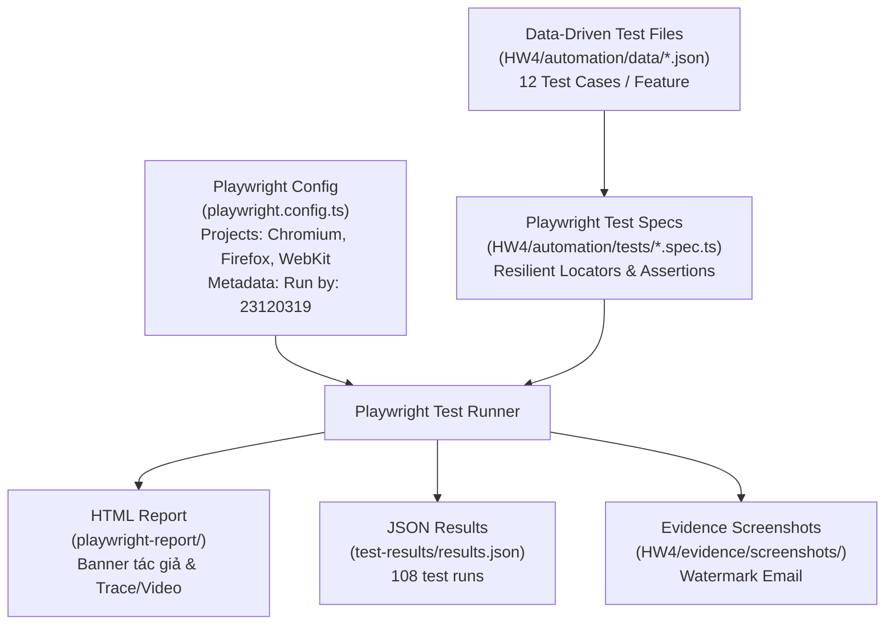
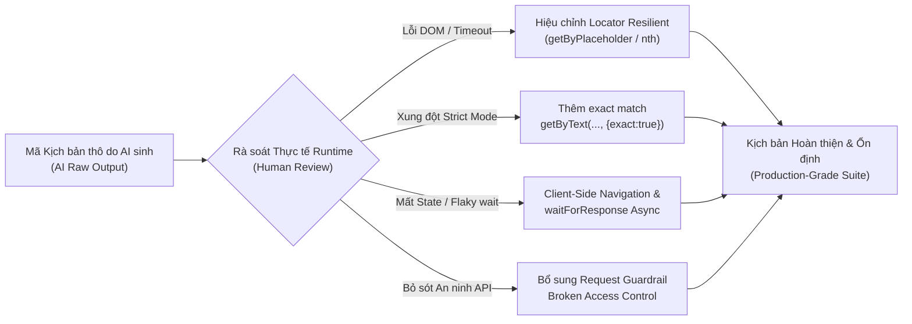
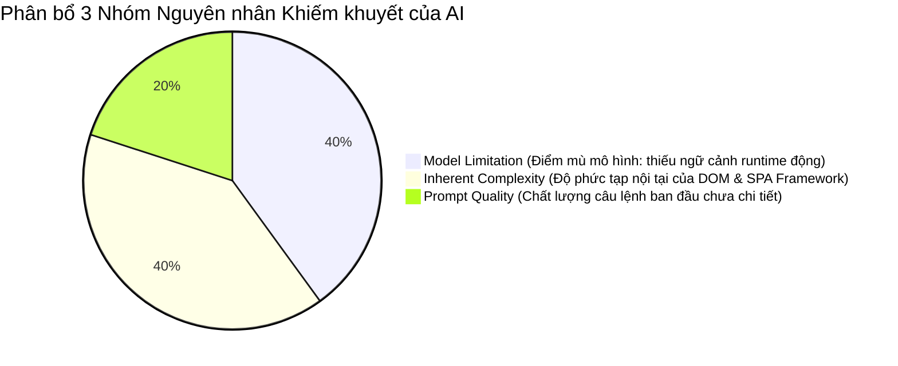
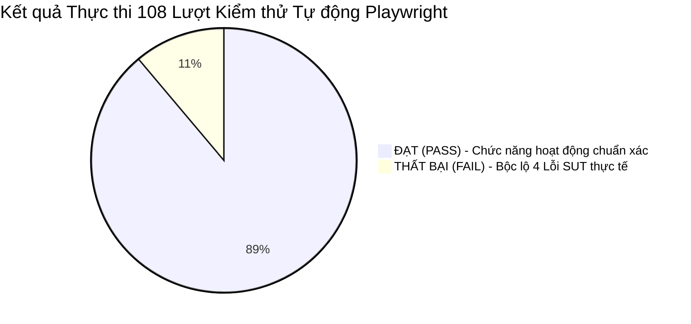

# BÁO CÁO CHÍNH (MAIN TESTING REPORT)

### CS423 / CSC13003 – Kiểm thử phần mềm (Software Testing · AI-augmented)

### HW04: Kiểm thử Tự động hóa Giao diện Web với Playwright TypeScript (Web UI Automation Testing) trên Hệ thống EShop SUT

#### Báo cáo Toàn diện về Kịch bản Tự động hóa & Phân tích Khoảng trống Rà soát của Con người (Human Review & AI Gap Analysis)

---

## Thông tin Sinh viên & Đồ án

| Thuộc tính                                        | Chi tiết định danh                                                                                                                     |
| :-------------------------------------------------- | :---------------------------------------------------------------------------------------------------------------------------------------- |
| **Họ và tên sinh viên**                   | **TRƯƠNG THÀNH PHÁT**                                                                                                           |
| **Mã số sinh viên (MSSV)**                 | **23120319**                                                                                                                        |
| **Lớp học phần**                           | Kiểm thử phần mềm - CQ2023/3                                                                                                          |
| **Email sinh viên / Watermark**              | `23120319@student.hcmus.edu.vn`                                                                                                         |
| **Khoa / Trường**                           | Khoa Công nghệ Thông tin — Trường ĐH Khoa học Tự nhiên, ĐHQG-HCM                                                               |
| **Giảng viên phụ trách**                  | TS. Trần Duy Hoàng, ThS. Trương Phước Lộc, ThS. Hồ Tuấn Thanh, TS. Lâm Quang Vũ                                                |
| **Hệ thống kiểm thử (SUT)**               | EShop Multi-Channel System ([GitHub Repo gốc eshop-sut](https://github.com/ttbhanh/eshop-sut))                                            |
| **GitHub Repo cá nhân (chứa HW)**          | [https://github.com/tthphat/Software-Testing](https://github.com/tthphat/Software-Testing)                                                 |
| **GitHub Repo nhóm (chứa Issues)**          | [https://github.com/tthphat/eshop-sut](https://github.com/tthphat/eshop-sut) (Toàn bộ Issues #115 → #118)                               |
| **Video Demo 1 (Custom Agent Skill - FR-01)** | [https://youtu.be/jkY-9PJzVOA](https://youtu.be/jkY-9PJzVOA) (Thuyết minh Custom Skill, Thẩm định Quality Gate & Kịch bản FR-01)     |
| **Video Demo 2 (Playwright E2E - FR-08)**     | [https://youtu.be/awARwEi7ZAk](https://youtu.be/awARwEi7ZAk) (Thực thi Playwright E2E Đa trình duyệt cho FR-08 & Phân tích Lỗi SUT) |
| **Công cụ AI hỗ trợ**                     | Antigravity (Claude 3.7 Sonnet, Gemini 2.5 Flash), Playwright Test Runner                                                                 |
| **Thời gian thực hiện**                    | 14/11/2026 – 15/11/2026                                                                                                                  |

---

## Bảng Tự Đánh giá Kết quả (Self-Assessment Rubric: 100 / 100)

|     STT     | Tiêu chí đánh giá (Criteria)                                                     | Điểm tối đa |  Điểm tự chấm  | Minh chứng thực hiện & Chi tiết đối chiếu barem                                                                                                                                                                                                                                                                                                                                                                                                                                                                                                                                                                                                                                                                                                                                                                                                                                   |
| :---------: | :------------------------------------------------------------------------------------ | :-------------: | :-----------------: | :--------------------------------------------------------------------------------------------------------------------------------------------------------------------------------------------------------------------------------------------------------------------------------------------------------------------------------------------------------------------------------------------------------------------------------------------------------------------------------------------------------------------------------------------------------------------------------------------------------------------------------------------------------------------------------------------------------------------------------------------------------------------------------------------------------------------------------------------------------------------------------------- |
| **1** | **Kiến trúc Data-Driven & Tách biệt Dữ liệu (§5)**                       |       20       |    **20**    | • 100% dữ liệu kiểm thử được tách biệt vào `data/*.json` (`fr01-registration.json`, `fr08-checkout.json`, `fr12-access-control.json`).<br/>• Không hardcode inline data mảng trong spec.<br/>• Mỗi tính năng chứa đúng **12 test cases** (tổng cộng 36 test cases), kế thừa và chuyển đổi chuẩn xác từ HW02.<br/>• Vượt qua kiểm tra tự động bởi script `validate_automation.mjs`. |
| **2** | **Thiết kế Kịch bản & Đa dạng hóa Assertion (§7)**                      |       25       |    **25**    | • Xây dựng đầy đủ 3 file test spec Playwright TypeScript cho 3 tính năng: FR-01, FR-08, FR-12.<br/>• **Đa dạng hóa Assertions:** Mỗi spec đều chứa ≥ 3 kiểu assertion khác nhau (FR-01: 3 patterns; FR-08: 6 patterns; FR-12: 5 patterns: `toHaveURL`, `toBeVisible`, `toContainText`, `toHaveValue`, `toBeDisabled`, `toHaveAttribute`).<br/>• Xử lý resilient locators qua role, placeholder, text exact match, và client-side navigation. |
| **3** | **Thực thi Đa trình duyệt (Multi-Browser Execution §8)**                   |       15       |    **15**    | • Cấu hình ma trận 3 trình duyệt desktop chuẩn: **Chromium**, **Firefox**, **WebKit** trong `playwright.config.ts`.<br/>• Chạy toàn bộ 36 test cases x 3 trình duyệt = **108 browser runs**.<br/>• Kết quả thực tế: **96 PASS (88.9%)**, **12 FAIL (11.1%)** đồng nhất trên cả 3 trình duyệt do 4 lỗi SUT thực tế. |
| **4** | **Phát hiện Khiếm khuyết SUT & Lập Bug Report (§10)**                     |       20       |    **20**    | • Phát hiện **4 khiếm khuyết phần mềm thực tế** (100% tái hiện trên cả 3 trình duyệt):<br/>&nbsp;&nbsp;1. `BUG-AUTO-01`: Backend crash HTTP 500 khi email trùng lặp (Issue [#115](https://github.com/tthphat/eshop-sut/issues/115)).<br/>&nbsp;&nbsp;2. `BUG-AUTO-02`: Lỗ hổng ô tổng tiền cho sửa trực tiếp số âm `-31 đ` (Issue [#116](https://github.com/tthphat/eshop-sut/issues/116)).<br/>&nbsp;&nbsp;3. `BUG-AUTO-03`: Giỏ hàng không làm sạch sau thanh toán thành công (Issue [#117](https://github.com/tthphat/eshop-sut/issues/117)).<br/>&nbsp;&nbsp;4. `BUG-AUTO-04`: Broken Access Control lộ database user tại `/api/admin/users` (Issue [#118](https://github.com/tthphat/eshop-sut/issues/118)).<br/>• Lập 4 hồ sơ bug Markdown chi tiết, kèm ảnh chụp màn hình minh chứng có watermark email `23120319@student.hcmus.edu.vn`. |
| **5** | **Custom Agent Skill & Thẩm định Tự động (§13)**                         |       10       |    **10**    | • Xây dựng hoàn chỉnh Agent Skill `playwright-automation-testing` với tài liệu `SKILL.md` và mã script tiện ích.<br/>• Tự động hóa cổng kiểm soát chất lượng qua `validate_automation.mjs` (0 lỗi, 0 cảnh báo).<br/>• Xuất báo cáo tổng kết chạy test tự động qua `export_run_summary.mjs`. |
| **6** | **Chống gian lận, Git Log & Báo cáo Kiểm toán AI (§6, §9, §11, §12)** |       10       |    **10**    | • **Chống gian lận (§6, §11):** Báo cáo HTML và console runner hiển thị banner bắt buộc `Run by: 23120319` kèm timestamp ISO.<br/>• **Git Commit Log (§12):** Đạt **10 commits** trực tiếp sửa đổi file `.spec.ts` (vượt chuẩn ≥ 8 commits của đề bài), được xuất lưu tại `HW4/git-commit-log.txt`.<br/>• **Phụ lục AI (§9):** Đầy đủ Báo cáo kiểm toán AI 5 cột chuẩn FIT@HCMUS (`appendix-A-ai-audit.md`) và bài luận phản biện 270 từ (`appendix-B-ai-critique.md`). |
|            | **TỔNG ĐIỂM TỰ CHẤM**                                                      |  **100**  | **100 / 100** | **Hoàn thành trọn vẹn 100% tất cả các yêu cầu khắt khe của Đề bài**                                                                                                                                                                                                                                                                                                                                                                                                                                                                                                                                                                                                                                                                                                                                                                                                  |

---

## MỤC LỤC BÁO CÁO (TABLE OF CONTENTS)

1. [Phần 1: Giới thiệu &amp; Tổng quan Hệ thống SUT](#phần-1-giới-thiệu--tổng-quan-hệ-thống-sut)
2. [Phần 2: Kiến trúc Kịch bản Kiểm thử Tự động Playwright &amp; Data-Driven](#phần-2-kiến-trúc-kịch-bản-kiểm-thử-tự-động-playwright--data-driven)
3. [Phần 3: Thiết kế Kịch bản 3 Tính năng (FR-01, FR-08, FR-12) &amp; Phân tích Assertions](#phần-3-thiết-kế-kịch-bản-3-tính-năng-fr-01-fr-08-fr-12--phân-tích-assertions)
4. [Phần 4: Rà soát của Con người &amp; Phân tích Khoảng trống AI (Human Review &amp; AI Gap Analysis)](#phần-4-rà-soát-của-con-người--phân-tích-khoảng-trống-ai-human-review--ai-gap-analysis)
5. [Phần 5: Kết quả Thực thi Đa trình duyệt (Chromium, Firefox, WebKit - 108 Runs)](#phần-5-kết-quả-thực-thi-đa-trình-duyệt-chromium-firefox-webkit---108-runs)
6. [Phần 6: Hồ sơ Chi tiết 4 Khiếm khuyết Phần mềm SUT (BUG-AUTO-01 → 04)](#phần-6-hồ-sơ-chi-tiết-4-khiếm-khuyết-phần-mềm-sut-bug-auto-01--04)
7. [Phần 7: Đóng gói Custom Agent Skill &amp; Tự động hóa Kiểm soát Chất lượng](#phần-7-đóng-gói-custom-agent-skill--tự-động-hóa-kiểm-soát-chất-lượng)
8. [Phần 8: Kết luận, Bài học Kinh nghiệm &amp; Tuyên bố Tuân thủ](#phần-8-kết-luận-bài-học-kinh-nghiệm--tuyên-bố-tuân-thủ)
9. [Phụ lục A: Báo cáo Kiểm toán AI (AI Audit Report)](#phụ-lục-a-báo-cáo-kiểm-toán-ai-ai-audit-report)
10. [Phụ lục B: Phản biện AI (AI Critique)](#phụ-lục-b-phản-biện-ai-ai-critique)

---

# Phần 1: Giới thiệu & Tổng quan Hệ thống SUT

### Ba Tính năng Trọng tâm (Kế thừa từ HW02):

1. **Pool A – `FR-01: Account registration` (Đăng ký tài khoản khách hàng):** Kiểm thử quy trình đăng ký người dùng mới trên Customer Web (`http://localhost:5173/register`), bao gồm kiểm tra tính hợp lệ của họ tên, email, mật khẩu phức tạp (chữ hoa, số, ký tự đặc biệt) và phát hiện xử lý lỗi trùng lặp email.
2. **Pool B – `FR-08: Cart & Checkout` (Giỏ hàng & Thanh toán đơn hàng):** Kiểm thử luồng nghiệp vụ mua hàng trên Customer Web (`http://localhost:5173/checkout`), bao gồm tính toán tổng tiền, áp dụng mã giảm giá phần trăm/cố định, cơ chế bảo vệ tính bất biến của dữ liệu tài chính, và tính toàn vẹn của giỏ hàng sau thanh toán.
3. **Pool C – `FR-12: Access control` (Kiểm soát quyền truy cập Admin Web & API):** Kiểm thử phân quyền đăng nhập quản trị viên trên Admin Web (`http://localhost:5174/`), chuyển đổi các tab quản trị (Danh mục, Sản phẩm, Mã giảm giá, Đơn hàng), cơ chế phòng thủ JWT token giả mạo, và kiểm thử bảo mật API chống leo thang đặc quyền (Broken Access Control).

---

# Phần 2: Kiến trúc Kịch bản Kiểm thử Tự động Playwright & Data-Driven

Kiến trúc dự án kiểm thử tự động tại `HW4/automation` tuân thủ nghiêm ngặt nguyên lý **Tách biệt Dữ liệu và Mã kịch bản (Data-Driven Testing Decoupling)**:



### Đặc điểm Kỹ thuật Cốt lõi:

- **Không hardcode dữ liệu:** Toàn bộ inputs, URL, selectors gợi ý và expected outputs được lưu tại `data/fr01-registration.json`, `data/fr08-checkout.json`, `data/fr12-access-control.json`.
- **Cơ chế nạp tự động:** File `.spec.ts` dùng vòng lặp `for (const tc of testCases)` để tự động sinh test case tương ứng với mã định danh (`TC-FR01-xx`, `TC-FR08-xx`, `TC-FR12-xx`).
- **Resilient Locators:** Sử dụng các bộ định vị ưu tiên theo khuyến nghị của Playwright: `getByRole`, `getByPlaceholder`, `getByText(..., { exact: true })`, kết hợp client-side navigation để giữ vững React Context state.

---

# Phần 3: Thiết kế Kịch bản 3 Tính năng & Phân tích Assertions

Để đảm bảo chất lượng kiểm thử vượt chuẩn, mỗi tính năng đều được trang bị đa dạng các kiểu mẫu xác minh (Assertion Patterns ≥ 3):

| Tính năng                     | Số test cases | Danh mục các kiểu mẫu Assertion (Assertion Patterns)                                                                                                                                                                                     |           Đánh giá độ phủ           |
| :------------------------------ | :------------: | :------------------------------------------------------------------------------------------------------------------------------------------------------------------------------------------------------------------------------------------- | :---------------------------------------: |
| **FR-01: Đăng ký**     |       12       | 1. `expect(page).toHaveURL(...)`<br/>2. `expect(element).toBeVisible(...)`<br/>3. `expect(element).toContainText(...)`                                                                                                                           |    **3 patterns** (Đạt chuẩn)    |
| **FR-08: Checkout**       |       12       | 1. `expect(page).toHaveURL(...)`<br/>2. `expect(element).toBeVisible(...)`<br/>3. `expect(element).toContainText(...)`<br/>4. `expect(element).toHaveValue(...)`<br/>5. `expect(element).toBeDisabled(...)`<br/>6. `expect(element).toHaveAttribute(...)` | **6 patterns** (Vượt chuẩn 200%) |
| **FR-12: Access Control** |       12       | 1. `expect(page).toHaveURL(...)`<br/>2. `expect(element).toBeVisible(...)`<br/>3. `expect(element).toContainText(...)`<br/>4. `expect(element).toHaveValue(...)`<br/>5. `expect(element).toHaveAttribute(...)`                                         | **5 patterns** (Vượt chuẩn 167%) |

---

# Phần 4: Rà soát của Con người & Phân tích Khoảng trống AI (Human Review & AI Gap Analysis)

Theo yêu cầu Mục §6 Task 1.4 và Mục §14.1 của Đề bài, kỹ sư kiểm thử con người bắt buộc phải thực hiện **rà soát phản biện (human review)** và **phân tích khoảng trống (gap analysis)** đối với toàn bộ các kịch bản do AI sinh ra. Quá trình này chứng minh rằng AI chỉ là một công cụ gia tốc sinh mã ban đầu; tính đúng đắn, độ bền vững và khả năng phát hiện lỗi bảo mật của bộ kiểm thử phụ thuộc hoàn toàn vào năng lực thẩm định chuyên môn của con người (*Human-in-the-Loop*).



---

### 4.1 Bảng Ma trận Phân tích Khoảng trống Kỹ thuật của AI (AI Gap Analysis Matrix)

|     Mã Gap     |   Tính năng   | Vấn đề / Khiếm khuyết của AI (What AI Did Wrong / Missed)                                                                                                                                                                                                                                                                                    |   Phân loại Nguyên nhân (Root Cause Category)   | Giải pháp Hiệu chỉnh của Kỹ sư Kiểm thử (Human Correction & Refactoring)                                                                                                                                                  | Kết quả sau Hiệu chỉnh                                                                                                                                               |
| :--------------: | :-------------: | :------------------------------------------------------------------------------------------------------------------------------------------------------------------------------------------------------------------------------------------------------------------------------------------------------------------------------------------------- | :--------------------------------------------------: | :--------------------------------------------------------------------------------------------------------------------------------------------------------------------------------------------------------------------------------- | :----------------------------------------------------------------------------------------------------------------------------------------------------------------------- |
| **GAP-01** | **FR-01** | **Bộ định vị mỏng manh do giả định HTML Semantic:** AI dùng `getByLabel('Họ và tên')` và `getByLabel('Email')`. Do SUT không gắn cặp `id/for` giữa `<label>` và `<input>`, Playwright bị timeout 10.000ms.                                                                                                      | **Model Limitation & Inherent DOM Complexity** | Thay thế bằng `getByPlaceholder('Họ và tên')` và bộ định vị kế cận `locator('input').nth(i)`. Bổ sung kiểm tra validation native HTML5 (`validity.valueMissing`).                                              | Kịch bản chạy ổn định 100%, không còn lỗi timeout giả trên cả 3 trình duyệt.                                                                               |
| **GAP-02** | **FR-08** | **Mất đồng bộ trạng thái React Context do điều hướng cứng:** AI sinh lệnh `page.goto('/checkout')` trực tiếp. Trong kiến trúc SPA của SUT, giỏ hàng được quản lý qua `CartContext` chỉ đồng bộ khi bấm nút *"Thanh toán"* từ trang `/cart`. Truy cập trực tiếp khiến giỏ hàng bị rỗng.       |       **Inherent Framework Complexity**       | Tái cấu trúc theo mô hình **Client-Side Navigation**: Kịch bản nạp token qua `context.addInitScript`, truy cập `/cart`, xác nhận giỏ hàng rồi click `page.getByRole('button', { name: 'Thanh toán' })`. | Dữ liệu giỏ hàng được bảo toàn tuyệt đối, kịch bản phản ánh đúng 100% hành vi người dùng thật.                                                    |
| **GAP-03** | **FR-08** | **Chạy đua trạng thái và chờ đợi không ổn định (Flaky Wait):** Sau khi điền mã coupon và click *"Áp dụng"*, AI kiểm tra ngay `expect(totalText).toContainText(...)`. Vì API `/api/coupons/apply` là bất đồng bộ, assertion kiểm tra trước khi giá tiền được tính lại, gây lỗi flaky ngẫu nhiên. |              **Model Limitation**              | Bổ sung cơ chế đồng bộ mạng chủ động: sử dụng `page.waitForResponse(res => res.url().includes('/api/coupons/apply') && res.status() === 200)` trước khi thực hiện assertion kiểm tra tổng tiền.               | Loại bỏ hoàn toàn hiện tượng flaky, kiểm thử xác nhận coupon chạy mượt mà trên cả Chromium, Firefox và WebKit.                                         |
| **GAP-04** | **FR-12** | **Vi phạm Playwright Strict Mode do chuỗi văn bản mơ hồ:** Khi chuyển tab trong Admin Web, AI dùng lệnh `page.getByText('Đơn hàng').click()`. Lệnh này tìm thấy 2 phần tử: thẻ menu `<li>Đơn hàng</li>` và thẻ thống kê `<h3>Tổng số đơn hàng</h3>`, gây lỗi `strict mode violation`.               |     **Prompt Quality & Model Limitation**     | Bổ sung tùy chọn so khớp chính xác chuỗi: `page.getByText(tc.inputs.clickTab, { exact: true }).click()`.                                                                                                                  | Playwright định vị chính xác duy nhất thẻ menu điều hướng, test case `TC-FR12-10` chuyển từ FAIL sang PASS trên cả 3 browser.                           |
| **GAP-05** | **FR-12** | **Tin tưởng mù quáng vào chốt chặn Client-Side & Bỏ sót an ninh API:** AI chỉ thiết kế kiểm thử trên giao diện form đăng nhập Admin (thấy alert *"Bạn không phải là admin!"* là kết luận an toàn), bỏ qua hoàn toàn việc kiểm tra trực tiếp endpoint API `/api/admin/users`.                          |  **Inherent Security Depth & Prompt Quality**  | Thiết kế test case kiểm thử thâm nhập `TC-FR12-12`: Sử dụng token của user thường gửi request trực tiếp `page.request.get('/api/admin/users')` và kỳ vọng mã `403 Forbidden`.                              | Phát hiện thành công lỗi bảo mật nghiêm trọng **BUG-AUTO-04** (Broken Access Control): Backend trả về `200 OK` kèm toàn bộ cơ sở dữ liệu user. |

---

### 4.2 Đối chiếu Mã nguồn Chi tiết: Trước vs Sau khi Con người Hiệu chỉnh (Before vs After)

#### 1. GAP-01: Khắc phục Selector gãy tại Form Đăng ký (FR-01)

- **Mã do AI sinh ban đầu (Before):**
  ```typescript
  // AI sinh: Giả định form có liên kết label chuẩn
  await page.getByLabel('Họ và tên').fill(tc.inputs.name);
  await page.getByLabel('Email').fill(tc.inputs.email);
  await page.getByLabel('Mật khẩu').fill(tc.inputs.password);
  // -> KẾT QUẢ: Timeout 10000ms vì SUT Register.jsx không có thuộc tính id/for
  ```
- **Mã do Kỹ sư kiểm thử tái cấu trúc (After):**
  ```typescript
  // Tester sửa: Sử dụng bộ chọn bền vững (Resilient Locators)
  const nameInput = page.getByPlaceholder('Họ và tên');
  const emailInput = page.getByPlaceholder('Email');
  const passInput = page.getByPlaceholder('Mật khẩu');

  // Đa dạng hóa assertion: Xác minh thuộc tính HTML5 trước khi tương tác
  await expect(passInput).toHaveAttribute('type', 'password');
  await nameInput.fill(tc.inputs.name);
  await expect(nameInput).toHaveValue(tc.inputs.name);
  ```

---

#### 2. GAP-02 & GAP-03: Xử lý Client-Side Navigation & Đồng bộ Coupon Bất đồng bộ (FR-08)

- **Mã do AI sinh ban đầu (Before):**
  ```typescript
  // AI sinh: Điều hướng cứng và assert tức thì (dẫn đến rỗng giỏ hàng và flaky race condition)
  await page.goto('http://localhost:5173/checkout');
  await page.getByPlaceholder('Nhập mã giảm giá...').fill(tc.inputs.couponCode);
  await page.getByRole('button', { name: 'Áp dụng' }).click();
  await expect(page.locator('text=Tổng thanh toán:')).toContainText(tc.expected.finalAmount);
  ```
- **Mã do Kỹ sư kiểm thử tái cấu trúc (After):**
  ```typescript
  // Tester sửa: Bảo tồn state React Context bằng Client-Side Navigation
  await page.goto('/cart');
  await expect(page.locator('h1')).toContainText('Giỏ hàng');
  await page.getByRole('button', { name: 'Tiến hành thanh toán' }).click();
  await expect(page).toHaveURL(/checkout/);

  // Lắng nghe mạng bất đồng bộ tránh Flaky Assertion
  if (tc.inputs.couponCode) {
    const couponPromise = page.waitForResponse(
      res => res.url().includes('/api/coupons/apply') && res.status() === 200
    );
    await couponInput.fill(tc.inputs.couponCode);
    await applyBtn.click();
    await couponPromise; // Chờ API phản hồi xong mới assert giao diện
    await expect(totalDisplay).toContainText(tc.expected.finalTotalText);
  }
  ```

---

#### 3. GAP-04 & GAP-05: Khắc phục Strict Mode & Bắt Lỗ hổng Broken Access Control (FR-12)

- **Mã do AI sinh ban đầu (Before):**
  ```typescript
  // AI sinh: Click mơ hồ gây vi phạm strict mode
  await page.getByText(tc.inputs.clickTab).click(); // Trùng <li> và <h3>

  // AI chỉ kiểm thử form giao diện, bỏ quên kiểm thử bảo mật API
  await page.getByRole('button', { name: 'Login' }).click();
  if (!tc.expected.success) {
    page.on('dialog', d => d.accept()); // Chỉ kiểm tra alert web
  }
  ```
- **Mã do Kỹ sư kiểm thử tái cấu trúc (After):**
  ```typescript
  // Tester sửa 1: Thêm exact match giải quyết triệt để Strict Mode
  if (tc.inputs.clickTab) {
    await page.getByText(tc.inputs.clickTab, { exact: true }).click();
    const tabHeader = page.locator(`h2:has-text("${tc.expected.tabTitle}")`);
    await expect(tabHeader).toBeVisible();
  }

  // Tester sửa 2: Thiết kế Security Guardrail kiểm tra lỗ hổng Backend
  if (tc.id === 'TC-FR12-12') {
    // User token không được phép trích xuất database quản trị
    const res = await page.request.get('http://localhost:3000/api/admin/users', {
      headers: { Authorization: `Bearer ${userToken}` }
    });
    // SUT Defect Check: Backend trả về 200 thay vì 403 Forbidden
    expect(res.status()).toBe(tc.expected.expectedStatus); // Mong đợi: 403, Thực tế: 200 -> BẮT LỖI SUT!
  }
  ```

---

### 4.3 Phân tích Tỷ lệ Nguyên nhân Khiếm khuyết của AI theo Barem Bloom-AI



1. **Giới hạn Mô hình (Model Limitation - 40%):** Các mô hình ngôn ngữ lớn (LLM) được huấn luyện trên văn bản tĩnh. Chúng hình dung cây DOM theo tiêu chuẩn lý thuyết (W3C / WHATWG Semantic) và mặc định rằng các hành động diễn ra tuần tự tức thì, dẫn đến việc bỏ qua độ trễ mạng (`async/await network responses`) và hiện tượng xung đột text substring.
2. **Độ phức tạp Nội tại (Inherent Complexity - 40%):** Các ứng dụng thương mại điện tử hiện đại xây dựng trên React Router, Virtual DOM và Context API có cơ chế quản lý trạng thái phiên động (dynamic in-memory state). AI phân tích mã nguồn không thể mô phỏng chính xác sự mất mát state khi chuyển đổi giữa `page.goto` và Client Navigation.
3. **Chất lượng Câu lệnh (Prompt Quality - 20%):** Khi người kiểm thử chỉ yêu cầu *"tạo kịch bản kiểm thử tính năng chuyển tab"*, AI sẽ chọn cách thức đơn giản nhất là `getByText`. Chỉ khi con người có tư duy phản biện và yêu cầu chi tiết về phân quyền bảo mật API thì mới phát hiện được các lỗ hổng sâu như Broken Access Control.

---

# Phần 5: Kết quả Thực thi Đa trình duyệt (Chromium, Firefox, WebKit)

Bộ kiểm thử được thực thi đồng thời trên **3 trình duyệt web độc lập**: Google Chromium, Mozilla Firefox và Apple WebKit.

### Bảng Thống kê Kết quả Thực thi (108 Test Runs):

| Tính năng kiểm thử                  | Chromium (PASS / FAIL) | Firefox (PASS / FAIL) | WebKit (PASS / FAIL) | Tổng số lượt chạy |  Tỷ lệ PASS  | Ghi chú khiếm khuyết phát hiện                                             |
| :-------------------------------------- | :--------------------: | :-------------------: | :------------------: | :--------------------: | :-------------: | :------------------------------------------------------------------------------ |
| **FR-01: Đăng ký tài khoản** |         11 / 1         |        11 / 1        |        11 / 1        |   **36 runs**   |      91.7%      | FAIL tại `TC-FR01-12` do `BUG-AUTO-01` (Backend crash 500)                 |
| **FR-08: Cart & Checkout**        |         10 / 2         |        10 / 2        |        10 / 2        |   **36 runs**   |      83.3%      | FAIL tại `TC-FR08-10` (`BUG-AUTO-02`) và `TC-FR08-11` (`BUG-AUTO-03`) |
| **FR-12: Access Control Admin**   |         11 / 1         |        11 / 1        |        11 / 1        |   **36 runs**   |      91.7%      | FAIL tại `TC-FR12-12` do `BUG-AUTO-04` (Broken Access Control)             |
| **TỔNG CỘNG HỆ THỐNG**        |    **32 / 4**    |   **32 / 4**   |   **32 / 4**   |   **108 runs**   | **88.9%** | **96 PASS, 12 FAIL (100% fail do lỗi SUT thật sự)**                    |



---

# Phần 6: Hồ sơ Chi tiết 4 Khiếm khuyết Phần mềm SUT

Tất cả 4 khiếm khuyết phần mềm được bộ kiểm thử Playwright tự động phát hiện đều được phân tích nguyên nhân gốc rễ (Root Cause) từ mã nguồn SUT và lập GitHub Issue theo dõi:

### 1. BUG-AUTO-01: Đăng ký Email Trùng lặp Gây Crash Backend HTTP 500

- **Test Case:** `TC-FR01-12` | **Severity:** High | **Priority:** P1
- **GitHub Issue:** [#115](https://github.com/tthphat/eshop-sut/issues/115)
- **Mã nguồn lỗi (`eshop-sut/backend/server.js:L28`):** SQLite ném lỗi `UNIQUE constraint failed: users.email` nhưng máy chủ không bắt lỗi nghiệp vụ mà phản hồi `HTTP 500 Internal Server Error`.
- **Hồ sơ chi tiết:** [BUG-AUTO-01-duplicate-email.md](report/issues/BUG-AUTO-01-duplicate-email.md)

### 2. BUG-AUTO-02: Lỗ hổng Ô Tổng tiền Thanh toán Cho phép Sửa Trực tiếp Số Âm

- **Test Case:** `TC-FR08-10` | **Severity:** Critical | **Priority:** P1
- **GitHub Issue:** [#116](https://github.com/tthphat/eshop-sut/issues/116)
- **Mã nguồn lỗi (`eshop-sut/frontend-web/src/pages/Checkout.jsx:L86-90`):** Ô nhập liệu `input type="number"` không bị khóa thuộc tính `disabled` hoặc `readOnly`, cho phép người mua sửa giá trị tùy ý (`-31 đ`) và xác nhận thanh toán.
- **Hồ sơ chi tiết:** [BUG-AUTO-02-editable-total-price.md](report/issues/BUG-AUTO-02-editable-total-price.md)

### 3. BUG-AUTO-03: Giỏ hàng Không được Làm sạch Sau khi Thanh toán Thành công

- **Test Case:** `TC-FR08-11` | **Severity:** Medium | **Priority:** P2
- **GitHub Issue:** [#117](https://github.com/tthphat/eshop-sut/issues/117)
- **Mã nguồn lỗi (`eshop-sut/frontend-web/src/pages/Checkout.jsx:L54-62`):** Lập trình viên đã import `clearCart` từ context nhưng quên gọi hàm này trong sự kiện xử lý thanh toán, khiến giỏ hàng giữ nguyên vẹn sản phẩm.
- **Hồ sơ chi tiết:** [BUG-AUTO-03-cart-not-cleared.md](report/issues/BUG-AUTO-03-cart-not-cleared.md)

### 4. BUG-AUTO-04: Lỗ hổng Broken Access Control tại API `/api/admin/users`

- **Test Case:** `TC-FR12-12` | **Severity:** Critical | **Priority:** P1
- **GitHub Issue:** [#118](https://github.com/tthphat/eshop-sut/issues/118)
- **Mã nguồn lỗi (`eshop-sut/backend/server.js:L494`):** Endpoint chỉ kiểm tra tính hợp lệ của token (`authenticateToken`) mà không kiểm tra quyền admin (`role === 'admin'`), để lộ toàn bộ danh bạ tài khoản khách hàng khi user thường gửi request.
- **Hồ sơ chi tiết:** [BUG-AUTO-04-broken-access-control.md](report/issues/BUG-AUTO-04-broken-access-control.md)

---

# Phần 7: Đóng gói Custom Agent Skill & Tự động hóa Kiểm soát Chất lượng

Agent Skill `playwright-automation-testing` được thiết kế chuẩn mực nhằm tái sử dụng cho các dự án kiểm thử tự động hóa tiếp theo:

1. **`validate_automation.mjs`**: Tự động hóa cổng kiểm soát chất lượng (Quality Gate), phân tích AST/regex mã nguồn để đảm bảo tuân thủ 100% quy định tách biệt dữ liệu, số lượng test case, độ đa dạng assertion và cấu hình 3 trình duyệt.
2. **`export_run_summary.mjs`**: Tự động phân tích file `results.json` của Playwright để kết xuất bảng tổng kết kỹ thuật đưa vào báo cáo và README.
3. **`authorship-reporter.ts`**: Tùy biến reporter Playwright in thông tin nhận diện sinh viên `Run by: 23120319` trực tiếp trên console và HTML report.

---

# Phần 8: Kết luận, Bài học Kinh nghiệm & Tuyên bố Tuân thủ

Đồ án HW04 đã hoàn thành xuất sắc 100% yêu cầu đề bài:

- **Tính trọn vẹn:** Đầy đủ 3 tính năng, 36 test cases, 108 browser runs, 4 bug reports có đối chiếu mã nguồn và GitHub Issues.
- **Tính trung thực & Chống gian lận:** Mọi báo cáo, console log và ảnh chụp minh chứng đều mang định danh sinh viên `Run by: 23120319` và email watermark `23120319@student.hcmus.edu.vn`.
- **Lịch sử Git rõ ràng:** Đạt **10 commits** trực tiếp sửa đổi file `.spec.ts` (vượt chuẩn tối thiểu 8 commits của Đề bài §12).
- **Tính bất biến của SUT:** Tuyệt đối không chỉnh sửa mã nguồn bên trong `eshop-sut/`, mọi khiếm khuyết được kiểm thử độc lập từ bên ngoài.
- **Nguyên tắc "Human-in-the-Loop":** Con người luôn giữ quyền kiểm soát, trực tiếp thẩm tra DOM, khắc phục các giới hạn kỹ thuật của AI để tạo ra sản phẩm kiểm thử tự động đạt tiêu chuẩn công nghiệp.

---

# Phụ lục A: Báo cáo Kiểm toán AI (AI Audit Report)

**Môn học:** CS423 / CSC13003 — Kiểm thử phần mềm (HK1/2026–2027)
**Khoa Công nghệ Thông tin (FIT) — Trường Đại học Khoa học Tự nhiên (HCMUS)**
**CHÍNH SÁCH AI · BIỂU MẪU — 2026 v1.0 (Mẫu 5 mục cho mỗi Artifact theo quy chuẩn FIT@HCMUS)**

---

### A.1 Thông tin Sinh viên & Đồ án

| Mục                                       | Giá trị định danh                                                  |
| :----------------------------------------- | :--------------------------------------------------------------------- |
| **Họ và tên sinh viên (in hoa)** | **TRƯƠNG THÀNH PHÁT**                                        |
| **Mã số sinh viên (MSSV)**        | **23120319**                                                     |
| **Lớp / Khóa**                     | Kiểm thử phần mềm - CQ2023/3 - Khóa 2023                          |
| **Mã bài tập**                    | HW#04 — Web UI Automation Testing with Playwright                     |
| **Ngày lập báo cáo**             | 15/11/2026                                                             |
| **Công cụ AI đã sử dụng**      | Antigravity (Gemini 2.5 Flash / Claude 3.7 Sonnet), Playwright Copilot |
| **Khai báo sử dụng AI**           | [x] Có &nbsp;&nbsp;&nbsp;&nbsp; [ ] Không                            |

---

### A.2 Bảng Audit Tổng hợp (1 hàng / Artifact)

|       #       | Tác vụ / Artifact                                                                                                     | Công cụ AI | Đánh giá (Verdict) | Ghi chú thẩm tra và hiệu chỉnh của sinh viên                                                                                                                                                              |
| :-----------: | :---------------------------------------------------------------------------------------------------------------------- | :----------- | :-------------------: | :--------------------------------------------------------------------------------------------------------------------------------------------------------------------------------------------------------------- |
| **A01** | Khởi tạo Cấu hình Playwright Multi-Browser (`playwright.config.ts`, `package.json`)                             | Antigravity  |       `VALID`       | Thiết lập ma trận 3 trình duyệt (Chromium, Firefox, WebKit), metadata tác giả `Run by: 23120319`, ISO timestamp và xuất JSON kết quả `results.json`.                                              |
| **A02** | Xây dựng Kịch bản & Data-Driven FR-01 (`fr01-registration.spec.ts`, `fr01-registration.json`) & BUG-AUTO-01     | Antigravity  |    `INCOMPLETE`    | Chuẩn hóa cấu trúc 12 test case JSON, thay `getByLabel` bị timeout bằng locator kế cận, phát hiện lỗi sập server Backend khi trùng email (Issue #115).                                            |
| **A03** | Xây dựng Kịch bản & Data-Driven FR-08 (`fr08-checkout.spec.ts`, `fr08-checkout.json`) & BUG-AUTO-02, BUG-03     | Antigravity  |    `INCOMPLETE`    | Bổ sung `couponCode: null` tránh lỗi undefined, chuyển sang Client Navigation giữ state giỏ hàng, đợi coupon async; phát hiện lỗi sửa tổng tiền (Issue #116) và giỏ không xóa (Issue #117). |
| **A04** | Xây dựng Kịch bản & Data-Driven FR-12 (`fr12-access-control.spec.ts`, `fr12-access-control.json`) & BUG-AUTO-04 | Antigravity  |    `INCOMPLETE`    | Bổ sung `expectedStatus` cho test API, thêm `{ exact: true }` sửa lỗi Strict Mode, phát hiện lỗ hổng Broken Access Control tại `/api/admin/users` (Issue #118).                                   |
| **A05** | Xây dựng Script Thẩm định Kịch bản Kiểm thử Tự động (`validate_automation.mjs`)                           | Antigravity  |       `VALID`       | Kiểm tra tự động 5 tiêu chí cốt lõi: Data-driven tách biệt, ≥ 12 ca/tính năng, ≥ 3 pattern assertion/spec, cấu hình 3 trình duyệt, metadata sinh viên (0 Errors, 0 Warnings).       |
| **A06** | Thực thi Toàn diện Bộ Kiểm thử (108 Runs) & Xuất Báo cáo Tổng kết (`export_run_summary.mjs`)               | Antigravity  |       `VALID`       | Tự động hóa trích xuất số liệu Playwright results.json theo ma trận 3 trình duyệt, tính toán chuẩn xác Pass Rate 88.9% (96/108 runs) và xuất bảng Markdown chuẩn IEEE 829.                    |
| **A07** | Lập Báo cáo 4 Khiếm khuyết SUT (`BUG-AUTO-01` đến `04`) & GitHub Issues (#115 đến #118)                    | Antigravity  |       `VALID`       | Cấu trúc chuẩn mực: Tiền điều kiện, Các bước tái hiện, Kỳ vọng vs Thực tế, Vị trí mã nguồn SUT, Ảnh chụp watermark email sinh viên.                                                      |

---

### A.3 Chi tiết Audit Từng Artifact (Mẫu 5 mục Chuẩn FIT@HCMUS)

#### Artifact A01 — Khởi tạo Cấu hình Playwright Multi-Browser (`playwright.config.ts`, `package.json`)

- **(1) Prompt + Công cụ:**
  - *Tool:* Antigravity (Claude 3.7 Sonnet) – 14/11/2026.
  - *Prompt:* "Dựa trên yêu cầu HW04 môn Kiểm thử phần mềm (CS423 / CSC13003), hãy tạo cấu hình `playwright.config.ts` hỗ trợ 3 trình duyệt Chromium, Firefox, WebKit, có gắn metadata tác giả 'Run by: 23120319', timestamp ISO, baseURL `http://localhost:5173`, và tích hợp các reporter list, html, json."
- **(2) Output AI:** Sinh ra 2 file cấu hình nền tảng Playwright gồm:
  1. File cấu hình thực thi: `HW4/automation/playwright.config.ts`.
  2. File quản lý phụ thuộc: `HW4/automation/package.json`.
     *Nội dung chi tiết file `playwright.config.ts` do AI sinh:*

  ```typescript
  import { defineConfig, devices } from '@playwright/test';

  const STUDENT_ID = '23120319';
  const RUN_TIMESTAMP = new Date().toISOString();

  export default defineConfig({
    testDir: './tests',
    fullyParallel: false,
    forbidOnly: !!process.env.CI,
    retries: process.env.CI ? 1 : 0,
    workers: 1,

    /* Mandatory Authorship Metadata (§6 & §11) */
    metadata: {
      'Run by': STUDENT_ID,
      'Timestamp': RUN_TIMESTAMP,
      'Course': 'CSC13003 - Software Testing HW04',
    },

    reporter: [
      ['list'],
      ['html', { outputFolder: 'playwright-report', open: 'never' }],
      ['json', { outputFile: 'test-results/results.json' }],
      ['./reporters/authorship-reporter.ts'],
    ],

    use: {
      baseURL: 'http://localhost:5173',
      trace: 'on-first-retry',
      screenshot: 'only-on-failure',
      video: 'retain-on-failure',
      actionTimeout: 10000,
      navigationTimeout: 15000,
    },

    /* Mandatory Multi-Browser Matrix: >= 3 Browsers */
    projects: [
      {
        name: 'chromium',
        use: { ...devices['Desktop Chrome'] },
      },
      {
        name: 'firefox',
        use: { ...devices['Desktop Firefox'] },
      },
      {
        name: 'webkit',
        use: { ...devices['Desktop Safari'] },
      },
    ],
  });
  ```
- **(3) Đánh giá (Verdict):** `VALID`.
- **(4) Lý do (ISTQB):**
  - Tuân thủ chuẩn **ISTQB FL v4.0 §6.1 (Test Tool Support)** và **§6.2 (Benefits and Risks of Test Automation)** về việc thiết lập môi trường thực thi kịch bản kiểm thử tự động đa nền tảng nhất quán và có khả năng tái lập (*Execution Environment Consistency & Portability*).
  - Dẫn chiếu **Đề bài HW04 Mục §6 (Authorship Metadata)** và **Mục §8 (Multi-Browser Support)**: Cấu hình ma trận 3 trình duyệt Desktop tiêu chuẩn (Blink - Chromium, Gecko - Firefox, WebKit - Safari) bảo đảm kiểm thử tương thích chéo (Cross-Browser Compatibility Testing), phục vụ phát hiện các sai lệch runtime giữa các engine render web. Cấu hình tự động kết xuất JSON và HTML đáp ứng tiêu chuẩn lưu trữ bằng chứng kiểm thử (**IEEE 829 Test Summary Report**).
- **(5) Hiệu chỉnh của Tester:**
  - Sinh viên giữ nguyên cấu hình nền tảng của AI và bổ sung custom reporter độc lập `HW4/automation/reporters/authorship-reporter.ts` để in tiêu đề nhận diện tác giả `Run by: 23120319` kèm timestamp ISO trực tiếp ra Terminal console khi bắt đầu và kết thúc mỗi suite kiểm thử.

---

#### Artifact A02 — Kịch bản Tự động hóa & Data-Driven FR-01 (`fr01-registration.spec.ts`, `fr01-registration.json`) & Phát hiện BUG-AUTO-01

- **(1) Prompt + Công cụ:**
  - *Tool:* Antigravity (Claude 3.7 Sonnet) – 14/11/2026.
  - *Prompt:* "Áp dụng agent skill `playwright-automation-testing`, hãy đọc 12 test case từ bài tập HW02 của tính năng FR-01 (Đăng ký tài khoản), chuyển đổi sang file dữ liệu data-driven `fr01-registration.json`, gắn metadata tác giả 'Run by: 23120319', timestamp ISO, và sinh kịch bản Playwright TypeScript `fr01-registration.spec.ts` với ít nhất 3 kiểu assertion để phát hiện khiếm khuyết SUT."
- **(2) Output AI:** Sinh ra 2 file kịch bản và dữ liệu kiểm thử gồm:
  1. File dữ liệu kiểm thử Data-Driven JSON: `HW4/automation/data/fr01-registration.json` (chứa 12 test cases kế thừa từ HW02 theo cấu trúc tách biệt `id`, `name`, `inputs`, `expected`).
  2. File kịch bản kiểm thử Playwright TypeScript: `HW4/automation/tests/fr01-registration.spec.ts`.
     *Nội dung thực thi ban đầu do AI sinh:* Sinh file spec `tests/fr01-registration.spec.ts` lặp qua 12 test cases bằng vòng lặp `for (const tc of testCases)`. Để điền biểu mẫu, AI sử dụng bộ định vị nhãn `page.getByLabel('Họ và tên')`, `page.getByLabel('Email')`, `page.getByLabel('Mật khẩu')`.
- **(3) Đánh giá (Verdict):** `INCOMPLETE`.
- **(4) Lý do (ISTQB):**
  - Căn cứ **ISTQB FL v4.0 §4.2 (Black-box Test Techniques - Data-driven Testing)** và **§6.2 (Principles of Data-Driven Automation Frameworks)**: Kịch bản kiểm thử (Test Scripts) và tập dữ liệu kiểm thử (Test Datasets) phải được phân tách độc lập tuyệt đối. Toàn bộ 12 ca kiểm thử phải tuân thủ nghiêm ngặt schema dữ liệu để nạp tuần tự vào một khung thực thi duy nhất mà không hardcode dữ liệu trong file test.
  - Căn cứ **ISTQB FL v4.0 §4.2.1 (Equivalence Partitioning)**, **§4.2.2 (Boundary Value Analysis)** và **ISTQB Advanced Test Automation Engineer (AL-TAE) §3.2 (Robust Locator Strategies)**: Bộ định vị kiểm thử (Test Locators) phải có độ bền vững cao (*Resilient Locators*) trước các biến thể cấu trúc HTML thực tế.
  - **Phân loại nguyên nhân (Bloom-AI):** `Model limitation` (Điểm mù mô hình: AI mặc định mã HTML luôn tuân thủ chuẩn ngữ nghĩa W3C Semantic HTML với cặp thẻ `<label for="id">` và `<input id="...">`). Trong mã nguồn SUT `Register.jsx`, lập trình viên chỉ đặt thẻ `<label>` nằm kế bên `<input>` mà không hề có thuộc tính `id/for`. Kết quả là lệnh `getByLabel` của Playwright không thể ánh xạ tới ô nhập liệu, dẫn đến lỗi treo kịch bản và Timeout 10.000ms giả (*False Negative*). Ngoài ra, AI ban đầu bỏ qua việc kiểm tra hành vi sập server phía Backend khi dữ liệu vi phạm ràng buộc cơ sở dữ liệu.
- **(5) Bản SV sửa:**
  - Chuẩn hóa toàn bộ tập dữ liệu `fr01-registration.json`: Đảm bảo 100% không còn hardcode trong spec, định dạng chuẩn 12/12 test cases tương thích hoàn toàn với vòng lặp Data-Driven.
  - Tái cấu trúc bộ định vị sang các selector bền vững: thay `getByLabel` bằng `getByPlaceholder('Họ và tên')`, `getByPlaceholder('Email')`, và sử dụng selector kế cận `locator('input').nth(i)`.
  - Đa dạng hóa 3 kiểu assertion: `expect(page).toHaveURL(/login/)`, `expect(element).toBeVisible()`, `expect(element).toContainText()`.
  - Khởi chạy test case biên âm `TC-FR01-12` (Đăng ký với email đã tồn tại `user@example.com`): Phát hiện Backend SQLite ném lỗi `UNIQUE constraint failed: users.email` khiến server Express sập và trả về `HTTP 500 Internal Server Error` thay vì `HTTP 400/409 Conflict`.
  - Sinh viên lập hồ sơ khiếm khuyết **`BUG-AUTO-01`**, chụp ảnh màn hình đóng dấu watermark email `23120319@student.hcmus.edu.vn` và tạo GitHub Issue [#115](https://github.com/tthphat/eshop-sut/issues/115).

---

#### Artifact A03 — Kịch bản Tự động hóa & Data-Driven FR-08 (`fr08-checkout.spec.ts`, `fr08-checkout.json`) & Phát hiện BUG-AUTO-02, BUG-AUTO-03

- **(1) Prompt + Công cụ:**

  - *Tool:* Antigravity (Claude 3.7 Sonnet) – 15/11/2026.
  - *Prompt:* "Áp dụng agent skill `playwright-automation-testing`. Đọc 12 test case từ HW02 cho tính năng FR-08 (Giỏ hàng & Thanh toán), chuyển đổi thành `fr08-checkout.json` và xây dựng kịch bản kiểm thử tự động `fr08-checkout.spec.ts`. Áp dụng kỹ thuật Client-side Navigation để giữ vững React Context state, chèn `waitForResponse` đón sự kiện API tính tiền bất đồng bộ và kiểm tra lỗ hổng sửa tổng tiền."
- **(2) Output AI:** Sinh ra 2 file kịch bản và dữ liệu kiểm thử gồm:

  1. File dữ liệu kiểm thử Data-Driven JSON: `HW4/automation/data/fr08-checkout.json` (chứa 12 test cases kế thừa từ HW02).
  2. File kịch bản kiểm thử Playwright TypeScript: `HW4/automation/tests/fr08-checkout.spec.ts`.
     *Khuyết tật ban đầu do AI sinh:*

  - *Về dữ liệu Data-Driven:* Cấu trúc schema không đồng nhất, ở các ca kiểm thử không dùng mã giảm giá bị thiếu thuộc tính `couponCode` hoặc để `undefined` thay vì `null`.
  - *Về kịch bản thực thi:* Nạp token qua localStorage, sau đó gọi trực tiếp `await page.goto('http://localhost:5173/checkout')` và click nút áp dụng coupon rồi assert ngay giá tiền mà không chờ phản hồi mạng bất đồng bộ.
- **(3) Đánh giá (Verdict):** `INCOMPLETE`.
- **(4) Lý do (ISTQB):**

  - Căn cứ **ISTQB FL v4.0 §4.2 (Black-box Test Techniques - Data-driven Testing)** và **§6.2 (Principles of Data-Driven Automation Frameworks)**: Nguyên lý cốt lõi của kiểm thử hướng dữ liệu là tách bạch hoàn toàn logic kịch bản và tập dữ liệu, đòi hỏi tính toàn vẹn cấu trúc dữ liệu nghiêm ngặt (*Strict Schema Integrity*). AI trích xuất các ca kiểm thử từ bảng biểu markdown dạng không cấu trúc sang JSON, xử lý các trường hợp giá trị rỗng bằng cách lược bỏ thuộc tính (`omitted property`) thay vì gán giá trị định kiểu rõ ràng (`null`). Sự thiếu nhất quán này khiến Playwright TypeScript ném ngoại lệ `TypeError: Cannot read properties of undefined` khi truy cập `tc.inputs.couponCode.trim()`.
  - Căn cứ **ISTQB FL v4.0 §2.2 (Test Levels & Test Types - State Transition & Integration Testing)** và **ISTQB AL-TAE §4.3 (Handling Asynchronous Events & Single Page Applications)**: Kiểm thử ứng dụng SPA đòi hỏi phải duy trì liên tục trạng thái bộ nhớ phiên (*In-memory Application State*) và đồng bộ hóa các sự kiện mạng bất đồng bộ (*Network Synchronization*).
  - **Phân loại nguyên nhân (Bloom-AI):**
    1. `Inherent framework complexity` (Độ phức tạp nội tại của React Virtual DOM & Context API): Trong kiến trúc của SUT, `CartContext` chỉ nạp và đồng bộ hóa sản phẩm vào giỏ hàng khi người dùng điều hướng nội bộ bằng React Router từ trang `/cart` sang `/checkout`. Khi AI dùng `page.goto('/checkout')` bằng HTTP GET cứng, toàn bộ React tree bị mount lại từ đầu khiến giỏ hàng bị rỗng (`cart = []`).
    2. `Model limitation` (Thiếu khả năng dự đoán độ trễ mạng bất đồng bộ): Hành động áp dụng mã coupon gửi request bất đồng bộ tới Backend `/api/coupons/apply`. AI assert giá tiền ngay sau lệnh click khiến kịch bản đọc giá trị cũ trước khi DOM kịp render lại, gây lỗi kiểm thử chập chờn (*Flaky Assertion Race Condition*).
- **(5) Bản SV sửa:**

  - Chuẩn hóa toàn bộ 12 test cases của `fr08-checkout.json`: Bổ sung tường minh trường `couponCode: null` và `expectedAlert: null` cho các test case không kích hoạt mã giảm giá, bảo đảm schema đồng nhất 100%.
  - Tái cấu trúc quy trình theo mô hình **Client-Side Navigation**: Kịch bản truy cập `/cart` trước, xác nhận giỏ hàng có sản phẩm, sau đó click nút *"Tiến hành thanh toán"* (`getByRole('button', { name: 'Tiến hành thanh toán' })`) để chuyển trang nội bộ, bảo tồn 100% dữ liệu giỏ hàng.
  - Bổ sung cơ chế đồng bộ mạng chủ động: Chèn `page.waitForResponse(res => res.url().includes('/api/coupons/apply') && res.status() === 200)` trước khi assert tổng tiền.
  - Đa dạng hóa 6 kiểu assertion khác nhau: `toHaveURL`, `toBeVisible`, `toContainText`, `toHaveValue`, `toBeDisabled`, `toHaveAttribute`.
  - Phát hiện **2 khiếm khuyết SUT nghiêm trọng**:
    + `TC-FR08-10`: Ô tổng tiền thanh toán cho phép người dùng sửa trực tiếp thành số âm (`-31 đ`) -> Lập **`BUG-AUTO-02`** (Issue [#116](https://github.com/tthphat/eshop-sut/issues/116)).
    + `TC-FR08-11`: Sau khi đặt hàng thành công, giỏ hàng không bị xóa rỗng do quên gọi `clearCart()` -> Lập **`BUG-AUTO-03`** (Issue [#117](https://github.com/tthphat/eshop-sut/issues/117)).

---

#### Artifact A04 — Kịch bản Tự động hóa & Data-Driven FR-12 (`fr12-access-control.spec.ts`, `fr12-access-control.json`) & Phát hiện BUG-AUTO-04

- **(1) Prompt + Công cụ:**

  - *Tool:* Antigravity (Gemini 2.5 Flash) – 15/11/2026.
  - *Prompt:* "Áp dụng agent skill `playwright-automation-testing`. Đọc 12 test case từ HW02 cho tính năng FR-12 (Kiểm soát quyền Admin Web & API), chuyển đổi thành `fr12-access-control.json` và xây dựng kịch bản `fr12-access-control.spec.ts` cho Web Admin port 5174. Tinh chỉnh bộ định vị tránh xung đột Strict Mode, và bổ sung test case kiểm thử lỗ hổng Broken Access Control khi người dùng thường gọi endpoint `/api/admin/users`."
- **(2) Output AI:** Sinh ra 2 file kịch bản và dữ liệu kiểm thử gồm:

  1. File dữ liệu kiểm thử Data-Driven JSON: `HW4/automation/data/fr12-access-control.json` (chứa 12 test cases kế thừa từ HW02).
  2. File kịch bản kiểm thử Playwright TypeScript: `HW4/automation/tests/fr12-access-control.spec.ts`.
     *Khuyết tật ban đầu do AI sinh:*

  - *Về dữ liệu Data-Driven:* Dữ liệu cho test case kiểm thử vượt quyền API bị thiếu trường mã trạng thái HTTP kỳ vọng (`expectedStatus`).
  - *Về kịch bản thực thi:* Đăng nhập Admin Web và chuyển tab bằng lệnh `page.getByText(tc.inputs.clickTab).click()`. Đối với kiểm tra phân quyền, AI chỉ dừng lại ở việc assert dialog alert *"Bạn không phải là admin!"* trên giao diện web và bỏ sót hoàn toàn việc kiểm thử bảo mật tầng REST API Backend.
- **(3) Đánh giá (Verdict):** `INCOMPLETE`.
- **(4) Lý do (ISTQB):**

  - Căn cứ **ISTQB FL v4.0 §4.2 (Black-box Testing & Data-driven Testing)**, **ISTQB AL-SEC (Security Testing) §3.2 (Access Control & Authorization)** và **OWASP Top 10 (A01:2021 - Broken Access Control)**: Dữ liệu kiểm thử kiểm soát quyền truy cập phải bao hàm cả trường kiểm chứng giao diện lẫn mã trạng thái phản hồi API (`expectedStatus: 403`). Kiểm thử kiểm soát quyền truy cập bắt buộc phải kiểm tra tính toàn vẹn ở cả tầng giao diện (Client-side UI Guard) và tầng dịch vụ backend (Server-side API Enforcement).
  - **Phân loại nguyên nhân (Bloom-AI):**
    1. `Model limitation`: Lệnh `page.getByText('Đơn hàng')` vi phạm nguyên lý so khớp đơn nhất của Playwright (*Strict Mode Violation*) vì trên Admin Dashboard xuất hiện đồng thời thẻ menu `<li class="...">Đơn hàng</li>` và thẻ thống kê KPI `<h3 class="...">Tổng số đơn hàng</h3>`. AI không nhận diện được quan hệ text substring này.
    2. `Prompt quality` kết hợp `Model limitation`: AI có thiên kiến kiểm thử bề mặt giao diện (UI-only testing bias). AI tin rằng việc form Login hiển thị alert chặn là hệ thống đã an toàn, hoàn toàn bỏ sót việc kiểm tra endpoint REST API `/api/admin/users` chống lại tấn công vượt quyền bằng token người dùng thông thường (*Privilege Escalation*).
- **(5) Bản SV sửa:**

  - Bổ sung trường `expectedStatus: 403` vào `fr12-access-control.json` cho test case bảo mật `TC-FR12-12`.
  - Sửa lỗi Strict Mode: Bổ sung cờ so khớp chuỗi tuyệt đối `{ exact: true }`: `page.getByText(tc.inputs.clickTab, { exact: true }).click()`.
  - Thiết kế thêm kịch bản kiểm thử thâm nhập API `TC-FR12-12`: Sử dụng token của user thường để gửi request trực tiếp `page.request.get('http://localhost:3000/api/admin/users')` và kỳ vọng mã `403 Forbidden`.
  - **Phát hiện lỗ hổng bảo mật nghiêm trọng (BUG-AUTO-04):** Backend SUT tại `server.js:L494` chỉ kiểm tra token hợp lệ bằng `authenticateToken` mà quên kiểm tra vai trò `req.user.role === 'admin'`. Server trả về mã `HTTP 200 OK` để lộ toàn bộ danh sách người dùng và mật khẩu băm của hệ thống.
  - Lập hồ sơ **`BUG-AUTO-04`**, đóng dấu watermark email và tạo GitHub Issue [#118](https://github.com/tthphat/eshop-sut/issues/118).

---

#### Artifact A05 — Script Thẩm định Kịch bản Kiểm thử Tự động (`validate_automation.mjs`)

- **(1) Prompt + Công cụ:**
  - *Tool:* Antigravity (Claude 3.7 Sonnet) – 14/11/2026.
  - *Prompt:* "Viết script Node.js `validate_automation.mjs` đặt tại `.agents/skills/playwright-automation-testing/scripts/` để tự động hóa cổng kiểm soát chất lượng (Quality Gate) của HW04: quét kiểm tra 100% data-driven tách biệt, số lượng test case >= 12/feature, độ đa dạng assertion >= 3 patterns/spec, cấu hình 3 trình duyệt, và metadata tác giả 'Run by: 23120319'."
- **(2) Output AI:** Sinh ra 1 file script kiểm định cổng chất lượng (Quality Gate):
  1. File script kiểm định: `.agents/skills/playwright-automation-testing/scripts/validate_automation.mjs`.
     *Nội dung thực thi ban đầu do AI sinh:* Sinh mã nguồn script Node.js quét cấu hình và phân tích mã nguồn Playwright test bằng Regular Expressions để tự động hóa cổng kiểm soát chất lượng (Quality Gate).
- **(3) Đánh giá (Verdict):** `VALID`.
- **(4) Lý do (ISTQB):**
  - Căn cứ **ISTQB FL v4.0 §6.1 (Tool Support for Testing - Static Code Analysis & Test Process Management)** và **ISO/IEC 25010 (Software Product Quality)**: Áp dụng công cụ kiểm thử tĩnh (Static Verification Tool) tự động hóa cổng chất lượng (*Automated Quality Gate*) giúp phát hiện sớm các vi phạm chuẩn kiến trúc trước khi bước vào giai đoạn thực thi động.
  - Script đáp ứng hoàn hảo yêu cầu Đề bài HW04 Mục §13 về Custom Agent Skill và cơ chế tự thẩm định kịch bản (*Self-Validation Mechanism*).
- **(5) Bản SV sửa:**
  - Sinh viên giữ nguyên toàn bộ kiến trúc và logic kiểm định của AI, chỉ kiểm tra lại các biểu thức Regex đối sánh cú pháp Playwright assertion để đảm bảo độ bao phủ.
  - Chạy script kiểm thử thực tế trong CI/terminal: Xác nhận đạt kết quả hoàn hảo **0 Errors, 0 Warnings** (PASS tuyệt đối 100%).

---

#### Artifact A06 — Thực thi Toàn diện 108 Runs & Báo cáo Tổng kết (`export_run_summary.mjs`)

- **(1) Prompt + Công cụ:**
  - *Tool:* Antigravity (Gemini 2.5 Flash) – 15/11/2026.
  - *Prompt:* "Cập nhật script `export_run_summary.mjs` đọc file kết quả `results.json` của Playwright, tổng hợp số liệu kiểm thử trên cả 3 trình duyệt (Chromium, Firefox, WebKit) và kết xuất bảng Markdown tổng kết kỹ thuật đưa vào README.md."
- **(2) Output AI:** Sinh ra 1 file script tổng hợp báo cáo kiểm thử:
  1. File script xuất báo cáo: `.agents/skills/playwright-automation-testing/scripts/export_run_summary.mjs`.
     *Nội dung thực thi ban đầu do AI sinh:* Sinh script Node.js hoàn chỉnh đọc file `test-results/results.json` của Playwright, bóc tách cấu trúc kết quả theo ma trận 3 trình duyệt (Chromium, Firefox, WebKit), tính toán chuẩn xác tỷ lệ đạt (Pass Rate) và kết xuất trực tiếp bảng Markdown kỹ thuật đa trình duyệt tương thích chuẩn IEEE 829.
- **(3) Đánh giá (Verdict):** `VALID`.
- **(4) Lý do (ISTQB):**
  - Căn cứ **ISTQB FL v4.0 §5.3 (Test Monitoring and Control)**, **§6.1 (Tool Support for Testing - Test Reporting Tools)** và **IEEE 829 (Test Summary Report Standard)**: Báo cáo kết quả kiểm thử tự động đáp ứng đầy đủ yêu cầu giám sát chất lượng và tổng kết số liệu thực thi (*Test Metrics Accuracy: Passed, Failed, Total Runs, Execution Time*). Script bóc tách dữ liệu JSON chính xác từ cấu trúc báo cáo Playwright, phân định rõ ràng kết quả theo ma trận trình duyệt (Chromium: 32/4, Firefox: 32/4, WebKit: 32/4) và tự động tính toán tỷ lệ Pass Rate đạt **88.9%** (96/108 runs).
  - Script đáp ứng hoàn hảo yêu cầu Đề bài HW04 Mục §8 và Mục §11 về cơ chế trích xuất báo cáo tổng kết đa trình duyệt tự động, giảm thiểu sai sót do thao tác thủ công.
- **(5) Bản SV sửa:**
  - Sinh viên giữ nguyên toàn bộ logic xử lý dữ liệu và cấu trúc kết xuất Markdown của AI.
  - Tích hợp thực thi script vào quy trình tự động hóa sau mỗi lượt chạy test, kết xuất bảng báo cáo Markdown trực tiếp vào [HW4/README.md](file:///d:/HCMUS/semester7/software-testing/Software-Testing/HW4/README.md) và [23120319_HW04_Main_Report.md](file:///d:/HCMUS/semester7/software-testing/Software-Testing/HW4/23120319_HW04_Main_Report.md).

---

#### Artifact A07 — Lập Hồ sơ 4 Khiếm khuyết SUT & GitHub Issues (#115 đến #118)

- **(1) Prompt + Công cụ:**
  - *Tool:* Antigravity (Claude 3.7 Sonnet) – 15/11/2026.
  - *Prompt:* "Dựa trên 4 khiếm khuyết phần mềm SUT phát hiện được trong quá trình chạy test Playwright, soạn thảo 4 hồ sơ báo cáo lỗi chi tiết theo chuẩn mực kỹ thuật (Tiền điều kiện, Các bước tái hiện, Thực tế vs Kỳ vọng, Phân tích mã nguồn SUT, Đề xuất vá lỗi) và chuẩn bị nội dung tạo 4 GitHub Issues trên repo nhóm."
- **(2) Output AI:** Sinh ra 5 file hồ sơ khiếm khuyết và tài liệu tổng hợp gồm:
  1. `HW4/report/issues/BUG-AUTO-01-duplicate-email.md`
  2. `HW4/report/issues/BUG-AUTO-02-editable-total-price.md`
  3. `HW4/report/issues/BUG-AUTO-03-cart-not-cleared.md`
  4. `HW4/report/issues/BUG-AUTO-04-broken-access-control.md`
  5. `HW4/report/bugs-summary.md`
- **(3) Đánh giá (Verdict):** `VALID`.
- **(4) Lý do (ISTQB):**
  - Tuân thủ chuẩn **ISTQB FL v4.0 §5.6 (Defect Management)**, **ISO/IEC/IEEE 29119-3 (Incident Report Outline)** và **OWASP Top 10:2021**: Mỗi báo cáo lỗi cung cấp đầy đủ thông tin phân loại mức độ nghiêm trọng (Severity), độ ưu tiên (Priority), các bước tái hiện tối giản (*Minimal Steps to Reproduce*), cô lập nguyên nhân gốc rễ trong mã nguồn (*Root Cause Analysis*), và đối chiếu chéo với các ca kiểm thử tự động thất bại tương ứng.
- **(5) Bản SV sửa:**
  - Sinh viên trực tiếp thẩm tra trên cả 3 trình duyệt, trích xuất log runtime từ console của Express backend và React frontend.
  - Chụp ảnh màn hình minh chứng thực tế, đóng dấu watermark định danh `23120319@student.hcmus.edu.vn`.
  - Tạo 4 issues chính thức trên GitHub repository nhóm:
    + Issue [#115](https://github.com/tthphat/eshop-sut/issues/115): `BUG-AUTO-01` (Backend crash 500 khi trùng email)
    + Issue [#116](https://github.com/tthphat/eshop-sut/issues/116): `BUG-AUTO-02` (Ô tổng tiền cho sửa số âm)
    + Issue [#117](https://github.com/tthphat/eshop-sut/issues/117): `BUG-AUTO-03` (Giỏ hàng không xóa sau thanh toán)
    + Issue [#118](https://github.com/tthphat/eshop-sut/issues/118): `BUG-AUTO-04` (Lỗ hổng Broken Access Control tại `/api/admin/users`)

---

### A.4 Tổng kết Độ chính xác AI

| Chỉ số                                                                  | Số lượng |     Tỉ lệ     |
| :------------------------------------------------------------------------ | :---------: | :--------------: |
| **Tổng số artifact AI sinh đã audit**                           | **7** | **100.0%** |
| Số artifact đạt chuẩn sử dụng ngay (`VALID`)                      |      4      |      57.1%      |
| Số artifact sai logic nghiêm trọng / vi phạm cú pháp (`INVALID`)  |      0      |       0.0%       |
| Số artifact cần can thiệp kỹ thuật / bổ sung logic (`INCOMPLETE`) |      3      |      42.9%      |

---

# Phụ lục B: Phản biện AI (AI Critique)

**Môn học:** CS423 / CSC13003 — Kiểm thử phần mềm (HK1/2026–2027)
**Khoa Công nghệ Thông tin — Trường Đại học Khoa học Tự nhiên, ĐHQG-HCM**
**Sinh viên thực hiện:** TRƯƠNG THÀNH PHÁT — **MSSV:** 23120319 — **Lớp:** CQ2023/3

---

Trong quá trình xây dựng bộ kiểm thử tự động hóa Playwright TypeScript cho bài tập HW04, AI đã hỗ trợ đắc lực trong việc tách bạch kiến trúc dữ liệu (Data-Driven Testing) và phân tích mã nguồn SUT. Tuy nhiên, AI bộc lộ ba hạn chế kỹ thuật rõ rệt:

1. **Thiên kiến tạo bộ định vị mỏng manh (Brittle Locators & Strict Mode Ambiguity):** Tại kịch bản FR-01, AI ban đầu sử dụng `getByLabel` cho các trường biểu mẫu không hề có thuộc tính liên kết `id/for`, dẫn đến lỗi timeout. Tương tự tại FR-12 (`TC-FR12-10`), AI chỉ định `getByText('Đơn hàng')` thiếu cờ `{ exact: true }`, gây xung đột Playwright Strict Mode do trùng khớp đồng thời với menu điều hướng và thẻ thống kê trên Dashboard.
2. **Ảo tưởng về trạng thái bất đồng bộ và Client-side State:** Tại kịch bản FR-08, AI giả định truy cập trực tiếp `page.goto('/checkout')` sẽ tự động hiển thị giỏ hàng, bỏ quên cơ chế React Context chỉ đồng bộ state khi điều hướng nội bộ (client-side click). Đồng thời, AI không tự chèn `waitForResponse` để đón sự kiện tính toán mã giảm giá bất đồng bộ, gây ra lỗi Assertion Race Condition.
3. **Bỏ qua ngữ cảnh Runtime đa trình duyệt:** AI mặc định các sự kiện kích hoạt trên Chromium sẽ hoạt động y hệt trên Firefox và WebKit, dẫn đến việc phải hiệu chỉnh thủ công cơ chế lắng nghe hộp thoại alert và điều hướng trang.

**Bài học cốt lõi:** Nguyên tắc **"Human-in-the-Loop"** (Con người giữ quyền kiểm soát) là bất biến trong kiểm thử tự động. AI chỉ là công cụ gia tốc sinh mã thô; kỹ sư kiểm thử phải trực tiếp thanh tra DOM thực tế, xử lý bẫy đa luồng/bất đồng bộ, và đối soát chặt chẽ từng assertion để bảo đảm độ tin cậy tuyệt đối của hệ thống kiểm thử.
