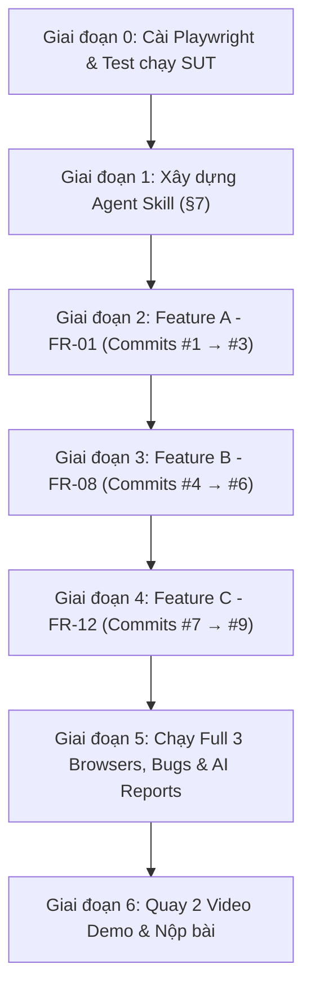

# KẾ HOẠCH THỰC HIỆN BÀI TẬP HW04: AUTOMATION TESTING (PLAYWRIGHT)
**Môn học:** Kiểm thử phần mềm (CSC13003) — Học kỳ 1, Năm học 2026–2027  
**Giảng viên phụ trách:** TS. Lâm Quang Vũ, TS. Trần Duy Hoàng, ThS. Trần Thị Bích Hạnh, ThS. Trương Phước Lộc, ThS. Hồ Tuấn Thanh — Khoa CNTT, Trường ĐH KHTN (HCMUS)  
**Sinh viên thực hiện:** TRƯƠNG THÀNH PHÁT — **MSSV:** `23120319` — **Lớp:** CQ2023/3  
**Email sinh viên:** `23120319@student.hcmus.edu.vn`  
**Hệ thống kiểm thử (SUT):** EShop Application (`https://github.com/ttbhanh/eshop-sut`)  
**Nhánh Git làm việc:** `HW4`

---

## 1. TỔNG QUAN & NGUYÊN TẮC BẮT BUỘC (NON-NEGOTIABLE PRINCIPLES)

### 1.1. Mục tiêu & Cơ cấu Điểm (100 Điểm)
Áp dụng chiến lược **AI-First** kết hợp **Human Review** để xây dựng bộ kiểm thử tự động (Web UI Automation) bằng **Playwright** cho 3 tính năng web kế thừa từ HW02:
1. **Task 1 — Feature A (25đ):** Tự động hóa **FR-01 (Account Registration)** [Pool A] (≥ 12 TCs, data-driven, ≥ 3 kiểu assertion, chạy 3 trình duyệt, human review).
2. **Task 1 — Feature B (25đ):** Tự động hóa **FR-08 (Checkout)** [Pool B] (≥ 12 TCs, data-driven, ≥ 3 kiểu assertion, chạy 3 trình duyệt, human review).
3. **Task 1 — Feature C (25đ):** Tự động hóa **FR-12 (Access Control)** [Pool C] (≥ 12 TCs, data-driven, ≥ 3 kiểu assertion, chạy 3 trình duyệt, human review).
4. **Task 2 — Demo Video (15đ):** Video YouTube Unlisted (≥ 5 phút, thuyết minh tiếng Việt) demo chạy end-to-end đa trình duyệt, mở HTML report và giải thích ≥ 1 lỗi đã sửa của AI.
5. **Task 3 (Mục §7) — Agent Skill (10đ):** Đóng gói Custom Agent Skill cho quy trình Automation Testing (data-driven + multi-browser) kèm video YouTube minh họa sử dụng skill.

### 1.2. Các quy tắc bất biến & Chống gian lận (§11, §12, §17)
1. **SUT Immutability:** Tuyệt đối **KHÔNG chỉnh sửa, vá lỗi** trong thư mục `eshop-sut/`. Mọi lỗi phát hiện qua Playwright phải lập Bug Report + GitHub Issue kèm ảnh chụp màn hình.
2. **Bắt buộc Data-Driven Testing:** Mọi dữ liệu test phải lưu trong file **`.json` hoặc `.csv` riêng biệt**. Cấm tuyệt đối việc hardcode mảng/object dữ liệu trong file `.spec.ts`.
3. **Chạy Đa trình duyệt & Metadata HTML Report (§6, §11):**
   - Mỗi tính năng phải chạy đủ trên **3 trình duyệt** (`Chromium`, `Firefox`, `WebKit`) $\rightarrow$ Tổng cộng **tối thiểu 9 lượt chạy (browser runs)**.
   - Mọi **HTML Report** (Playwright HTML Reporter) phải hiển thị rõ ràng chuỗi **`Run by: 23120319`** kèm **ISO Timestamp** (ví dụ: `2026-11-13T10:30:00.000Z`).
4. **Quy tắc Git Commit (§12):**
   - Duy trì kho lưu trữ GitHub công khai với **tối thiểu 8 commits có chỉnh sửa trực tiếp file test script** (`.spec.ts` / `.spec.js`).
   - *Lưu ý:* Các commit chỉ sửa `README.md`, báo cáo `.md`/`.pdf` **không** được tính vào chỉ tiêu 8 commits này.
5. **Quy định Video Demo (§11):** Phải có giọng nói tiếng Việt của chính sinh viên và hiển thị **face-cam** hoặc cửa sổ terminal chạy hai lệnh **`whoami`** và **`hostname`**.

---

## 2. CẤU TRÚC THƯ MỤC DỰ KIẾN TẠI `HW4/`

```text
HW4/
├── README.md                            # Bảng tự chấm 100/100, Test Summary, link GitHub & Video
├── 23120319_HW04_Main_Report.md         # Báo cáo chính (Markdown)
├── 23120319_HW04_Main_Report.pdf        # Báo cáo chính (PDF)
├── git-commit-log.txt                   # Nhật ký git log xuất dạng văn bản
├── requirements/                        # Đề bài gốc En/Vi
├── plan/
│   └── plan.md                          # Tệp kế hoạch chi tiết này
├── automation/                          # Dự án Playwright TypeScript
│   ├── package.json
│   ├── playwright.config.ts             # Cấu hình 3 browsers + HTML Reporter ("Run by: 23120319" + ISO time)
│   ├── data/                            # Dữ liệu Data-Driven Testing (tách rời hoàn toàn khỏi script)
│   │   ├── fr01-registration.json
│   │   ├── fr08-checkout.json
│   │   └── fr12-access-control.json
│   ├── pages/ (hoặc helpers/)           # Page Objects / Auth & Cart Helpers
│   ├── tests/                           # Bộ test scripts Playwright (.spec.ts)
│   │   ├── fr01-registration.spec.ts    # ≥ 12 test cases
│   │   ├── fr08-checkout.spec.ts        # ≥ 12 test cases
│   │   └── fr12-access-control.spec.ts  # ≥ 12 test cases
│   └── playwright-report/               # Báo cáo HTML xuất ra sau khi chạy 3 trình duyệt (9+ runs)
├── report/
│   ├── bugs-summary.md                  # Tổng hợp bug phát hiện qua Playwright
│   ├── issues/                          # Các file báo cáo lỗi chi tiết (BUG-AUTO-xx.md)
│   ├── appendix-A-ai-audit.md & .pdf    # Báo cáo kiểm toán AI (đủ prompt/output)
│   └── appendix-B-ai-critique.md & .pdf # Phê bình AI (200–300 từ)
└── evidence/
    └── screenshots/                     # Ảnh chụp màn hình lỗi SUT & GitHub Issues
```

*(Kèm theo Skill lưu tại `.agents/skills/playwright-automation-testing/` và `.claude/skills/playwright-automation-testing/`).*

---

## 3. BẢNG KẾ HOẠCH CHI TIẾT 8 GIT COMMITS CHUẨN §12 (8-COMMIT SCRIPT ROADMAP)

Theo quy định bắt buộc tại **Mục §12 của Đề bài HW04**, sinh viên phải duy trì lịch sử kho Git với **tối thiểu 8 commits có chỉnh sửa trực tiếp vào các tệp kịch bản kiểm thử (`.spec.ts` / `.spec.js`)**. Các commit chỉ sửa `README.md`, xuất file `PDF` hoặc tài liệu không được tính vào chỉ tiêu này.

Để chứng minh tiến trình làm việc bài bản (**AI-First $\rightarrow$ Human Review $\rightarrow$ Cross-Browser Optimization**), 8 commits được phân bổ khoa học qua 3 tính năng như sau:

| STT | Mã Commit | Thông Điệp Commit (Conventional Commits) | Tệp `.spec.ts` Chỉnh Sửa Trực Tiếp | Giai Đoạn & Ý Nghĩa Kỹ Thuật |
|:---:|:---|:---|:---|:---|
| **#1** | `commit-fr01-01` | `test(HW4-FR01): generate initial AI-assisted Playwright script for registration` | `HW4/automation/tests/fr01-registration.spec.ts` | **(Giai đoạn 2 - AI Baseline)** Sinh mã kịch bản đăng ký ban đầu từ AI nạp data `fr01-registration.json`. |
| **#2** | `commit-fr01-02` | `fix(HW4-FR01): replace brittle selectors and handle password regex whitespace` | `HW4/automation/tests/fr01-registration.spec.ts` | **(Giai đoạn 2 - Human Review #1)** Sửa selector dễ vỡ và xử lý regex mật khẩu đặc thù `(?=.*\s)` của EShop. |
| **#3** | `commit-fr01-03` | `test(HW4-FR01): add multi-assertion patterns and stabilize multi-browser runs` | `HW4/automation/tests/fr01-registration.spec.ts` | **(Giai đoạn 2 - Cross-Browser)** Bổ sung đủ $\ge 3$ kiểu assertion và kiểm tra tương thích WebKit/Firefox. |
| **#4** | `commit-fr08-01` | `test(HW4-FR08): create initial checkout automation spec from HW02 test cases` | `HW4/automation/tests/fr08-checkout.spec.ts` | **(Giai đoạn 3 - AI Baseline)** Sinh mã kịch bản giỏ hàng & thanh toán nạp data `fr08-checkout.json`. |
| **#5** | `commit-fr08-02` | `fix(HW4-FR08): isolate cart state in beforeEach and handle async coupon calculation` | `HW4/automation/tests/fr08-checkout.spec.ts` | **(Giai đoạn 3 - Human Review #2)** Khắc phục lỗi rò rỉ giỏ hàng giữa các test và chờ API tính mã giảm giá. |
| **#6** | `commit-fr08-03` | `test(HW4-FR08): add assertions for editable total defect and multi-browser stability` | `HW4/automation/tests/fr08-checkout.spec.ts` | **(Giai đoạn 3 - Cross-Browser)** Bổ sung assertion bắt lỗi sửa ô tổng tiền và ổn định chạy 3 trình duyệt. |
| **#7** | `commit-fr12-01` | `test(HW4-FR12): generate initial spec for admin access control and RBAC routes` | `HW4/automation/tests/fr12-access-control.spec.ts` | **(Giai đoạn 4 - AI Baseline)** Sinh mã kiểm tra phân quyền truy cập Admin Web (`:5174`) nạp data `fr12-access-control.json`. |
| **#8** | `commit-fr12-02` | `fix(HW4-FR12): handle token storage between ports and verify UI redirect assertions` | `HW4/automation/tests/fr12-access-control.spec.ts` | **(Giai đoạn 4 - Human Review #3)** Sửa lỗi lưu token giữa 2 port `:5173`/`:5174` và hoàn thiện chuyển hướng UI. |

> 🔍 **Lệnh kiểm tra điều kiện đạt chuẩn §12 trước khi nộp bài:**
> ```powershell
> git log --oneline -- "*.spec.ts"
> ```
> *(Lệnh này phải trả về danh sách $\ge 8$ commits để đảm bảo đạt trọn vẹn điểm số Mục §12).*

---

## 3.1. BẢNG TRA CỨU CÁC LỆNH THAO TÁC CỐT LÕI (COMMAND CHEAT SHEET)

Dành cho sinh viên tự thực thi trong quá trình quay video, kiểm tra kịch bản và xuất báo cáo:

### 1. Khởi chạy SUT (Hệ thống EShop cần kiểm thử)
Mở 2 cửa sổ terminal riêng biệt:
```powershell
# Terminal 1: Backend API (cổng 5000)
cd d:\HCMUS\semester7\software-testing\Software-Testing\eshop-sut\backend
npm run dev

# Terminal 2: Frontend Web Khách hàng (cổng 5173)
cd d:\HCMUS\semester7\software-testing\Software-Testing\eshop-sut\frontend-web
npm run dev
```

### 2. Kiểm định tự động chất lượng Test Spec (Validator Script)
Kiểm tra xem toàn bộ file test có đạt chuẩn Data-Driven, đủ $\ge 12$ TCs, đủ $\ge 3$ loại assertion, không hardcode data:
```powershell
# Chạy từ thư mục gốc của repository:
node .agents/skills/playwright-automation-testing/scripts/validate_automation.mjs --dir HW4/automation
```

### 3. Các lệnh chạy kiểm thử Playwright (`npx playwright test`)
*Lưu ý: Luôn `cd` vào thư mục `HW4/automation` trước khi chạy:*
```powershell
cd d:\HCMUS\semester7\software-testing\Software-Testing\HW4\automation

# A. Chạy 1 tính năng trên 1 trình duyệt (ví dụ Chromium - nhanh nhất để debug):
npx playwright test tests/fr01-registration.spec.ts --project=chromium

# B. Chạy 1 tính năng trên cả 3 trình duyệt (Chromium, Firefox, WebKit):
npx playwright test tests/fr01-registration.spec.ts

# C. Chạy toàn bộ 3 tính năng trên cả 3 trình duyệt (Full Suite ≥ 9 runs):
npx playwright test

# D. Chạy có mở giao diện trình duyệt (Headed mode) để quay video quan sát trực tiếp:
npx playwright test tests/fr01-registration.spec.ts --project=chromium --headed

# E. Chạy với giao diện tương tác Playwright UI Mode:
npx playwright test --ui
```

### 4. Mở xem Báo cáo HTML (Playwright HTML Report)
```powershell
cd d:\HCMUS\semester7\software-testing\Software-Testing\HW4\automation

# Khởi chạy server nội bộ để xem báo cáo HTML đầy đủ (có Run by: 23120319 + ISO Timestamp):
npx playwright show-report
```

### 5. Lệnh xác thực danh tính cho Video Demo (§11)
```powershell
whoami
hostname
git log -1 --oneline
```

---

## 4. LỘ TRÌNH TRIỂN KHAI TỪNG BƯỚC (STEP-BY-STEP ROADMAP)



---

### 🚀 GIAI ĐOẠN 0: Cài đặt Playwright & Khởi chạy SUT
*Mục tiêu:* Thiết lập dự án Playwright hoàn chỉnh, chạy được 3 trình duyệt và xác nhận hệ thống EShop hoạt động ổn định.

- [ ] **Bước 0.1: Khởi chạy SUT (EShop):**
  - Chạy Backend (`eshop-sut/backend`, cổng `3000` hoặc cổng cấu hình) và seed database sạch.
  - Chạy Customer Web (`eshop-sut/frontend-web` tại `http://localhost:5173`).
  - Chạy Admin Web (`eshop-sut/frontend-admin` tại `http://localhost:5174`).
- [ ] **Bước 0.2: Cài đặt Playwright trong `HW4/automation/`:**
  ```powershell
  mkdir HW4\automation
  cd HW4\automation
  npm init -y
  npm init playwright@latest -- --quiet --lang=ts
  npx playwright install chromium firefox webkit
  ```
- [ ] **Bước 0.3: Cấu hình `playwright.config.ts` đạt chuẩn §6 & §11:**
  - Khai báo đủ 3 `projects`: `chromium`, `firefox`, `webkit`.
  - Cấu hình `reporter` dùng Playwright HTML Reporter (hoặc custom wrapper/title/metadata) để tiêu đề/header báo cáo HTML hiển thị chính xác chuỗi:
    `Run by: 23120319 | Timestamp: <ISO-8601>`
  - Bật `screenshot: 'only-on-failure'`, `trace: 'on-first-retry'`.
- [ ] **Git Commit (Setup):** `chore(HW4): initialize Playwright project with multi-browser config and student metadata`

---

### 🧠 GIAI ĐOẠN 1: Xây dựng Custom Agent Skill (10 Điểm — §7)
*Mục tiêu:* Đóng gói bộ quy trình chuẩn hóa giúp AI tự động sinh, kiểm tra và chạy script Playwright data-driven đúng chuẩn đề bài.

- [ ] **Bước 1.1: Thiết kế cấu trúc Skill tại `.agents/skills/playwright-automation-testing/` (đồng bộ sang `.claude/skills/`):**
  - `SKILL.md`: Quy định quy trình 5 bước bắt buộc cho AI:
    1. *Inspect SUT DOM:* Đọc mã nguồn JSX/HTML của component tương ứng trong `eshop-sut/` để lấy locator chuẩn (`getByRole`, `getByLabel`, `getByPlaceholder`, `data-testid`) — không đoán mò.
    2. *Convert HW02 Test Cases to Data File:* Đọc lại TCs từ `HW2/testcases/FR-xx.json` và chuyển sang định dạng dữ liệu Data-Driven (`HW4/automation/data/*.json` hoặc `.csv`), bao phủ Positive, Negative và Edge cases (≥ 12 TCs).
    3. *Generate Playwright Spec:* Sinh file `.spec.ts` lặp qua file dữ liệu (không hardcode), bắt buộc dùng **≥ 3 assertion patterns khác nhau** (ví dụ: `toHaveURL`, `toBeVisible`, `toHaveText`/`toContainText`, `toHaveValue`, `expect(response.status())`).
    4. *Multi-Browser Dry-Run & Self-Review:* Chạy thử trên Chromium/Firefox/WebKit; liệt kê lỗi AI thường mắc (flaky `waitForTimeout`, selector dễ gãy, quên state setup) và đề xuất bản sửa.
    5. *Report & Audit:* Kiểm tra report HTML có `"Run by: 23120319"` + ISO timestamp và xuất log prompt/output sang AI Audit Report.
- [ ] **Bước 1.2: Tạo Templates & Validation Script trong thư mục Skill:**
  - `templates/playwright.config.template.ts`
  - `scripts/validate_automation.mjs`: Script Node.js tự động rà soát các file `.spec.ts` xem có: (a) đọc dữ liệu từ file ngoài hay hardcode, (b) đạt ≥ 12 cases/feature, (c) dùng ≥ 3 hàm `expect(...)` khác nhau.
- [ ] **Git Commit:** `feat(HW4): create reusable playwright-automation-testing Agent Skill and validator`

---

### 🧪 GIAI ĐOẠN 2: Task 1A — Tự động hóa `FR-01` Account Registration (25 Điểm)
*Mục tiêu:* Sinh ≥ 12 automation TCs cho trang Đăng ký (`:5173/register`), review sửa lỗi AI qua nhiều lần commit, chạy trên 3 trình duyệt.

- [ ] **Bước 2.1: Khảo sát & Chuẩn bị Data (`fr01-registration.json`):**
  - Tham chiếu `HW2/testcases/FR-01.json` (có sẵn 30 ca DT + BVA) và đọc form đăng ký trong `eshop-sut/frontend-web`.
  - Chọn/tổng hợp **≥ 12 test cases** tiêu biểu (đăng ký thành công với tên có MSSV `23120319`, email trùng, email sai format, mật khẩu biên 5/6/128/129 ký tự, tên có dấu tiếng Việt UTF-8, trường rỗng...).
  - Ghi vào `HW4/automation/data/fr01-registration.json`. *(Dùng email động có timestamp hoặc MSSV để không bị trùng khi chạy qua 3 trình duyệt).*
- [ ] **Bước 2.2: Sinh script bước đầu bằng AI theo Skill (Commit #1 sửa `.spec.ts`):**
  - Prompt AI tạo bản nháp `HW4/automation/tests/fr01-registration.spec.ts`.
  - **Commit #1:** `test(HW4-FR01): generate initial AI-assisted Playwright script for registration`
- [ ] **Bước 2.3: Human Review & Fix lỗi AI lần 1 (Commit #2 sửa `.spec.ts`):**
  - Chạy `npx playwright test tests/fr01-registration.spec.ts --project=chromium`.
  - Rà soát những điểm AI làm sai/thiếu (ví dụ: AI đoán sai text nút submit, dùng `waitForTimeout` thay vì chờ response API/toast, thiếu xử lý native HTML5 `validationMessage` khi input `type="email"` chặn submit).
  - Ghi chép chi tiết các lỗi đã sửa vào nhật ký Review/Gap Analysis.
  - **Commit #2:** `fix(HW4-FR01): replace brittle selectors and handle HTML5 native validation`
- [ ] **Bước 2.4: Tối ưu Data-Driven, Assertions & Cross-Browser Fix (Commit #3 sửa `.spec.ts`):**
  - Bổ sung đủ ≥ 3 loại assertion (`toHaveURL`, `toBeVisible`, `toContainText` / `toHaveValue` / `evaluate` validationMessage).
  - Chạy đủ cả 3 trình duyệt: `npx playwright test tests/fr01-registration.spec.ts` (Chromium + Firefox + WebKit). Fix nếu có sự khác biệt hành vi giữa Firefox/WebKit và Chromium.
  - **Commit #3:** `test(HW4-FR01): ensure cross-browser compatibility and add 3+ assertion patterns`

---

### 🛒 GIAI ĐOẠN 3: Task 1B — Tự động hóa `FR-08` Checkout (25 Điểm)
*Mục tiêu:* Sinh ≥ 12 automation TCs cho luồng Giỏ hàng & Thanh toán (`:5173/cart`, `/checkout`), xử lý bài toán có trạng thái (stateful: phải đăng nhập + có sản phẩm trong giỏ).

- [ ] **Bước 3.1: Khảo sát & Chuẩn bị Data (`fr08-checkout.json`):**
  - Tham chiếu `HW2/testcases/FR-08.json` + các bug UX đã phát hiện ở HW03 (`BUG-UX-02` ô tổng tiền cho sửa, `BUG-UX-03` giỏ hàng không xóa sau checkout).
  - Tạo `HW4/automation/data/fr08-checkout.json` với **≥ 12 test cases** (checkout thành công, giỏ hàng trống, mã coupon `SAVE10`, địa chỉ giao hàng rỗng/quá dài, kiểm tra ô tổng tiền có bị sửa không, kiểm tra giỏ hàng sau khi thanh toán...).
- [ ] **Bước 3.2: Sinh script bước đầu bằng AI theo Skill (Commit #4 sửa `.spec.ts`):**
  - Tạo `tests/fr08-checkout.spec.ts` (có `beforeEach` đăng nhập và thêm sản phẩm vào giỏ hàng sạch).
  - **Commit #4:** `test(HW4-FR08): add initial Playwright automation spec for checkout flow`
- [ ] **Bước 3.3: Human Review & Fix lỗi Stateful / Async (Commit #5 sửa `.spec.ts`):**
  - Sửa lỗi AI hay mắc ở luồng Checkout: `localStorage` hoặc giỏ hàng bị lưu tồn dư giữa các test, click thanh toán trước khi giá cập nhật xong, assertion yếu không kiểm tra đúng tổng tiền sau giảm giá.
  - **Commit #5:** `fix(HW4-FR08): isolate cart state per test and fix async coupon calculation waits`
- [ ] **Bước 3.4: Chạy 3 trình duyệt & Ghi nhận Assertion Fail do Bug thật (Commit #6 sửa `.spec.ts`):**
  - Chạy `npx playwright test tests/fr08-checkout.spec.ts` trên Chromium, Firefox, WebKit.
  - Xác nhận các ca fail phản ánh đúng lỗi của EShop (ví dụ: tổng tiền cho phép sửa `toBeDisabled()` fail, giỏ hàng vẫn còn badge sau checkout fail) và cấu hình chụp screenshot bằng chứng.
  - **Commit #6:** `test(HW4-FR08): add assertions exposing SUT checkout defects and stabilize multi-browser runs`

---

### 🔐 GIAI ĐOẠN 4: Task 1C — Tự động hóa `FR-12` Access Control (25 Điểm)
*Mục tiêu:* Sinh ≥ 12 automation TCs kiểm tra phân quyền người dùng vãng lai (Guest), Khách hàng (Customer) và Quản trị viên (Admin) trên cả Customer Web (`:5173`) và Admin Web (`:5174`).

- [ ] **Bước 4.1: Khảo sát & Chuẩn bị Data (`fr12-access-control.json`):**
  - Tham chiếu `HW2/testcases/FR-12.json` và mã nguồn `frontend-admin/`.
  - Tạo `HW4/automation/data/fr12-access-control.json` với **≥ 12 test cases** (Guest vào `/admin`, `/checkout`, `/orders`; Customer dùng token thường truy cập Admin Dashboard `:5174`; Admin đăng nhập vào quản trị; token hết hạn/giả mạo trong `localStorage`; nút/route nhạy cảm không ẩn với role thường...).
- [ ] **Bước 4.2: Sinh script bước đầu bằng AI theo Skill (Commit #7 sửa `.spec.ts`):**
  - Tạo `tests/fr12-access-control.spec.ts`.
  - **Commit #7:** `test(HW4-FR12): generate initial Playwright spec for RBAC and access control`
- [ ] **Bước 4.3: Human Review, Multi-Browser Verification & Refine (Commit #8 sửa `.spec.ts`):**
  - Sửa lỗi AI xử lý sai `localStorage` / cookie giữa hai port `:5173` và `:5174`, hoặc assertion chỉ check status code mà quên kiểm tra UI redirect về `/login`.
  - Chạy full 3 trình duyệt: `npx playwright test tests/fr12-access-control.spec.ts`.
  - **Commit #8:** `fix(HW4-FR12): handle multi-port origin storage and verify UI access control redirects` *(Đạt tối thiểu 8 commits sửa trực tiếp `.spec.ts` theo §12!)*.

---

### 📊 GIAI ĐOẠN 5: Tổng hợp Report, Bug Issues, Git Log & Hồ sơ AI (§6, §9, §10, §12)
*Mục tiêu:* Tạo đầy đủ đầu ra thực tế, không sót bất kỳ tài liệu nào trong quy định nộp bài §14.

- [ ] **Bước 5.1: Thực thi Full Suite & Lưu trữ HTML Reports:**
  - Chạy toàn bộ 3 tính năng trên cả 3 trình duyệt (**9+ browser runs**) để sinh bộ báo cáo cuối cùng:
    `npx playwright test`
  - Ngoài báo cáo tổng, nếu cần có thể chạy tách riêng từng feature (`--project=chromium`, `--project=firefox`, `--project=webkit` hoặc lưu snapshot report) để minh họa rõ **9 browser runs**.
  - Kiểm tra kỹ trên HTML Report phải hiển thị rõ: **`Run by: 23120319`** và **ISO Timestamp** (ví dụ `2026-11-14T...Z`).
- [ ] **Bước 5.2: Chạy Script Validator của Agent Skill:**
  - Chạy `node .agents/skills/playwright-automation-testing/scripts/validate_automation.mjs` kiểm tra 100% file `.spec.ts` đạt chuẩn data-driven, ≥ 12 cases/feature, ≥ 3 assertions.
- [ ] **Bước 5.3: Ghi nhận Bug Reports & GitHub Issues:**
  - Tổng hợp các ca Fail do lỗi thật của SUT (lỗi validation đăng ký FR-01, lỗi checkout/total FR-08, lỗi không chặn quyền admin FR-12).
  - Lập bug reports trong `HW4/report/issues/` và mở GitHub Issues (đính kèm ảnh chụp lỗi của Playwright + chụp màn hình trang GitHub Issues lưu vào `HW4/evidence/screenshots/`).
- [ ] **Bước 5.4: Xuất Git Commit Log & Viết Hồ sơ Báo cáo (Markdown + PDF):**
  - Xuất nhật ký commit: `git log --stat -n 30 > HW4/git-commit-log.txt` (kiểm tra chắc chắn có ≥ 8 commits chạm `.spec.ts`).
  - Viết `HW4/23120319_HW04_Main_Report.md` (kèm bảng phân tích Human Review / Gap Analysis: AI sai ở đâu, vì sao sai, đã sửa thế nào) $\rightarrow$ xuất `.pdf`.
  - Hoàn thiện `HW4/report/appendix-A-ai-audit.md` & `.pdf` (đủ Name of AI tool, Date/time, Prompt, Output) và `appendix-B-ai-critique.md` & `.pdf` (**200–300 từ**).
  - Hoàn thiện `HW4/README.md` (Bảng tự chấm 100/100 theo §15 + Bảng Test Summary + Link Repo & Link Video).

---

### 🎬 GIAI ĐOẠN 6: Quay Video Demo YouTube & Đóng gói Nộp bài (§6 Task 2, §7, §14)
*Mục tiêu:* Hoàn thành 2 video minh chứng trung thực và nộp đúng quy cách lên Moodle.

- [ ] **Bước 6.1: Quay Video Demo Task 2 (15đ — YouTube Unlisted, ≥ 5 phút, Tiếng Việt):**
  - Mở terminal, chạy rõ hai lệnh chống gian lận:
    ```powershell
    whoami
    hostname
    ```
    *(hoặc bật face-cam xuyên suốt video)*.
  - Trình bày file data `.json` và file `.spec.ts` của 1 tính năng (ví dụ `FR-08`).
  - Thuyết minh rõ **ít nhất 1 lỗi do AI sinh ra** và cách bạn đã chỉnh sửa code `.spec.ts` để khắc phục.
  - Chạy lệnh `npx playwright test tests/fr08-checkout.spec.ts` cho chạy trực tiếp trên 3 trình duyệt (`chromium`, `firefox`, `webkit`).
  - Mở HTML Report lên trình duyệt, chỉ rõ dòng **`Run by: 23120319`** + **ISO timestamp** và xem chi tiết ca Pass/Fail + ảnh chụp screenshot lỗi.
- [ ] **Bước 6.2: Quay Video Demo Agent Skill (§7 — 10đ, YouTube Unlisted):**
  - Mở `SKILL.md` và giải thích cấu trúc Skill vừa xây dựng.
  - Demo gọi Skill chạy trọn vẹn từ đầu đến cuối cho 1 tính năng hoàn chỉnh (từ sinh data/script $\rightarrow$ chạy validate $\rightarrow$ chạy Playwright $\rightarrow$ xem report).
- [ ] **Bước 6.3: Đẩy toàn bộ lên GitHub Public Repo & Nén Nộp Moodle:**
  - Push toàn bộ code, data files, HTML reports lên GitHub công khai nhánh `HW4`.
  - Kiểm tra đối chiếu mọi thành phần theo Mục §14.
  - Đóng gói thành file `23120319_HW04_AI_Automation_100.zip` (hoặc split nếu > 20MB) và nộp lên Moodle trước hạn.

---

## 5. CHECKLIST KIỂM TRA TRƯỚC KHI NỘP (§14)

- [ ] `23120319_HW04_Main_Report.md` + `.pdf` (có review & gap analysis code AI).
- [ ] Link Public GitHub Repository (chứa scripts, data files `.json`/`.csv`, HTML reports).
- [ ] Bộ Multi-browser HTML Reports (có đủ **`Run by: 23120319`** + **ISO Timestamp**).
- [ ] Link YouTube Unlisted Video Demo Task 2 (≥ 5 phút, tiếng Việt, có `whoami`/`hostname` hoặc face-cam, giải thích ≥ 1 AI fix).
- [ ] Link YouTube Video Demo Agent Skill (§7) + Mã nguồn Skill.
- [ ] AI Audit Report (Phụ lục A) + AI Critique 200–300 từ (Phụ lục B) — bản Markdown + PDF.
- [ ] `git-commit-log.txt` (có **≥ 8 commits sửa trực tiếp file `.spec.ts`**).
- [ ] Bug Reports (Markdown) + ảnh chụp trang GitHub Issues.
- [ ] `README.md` (Bảng tự chấm 100/100 + Test Summary Report đầy đủ số liệu).

