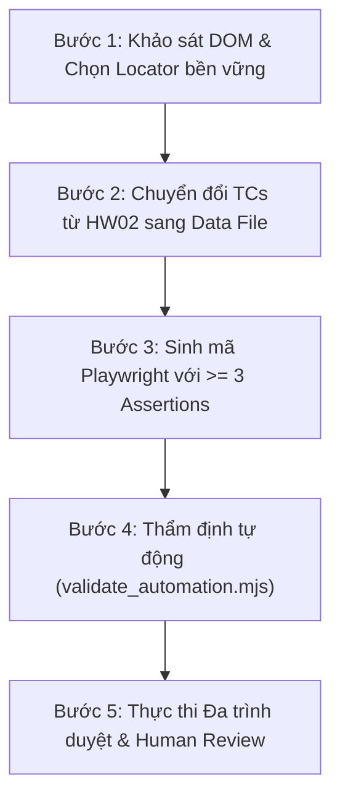

# Báo Cáo Giải Trình & Hướng Dẫn Sử Dụng Agent Skill: `playwright-automation-testing`

**Môn học:** CS423 / CSC13003 – Kiểm thử phần mềm (Software Testing · AI-augmented)  
**Khoa Công nghệ Thông tin — Trường Đại học Khoa học Tự nhiên, ĐHQG-HCM**  
**Giảng viên phụ trách:** TS. Lâm Quang Vũ, TS. Trần Duy Hoàng, ThS. Trần Thị Bích Hạnh, ThS. Trương Phước Lộc, ThS. Hồ Tuấn Thanh  
**Sinh viên thực hiện:** TRƯƠNG THÀNH PHÁT — **MSSV:** `23120319` — **Lớp:** CQ2023/3  
**Hệ thống kiểm thử (SUT):** EShop Application ([https://github.com/ttbhanh/eshop-sut](https://github.com/ttbhanh/eshop-sut))  
**Tài liệu gốc tham chiếu:** [`.agents/skills/playwright-automation-testing/SKILL.md`](file:///d:/HCMUS/semester7/software-testing/Software-Testing/.agents/skills/playwright-automation-testing/SKILL.md)

---

## 1. Mục Tiêu & Tổng Quan Kỹ Năng (Goal & Overview)

Agent Skill **`playwright-automation-testing`** được xây dựng nhằm chuẩn hóa và tự động hóa toàn diện quy trình kiểm thử giao diện web (Web UI Automation Testing) bằng **Playwright TypeScript** cho 3 tính năng của hệ thống EShop (kế thừa từ HW02), tuân thủ nghiêm ngặt **Chiến lược AI-First kết hợp Đánh giá của con người (Human Review)** theo chuẩn bài tập HW04:

1. **Chuyển đổi dữ liệu hướng dữ liệu (Data-Driven):** Chuyển đổi ít nhất **12 ca kiểm thử cho mỗi tính năng** (bao gồm ca kiểm thử tích cực - positive, tiêu cực - negative, và ca kiểm thử biên/ngoại lệ - boundary/edge) kế thừa từ HW02 vào các tệp dữ liệu rời (`.json` hoặc `.csv`).
2. **Sinh mã kiểm thử chuẩn mực:** Tạo các kịch bản kiểm thử Playwright (`.spec.ts`) có cấu trúc rõ ràng, nạp dữ liệu từ tệp bên ngoài (tuyệt đối không hardcode inline) và áp dụng **ít nhất 3 mẫu xác nhận (assertion patterns) khác nhau**.
3. **Thực thi đa trình duyệt (Multi-Browser Matrix):** Chạy toàn bộ bộ kiểm thử trên **ít nhất 3 trình duyệt** (`Chromium`, `Firefox`, `WebKit`) đạt tổng cộng **ít nhất 9 lượt chạy (browser runs)** xuyên suốt đồ án.
4. **Báo cáo HTML có nhãn định danh chống gian lận:** Tự động xuất Playwright HTML Report có hiển thị rõ ràng thông tin tác giả và dấu thời gian thực thi: **`Run by: 23120319`** kèm **ISO-8601 Timestamp**.
5. **Quy trình Human Review & Đánh giá khoảng cách AI (AI Gap Analysis):** Phản biện và chỉnh sửa mã nguồn do AI sinh ra (bắt các lỗi selector dễ gãy, lỗi chờ bất đồng bộ flaky wait, thiếu sót assertion) và ghi nhận các lỗi thật của phần mềm SUT lên GitHub Issues kèm ảnh chụp bằng chứng.

---

## 2. Các Nguyên Tắc Bắt Buộc & Chống Gian Lận Học Thuật (Strict Rules)

### 2.1. Tính Bất Biến Của Hệ Thống SUT (SUT Immutability)
* **TUYỆT ĐỐI KHÔNG chỉnh sửa, vá lỗi hay can thiệp vào mã nguồn bên trong `eshop-sut/`** (bao gồm `backend/`, `frontend-web/`, `frontend-admin/`, và `frontend-mobile/`).
* Hệ thống EShop là đối tượng kiểm thử và phải được xem là một **hộp đen chỉ đọc (Read-only Black-box)**. Khi một ca kiểm thử Playwright bị thất bại (Fail) do lỗi thực tế của ứng dụng (ví dụ: trường tổng tiền cho phép chỉnh sửa bằng tay ở Checkout, thiếu kiểm tra độ dài mật khẩu khi Đăng ký), người kiểm thử phải lập **Báo cáo lỗi (Defect Report)** và tạo **GitHub Issue** kèm ảnh chụp màn hình, **không được sửa code ứng dụng để làm đẹp kết quả kiểm thử**.

### 2.2. Bắt Buộc Kiểm Thử Hướng Dữ Liệu (Strict Data-Driven Testing)
* Mọi dữ liệu kiểm thử đầu vào, cờ logic, và kết quả kỳ vọng phải được lưu trữ trong các tệp dữ liệu độc lập tại thư mục `HW4/automation/data/*.json` (hoặc `.csv`).
* **Nghiêm cấm hành vi nhúng cứng (hardcode) các mảng hoặc đối tượng dữ liệu kiểm thử trực tiếp trong tệp kịch bản `.spec.ts`**. Các kịch bản vi phạm quy tắc này sẽ bị script kiểm định tự động đánh rớt.

### 2.3. Quy Định Chống Gian Lận & Xác Thực Tác Quyền (§11)
* Báo cáo kiểm thử **Playwright HTML Report** phải hiển thị trực quan thông tin tác giả:  
  `Run by: 23120319` cùng dấu thời gian chuẩn ISO-8601 (ví dụ: `2026-11-13T10:30:00.000Z`).
* Trong video demo nộp bài, sinh viên bắt buộc phải quay **face-cam** hoặc thực hiện lệnh kiểm tra định danh trên cửa sổ terminal:
  ```powershell
  whoami
  hostname
  ```

### 2.4. Quy Định Về Lịch Sử Cam Kết Git (§12)
* Duy trì kho mã nguồn GitHub công khai với **tối thiểu 8 commits có chỉnh sửa trực tiếp vào các tệp kịch bản kiểm thử** (`.spec.ts` hoặc `.spec.js`).
* *Lưu ý quan trọng:* Các commit chỉ chỉnh sửa tài liệu, tệp PDF, README hoặc cấu hình mà không sửa tệp `.spec.ts` sẽ **không** được tính vào chỉ tiêu 8 commits này.

### 2.5. Quy Định Về Thư Mục Đầu Ra (<OUTPUT_DIR> Override)
* Mọi sản phẩm kiểm thử (artifacts), tệp dữ liệu, mã nguồn kịch bản `.spec.ts`, báo cáo kết quả và ảnh chụp bằng chứng bắt buộc phải được lưu trữ trong thư mục đầu ra chỉ định của dự án (`<OUTPUT_DIR>`, được cấu hình thông qua tệp `CLAUDE.md`, ở bài tập này là `HW4/`). Tuyệt đối **không ghi tệp vào `eshop-sut/` hoặc để tràn ra thư mục gốc**.
* Cấu trúc thư mục chuẩn bên trong `<OUTPUT_DIR>` (`HW4/`):
  * `<OUTPUT_DIR>/automation/` : Thư mục gốc dự án Playwright (`package.json`, `playwright.config.ts`)
  * `<OUTPUT_DIR>/automation/data/` : Chứa các tệp dữ liệu kiểm thử rời (`.json` hoặc `.csv`)
  * `<OUTPUT_DIR>/automation/tests/` : Chứa các tệp kịch bản kiểm thử Playwright (`.spec.ts`)
  * `<OUTPUT_DIR>/automation/playwright-report/` : Báo cáo HTML do Playwright xuất ra
  * `<OUTPUT_DIR>/report/` : Báo cáo chính, báo cáo lỗi và các phụ lục kiểm định AI
  * `<OUTPUT_DIR>/evidence/screenshots/` : Ảnh chụp màn hình lỗi kiểm thử và minh chứng GitHub Issues

---

## 3. Chu Trình 5 Bước Tự Động Hóa (The 5-Step Automation Lifecycle)



---

### Bước 1: Khảo Sát DOM & Chiến Lược Lựa Chọn Locator Bền Vững (Resilient Locators)
Trước khi sinh mã kiểm thử, Agent phải đọc trực tiếp mã nguồn giao diện JSX của component trong `eshop-sut/`:
* Giao diện khách hàng (Customer Web): `eshop-sut/frontend-web/src/pages/`
* Giao diện quản trị (Admin Web): `eshop-sut/frontend-admin/src/pages/`

**Thứ tự ưu tiên lựa chọn phần tử (Chuẩn W3C & Playwright Best Practices):**
1. **Vai trò ngữ nghĩa hướng người dùng (Role):**  
   `page.getByRole('button', { name: 'Đăng ký' })`, `page.getByRole('heading', { level: 1 })`
2. **Nhãn nhúng hỗ trợ tiếp cận (Label):**  
   `page.getByLabel('Mật khẩu')`
3. **Văn bản gợi ý ô nhập liệu (Placeholder):**  
   `page.getByPlaceholder('Nhập địa chỉ email')`
4. **Nội dung văn bản hiển thị (Text content):**  
   `page.getByText('Đăng ký thành công', { exact: false })`
5. **Định danh kiểm thử riêng (Test ID):**  
   `page.getByTestId('checkout-total')`
6. ❌ **CẤM DÙNG (Dễ gãy / Brittle):** Tuyệt đối không dùng class sinh tự động (`.css-1x8b`), đường dẫn XPath phân cấp sâu (`//div[2]/form/div[3]/button`), hoặc bộ chọn CSS theo số thứ tự con (`nth-child`).

#### 💡 Giải thích chuyên sâu: Tại sao phải tuân thủ thứ tự ưu tiên Locator này?

Trong kiểm thử tự động, **Locator** là công cụ định vị để chỉ đường cho robot Playwright tìm thấy nút bấm, ô nhập liệu hay thông báo trên trang web. Có 2 cách tiếp cận hoàn toàn trái ngược nhau:

1. **Cách tiếp cận sai lầm (Cách AI lười hay làm — Dễ gãy / Brittle):**
   * AI thường dựa vào cấu trúc cây DOM theo thứ tự phân cấp hoặc tên class CSS tự sinh:
     ```ts
     // ❌ DỄ GÃY: Chỉ cần giao diện đổi 1 thẻ <div> hoặc đổi class là test sập ngay!
     await page.locator('form > div:nth-child(2) > input').fill('test@gmail.com');
     await page.locator('.btn-primary.css-1x8b9').click();
     ```
   * *Hậu quả:* Chỉ cần lập trình viên sửa lại giao diện một chút (thêm 1 thẻ `<div>` bọc ngoài, đổi màu nút, hoặc build lại dự án làm đổi tên class CSS), toàn bộ test script sẽ lăn ra **FAILED** do không tìm thấy phần tử, dù tính năng web không hề có lỗi (hiện tượng False Positive).

2. **Cách tiếp cận chuẩn mực (Chuẩn W3C & Playwright — Bền vững / Resilient):**
   * Tìm phần tử dựa đúng theo **những gì mắt người dùng thật nhìn thấy và tương tác**:
     ```ts
     // ✅ BỀN VỮNG: Bám theo ngữ nghĩa thực tế của người dùng
     await page.getByPlaceholder('Nhập địa chỉ email').fill('test@gmail.com');
     await page.getByRole('button', { name: 'Đăng ký' }).click();
     ```
   * *Lợi ích:* Dù giao diện có đổi màu sắc, thay đổi class hay cấu trúc thẻ HTML bên dưới, miễn trên màn hình vẫn là cái nút có chữ *"Đăng ký"*, robot Playwright vẫn tìm thấy và click chính xác 100%.

3. **Ý nghĩa cốt lõi trong bài tập HW04:**
   * **Bắt buộc AI đọc mã nguồn thật:** Quy tắc này ngăn chặn triệt để việc AI "đoán mò" selector, ép AI phải mở các tệp JSX trong `eshop-sut/` để lấy đúng text nhãn/placeholder tiếng Việt thực tế.
   * **Tư liệu ăn điểm Human Review & Video Demo (§6, §10):** Khi AI sinh code lần đầu, nếu AI mắc lỗi dùng XPath dài ngoằng hoặc class lung tung, bạn sẽ sửa lại thành `getByRole` / `getByPlaceholder`. Đây chính là minh chứng thực tế giúp bạn ghi điểm phần **Phân tích khoảng cách AI (AI Gap Analysis)** trong Báo cáo chính và thuyết minh trong **Video demo 5 phút**!

---

### Bước 2: Chuẩn Bị Dữ Liệu Kiểm Thử Hướng Dữ Liệu (Data-Driven Preparation)
Kế thừa trực tiếp các ca kiểm thử đã thiết kế tại HW02 (`HW2/testcases/FR-xx.json`):
* Lọc ra tập hợp cân bằng gồm **ít nhất 12 ca kiểm thử**:
  * Ca kiểm thử thành công (Happy Path / Positive): Dữ liệu chuẩn, luồng nghiệp vụ trơn tru.
  * Ca kiểm thử thất bại (Negative): Bỏ trống trường bắt buộc, sai định dạng email, trùng lặp tài khoản, trái quyền truy cập.
  * Ca kiểm thử biên / ngoại lệ (Boundary / Edge): Độ dài tối thiểu/tối đa của mật khẩu, ký tự tiếng Việt Unicode UTF-8 có dấu, số lượng hàng hóa cực trị.
* Lưu vào tệp `HW4/automation/data/<feature-id>-<name>.json`:
```json
[
  {
    "id": "TC-FR01-01",
    "description": "Đăng ký thành công với thông tin hợp lệ",
    "category": "positive",
    "inputs": {
      "name": "Trương Thành Phát 23120319",
      "email": "test_{{TIMESTAMP}}@student.hcmus.edu.vn",
      "password": "Password123@"
    },
    "expected": {
      "success": true,
      "redirectUrl": "/login",
      "toastMessage": "Đăng ký thành công"
    }
  }
]
```
*(Mẹo kỹ thuật: Sử dụng cờ động `{{TIMESTAMP}}` trong email hoặc tên đăng nhập để khi bộ test chạy lặp lại trên cả 3 trình duyệt không bị lỗi đụng độ khóa duy nhất trong cơ sở dữ liệu).*

---

### Bước 3: Sinh Mã Kịch Bản Với Ít Nhất 3 Mẫu Xác Nhận (Multi-Assertion Patterns)
Mỗi tệp kịch bản (`.spec.ts`) phải nạp tệp dữ liệu tương ứng và lặp qua từng ca kiểm thử. Trong bộ kịch bản của mỗi tính năng, bắt buộc phải phối hợp **ít nhất 3 mẫu xác nhận (assertion patterns) khác nhau** từ danh mục sau:

| Mã Mẫu | Phương thức Assertion | Mục tiêu kiểm chứng | Ví dụ mã nguồn thực tế |
|:---:|:---|:---|:---|
| **A-01** | `toHaveURL()` | Kiểm tra chuyển hướng liên kết / URL | `await expect(page).toHaveURL(/\/login/);` |
| **A-02** | `toBeVisible()` / `toBeHidden()` | Kiểm tra hiển thị phần tử UI / Toast / Modal | `await expect(page.getByText(tc.expected.toastMessage)).toBeVisible();` |
| **A-03** | `toContainText()` / `toHaveText()` | Kiểm tra nội dung văn bản thông báo lỗi | `await expect(errorBanner).toContainText(tc.expected.errorMessage);` |
| **A-04** | `toHaveValue()` | Kiểm tra giá trị ô input / Giá trị mặc định | `await expect(priceInput).toHaveValue(tc.expected.price);` |
| **A-05** | `toBeDisabled()` / `toBeEnabled()` | Kiểm tra trạng thái khóa của nút bấm | `await expect(submitBtn).toBeDisabled();` |
| **A-06** | `toHaveCount()` | Kiểm tra số lượng dòng bảng / Item giỏ hàng | `await expect(cartRows).toHaveCount(tc.expected.itemCount);` |

**Quy tắc phòng chống lỗi Flaky (Flakiness Prevention):**
- ❌ **CẤM DÙNG:** `await page.waitForTimeout(3000)` (thao tác sleep cứng gây chậm bộ test và không ổn định giữa các máy).
- ✅ Dựa vào cơ chế tự động chờ web assertions của Playwright (`expect(...).toBeVisible()`).
- ✅ Sử dụng `await page.waitForResponse(resp => resp.url().includes('/api/') && resp.status() === 200)` khi xử lý các form gọi API bất đồng bộ.
- ✅ Cô lập trạng thái trình duyệt và dọn sạch `localStorage`, cookie trong hook `test.beforeEach()` để tránh rò rỉ dữ liệu giữa các ca test.

---

### Bước 4: Thẩm Định Tự Động Bằng Kịch Bản (`validate_automation.mjs`)
Trước khi thực thi toàn diện hoặc nộp bài, chạy script thẩm định tự động để rà soát vi phạm:
```bash
node .agents/skills/playwright-automation-testing/scripts/validate_automation.mjs --dir HW4/automation
```
Kịch bản sẽ tự động quét và kiểm tra các tiêu chí:
- [x] Tính độc lập dữ liệu (không có mảng dữ liệu kiểm thử hardcode inline trong file `.spec.ts`).
- [x] Số lượng ca kiểm thử đạt $\ge 12$ cases cho mỗi tính năng.
- [x] Sử dụng đủ $\ge 3$ mẫu assertion khác nhau trong mỗi tệp test.
- [x] Cấu hình đầy đủ 3 dự án trình duyệt (`chromium`, `firefox`, `webkit`) trong `playwright.config.ts`.
- [x] Cấu hình siêu dữ liệu tác giả (`Run by: 23120319`) và dấu thời gian ISO.

---

### Bước 5: Thực Thi Đa Trình Duyệt & Quy Trình Human Review
1. **Thực thi trên đủ 3 trình duyệt:**
   ```bash
   cd HW4/automation
   # Chạy toàn bộ bộ test trên Chromium, Firefox và WebKit
   npx playwright test
   
   # Chạy riêng một tính năng trên đủ 3 trình duyệt
   npx playwright test tests/fr01-registration.spec.ts
   ```
2. **Quy trình Human Review (Bắt lỗi của AI):**
   Người kiểm thử rà soát từng trường hợp thất bại hoặc bất thường giữa các trình duyệt. Ghi nhận lỗi do AI gây ra theo 3 nhóm nguyên nhân gốc:
   - **Bộ chọn không bền vững (Fragile Selectors):** AI tự đoán tên class hoặc thẻ lồng nhau không tồn tại trong component React.
   - **Bất đồng bộ & Lệch nhịp thời gian (Timing/Async):** AI chưa tính đến độ trễ trả lời của API backend hoặc thời gian lưu token.
   - **Dị biệt hành vi trình duyệt (Browser Quirks):** Sự khác biệt giữa Chromium và Firefox trong việc hiển thị tooltip báo lỗi native HTML5 `validationMessage`.
3. **Phân loại khiếm khuyết (Defect Triage):**
   - Nếu lỗi xuất phát từ **mã test của AI sinh ra** $\rightarrow$ Sửa script test, thực hiện commit với thông điệp `fix(HW4-...): ...` để ghi điểm Human Review.
   - Nếu lỗi xuất phát từ **lỗi thật của hệ thống SUT** $\rightarrow$ Chụp ảnh màn hình báo cáo lỗi của Playwright, lập Báo cáo lỗi (Defect Report) và mở issue trên GitHub Issues.

---

## 4. Cấu Trúc Các Tệp Tin Thành Phần Của Skill

Thư mục Skill được tổ chức quy củ tại `.agents/skills/playwright-automation-testing/` (và đồng bộ sang `.claude/skills/`):

```text
.agents/skills/playwright-automation-testing/
├── SKILL.md                                 # Bản đặc tả quy chuẩn gốc tiếng Anh
├── templates/
│   ├── playwright.config.template.ts        # Mẫu cấu hình Playwright 3 trình duyệt + metadata sinh viên
│   └── spec.template.ts                     # Mẫu kịch bản test nạp JSON ngoài + đa dạng assertion
└── scripts/
    ├── validate_automation.mjs              # Script Node.js tự động kiểm tra vi phạm quy định đề bài
    └── export_run_summary.mjs               # Script xuất bảng tổng kết kết quả chạy cho README.md
```

---

## 5. Hướng Dẫn Thực Hiện Video Demo Agent Skill (§7 — 10 Điểm)

Khi thực hiện video demo cho phần Agent Skill (Mục §7 đề bài), sinh viên thực hiện các bước sau để đạt điểm tuyệt đối:
1. **Mở đầu:** Giới thiệu định danh sinh viên (MSSV `23120319`), mở tệp `SKILL.md` và giải thích ngắn gọn kiến trúc 5 bước của Skill.
2. **Gọi Skill:** Thao tác gọi Skill để sinh bộ kiểm thử cho một tính năng (ví dụ: `FR-01`).
3. **Minh chứng Data-Driven & Assertions:** Mở tệp `data/fr01-registration.json` (chỉ rõ $\ge 12$ test cases) và tệp `tests/fr01-registration.spec.ts` (chỉ rõ $\ge 3$ kiểu assertion).
4. **Chạy Validator:** Chạy lệnh `node .../validate_automation.mjs` để công cụ xác nhận 100% đạt chuẩn quy chế.
5. **Thực thi đa trình duyệt:** Chạy `npx playwright test tests/fr01-registration.spec.ts` và mở xem **HTML Report** hiển thị đủ 3 trình duyệt cùng dòng chữ **`Run by: 23120319`**.

