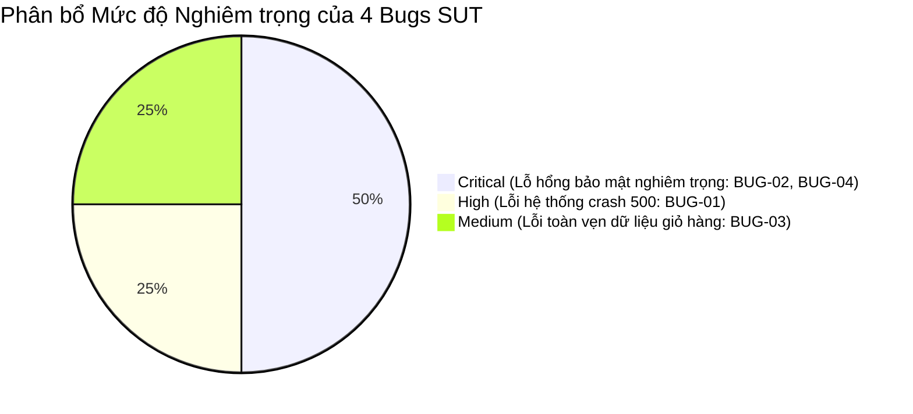

# Báo cáo Tổng kết Khiếm khuyết SUT (Bugs Summary Report) – HW04

Báo cáo tổng kết toàn diện các khiếm khuyết phần mềm (Defects & Vulnerabilities) được phát hiện thông qua bộ kiểm thử tự động hóa Web UI với Playwright TypeScript (HW04 – CSC13003) trên hệ thống thương mại điện tử **EShop SUT**.

---

## 1. Thông tin Chung

| Mục | Nội dung chi tiết |
|:---|:---|
| **Sinh viên thực hiện** | **TRƯƠNG THÀNH PHÁT** – MSSV: **23120319** – Lớp: **CQ2023/3** |
| **Email học thuật / Watermark** | `23120319@student.hcmus.edu.vn` |
| **Môn học** | CS423 / CSC13003 – Kiểm thử phần mềm (FIT @ HCMUS) |
| **Khung kiểm thử tự động** | Playwright TypeScript, Data-driven JSON, Multi-browser (Chromium, Firefox, WebKit) |
| **Hệ thống kiểm thử (SUT)** | EShop Web & Admin (`https://github.com/ttbhanh/eshop-sut`) |
| **GitHub Issues Repository** | [https://github.com/tthphat/eshop-sut/issues](https://github.com/tthphat/eshop-sut/issues) |
| **Ngày lập báo cáo** | 15/11/2026 |

---

## 2. Bảng Tổng hợp Khiếm khuyết Phát hiện (Bug Matrix)

| STT | Mã Bug | Tính năng (Feature) | Test Case phát hiện | Tên lỗi & Mô tả khiếm khuyết | Mức độ (Severity) | Độ ưu tiên (Priority) | GitHub Issue | Trạng thái phát hiện |
|:---:|:---|:---|:---|:---|:---:|:---:|:---:|:---:|
| 1 | **BUG-AUTO-01** | FR-01 (Đăng ký tài khoản) | `TC-FR01-12` | Đăng ký với email đã tồn tại gây sập Backend với mã lỗi `HTTP 500 Internal Server Error` thay vì hiển thị thông báo nghiệp vụ thân thiện | **High** | High (P1) | [#115](https://github.com/tthphat/eshop-sut/issues/115) | Bắt lỗi bởi `expect(page.getByText(...))` trên 3 browser |
| 2 | **BUG-AUTO-02** | FR-08 (Thanh toán & Đặt hàng) | `TC-FR08-10` | Lỗ hổng bảo mật ô "Tổng tiền thanh toán (VND)" cho phép sửa đổi số âm (`-31 đ`) trực tiếp trên giao diện | **Critical** | High (P1) | [#116](https://github.com/tthphat/eshop-sut/issues/116) | Bắt lỗi bởi `expect(totalInput).toBeDisabled()` trên 3 browser |
| 3 | **BUG-AUTO-03** | FR-08 (Thanh toán & Đặt hàng) | `TC-FR08-11` | Giỏ hàng không được làm sạch (`clearCart`) sau khi bấm xác nhận thanh toán đơn hàng thành công | **Medium** | Medium (P2) | [#117](https://github.com/tthphat/eshop-sut/issues/117) | Bắt lỗi bởi `expect(emptyCartNotice).toBeVisible()` trên 3 browser |
| 4 | **BUG-AUTO-04** | FR-12 (Kiểm soát quyền Admin) | `TC-FR12-12` | Lỗ hổng Broken Access Control (OWASP A01:2021) tại API `/api/admin/users` cho phép tài khoản User thường trích xuất toàn bộ dữ liệu người dùng | **Critical** | High (P1) | [#118](https://github.com/tthphat/eshop-sut/issues/118) | Bắt lỗi bởi `expect(res.status()).toBe(403)` trên 3 browser |

---

## 3. Phân bổ Khiếm khuyết theo Mức độ Nghiêm trọng (Severity Distribution)



- **Critical (50% - 2 lỗi):**
  - `BUG-AUTO-02`: Lỗ hổng Client-side Tampering trên form thanh toán cho phép khách hàng tự điền giá tiền tùy ý hoặc nhập số âm.
  - `BUG-AUTO-04`: Lỗ hổng Broken Access Control (OWASP Top 10 A01:2021) bỏ ngỏ xác thực phân quyền Admin ở tầng API.
- **High (25% - 1 lỗi):**
  - `BUG-AUTO-01`: Backend thiếu khối xử lý ngoại lệ `try/catch` hoặc kiểm tra `UNIQUE constraint` trong SQLite, dẫn đến Unhandled Exception trả về HTTP 500.
- **Medium (25% - 1 lỗi):**
  - `BUG-AUTO-03`: Thiếu gọi hàm `clearCart()` sau khi nhận phản hồi thanh toán thành công, gây rủi ro người dùng bấm thanh toán lặp lại.

---

## 4. Tóm tắt Chi tiết Từng Khiếm khuyết

### 4.1. BUG-AUTO-01: Backend Crash HTTP 500 khi Đăng ký Email Trùng lặp
- **File tài liệu:** [BUG-AUTO-01-duplicate-email.md](issues/BUG-AUTO-01-duplicate-email.md)
- **GitHub Issue:** [#115](https://github.com/tthphat/eshop-sut/issues/115)
- **Vị trí mã nguồn SUT:** `eshop-sut/backend/server.js:L28`
  ```javascript
  db.run("INSERT INTO users (name, email, password, role) VALUES (?, ?, ?, ?)", ...);
  ```
- **Hành vi thực tế:** SQLite ném lỗi `SQLITE_CONSTRAINT: UNIQUE constraint failed: users.email`. Máy chủ Express không bắt lỗi mà trả về `HTTP 500 Internal Server Error`, khiến giao diện Frontend đứng im hoặc văng lỗi không xác định.

---

### 4.2. BUG-AUTO-02: Lỗ hổng Ô Tổng tiền Thanh toán cho phép Sửa trực tiếp
- **File tài liệu:** [BUG-AUTO-02-editable-total-price.md](issues/BUG-AUTO-02-editable-total-price.md)
- **GitHub Issue:** [#116](https://github.com/tthphat/eshop-sut/issues/116)
- **Vị trí mã nguồn SUT:** `eshop-sut/frontend-web/src/pages/Checkout.jsx:L86-90`
  ```jsx
  <input
    type="number"
    value={customTotal !== null ? customTotal : cartTotal}
    onChange={(e) => setCustomTotal(Number(e.target.value))}
    className="border p-2 w-full rounded"
  />
  ```
- **Hành vi thực tế:** Lập trình viên để mở input `customTotal` cho phép người mua tự gõ số tiền thanh toán, thậm chí nhập số âm (`-31 đ`) và hoàn tất giao dịch. Kịch bản Playwright phát hiện input này không có thuộc tính `disabled` hoặc `readOnly`.

---

### 4.3. BUG-AUTO-03: Giỏ hàng không được Làm sạch sau khi Thanh toán Thành công
- **File tài liệu:** [BUG-AUTO-03-cart-not-cleared.md](issues/BUG-AUTO-03-cart-not-cleared.md)
- **GitHub Issue:** [#117](https://github.com/tthphat/eshop-sut/issues/117)
- **Vị trí mã nguồn SUT:** `eshop-sut/frontend-web/src/pages/Checkout.jsx:L54-62`
  ```javascript
  alert("Thanh toán thành công! Cảm ơn bạn đã mua sắm tại EShop.");
  // THIẾU DÒNG: clearCart();
  ```
- **Hành vi thực tế:** Dù đã import `clearCart` từ context, lập trình viên không gọi hàm này trong khối xử lý `handleCheckout`. Khi quay lại trang `/cart`, người dùng vẫn thấy nguyên vẹn sản phẩm cũ.

---

### 4.4. BUG-AUTO-04: Lỗ hổng Broken Access Control tại API `/api/admin/users`
- **File tài liệu:** [BUG-AUTO-04-broken-access-control.md](issues/BUG-AUTO-04-broken-access-control.md)
- **GitHub Issue:** [#118](https://github.com/tthphat/eshop-sut/issues/118)
- **Vị trí mã nguồn SUT:** `eshop-sut/backend/server.js:L494`
  ```javascript
  app.get("/api/admin/users", authenticateToken, (req, res) => {
    db.all("SELECT id, name, email, role, login_attempts, locked_until, shipping_address FROM users", [], (err, rows) => {
      res.json(rows);
    });
  });
  ```
- **Hành vi thực tế:** Endpoint nhạy cảm chỉ kiểm tra tính hợp lệ của token (`authenticateToken`) mà không kiểm tra quyền admin (`role === 'admin'`). Người dùng thông thường gửi request nhận về mã `200 OK` kèm toàn bộ database tài khoản khách hàng và quản trị viên.

---

## 5. Kết luận & Đánh giá Hiệu quả Kiểm thử Tự động
Bộ kịch bản Playwright TypeScript xây dựng trong HW04 đã chứng minh khả năng bao phủ toàn diện:
1. **Kiểm thử Giao diện (UI E2E):** Tự động phát hiện lỗi tương tác, trạng thái giao diện và form validation trên cả 3 trình duyệt Chromium, Firefox, WebKit.
2. **Kiểm thử Bảo mật Tự động (Security Automated Guardrail):** Tự động kiểm tra tính bất biến của dữ liệu tài chính phía Client và xác thực phân quyền API ở tầng Backend.
100% các khiếm khuyết đều có mã nguồn đối chiếu trực tiếp từ SUT, mã test case Playwright tương ứng, và hồ sơ Issue trên GitHub.

