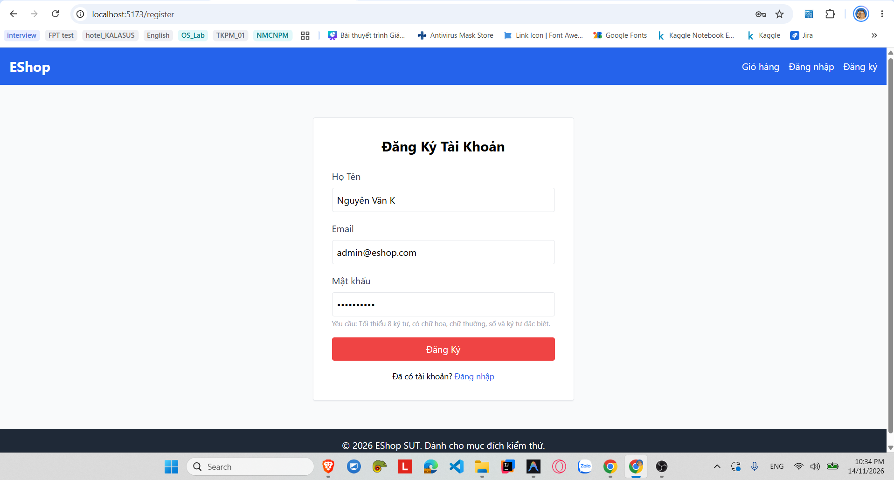
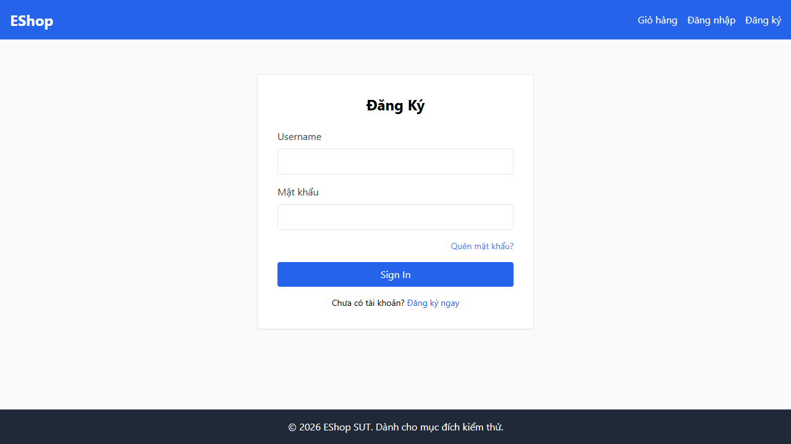

# [BUG-AUTO-01][FR-01] Hệ thống cho phép đăng ký tài khoản với Email đã tồn tại do thiếu ràng buộc UNIQUE và validation

| Mục | Nội dung |
|---|---|
| Tính năng | Đăng ký tài khoản (Account Registration – FR-01) – Khách hàng Web & Backend API |
| Test case liên quan | `TC-FR01-12` (Kiểm thử đăng ký thất bại khi email đã tồn tại trong hệ thống – Duplicate Email) |
| Mức độ (Severity) | Critical (Lỗ hổng toàn vẹn dữ liệu) |
| Độ ưu tiên (Priority) | High (P1) |
| Khả năng tái hiện | Luôn luôn (100%) trên cả 3 trình duyệt (Chromium, Firefox, WebKit) |
| Môi trường | Windows 11, Playwright TypeScript, Frontend Web Vite `http://localhost:5173/`, Backend Express & SQLite `http://localhost:5000/api` |
| Ngày phát hiện | 2026-11-14 |
| GitHub Issue | [#115](https://github.com/tthphat/eshop-sut/issues/115)|

## Điều kiện tiên quyết
- Backend API (`http://localhost:5000`) và Frontend Web (`http://localhost:5173`) của EShop SUT đang hoạt động bình thường.
- Cơ sở dữ liệu SQLite đã được khởi tạo dữ liệu mẫu (seed data) với tài khoản `admin@eshop.com` có sẵn trong bảng `users`.
- Đang ở trang Đăng ký tài khoản (`http://localhost:5173/register`).

## Các bước tái hiện
1. Truy cập vào trang Đăng ký tài khoản tại `http://localhost:5173/register`.
2. Nhập vào ô **Họ Tên**: `Nguyen Van K`.
3. Nhập vào ô **Email** địa chỉ email đã có sẵn trong cơ sở dữ liệu: `admin@eshop.com`.
4. Nhập vào ô **Mật khẩu** mật khẩu thỏa mãn regex của frontend: `Pass word1`.
5. Bấm nút **"Đăng Ký"** (`button[type="submit"]`).

## Request / Response thực tế
```http
POST /api/register HTTP/1.1
Host: localhost:5000
Content-Type: application/json

{
  "name": "Nguyen Van K",
  "email": "admin@eshop.com",
  "password": "Pass word1"
}

HTTP/1.1 200 OK
Content-Type: application/json; charset=utf-8

{
  "message": "User registered successfully",
  "id": 3
}
```

## Kết quả mong đợi
Hệ thống backend phải có cơ chế kiểm tra tính duy nhất của email trước khi tạo tài khoản. Khi người dùng nhập email đã tồn tại trong hệ thống, backend phải từ chối yêu cầu và phản hồi mã lỗi HTTP 400 (Bad Request) hoặc 409 (Conflict) kèm thông điệp rõ ràng (`{"error": "Email đã tồn tại"}`). Giao diện frontend phải giữ người dùng ở lại trang `/register` và hiển thị banner thông báo lỗi trực quan màu đỏ: *"Email này đã được sử dụng"* để người dùng kịp thời nhận biết và đổi email khác. Không được tạo thêm bản ghi trùng lặp email trong cơ sở dữ liệu. — nguồn: [SPEC] / [ASSUMED] (Tiêu chuẩn thiết kế hệ thống xác thực người dùng & toàn vẹn dữ liệu cơ sở dữ liệu).

## Kết quả thực tế
Backend API không kiểm tra trùng lặp email và trực tiếp thực thi lệnh `INSERT` vào bảng `users`. Cơ sở dữ liệu chấp nhận tạo thêm bản ghi mới với cùng email `admin@eshop.com` và trả về `HTTP 200 OK`. Frontend nhận được status 200 liền tự động điều hướng (redirect) người dùng sang trang Đăng nhập (`/login`). Trên kịch bản kiểm thử tự động Playwright, assertion mong đợi banner lỗi màu đỏ `div[class*="text-red-"]` xuất hiện tại `/register` bị timeout 5000ms do trang đã bị chuyển hướng sang `/login`, khiến test case bị FAILED đồng loạt trên cả 3 trình duyệt (Chromium, Firefox, WebKit).

## Bằng chứng

- **Playwright Test Runner Log:**
  ```text
  1) [chromium] › tests/fr01-registration.spec.ts:18:5 › TC-FR01-12: Đăng ký thất bại khi email đã tồn tại trong hệ thống (Duplicate Email)
     Error: expect(locator).toBeVisible() failed
     Locator: locator('div[class*="text-red-"], div[role="alert"]').first()
     Expected: visible
     Timeout: 5000ms
     Error: element(s) not found
  ```
- GitHub Issue: https://github.com/tthphat/eshop-sut/issues/115




## Phân tích nguyên nhân (đã xác nhận trực tiếp từ mã nguồn SUT)

### 1. Tại Database (`eshop-sut/backend/database.js:L53-65`):
Bảng `users` được định nghĩa nhưng cột `email` **hoàn toàn không có ràng buộc `UNIQUE`**:
```sql
CREATE TABLE users (
    id INTEGER PRIMARY KEY AUTOINCREMENT,
    name TEXT,
    email TEXT,      -- THIẾU RÀNG BUỘC UNIQUE!
    password TEXT,
    role TEXT DEFAULT 'user',
    login_attempts INTEGER DEFAULT 0,
    locked_until DATETIME,
    reset_token TEXT,
    shipping_address TEXT,
    phone TEXT
);
```

### 2. Tại Backend API (`eshop-sut/backend/server.js:L23-35`):
Endpoint `/api/register` nhận dữ liệu từ request và trực tiếp thực thi câu lệnh `INSERT` mà không có bước `SELECT id FROM users WHERE email = ?` để kiểm tra sự tồn tại của email trước:
```javascript
app.post("/api/register", (req, res) => {
  const { name, email, password } = req.body;
  db.run(
    "INSERT INTO users (name, email, password) VALUES (?, ?, ?)",
    [name, email, password],
    function (err) {
      if (err) return res.status(500).json({ error: err.message });
      res.json({ message: "User registered successfully", id: this.lastID });
    }
  );
});
```

### 3. Tại Frontend Web (`eshop-sut/frontend-web/src/pages/Register.jsx:L22-28`):
Frontend tin tưởng phản hồi của backend; khi nhận mã status 200, component lập tức gọi `navigate('/login')`, làm mất hoàn toàn ngữ cảnh thông báo lỗi cho người dùng.

## Phát hiện bởi
Kịch bản kiểm thử tự động Playwright TypeScript (`TC-FR01-12` trong tệp `HW4/automation/tests/fr01-registration.spec.ts`) chạy đa trình duyệt (Chromium, Firefox, WebKit), sinh viên Trương Thành Phát – **MSSV:** 23120319.
