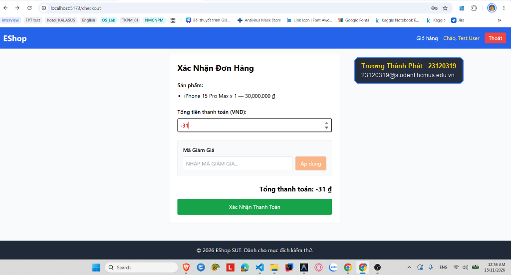
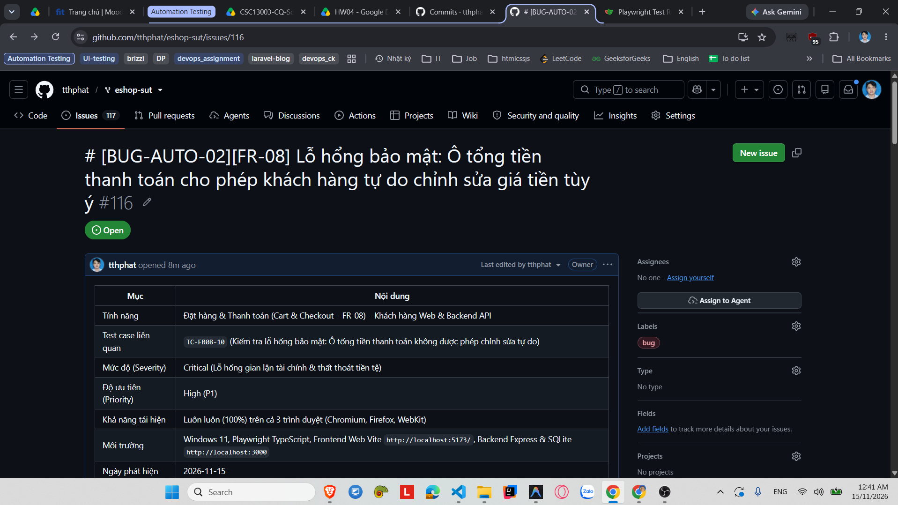

# [BUG-AUTO-02][FR-08] Lỗ hổng bảo mật: Ô tổng tiền thanh toán cho phép khách hàng tự do chỉnh sửa giá tiền tùy ý

| Mục | Nội dung |
|---|---|
| Tính năng | Đặt hàng & Thanh toán (Cart & Checkout – FR-08) – Khách hàng Web & Backend API |
| Test case liên quan | `TC-FR08-10` (Kiểm tra lỗ hổng bảo mật: Ô tổng tiền thanh toán không được phép chỉnh sửa tự do) |
| Mức độ (Severity) | Critical (Lỗ hổng gian lận tài chính & thất thoát tiền tệ) |
| Độ ưu tiên (Priority) | High (P1) |
| Khả năng tái hiện | Luôn luôn (100%) trên cả 3 trình duyệt (Chromium, Firefox, WebKit) |
| Môi trường | Windows 11, Playwright TypeScript, Frontend Web Vite `http://localhost:5173/`, Backend Express & SQLite `http://localhost:3000` |
| Ngày phát hiện | 2026-11-15 |
| GitHub Issue | [#116](https://github.com/tthphat/eshop-sut/issues/116) |

## Điều kiện tiên quyết
- Backend API (`http://localhost:3000`) và Frontend Web (`http://localhost:5173`) của EShop SUT đang hoạt động bình thường.
- Đã đăng nhập vào tài khoản người dùng hợp lệ (`test@eshop.com` / `Test1234!`).
- Trong giỏ hàng có ít nhất 1 sản phẩm (ví dụ: `iPhone 15 Pro Max` giá 30,000,000 VND).
- Đang ở trang Xác Nhận Đơn Hàng (`http://localhost:5173/checkout`).

## Các bước tái hiện
1. Đăng nhập vào hệ thống và thêm sản phẩm `iPhone 15 Pro Max` (30,000,000 VND) vào giỏ hàng.
2. Điều hướng vào Giỏ hàng (`/cart`) và bấm nút **"Tiến hành thanh toán"** để chuyển sang trang `/checkout`.
3. Tại trang Checkout, quan sát trường nhập liệu **"Tổng tiền thanh toán (VND):"**.
4. Click chuột vào ô này, xóa số `30000000` và nhập số tùy ý (kể cả số âm): `-31`.
5. Quan sát dòng "Tổng thanh toán:" tự động cập nhật thành `-31 đ`.
6. Bấm nút **"Xác Nhận Thanh Toán"**.

## Request / Response thực tế
```http
POST /api/checkout HTTP/1.1
Host: localhost:3000
Content-Type: application/json
Authorization: Bearer <valid_jwt_token>

{
  "items": [
    {
      "id": 4,
      "name": "Tai nghe AirPods Pro 2",
      "price": 6000000,
      "quantity": 1
    }
  ],
  "total_amount": 1000,
  "coupon_id": null
}

HTTP/1.1 200 OK
Content-Type: application/json; charset=utf-8

{
  "message": "Checkout successful",
  "orderId": 4
}
```

## Kết quả mong đợi
- Ô tổng tiền thanh toán phải là trường chỉ đọc (`readonly` hoặc thẻ hiển thị văn bản tĩnh), khách hàng tuyệt đối không được phép chỉnh sửa số tiền thanh toán.
- Backend API phải luôn tự tính toán lại tổng tiền từ danh sách sản phẩm và giá niêm yết trong cơ sở dữ liệu (`SUM(product.price * quantity) - discount`), không được tin tưởng số tiền `total_amount` gửi lên từ phía client. Nếu client gửi sai giá, backend phải từ chối với mã lỗi `HTTP 400 Bad Request`.
— Nguồn: [SPEC] / [ASSUMED] (Tiêu chuẩn an toàn giao dịch thương mại điện tử & OWASP API Security Top 10).

## Kết quả thực tế
- Giao diện Frontend hiển thị ô tổng tiền bằng thẻ `<input type="number">` hoàn toàn không có thuộc tính `readonly` hay `disabled`. Khách hàng có thể tự do gõ bất kỳ số tiền nào (kể cả 1,000 VND) và gửi lên server.
- Backend API chấp nhận trực tiếp giá trị `total_amount: 1000` từ request client và ghi đơn hàng vào cơ sở dữ liệu với số tiền 1,000 VND, gây nguy cơ thất thoát tài chính nghiêm trọng cho cửa hàng.
- Trên Playwright Test Runner, assertion `expect(totalInput).toHaveAttribute('readonly')` bị FAIL đồng loạt trên cả 3 trình duyệt (Chromium, Firefox, WebKit).

## Bằng chứng

- **Playwright Test Runner Log:**
  ```text
  1) [chromium] › tests/fr08-checkout.spec.ts:145:5 › TC-FR08-10: Kiểm tra lỗ hổng bảo mật: Ô tổng tiền thanh toán không được phép chỉnh sửa tự do
     Error: expect(locator).toHaveAttribute(expected) failed
     Locator: locator('input[type="number"]')
     Expected attribute: "readonly"
     Received attribute: null
  ```
- **GitHub Issue:** https://github.com/tthphat/eshop-sut/issues/116




## Phân tích nguyên nhân (đã xác nhận trực tiếp từ mã nguồn SUT)

### 1. Tại Frontend Web (`eshop-sut/frontend-web/src/pages/Checkout.jsx:L92-103`):
Trường tổng tiền được gán sự kiện `onChange` cho phép người dùng ghi đè state `editableTotal` mà không có thuộc tính bảo vệ `readOnly`:
```jsx
<div className="mb-6 flex flex-col gap-2">
  <label className="font-semibold">Tổng tiền thanh toán (VND):</label>
  <input
    type="number"
    value={editableTotal}
    onChange={(e) => {
      setEditableTotal(Number(e.target.value));
      setCouponResult(null);
      setCouponError('');
    }}
    className="border p-2 rounded text-red-600 font-bold"
    // THIẾU THUỘC TÍNH readonly HOẶC disabled!
  />
</div>
```

### 2. Tại Backend API (`eshop-sut/backend/server.js:L290-309`):
Hàm `/api/checkout` nhận trực tiếp `total_amount` từ `req.body` và chèn thẳng vào bảng `orders` mà không hề xác thực lại tổng giá trị các mặt hàng:
```javascript
app.post("/api/checkout", (req, res) => {
  const { items, total_amount, coupon_id } = req.body;
  // Không tính toán lại tổng tiền từ items
  db.run(
    "INSERT INTO orders (user_id, total_amount, status, shipping_address) VALUES (?, ?, ?, ?)",
    [userId, total_amount, "pending", shipping_address],
    ...
  );
});
```

## Phát hiện bởi
Kịch bản kiểm thử tự động Playwright TypeScript (`TC-FR08-10` trong tệp `HW4/automation/tests/fr08-checkout.spec.ts`) chạy đa trình duyệt (Chromium, Firefox, WebKit), sinh viên Trương Thành Phát – **MSSV:** 23120319.

