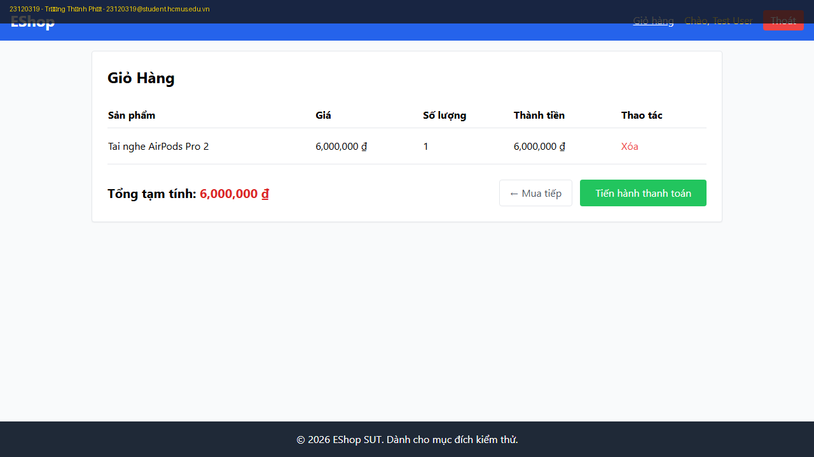
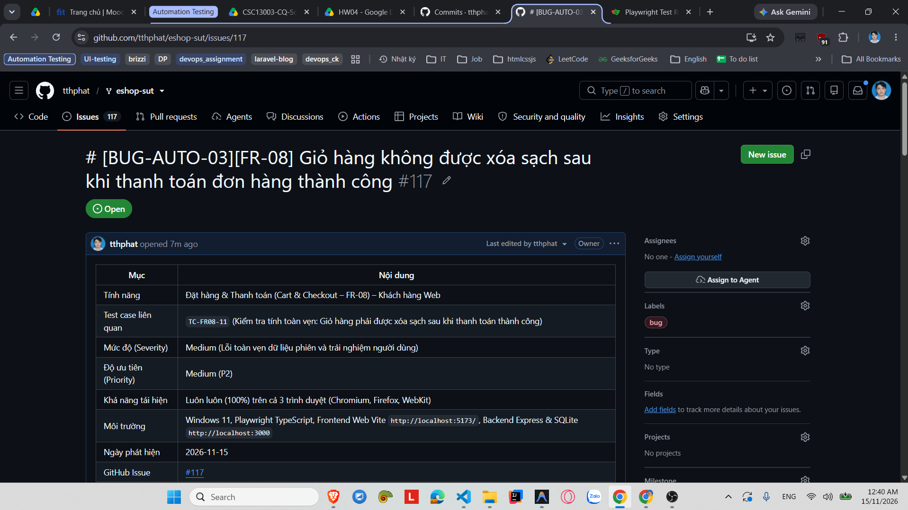

# [BUG-AUTO-03][FR-08] Giỏ hàng không được xóa sạch sau khi thanh toán đơn hàng thành công

| Mục | Nội dung |
|---|---|
| Tính năng | Đặt hàng & Thanh toán (Cart & Checkout – FR-08) – Khách hàng Web |
| Test case liên quan | `TC-FR08-11` (Kiểm tra tính toàn vẹn: Giỏ hàng phải được xóa sạch sau khi thanh toán thành công) |
| Mức độ (Severity) | Medium (Lỗi toàn vẹn dữ liệu phiên và trải nghiệm người dùng) |
| Độ ưu tiên (Priority) | Medium (P2) |
| Khả năng tái hiện | Luôn luôn (100%) trên cả 3 trình duyệt (Chromium, Firefox, WebKit) |
| Môi trường | Windows 11, Playwright TypeScript, Frontend Web Vite `http://localhost:5173/`, Backend Express & SQLite `http://localhost:3000` |
| Ngày phát hiện | 2026-11-15 |
| GitHub Issue | [#117](https://github.com/tthphat/eshop-sut/issues/117) |

## Điều kiện tiên quyết
- Backend API (`http://localhost:3000`) và Frontend Web (`http://localhost:5173`) của EShop SUT đang hoạt động bình thường.
- Đã đăng nhập vào tài khoản người dùng hợp lệ (`test@eshop.com` / `Test1234!`).
- Trong giỏ hàng có 1 sản phẩm `Tai nghe AirPods Pro 2` (số lượng: 1).
- Đang ở trang Xác Nhận Đơn Hàng (`http://localhost:5173/checkout`).

## Các bước tái hiện
1. Đăng nhập vào hệ thống và thêm 1 sản phẩm `Tai nghe AirPods Pro 2` vào giỏ hàng.
2. Điều hướng vào trang `/checkout`.
3. Bấm nút **"Xác Nhận Thanh Toán"**.
4. Màn hình hiển thị thông báo thành công: *"Thanh toán thành công! Cảm ơn bạn đã mua sắm tại EShop."*
5. Click vào liên kết **"Giỏ hàng"** trên thanh Header (hoặc điều hướng đến URL `/cart`).
6. Quan sát danh sách sản phẩm hiển thị trên trang Giỏ hàng.

## Kết quả mong đợi
- Sau khi đơn hàng đã được gửi và thanh toán thành công, hệ thống phải tự động dọn sạch giỏ hàng (reset React state giỏ hàng về mảng rỗng `[]` thông qua hàm `clearCart()`).
- Khi người dùng quay lại trang Giỏ hàng (`/cart`), màn hình phải hiển thị thông báo: *"Giỏ hàng của bạn đang trống"* kèm theo liên kết *"Tiếp tục mua sắm"* dẫn về trang chủ.
— Nguồn: [SPEC] / [ASSUMED] (Quy chuẩn luồng nghiệp vụ giỏ hàng chuẩn thương mại điện tử).

## Kết quả thực tế
- Sau khi bấm thanh toán thành công, hệ thống **không hề xóa giỏ hàng**.
- Khi người dùng bấm vào liên kết "Giỏ hàng", trang `/cart` vẫn hiển thị nguyên vẹn bảng sản phẩm `Tai nghe AirPods Pro 2` x 1 kèm tổng tạm tính `6,000,000 ₫`.
- Người dùng có thể bị hiểu nhầm là đơn hàng chưa được xử lý, hoặc vô tình bấm *"Tiến hành thanh toán"* lần 2 gây trùng lặp đơn hàng.
- Trên kịch bản kiểm thử tự động Playwright, assertion `expect(page.getByText('Giỏ hàng của bạn đang trống')).toBeVisible()` bị timeout 5000ms do bảng sản phẩm vẫn tồn tại, khiến test case bị FAILED đồng loạt trên cả 3 trình duyệt (Chromium, Firefox, WebKit).

## Bằng chứng

- **Playwright Test Runner Log:**
  ```text
  1) [chromium] › tests/fr08-checkout.spec.ts:161:11 › TC-FR08-11: Kiểm tra tính toàn vẹn: Giỏ hàng phải được xóa sạch sau khi thanh toán thành công
     Error: expect(locator).toBeVisible() failed
     Locator: getByText('Giỏ hàng của bạn đang trống')
     Expected: visible
     Timeout: 5000ms
     Error: element(s) not found
  ```
- **GitHub Issue:** https://github.com/tthphat/eshop-sut/issues/117




## Phân tích nguyên nhân (đã xác nhận trực tiếp từ mã nguồn SUT)

### Tại Frontend Web (`eshop-sut/frontend-web/src/pages/Checkout.jsx:L8 & L40-66`):
1. Lập trình viên đã import sẵn hàm `clearCart` từ `CartContext`:
   ```javascript
   const { cart, cartTotal, clearCart } = useCart();
   ```
2. Tuy nhiên, trong toàn bộ hàm xử lý đặt hàng `handleCheckout`, lập trình viên **hoàn toàn quên gọi hàm `clearCart()`** sau khi nhận kết quả thành công từ API:
   ```javascript
   const handleCheckout = async () => {
     setLoading(true);
     try {
       const finalAmount = couponResult ? couponResult.final_amount : editableTotal;

       await axios.post('http://localhost:3000/api/checkout', {
         items: cart,
         total_amount: finalAmount,
         coupon_id: couponResult?.coupon_id || null
       }, {
         headers: token ? { Authorization: `Bearer ${token}` } : {}
       });

       // Record coupon usage if applied
       if (couponResult?.coupon_id && token) {
         await axios.post('http://localhost:3000/api/coupon-usage', ...);
       }

       setSuccess(true);
       // LẬP TRÌNH VIÊN QUÊN GỌI: clearCart(); TẠI ĐÂY!
     } catch (err) {
       alert("Lỗi khi thanh toán: " + (err.response?.data?.error || err.message));
     }
     setLoading(false);
   };
   ```

## Phát hiện bởi
Kịch bản kiểm thử tự động Playwright TypeScript (`TC-FR08-11` trong tệp `HW4/automation/tests/fr08-checkout.spec.ts`) chạy đa trình duyệt (Chromium, Firefox, WebKit), sinh viên Trương Thành Phát – **MSSV:** 23120319.

