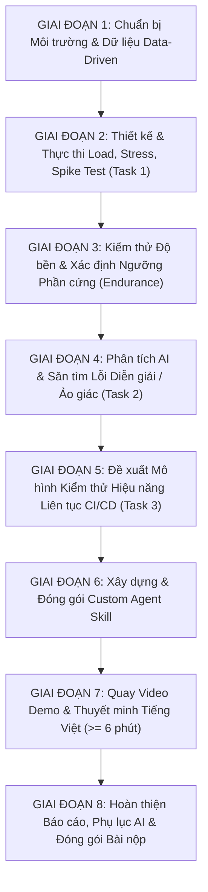

# KẾ HOẠCH THỰC HIỆN ĐỒ ÁN HW05 — KIỂM THỬ HIỆU NĂNG (PERFORMANCE TESTING)
**Môn học:** CS423 / CSC13003 — Kiểm thử phần mềm (Software Testing · AI-augmented)  
**Khoa / Trường:** Khoa Công nghệ Thông tin — Trường ĐH Khoa học Tự nhiên, ĐHQG-HCM  
**Học kỳ:** Học kỳ 1, Năm học 2026–2027  
**Sinh viên thực hiện:** TRƯƠNG THÀNH PHÁT — **MSSV:** 23120319 — **Lớp:** CQ2023/3  
**Email học thuật:** `23120319@student.hcmus.edu.vn`  
**Mục tiêu điểm số:** **100 / 100 điểm** (Hoàn thành xuất sắc toàn bộ Task 1, 2, 3 và Agent Skill)

---

## 1. Mục tiêu và Phạm vi Đồ án (Project Scope & Objectives)

### 1.1. Hệ thống Kiểm thử (System Under Test - SUT)
* **Tên ứng dụng:** EShop Web & Admin System (Mã nguồn: `https://github.com/ttbhanh/eshop-sut`).
* **Kiến trúc:** REST Backend API (Node.js/Express + SQLite) kết hợp Frontend React.

### 1.2. Lựa chọn Nhóm Endpoint & Quy trình Nghiệp vụ (End-to-End Workflow)
Đề bài yêu cầu xây dựng một kịch bản kiểm thử xuyên suốt (End-to-End Workflow) kết hợp đầy đủ **cả 3 nhóm endpoint** của SUT trong cùng một luồng người dùng ảo (Virtual User - VU):
1. **Auth-heavy Endpoint:**
   * Tính năng: `FR-02: Đăng nhập và khóa tài khoản (Login & account lockout)`.
   * Endpoint: `POST /api/auth/login`.
   * Đặc thù: Cần quản lý token xác thực (JWT/Bearer), đồng thời xử lý chặt chẽ cơ chế tự động khóa tài khoản sau 3 lần đăng nhập thất bại.
2. **Read-heavy Endpoint:**
   * Tính năng: `FR-05: Danh sách sản phẩm & Tìm kiếm` và `FR-06: Xem chi tiết sản phẩm`.
   * Endpoint: `GET /api/products` (có query parameters: `category`, `keyword`, `page`, `limit`) và `GET /api/products/:id`.
   * Đặc thù: Tần suất gọi cao, áp lực lên bộ nhớ đệm (caching), câu lệnh truy vấn SQLite và băng thông phản hồi dữ liệu JSON.
3. **Transactional Endpoint:**
   * Tính năng: `FR-07: Giỏ hàng` và `FR-08: Thanh toán & Tạo đơn hàng`.
   * Endpoint: `POST /api/cart/items` (Thêm hàng vào giỏ) và `POST /api/orders` (Tạo đơn hàng).
   * Đặc thù: Ghi dữ liệu vào database SQLite, kiểm tra tính toàn vẹn giao dịch (ACID), xử lý khóa ghi (database write lock).

### 1.3. Phân bổ Điểm số theo Đề bài (Rubric)
| STT | Tiêu chí đánh giá (Rubric Criteria) | Điểm tối đa |
|:---:|:---|:---:|
| 1 | **Task 1 — Load Testing (Kiểm thử tải ổn định)** | 30 |
| 2 | **Task 1 — Stress Testing (Kiểm thử áp lực / điểm gãy)** | 20 |
| 3 | **Task 1 — Spike Testing (Kiểm thử xung đột tải đột biến)** | 20 |
| 4 | **Task 2 — AI Analysis & Misinterpretation Hunt (Phân tích log & Săn ảo giác AI)** | 10 |
| 5 | **Task 3 — Continuous Performance Testing Proposal (Mô hình CI/CD - Bloom G9.6 Disrupt)** | 10 |
| 6 | **Task 7 — Custom Agent Skill (Kỹ năng kiểm thử hiệu năng & Video demo skill)** | 10 |
| | **TỔNG ĐIỂM MỤC TIÊU** | **100** |

---

## 2. Kế hoạch Thực hiện Chi tiết Từng Bước (Step-by-Step Execution Plan)



---

### Giai đoạn 1: Chuẩn bị Môi trường, Công cụ & Dữ liệu Kiểm thử (Data-Driven)
1. **Khởi chạy & Kiểm tra SUT:**
   * Cài đặt dependencies và chạy Backend SUT (`npm run dev` hoặc `node index.js`).
   * Kiểm tra tính thông suốt của các API endpoint qua Postman/curl: Login -> Get Products -> Add to Cart -> Checkout.
   * Ghi nhận và thiết lập cơ chế khôi phục cơ sở dữ liệu (`database.sqlite`) khi chạy stress gây tràn dữ liệu hoặc khóa tài khoản.
2. **Cấu hình Công cụ Kiểm thử:**
   * Sử dụng **Apache JMeter 5.6+** (công cụ chính quy định) và/hoặc **k6** (công cụ bonus).
   * Cấu hình JMeter Plugins (nếu cần): Thread Groups nâng cao (Stepping Thread Group, Ultimate Thread Group).
3. **Xây dựng Dữ liệu Data-Driven (CSV Data Set Config):**
   * Chuẩn bị file CSV phân tách tham số:
     * `users.csv`: Chứa danh sách tài khoản hợp lệ (`email`, `password`) phục vụ kịch bản đăng nhập.
     * `products.csv`: Chứa danh mục `productId`, từ khóa tìm kiếm, mức giá.
     * `orders.csv`: Chứa thông tin địa chỉ giao hàng, phương thức thanh toán, ghi chú đơn hàng.
   * Đảm bảo không hardcode dữ liệu trong kịch bản kiểm thử.
4. **Thu thập Thông số Phần cứng & Hostname Định danh:**
   * Xuất báo cáo cấu hình phần cứng: Chạy lệnh `dxdiag` (Windows) hoặc `systeminfo` / `screenfetch`.
   * Ghi nhận Hostname, CPU, RAM, GPU, OS để chứng minh tính nhất quán thiết bị với các bài tập trước (HW01–HW04).

---

### Giai đoạn 2: Thiết kế & Thực thi Kịch bản Kiểm thử Hiệu năng (Task 1)

#### Bước 2.1 — AI-Assisted Test Plan Design (Thiết kế kịch bản với AI)
* Hướng dẫn AI (Step-by-step prompt) xây dựng kịch bản kiểm thử cho 3 loại hình:
  1. **Load Test (Tải danh định / ổn định):**
     * Mục đích: Đánh giá thời gian phản hồi (Response Time / Latency), Thông lượng (Throughput / RPS) và tỷ lệ lỗi khi hệ thống hoạt động ở mức tải dự kiến.
     * Cấu hình gợi ý: 50–100 VUs, Ramp-up 1–2 phút, Duy trì tải 5–10 phút, Think time 1–3s (Gaussian Random Timer).
  2. **Stress Test (Tải áp lực / Tìm điểm gãy):**
     * Mục đích: Tăng tải vượt ngưỡng danh định (Step-up) để xác định giới hạn chịu tải tối đa (Breaking Point / Saturation Point) của backend SQLite và khả năng phục hồi sau quá tải.
     * Cấu hình gợi ý: Tăng dần từ 50 -> 100 -> 200 -> 300+ VUs cho đến khi xuất hiện lỗi HTTP 5xx, timeout, hoặc response time tăng đột biến.
  3. **Spike Test (Tải xung đột / Đột biến tức thời):**
     * Mục đích: Mô phỏng lưu lượng tăng vọt đột ngột trong thời gian cực ngắn (ví dụ: giờ vàng mở bán Flash Sale) rồi hạ nhiệt nhanh về mức bình thường.
     * Cấu hình gợi ý: Tải nền 10 VUs -> Bùng nổ lên 250 VUs trong 10–15s -> Giữ đỉnh 30s -> Giảm nhanh về 10 VUs -> Theo dõi thời gian hệ thống tự phục hồi.

#### Bước 2.2 — Human Review & Tinh chỉnh Kịch bản (Bắt buộc)
* Phê bình, rà soát các khiếm khuyết trong kịch bản AI sinh ra:
  * AI thiết lập thời gian ramp-up phi thực tế (ví dụ: 0 giây hoặc quá dốc làm sập server ngay lập tức).
  * Thiếu độ trễ hành vi người dùng thật (Think Time / Timers).
  * Thiếu xử lý token xác thực động (Correlation: Trích xuất `token` từ Response Login bằng JSON Extractor và truyền vào Header Manager của các request kế tiếp).
  * Thiếu bộ kiểm chứng tính đúng đắn dữ liệu (Response Assertions: HTTP 200, JSON payload, thời gian phản hồi < ngưỡng SLA).
  * Bỏ sót cơ chế khóa tài khoản (Login Lockout): Nếu dữ liệu test có tài khoản sai hoặc stress login dồn dập làm tài khoản bị khóa sau 3 lần fail.

#### Bước 2.3 — Chuẩn hóa Tên File & Cấu hình 3 Report Views Khác Nhau
* Đặt tên file kịch bản đúng quy tắc bắt buộc:
  * Load Test: `23120319_Load_20261125.jmx`
  * Stress Test: `23120319_Stress_20261125.jmx`
  * Spike Test: `23120319_Spike_20261125.jmx`
* Sử dụng **3 loại Listener / Report View hoàn toàn khác nhau** trên 3 kịch bản (không được trùng lặp):
  * Kịch bản 1 (Load): **Summary Report** (thống kê tổng quát Samples, Average, Min, Max, Error %, Throughput).
  * Kịch bản 2 (Stress): **Aggregate Report** (thống kê phân vị chuyên sâu: Median, 90% Line, 95% Line, 99% Line).
  * Kịch bản 3 (Spike): **View Results Tree** hoặc **Response Time Graph / Graph Results** (trực quan hóa diễn biến biến thiên thời gian phản hồi theo trục thời gian thực).

#### Bước 2.4 — Thực thi & Ghi nhận Minh chứng Runtime (Evidence Capture)
* Chạy kịch bản bằng CLI (`jmeter -n -t ... -l ... -e -o ...`) để tránh tải ảo của GUI:
  * Xuất file log thô đầy đủ: `23120319_Load_results.jtl`, `23120319_Stress_results.jtl`, `23120319_Spike_results.jtl`.
  * Sinh báo cáo đồ họa chuyên nghiệp HTML Dashboard Report cho từng kịch bản: `load-html-report/`, `stress-html-report/`, `spike-html-report/`.
* **Chụp ảnh minh chứng đồng khung hình (Same Frame Evidence):**
  * Trong mỗi lần chạy, chụp ảnh màn hình hiển thị đồng thời: Cửa sổ tool đang chạy + Cửa sổ giám sát tài nguyên hệ thống (Task Manager / Resource Monitor: CPU %, Memory MB, Disk Active Time, Network) của tiến trình Node.js Backend.
* **Xử lý Khóa Tài khoản (Login Lockout Reset):**
  * Ghi nhận tình huống khi chạy Stress/Spike chạm ngưỡng 3-fail login lockout.
  * Lập tài liệu các bước reset trạng thái khóa trong SQLite (`UPDATE Users SET isLocked = 0, failedAttempts = 0 WHERE ...`) giữa các lượt test.

#### Bước 2.5 — Kiểm thử Độ bền & Xác định Ngưỡng Phần cứng (Endurance / Soak Test)
* Chạy một phiên kiểm thử duy trì tải liên tục trong **10–15 phút** tại mức tải ổn định.
* Xác định và công bố các chỉ số ngưỡng phần cứng thực nghiệm:
  * **Maximum Stable Throughput (RPS):** Mức RPS cao nhất mà hệ thống duy trì được mà không bị lỗi hoặc tăng trễ.
  * **Memory Ceiling / Leak Analysis:** Quan sát tiến trình Node.js có bị rò rỉ bộ nhớ (memory leak tăng dần đều không giải phóng) hay đạt trần RAM ổn định.
  * **Saturation Point:** Điểm bão hòa CPU / I/O đĩa của máy tính kiểm thử.

#### Bước 2.6 — Lập Báo cáo Khiếm khuyết Hiệu năng (Defect / Bug Logging)
* Nếu phát hiện lỗi chức năng hoặc lỗi hiệu năng (HTTP 500, Database locked, Crash, Memory leak):
  * Lập Issue trên GitHub repository cá nhân / nhóm (`BUG-PERF-xx`).
  * Chụp ảnh màn hình bằng chứng có đóng dấu Watermark (`23120319@student.hcmus.edu.vn`).

---

### Giai đoạn 3: Phân tích AI & Săn tìm Lỗi Diễn giải / Ảo giác (Task 2)
1. **Phân tích Log Thô bằng AI (AI Analysis):**
   * Đưa dữ liệu kết quả trích xuất từ các file `.jtl` cho AI (ChatGPT/Claude/Gemini).
   * Yêu cầu AI tính toán và nhận định về các chỉ số: Avg Response Time, Median, p90, p95, Throughput, Error Rate.
   * Yêu cầu AI đề xuất SLA / Performance Thresholds cho các endpoint.
2. **Săn Lỗi Diễn giải của AI (Human Review & Misinterpretation Hunt):**
   * Phân tích phản biện xem AI đã:
     * Đọc sai số liệu nào? (Ví dụ: nhầm lẫn giữa trung bình Average và phân vị p95, cộng sai mẫu, lấy nhầm thời gian kết nối Connect Time thành Latency).
     * Bỏ qua các điểm bất thường nào trong log thô?
   * Đối với mỗi lỗi diễn giải của AI, bắt buộc **trích dẫn giá trị chính xác tuyệt đối từ file log `.jtl` gốc** để chứng minh lỗi sai.
3. **Thẩm định Đề xuất Tối ưu hóa (Feasible vs. Hallucinated Recommendations):**
   * Yêu cầu AI đề xuất các giải pháp tối ưu hệ thống (ví dụ: Database Index, Connection Pooling, SQLite WAL Mode, Caching Redis, Query Optimization).
   * Đánh giá từng đề xuất của AI và phân loại:
     * **Feasible (Khả thi):** Phù hợp với kiến trúc thực tế của EShop SUT (ví dụ: Kích hoạt `PRAGMA journal_mode=WAL;` cho SQLite để hỗ trợ đọc/ghi đồng thời; thêm index cho cột `categoryId`).
     * **Hallucinated / Infeasible (Ảo giác / Không khả thi):** Đề xuất công nghệ trên trời không liên quan hoặc không tương thích với SUT (ví dụ: cấu hình connection pool cho SQLite file-based, chia partition bảng MySQL trong khi SUT dùng SQLite đơn luồng).

---

### Giai đoạn 4: Đề xuất Mô hình Kiểm thử Hiệu năng Liên tục (Task 3 - Disrupt G9.6)
1. **Thiết kế Kiến trúc CI/CD Continuous Performance Testing:**
   * Xây dựng mô hình kiểm thử tự động tích hợp trong GitHub Actions / GitLab CI.
   * Cơ chế giám sát Git Commit của SUT:
     * Phân loại commit: Nếu commit chỉ sửa Markdown/CSS/Docs -> Bỏ qua performance test.
     * Nếu commit thay đổi controller, database schema, ORM queries -> Tự động kích hoạt Performance Test Job.
2. **Cơ chế Cảnh báo Hồi quy Hiệu năng (p95 Regression Flagging):**
   * Lưu trữ baseline p95 qua từng build.
   * Thiết lập ngưỡng cảnh báo (ví dụ: nếu p95 tăng vượt quá 15% so với commit trước đó -> Gửi cảnh báo Slack/Discord và đánh dấu build fail).
3. **Vẽ Lưu đồ Quy trình (Mermaid Flowchart):**
   * Minh họa trực quan luồng quyết định từ lúc lập trình viên commit mã nguồn đến khi xuất báo cáo hồi quy.
4. **Phân tích Cân bằng Chi phí & Rủi ro (Trade-offs Discussion):**
   * Thời gian chạy pipeline CI/CD vs Tần suất commit.
   * Chi phí hạ tầng runner môi trường staging.
   * Nguy cơ cảnh báo sai (False Alarms) do biến động tài nguyên môi trường chia sẻ.

---

### Giai đoạn 5: Xây dựng Custom Agent Skill (Mục 7 - Agent Skill)
1. **Xây dựng Agent Skill Chuyên biệt (`k6-performance-testing`):**
   * Tạo thư mục skill đồng bộ tại `.claude/skills/k6-performance-testing/` và `.agents/skills/k6-performance-testing/`.
   * Soạn thảo `SKILL.md`: Định nghĩa quy trình chuẩn 4 bước (SUT Immutability, Sinh kịch bản từ template, Kiểm tra Quality Gate, Phân tích Ground Truth), kiểm soát chất lượng và bộ quy tắc chống gian lận.
   * Chuẩn bị `templates/`: `k6-e2e.template.js`, `bundle.js` (offline HTML reporter), `users.template.csv`, `products.template.csv`.
2. **Viết Script Tiện ích Tự động hóa:**
   * `scripts/validate_k6_plan.mjs`: Kiểm tra tự động file `.js` có đúng quy chuẩn tên `{StudentID}_{ScenarioType}_{YYYYMMDD}.js`, metadata MSSV, 3 nhóm endpoint, JWT correlation, `sleep()`, `check()`, `thresholds`, `stages`, CSV và 3 dạng output khác nhau.
   * `scripts/parse_k6_summary.mjs`: Đọc file `summary.json` của k6, trích xuất giá trị chính xác tuyệt đối (`p50`, `p90`, `p95`, `p99`, `RPS`, `Error Rate`) làm Ground Truth đối chiếu chống AI ảo giác ở Task 2.
3. **Quay Video Demo Skill:**
   * Thực hiện quay video màn hình minh chứng sử dụng Skill **từ đầu đến cuối trên một nhóm endpoint hoàn chỉnh** (xem chi tiết kịch bản quay tại Giai đoạn 6).

---

### Giai đoạn 6: Quay Video Demo & Thuyết minh (2 Video Bắt buộc)

Theo đề bài `2026.HW05.Performance Testing_En.pdf`, bạn cần chuẩn bị **2 video riêng biệt**, đăng tải YouTube ở chế độ **Unlisted (Không công khai)**, thuyết minh bằng **giọng nói tiếng Việt thật của chính sinh viên** (tuyệt đối không dùng giọng AI/TTS).

#### 1. Video 1 — Demo Thực thi Kiểm thử Hiệu năng (Nhiệm vụ 1 & §11)
* **Mục đích:** Chứng minh quá trình chạy test thật trên máy cá nhân, quan sát tài nguyên phần cứng thực tế và cách hệ thống phản ứng dưới 3 mức tải (`Load`, `Stress`, `Spike`).
* **Yêu cầu bắt buộc từ đề bài:**
  * **Thời lượng:** Tổng thời lượng **tối thiểu 6 phút** (có thể quay 1 video liền mạch hoặc ghép 3 clip tương ứng 3 kịch bản).
  * **Bố cục Same-Frame (Đồng khung hình):** Trong suốt lúc chạy test, màn hình phải hiển thị **đồng thời trong cùng 1 khung hình**:
    * *Bên trái/trên:* Terminal chạy lệnh `k6 run ...` (hoặc log chạy trực tiếp).
    * *Bên phải/dưới:* **Task Manager** (tab *Details* hoặc *Performance*) / **Resource Monitor** theo dõi tiến trình `node.exe` (CPU %, Memory MB, Disk).
  * **Định danh chống gian lận:** Đầu video mở Terminal gõ `whoami` và `hostname` (khớp với báo cáo phần cứng `dxdiag` / `systeminfo` và các bài HW01–HW04), hoặc bật webcam khuôn mặt.
  * **Thuyết minh:** Giọng tiếng Việt của chính sinh viên giải thích diễn biến tải, thông lượng, độ trễ và nguyên nhân điểm nghẽn.
* **Nội dung cần quay chi tiết (Gợi ý phân bổ $\ge 6$ phút):**
  * **[0:00 – 0:45] Định danh & Khởi động SUT:**
    * Chạy `whoami`, `hostname`, `k6 version`.
    * Cho thấy thư mục `eshop-sut/backend` đang chạy `node server.js` tại port `3000` (không chỉnh sửa mã nguồn SUT).
    * Giới thiệu nhanh 3 nhóm endpoint bao phủ: Auth (`/api/login`), Read (`/api/products`), Transactional (`/api/cart`, `/api/apply-coupon`, `/api/checkout`, `/api/orders/my-orders`) và file dữ liệu `users.csv`.
  * **[0:45 – 2:30] Kịch bản 1 — Load Test (`23120319_Load_20261125.js`):**
    * Giải thích cấu hình `stages` (Ramp 30s -> 50 VUs giữ 4 phút -> Ramp-down 30s) và `thresholds` (`p(95)<500ms`, `rate<0.01`).
    * Chạy `k6 run 23120319_Load_20261125.js` song song Task Manager đang theo dõi `node.exe`.
    * Chỉ ra mức CPU/RAM ổn định khi chạy tải danh định. Mở **Report View 1: HTML Dashboard** (`results/load_report.html`) để phân tích chỉ số.
  * **[2:30 – 4:30] Kịch bản 2 — Stress Test (`23120319_Stress_20261125.js`):**
    * Giải thích mục tiêu tìm điểm gãy (Breaking Point): tăng bậc thang 50 -> 100 -> 180 -> 250 VUs.
    * Chạy test đồng khung hình với Task Manager; chỉ vào thời điểm CPU/RAM tăng hoặc latency vọt do SQLite lock khi ghi đồng thời.
    * Xem **Report View 2: CLI Stdout & `results/stress_summary.txt`**; giải thích cách xử lý nếu kích hoạt 3-fail login lockout (reset `login_attempts = 0, locked_until = NULL`).
  * **[4:30 – 6:15] Kịch bản 3 — Spike Test (`23120319_Spike_20261125.js`) & Tổng kết Ngưỡng bền:**
    * Giải thích kịch bản đột biến Flash Sale: 10 VUs -> vọt lên 200 VUs trong 10s -> giữ 30s -> hạ về 10 VUs theo dõi hồi phục.
    * Chạy test đồng khung hình với Task Manager để thấy hệ thống chịu xung lực và tự hồi phục thế nào.
    * Mở **Report View 3: Raw JSON Stream** (`results/spike_summary.json`).
    * *(Nếu Endurance Test 10–15 phút đã chạy riêng trước đó)*: Mở nhanh file `results/endurance_report.html` / `endurance_summary.json` đọc rõ các con số thực nghiệm: **Maximum Stable RPS** và **Memory Ceiling (MB)**.

#### 2. Video 2 — Demo Custom Agent Skill (Mục 7 - Agent Skill)
* **Mục đích:** Theo §7 của đề bài, video phải chứng minh **từ đầu đến cuối cách bạn sử dụng Agent Skill trên một nhóm endpoint hoàn chỉnh** (*end-to-end how you used the skill on a complete endpoint group*), để có thể tái sử dụng cho các endpoint khác trong tương lai.
* **Yêu cầu:**
  * **Thời lượng đề xuất:** **2 – 4 phút**, ngắn gọn, đúng trọng tâm quy trình Agentic.
  * **Chế độ:** **Unlisted** trên YouTube, thuyết minh tiếng Việt.
* **Nội dung cần quay chi tiết (End-to-End Skill Workflow):**
  * **[0:00 – 0:40] Giới thiệu cấu trúc Skill `k6-performance-testing`:**
    * Mở cây thư mục `.agents/skills/k6-performance-testing/` trong IDE: `SKILL.md` (nhấn mạnh quy tắc **SUT Immutability**), `templates/k6-e2e.template.js`, `scripts/validate_k6_plan.mjs`, `scripts/parse_k6_summary.mjs`.
  * **[0:40 – 1:40] Triệu hồi Skill tạo kịch bản cho một nhóm endpoint hoàn chỉnh:**
    * Cho thấy bước gọi Agent Skill (prompt yêu cầu áp dụng `k6-performance-testing` cho nhóm endpoint hoàn chỉnh của EShop — ví dụ Auth + Read + Transactional hoặc mở rộng sang nhóm endpoint bổ sung) -> AI sinh kịch bản đúng chuẩn template (`SharedArray` CSV, JWT correlation, `sleep()`, `check()`, `thresholds`, `handleSummary`).
  * **[1:40 – 2:20] Chạy Quality Gate Tự động (`validate_k6_plan.mjs`):**
    * Chạy lệnh `node .agents/skills/k6-performance-testing/scripts/validate_k6_plan.mjs --dir HW5/k6`.
    * Giải thích các tiêu chí được kiểm tra tự động và kết quả `PASSED (0 Errors, 0 Warnings)`.
  * **[2:20 – 3:15] Thực thi & Trích xuất Ground Truth (`parse_k6_summary.mjs`):**
    * Chạy k6 với kịch bản vừa kiểm chứng (hoặc trỏ vào `summary.json` vừa sinh ra) -> chạy lệnh:
      `node .agents/skills/k6-performance-testing/scripts/parse_k6_summary.mjs --json HW5/k6/results/spike_summary.json`
    * Chỉ ra bảng số liệu chính xác (`p50`, `p90`, `p95`, `p99`, `RPS`, `Error Rate`) được xuất tự động để đưa sang Task 2 làm cơ sở bắt lỗi ảo giác AI.

#### 3. Bảng Lệnh Thực Thi Nhanh (PowerShell Command Reference)
*(Chạy từ thư mục gốc `d:\HCMUS\semester7\software-testing\Software-Testing`)*

1. **Khởi động Backend SUT (Mở ở 1 Terminal riêng):**
   ```powershell
   cd eshop-sut\backend
   node server.js
   ```
2. **Kiểm tra Quality Gate tự động (`validate_k6_plan.mjs`):**
   ```powershell
   node .agents\skills\k6-performance-testing\scripts\validate_k6_plan.mjs --dir HW5\k6
   ```
3. **Seed 501 tài khoản từ `users.csv` qua API công khai (chạy 1 lần khi DB còn sạch, không sửa code SUT):**
   ```powershell
   node HW5\k6\seed_users.mjs
   ```
4. **Chạy các kịch bản kiểm thử k6 (cần `cd` vào `HW5\k6` để nhận đúng `./users.csv`, `./bundle.js` và lưu vào `results/`):**
   ```powershell
   cd HW5\k6

   # Load Test (xuất load_report.html + load_summary.json + load_raw.json từng request + stdout chuẩn k6)
   k6 run --out json=results/load_raw.json 23120319_Load_20261125.js

   # Stress Test (xuất stress_report.html + stress_summary.txt + stress_summary.json + stress_raw.json từng request + stdout chuẩn k6)
   k6 run --out json=results/stress_raw.json 23120319_Stress_20261125.js

   # Spike Test (xuất spike_report.html + spike_summary.json + spike_raw.json từng request + stdout chuẩn k6)
   k6 run --out json=results/spike_raw.json 23120319_Spike_20261125.js

   # Endurance / Soak Test 10 phút (xuất endurance_report.html + endurance_summary.json + endurance_raw.json + stdout chuẩn k6)
   k6 run --out json=results/endurance_raw.json 23120319_Endurance_20261125.js
   ```
5. **Trích xuất Ground Truth phục vụ Task 2 (`parse_k6_summary.mjs`):**
   ```powershell
   # Chạy từ thư mục gốc repo:
   node .agents\skills\k6-performance-testing\scripts\parse_k6_summary.mjs --json HW5\k6\results\load_summary.json
   node .agents\skills\k6-performance-testing\scripts\parse_k6_summary.mjs --json HW5\k6\results\stress_summary.json
   node .agents\skills\k6-performance-testing\scripts\parse_k6_summary.mjs --json HW5\k6\results\spike_summary.json
   node .agents\skills\k6-performance-testing\scripts\parse_k6_summary.mjs --json HW5\k6\results\endurance_summary.json
   ```

---

### Giai đoạn 7: Soạn thảo Báo cáo Chính & Các Phụ lục AI Bắt buộc
1. **Báo cáo chính (`Markdown` + `PDF`):**
   * Đặt tên: `23120319_HW05_Main_Report.md` và biên dịch ra `23120319_HW05_Main_Report.pdf`.
   * Cấu trúc báo cáo đầy đủ: Thông tin sinh viên, Bảng tự đánh giá, Thiết kế 3 kịch bản, Số liệu thực thi, Phân tích ngưỡng bền, Săn lỗi AI, Đề xuất CI/CD Continuous Testing.
2. **Báo cáo Kiểm toán AI (AI Audit Report - Mẫu 5 cột chuẩn FIT@HCMUS):**
   * `[AI-02] - FIT@HCMUS - AI Audit Report_Vn.md` và `.pdf`.
   * Ghi nhận chi tiết từng Artifact được AI tạo ra kèm 5 tiêu chí: Prompt, AI Output, Phân loại, Tinh chỉnh của người, Đánh giá độ tin cậy.
3. **Bài luận Phản biện AI (AI Critique - Bắt buộc):**
   * `appendix-B-ai-critique.md` và `.pdf`.
   * Độ dài: **200–300 từ** phản biện trung thực về điểm mù, thiên vị, ảo giác của AI và bài học rút ra.
4. **Các Biểu mẫu Bổ trợ AI:**
   * Biểu mẫu công bố sử dụng AI (`[AI-03]`) và Bảng kiểm quyền riêng tư (`[AI-05]`).
5. **Nhật ký Commit Git:**
   * Xuất file `git-commit-log.txt` ghi lại các commits trên nhánh làm việc.
6. **Tệp `README.md` Thư mục Gốc:**
   * Bảng tự chấm điểm (Rubric 100/100).
   * Test Summary Report: Số lượng kịch bản, nhóm endpoint, thông số ngưỡng bền, số lượng lỗi, link video demo.

---

### Giai đoạn 8: Đóng gói Hồ sơ Bài nộp & Rà soát Cuối cùng (§14)
1. **Định dạng Tên Tệp Nén:**
   * `23120319_HW05_AI_Performance_100.zip` (Chuẩn 3 chữ số điểm tự chấm `100`).
2. **Kiểm tra Danh mục 11 Thành phần Bắt buộc trong file `.zip`:**
   * [x] 1. Báo cáo chính (`Markdown` + `PDF`).
   * [x] 2. Liên kết GitHub repo công khai.
   * [x] 3. Ba tệp kịch bản kiểm thử (`Load`, `Stress`, `Spike`) đúng quy tắc đặt tên.
   * [x] 4. Ba tệp log thô `.jtl` đầy đủ + Ba thư mục báo cáo HTML.
   * [x] 5. Ảnh chụp minh chứng Resource Monitor & Cấu hình phần cứng (dxdiag/screenfetch).
   * [x] 6. Liên kết video demo YouTube (chế độ Unlisted).
   * [x] 7. AI Critique & AI Audit Report (`Markdown` + `PDF`).
   * [x] 8. Nhật ký commit Git (`git-commit-log.txt`).
   * [x] 9. Báo cáo lỗi (Bug reports trên GitHub Issues nếu có).
   * [x] 10. Tệp `README.md` (Bảng tự đánh giá + Test summary report).
   * [x] 11. Custom Agent Skill và link video demo skill.

---

## 3. MỤC CHÚ Ý QUAN TRỌNG: CÁC ĐIỂM BẮT BUỘC PHẢI ĐƯỢC TUÂN THỦ

> [!CAUTION]
> **CẢNH BÁO VI PHẠM QUY CHẾ:**
> * Không nộp bài trễ (Late submission is not permitted).
> * Thiếu bất kỳ tài liệu nào trong danh mục bắt buộc sẽ bị **0 điểm**.
> * Sao chép bài làm (kể cả sao chép prompt AI giữa sinh viên) sẽ bị **0 điểm toàn bộ**.
> * 30% sinh viên sẽ được chọn ngẫu nhiên để **vấn đáp bảo vệ (Oral Defense)** trong 5–7 phút.

Dưới đây là các nguyên tắc và ràng buộc kỹ thuật **BẮT BUỘC PHẢI TUÂN THỦ TUYỆT ĐỐI**:

### 1. Quy chuẩn Đặt tên File Kịch bản Kiểm thử (§11)
* Bắt buộc đặt tên theo cú pháp:
  $$\mathbf{\{StudentID\}\_\{ScenarioType\}\_\{YYYYMMDD\}}$$
* *Ví dụ cụ thể:*
  * `23120319_Load_20261125.jmx` (hoặc `.js` nếu dùng k6)
  * `23120319_Stress_20261125.jmx`
  * `23120319_Spike_20261125.jmx`
* Tuyệt đối không đặt tên tùy tiện như `test.jmx`, `load_test.jmx` (sẽ bị trừ điểm chống gian lận).

### 2. Yêu cầu Bắt buộc về 3 Report Views Khác Nhau (§6 - Task 1)
* Xuyên suốt 3 kịch bản Load, Stress, Spike, bắt buộc phải dùng **3 dạng Listener / Report View hoàn toàn khác nhau**.
* **Tuyệt đối không được lặp lại cùng một dạng listener** giữa 3 bài test (ví dụ: không được dùng cả 3 bài đều là Summary Report).
* *Khuyến nghị:*
  * Kịch bản 1: `Summary Report`.
  * Kịch bản 2: `Aggregate Report`.
  * Kịch bản 3: `View Results Tree` hoặc `Graph Results`.

### 3. Nguyên vẹn Tệp Log Thô `.jtl` (§11)
* Bắt buộc đính kèm **toàn bộ tệp `.jtl` đầy đủ** cho cả 3 kịch bản.
* Không được chỉ đính kèm file tóm tắt hoặc bảng tổng hợp. Thầy/Cô sẽ dùng script để phân tích lại file `.jtl` kiểm tra tính trung thực.

### 4. Minh chứng Giám sát Tài nguyên Đồng Khung Hình (Same Frame Evidence - §11)
* Ảnh chụp màn hình khi chạy test **bắt buộc phải chụp trong cùng một khung hình**:
  * Bên trái/trên: Giao diện công cụ chạy test (JMeter/k6 terminal).
  * Bên phải/dưới: Cửa sổ giám sát tài nguyên (Task Manager / Resource Monitor / htop) làm nổi bật tiến trình backend Node.js (CPU %, RAM MB).
* Minh chứng cấu hình máy tính (`dxdiag` / `systeminfo`) phải có **Hostname trùng khớp** với thông tin máy đã nộp ở các bài HW01–HW04.

### 5. Xử lý Cơ chế Khóa Tài khoản (Account Lockout Handling - §5, §6)
* SUT có tính năng bảo mật: **Sai mật khẩu 3 lần sẽ khóa tài khoản**.
* Khi chạy Stress Test hoặc Spike Test với số lượng request dồn dập, nếu kịch bản hoặc dữ liệu làm kích hoạt cơ chế này, bạn phải:
  * Lập tài liệu mô tả rõ hiện tượng.
  * Trình bày và thực thi các bước reset tài khoản giữa các lượt chạy để không làm hỏng các bài test tiếp theo.

### 6. Kiểm thử Độ bền & Bắt buộc có Con số Ngưỡng Cụ thể (§6 - Task 1)
* Bắt buộc thực hiện bài kiểm thử độ bền (Endurance / Soak Test) kéo dài **10–15 phút**.
* Báo cáo bắt buộc phải đưa ra **con số thực nghiệm cụ thể**, không được viết định tính chung chung:
  * Ví dụ: Ngưỡng thông lượng ổn định tối đa là `X RPS`, mức trần RAM tiêu thụ tối đa là `Y MB`, tỷ lệ lỗi ở trạng thái bão hòa là `Z %`.

### 7. Quy định Khắt khe về Video Demo (§6, §11)
* **Thời lượng:** Tối thiểu **6 phút** trở lên.
* **Hình thức:** Đăng tải chế độ **Unlisted (Không công khai)** lên YouTube.
* **Âm thanh:** Bắt buộc có **giọng nói thuyết minh tiếng Việt chính chủ** của sinh viên (không dùng giọng đọc bot AI tự động).
* **Khung hình:** Hiển thị công cụ test và Resource Monitor trong cùng khung hình; có webcam khuôn mặt hoặc cửa sổ terminal chạy lệnh `whoami` và `hostname`.

### 8. Quy định về Phân tích AI & Săn Lỗi Diễn giải (§6 - Task 2)
* Khi yêu cầu AI phân tích file log, bạn phải chỉ ra các điểm AI diễn giải sai hoặc đưa ra số liệu ảo giác.
* Với mỗi lỗi của AI, **bắt buộc phải dẫn chứng số liệu thực tế chính xác trích từ file log `.jtl` gốc**.
* Phải phân loại rõ các đề xuất tối ưu của AI thành **Feasible (Khả thi)** hoặc **Hallucinated (Ảo giác)** kèm lập luận kỹ thuật.

### 9. Ràng buộc về AI Critique & AI Audit Report (§9, §10)
* **AI Critique:** Bắt buộc viết đoạn văn **200–300 từ** phê bình AI (nếu viết dưới 200 từ hoặc trên 300 từ sẽ bị trừ điểm hình thức).
* **AI Audit Report:** Bắt buộc ghi nhận đầy đủ các lần tương tác AI theo bảng 5 cột chuẩn FIT@HCMUS.

### 10. Nhật ký Commit Git (Git Commit Log - §12)
* Bắt buộc có tối thiểu các commit riêng biệt cho từng bước: mỗi kịch bản test plan, bước phân tích AI, đề xuất CI/CD.
* Xuất ra tệp văn bản thuần túy `git-commit-log.txt` đặt tại thư mục nộp bài.

---

*Kế hoạch này được thiết lập làm kim chỉ nam xuyên suốt quá trình thực hiện đồ án HW05, đảm bảo tối đa hóa chất lượng kỹ thuật, tính minh bạch học thuật và đạt điểm số tuyệt đối 100/100.*

